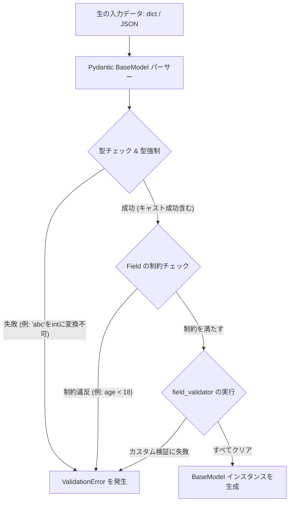

### 🎯 学習目標
- Pydanticの`BaseModel`を継承し、構造化されたデータスキーマを宣言できる。
- Pydanticの`Field`を使用して、データの制約（`ge`、`le`、`min_length`、正規表現パターンなど）を設定できる。
- Pydantic v2における`@field_validator`デコレータを用いて、フィールド単位のカスタム検証ロジックを実装できる。
- 型強制（Type Coercion）の仕組み、およびPydanticが型を動的に解析・検証するプロセスを理解する。
- バリデーションエラー（`ValidationError`）を適切にキャッチし、詳細なエラー構造をプログラムで検査できる。

### 🧩 中核概念（なぜ）
Webアプリケーションにおいて、外部から送信されるデータ（JSONリクエストボディ、クエリパラメータ、外部APIのペイロード）は常に信頼できないものです。これらを何重もの `if/else` 文を使って手動で検証するのは、記述漏れやバグが生じやすく、メンテナンスも困難になります。

**Pydantic**は、Pythonで最も広く使われているデータバリデーションおよび設定管理用のライブラリです。開発者はパース処理を自作する代わりに、Python標準の「型ヒント（Type Hints）」を使ってデータの構造を宣言します。Pydanticは、出力データが定義された型に確実に適合していることを保証します。

Pydantic v2は**Rust**で再構築されており、Pydantic v1と比較してバリデーション速度が最大50倍向上しています。主な特徴は以下の通りです。
1. **型注釈以上の動作（ランタイム検証）**: IDEや静的型チェッカー（mypyなど）とは異なり、Pydanticはプログラムの実行時（ランタイム）に型を強制します。
2. **型強制（パース）の仕組み**: 不正な型を単に拒否するだけでなく、可能であれば期待する型に変換（キャスト）を試みます。例えば、`int`型を期待しているフィールドに文字列の `"42"` が渡された場合、Pydanticはこれを自動的に整数の `42` に変換します。
3. **FastAPIでの活用**: FastAPIは内部でPydanticスキーマを利用し、リクエストボディのパース、クエリパラメータの検証、JSONレスポンスの生成、およびOpenAPIスキーマの自動作成を行っています。

### 🔁 ロジックと動作

以下は、Pydanticにおけるスキーマ検証およびパース処理のライフサイクルです。

#### 1. バリデーションの実行フロー


- **実行順序**: Pydanticは以下の3つの主要なステージでデータを検証します。
  1. **型チェックとパース**: 値が型注釈に合致しているかを検証します（可能であれば文字列から数値や真偽値へのキャストも実行されます）。
  2. **Fieldによる制約の評価**: `Field` で定義された境界条件（最小値・最大値、文字数制限など）を確認します。
  3. **カスタムバリデータ**: `@field_validator` で定義されたカスタムロジックを実行します。
- **一括エラー検出**: Pydanticは入力データ全体の検証が終わるまでエラーを発生させません。複数のフィールドでエラーが発生した場合、それらを1つの `ValidationError` にまとめて呼び出し元に返します。これにより、最初のエラーで即座に処理が中断するのを防ぎ、すべてのエラーレポートを一度に取得できます。

### 📝 注釈付きサンプル

#### 1. Fieldを使用した制約付きスキーマの定義
厳しい境界条件を持つユーザープロフィールスキーマを定義してみましょう。

```python
from pydantic import BaseModel, Field, EmailStr

class UserProfile(BaseModel):
    # 'name' は文字列で、かつ2文字以上50文字以下でなければならない
    name: str = Field(min_length=2, max_length=50)
    
    # EmailStr は値が正しいメールアドレスの形式であるかを検証します
    # (実行には: pip install email-validator が必要です)
    email: EmailStr
    
    # 'age' は任意（デフォルトはNone）ですが、指定された場合は18以上120以下でなければならない
    age: int | None = Field(default=None, ge=18, le=120)
    
    # 'tags' は空のリストをデフォルト値として持ちます
    # 可変オブジェクト（リストなど）のデフォルト値問題を避けるため、default_factoryを使用します
    tags: list[str] = Field(default_factory=list)

# 有効なデータでパーステストを実行:
data = {
    "name": "Alex",
    "email": "alex@example.com",
    "age": "25",  # 文字列 "25" は自動的に整数 25 に型強制（キャスト）されます
    "tags": ["developer", "pythonist"]
}

user = UserProfile(**data)
print(user.name)  # 出力: Alex
print(user.age)   # 出力: 25 (型: int)
print(user.model_dump()) # 出力: モデルのディクショナリ表現
```

#### 2. Pydantic v2におけるカスタムバリデータの追加
`@field_validator` デコレータを使用して、独自のビジネスバリデーション（パスワードの強度検証など）を追加します。

```python
from pydantic import BaseModel, Field, field_validator

class SignupForm(BaseModel):
    username: str = Field(min_length=3)
    password: str = Field(min_length=8)
    
    # パスワードの強度に関するカスタム検証
    # Pydantic v2では、カスタムバリデータは必ず @field_validator と
    # @classmethod を併用する必要があります（field_validatorを外側に配置）
    @field_validator("password")
    @classmethod
    def check_password_complexity(cls, v: str) -> str:
        # 'v' には検証対象のフィールドの値が入ります
        if not any(char.isdigit() for char in v):
            raise ValueError("パスワードには少なくとも1つの数字を含める必要があります。")
        return v # 検証済み（または加工済み）の値を必ず返してください

# バリデーションエラーがどのように処理されるか見てみましょう:
from pydantic import ValidationError

try:
    SignupForm(username="bob", password="nopassword")
except ValidationError as e:
    # 構造化されたクリーンなJSON形式でエラー情報を出力
    print(e.json(indent=2))
```

**JSON形式のエラー出力例:**
```json
[
  {
    "type": "value_error",
    "loc": [
      "password"
    ],
    "msg": "Value error, パスワードには少なくとも1つの数字を含める必要があります。",
    "input": "nopassword",
    "ctx": {
      "error": {}
    }
  }
]
```

### ❌ よくある間違い

**間違い 1: Pydantic v2において `@field_validator` に対する `@classmethod` デコレータの付与を忘れる**
```python
from pydantic import BaseModel, field_validator

class User(BaseModel):
    username: str
    
    @field_validator("username")
    def validate_user(self, value):  # @classmethod が欠落している
        if value.lower() == "admin":
            raise ValueError("ユーザー名を 'admin' にすることはできません")
        return value
```
```text
PydanticUserError: `@field_validator` must be decorated with `@classmethod`.
```
```python
from pydantic import BaseModel, field_validator

class User(BaseModel):
    username: str
    
    @field_validator("username")
    @classmethod  # 修正後: @classmethodデコレータを追加
    def validate_user(cls, value):  # 第一引数で cls を受け取る
        if value.lower() == "admin":
            raise ValueError("ユーザー名を 'admin' にすることはできません")
        return value
```
> Pydantic v2では、フィールドバリデータはクラスのインスタンスが生成される前にクラスメソッドとして呼び出されます。そのため、必ず `@classmethod` を付与し、第一引数として `self` ではなく `cls` を受け取るように定義しなければなりません。

**間違い 2: `EmailStr` を使用する際に `email-validator` ライブラリのインストールを忘れる**
```python
from pydantic import BaseModel, EmailStr

class Account(BaseModel):
    email: EmailStr
```
```text
PydanticImportError: `pydantic-extra-types` or `email-validator` is not installed. Run `pip install email-validator` to use `EmailStr`.
```
```python
# 最初に対象の環境で `pip install email-validator` を実行します。
# その後、通常通りインポートしてスキーマを定義します:
from pydantic import BaseModel, EmailStr

class Account(BaseModel):
    email: EmailStr
```
> Pydanticの `EmailStr` 型は、実際の検証処理を外部ライブラリ `email-validator` に依存しています。この依存関係がインストールされていない環境でモデルを定義しようとすると、インポート時またはモデル宣言時に `PydanticImportError` が発生します。

### 💡 コツ・イディオム
- **代入時の検証（validate_assignment）**: デフォルトでは、Pydanticは初期化時にしか値を検証しません。初期化後に `user.age = 10` のように値を書き換えた際にも検証を実行したい場合は、クラス内で `ConfigDict` を追加して設定を有効化します。
  ```python
  from pydantic import BaseModel, ConfigDict
  
  class User(BaseModel):
      model_config = ConfigDict(validate_assignment=True)
      age: int
  ```
- **デフォルト値やNoneの除外シリアライズ**: `model_dump()` を使用してシリアライズする際、不要なデータを除外することができます。
  - `user.model_dump(exclude_unset=True)`: 初期化時に明示的に渡された値のみを出力します。
  - `user.model_dump(exclude_none=True)`: `None` になっているフィールドを取り除いて出力します。

### 🧠 深掘り（内部の仕組み）
<details><summary>型強制とコアバリデーションエンジン（Rust Core）</summary>

Pydantic v2では、パース処理とデータバリデーションのルールのほぼすべてが、Rustで実装されたコアエンジン `pydantic-core` に委ねられています。

`BaseModel` がインスタンス化される際、処理は以下のように実行されます。
1. Pydanticは入力辞書をコンパイル済みのRustバリデータに引き渡します。
2. Rustエンジンはスキーマに従って各キーを照合します。その過程で型の不一致を発見した場合、あらかじめ定義された型強制（Coercion）の変換ルールに基づいてキャストを試みます。
   - `int`型の場合: 文字列の表現（`"100"` -> `100`）、浮動小数点数（`100.0` -> `100`）、または真偽値（`True` -> `1`, `False` -> `0`）からの変換を試みます。
   - `bool`型の場合: 文字列 `"true"`, `"yes"`, `"1"`, `"on"` などは `True` にキャストされ、`"false"`, `"no"`, `"0"`, `"off"` などは `False` にキャストされます。
3. キャストまたは型検証が成功すると、Rustの速度で記述された各制約条件（値の大小チェックなど）が走ります。
4. すべてのRust側での検証が完了した後に初めて、Pythonの実行環境へと戻り、`BaseModel` のインスタンスオブジェクトが構築されます。これによりPython側のコールスタックを極力通さず、極めて高いバリデーション速度を実現しています。
</details>

### 🏋️ 演習
Pydanticの`BaseModel`を継承した`UserSchema`を定義してください。このスキーマには以下の属性を設定してください。
- `name` (文字列)
- `email` (`EmailStr` を使用)
- `age` (整数型、かつ18以上であるという制約を付与)

```python
from pydantic import BaseModel, Field, EmailStr

# name, email, age (18以上)を持つUserSchemaを定義してください
```

### ✅ 自己チェック
1. `int`型と定義されたフィールドに対し、浮動小数点数 `25.0` を渡すとPydanticはエラーを吐きますか？
2. `model_dump()` と `model_dump_json()` の違いは何ですか？
3. `@field_validator` の内部でカスタムエラーを通知するにはどうすればいいですか？
<details><summary>解答</summary>

1. エラーは発生しません。Pydanticは `25.0` に小数部がないため、整数 `25` へ自動的にキャストします。しかし、`25.5` のように小数部がある場合はバリデーションエラーになります。
2. `model_dump()` は標準的なPythonデータ型（dictなど）を含むディクショナリを返すのに対し、`model_dump_json()` はシリアライズされたJSON文字列を返します。
3. `ValueError` または `AssertionError` を発生させます。Pydanticがこれらを自動的にキャッチし、適切にラップされた `ValidationError` を生成します。
</details>

### 📌 まとめ
- **Pydantic**は、標準のPython型注釈を利用して入力データを動的に検証しパースするライブラリです。
- **BaseModel**は、Pydanticでデータスキーマを定義する際のベースとなるクラスです。
- **Field**を使用すると、数値の範囲指定（`ge`, `le`）、文字列の長さ制限、デフォルト値などの細かな制約を設定できます。
- **@field_validator**を利用して、カスタムクラスメソッドとしてドメイン特有のビジネスルールを検証できます。
- **ValidationError**は検証失敗時に発生し、すべてのエラー個所を一括してキャプチャした構造化データを保持します。
