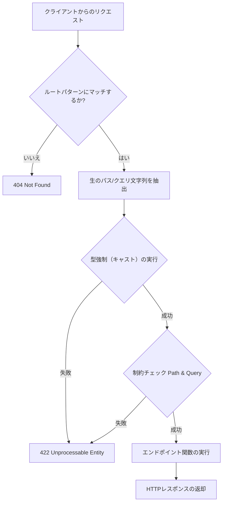

### 🎯 学習目標
- FastAPIのルート定義において、動的なパスパラメータを定義し、値を取得できる。
- オプション値の指定、フィルタリング、ソートのために、クエリパラメータを定義できる。
- `Path` および `Query` ヘルパーを使用して、パラメータの制約やメタデータを追加・適用できる。
- FastAPIの自動型強制（型キャスト）と検証エンジンの仕組みを理解する。
- 型の不一致エラーを処理し、適切な HTTP 422 エラーレスポンスを生成できる。

### 🧩 中核概念（なぜ）
RESTfulなWeb APIにおいて、エンドポイントはクライアントから入力を受け取る必要があります。シンプルなデータ型（数値、文字列、真偽値など）を渡す最も一般的な方法は以下の2つです。
1. **パスパラメータ**: 特定のリソースを識別するために使用されます。URLパスの一部として恒久的に組み込まれます（例: `/items/42` の `42` がIDに該当）。
2. **クエリパラメータ**: レスポンスのフィルタリング、ソート、ページネーション、カスタマイズに使用されます。URLの `?` の後にキーと値のペアとして配置されます（例: `/items?limit=10&sort=desc`）。

FastAPIでは、Python標準の「型ヒント（Type Hints）」を利用することで、パラメータの処理を大幅に簡略化できます。ルートハンドラー関数に型ヒントを記述するだけで、FastAPIは自動的に以下の処理を実行します。
- リクエストURLからパラメータを抽出して解析する。
- 生の文字列値（raw string）を、宣言されたPythonの型にキャスト（型強制）する（例: `"42"` を `42` に変換）。
- 定義された制約（最小値・最大値、文字数、正規表現パターンなど）に基づいて値を検証する。
- OpenAPI（Swagger）ドキュメントにパラメータの情報を自動で同期・反映する。

FastAPIの `Path` や `Query` ヘルパー関数を使用すると、さらに詳細なバリデーションルールや説明用のメタデータをパラメータに追加できます。

### 🔁 ロジックと動作

#### パラメータの解析とバリデーションのライフサイクル
リクエストを受信すると、FastAPIは以下の流れでパスパラメータおよびクエリパラメータを処理します。



### 📝 注釈付きサンプル

#### 1. 基本的なパスパラメータとクエリパラメータ（自動型強制）
FastAPIは、パラメータ名がルートパスのテンプレートに含まれているかどうかに基づいて、パスパラメータかクエリパラメータかを自動的に判定します。
```python
from fastapi import FastAPI

app = FastAPI()

# 'item_id' はルートパスに記述されているため、パスパラメータとして処理されます。
# 'q' と 'short' はパスに含まれていないため、クエリパラメータになります。
@app.get("/items/{item_id}")
def read_item(item_id: int, q: str | None = None, short: bool = False):
    # FastAPIは自動的に item_id を int に、short を bool にキャストします。
    # リクエスト: GET /items/42?q=hello&short=true
    # 結果: {"item_id": 42, "q": "hello", "short": True}
    return {"item_id": item_id, "q": q, "short": short}
```

#### 2. PathとQueryを使用した高度なバリデーション
`fastapi` から `Path` や `Query` をインポートし、数値の範囲制限や文字数制限などのバリデーション制約を設けることができます。
```python
from typing import Annotated
from fastapi import FastAPI, Query, Path

app = FastAPI()

@app.get("/products/{product_id}")
def get_product(
    # product_id は 1 以上の整数でなければならない (ge=1)
    product_id: int = Path(..., title="The ID of the product", ge=1),
    
    # search は最小 3 文字、最大 50 文字の文字列 (オプション)
    search: str | None = Query(None, min_length=3, max_length=50),
    
    # limit は 1 以上 100 以下の整数（デフォルトは20）
    limit: int = Query(20, ge=1, le=100)
):
    return {"product_id": product_id, "search": search, "limit": limit}
```

*補足: 現代のPython（FastAPI）では、`Annotated` を用いるとコードをよりクリーンに記述できます。*
```python
product_id: Annotated[int, Path(ge=1)]
```

### ❌ よくある間違い

**間違い 1: パスパラメータに対してデフォルト値を設定してしまう**
```python
from fastapi import FastAPI, Path

app = FastAPI()

@app.get("/users/{user_id}")
def get_user(user_id: int = Path(10)):  # 間違い: パスパラメータにデフォルト値を設定することはできません。
    return {"user_id": user_id}
```
```text
AssertionError: Path parameters cannot have default values
```
```python
from fastapi import FastAPI, Path

app = FastAPI()

@app.get("/users/{user_id}")
def get_user(user_id: int = Path(...)):  # 正しい: Ellipsis (...) を指定して必須パラメータであることを示します。
    return {"user_id": user_id}
```
> パスパラメータはURLパスの一部そのものであり、リクエストがこのルートにマッチするためにはパラメータの提供が必須です。したがって、パスパラメータにデフォルト値（フォールバック）を定義することは論理的に破綻しており、FastAPIは起動時にアサーションエラーを発生させます。

**間違い 2: 関数シグネチャ内でデフォルト値のないパラメータの前にデフォルト値のあるパラメータを宣言する**
```python
from fastapi import FastAPI, Query

app = FastAPI()

# SyntaxError: non-default argument follows default argument
@app.get("/items/")
def read_items(q: str = Query(None), limit: int): 
    return {"q": q, "limit": limit}
```
```text
SyntaxError: non-default argument follows default argument
```
```python
from fastapi import FastAPI, Query

app = FastAPI()

@app.get("/items/")
def read_items(limit: int, q: str = Query(None)):  # 正しい: 必須引数を先に配置する
    return {"q": q, "limit": limit}
```
> Pythonの構文規則では、デフォルト値を持たない引数（必須引数）は、デフォルト値を持つ引数の前に記述する必要があります。これを解決するには、必須のパラメータを関数シグネチャの先頭に移動するか、引数リストの先頭に `*` を追加してキーワード専用引数として宣言します。

### 💡 コツ・イディオム
- **`Annotated` の活用**: 型注釈と検証用メタデータを分離する `typing.Annotated` は、コードの可読性を向上させ、静的コード解析ツールとの親和性を高めるため、現代のFastAPI開発で最も推奨されています。
  ```python
  from typing import Annotated
  from fastapi import Query
  
  @app.get("/items/")
  def read(q: Annotated[str | None, Query(max_length=50)] = None):
      return {"q": q}
  ```
- **同名クエリパラメータのリスト化**: リスト型（`list[str]` や `list[int]`）を指定することで、同一名のクエリキーで複数の値を受け取ることができます。
  ```python
  @app.get("/items/")
  def read(tags: list[str] = Query(None)):
      # GET /items/?tags=foo&tags=bar -> tags = ["foo", "bar"]
      return {"tags": tags}
  ```

### 🧠 深掘り（内部の仕組み）
<details><summary>FastAPIのパラメータ抽出と型強制の仕組み</summary>

FastAPIはアプリケーションの起動時に、Python標準の `inspect` モジュールを使用してルートハンドラーのシグネチャをスキャンします。これにより、各パラメータの名前、型、デフォルト値が内部的にマッピングされます。

1. **解析と型強制**: クライアントが `/items/42?short=true` にアクセスすると、FastAPIはパスおよびクエリ文字列から生データを抽出し、Pydanticのデータ変換（型強制）機能に引き渡します。
   - 文字列としての `"42"` は整数型の `42` に変換されます。
   - 文字列としての `"true"`, `"1"`, `"on"` などは真偽値の `True` に変換されます。
2. **エラー収集と422応答**: もし検証（キャストやバリデーション制約など）に失敗した場合（例: `/items/invalid_id`）、Pydanticは発生したすべてのエラー内容を収集します。FastAPIはこれをインターセプトして、クライアントに `HTTP 422 Unprocessable Entity` レレスポンス（エラー発生場所 `loc` や期待される形式を記述した構造化データ）として返送します。
3. **OpenAPI仕様との同期**: `Path` や `Query` に定義された制約やメタデータは、自動的にOpenAPIのJSONスキーマ定義に出力されます。これにより、Swagger UIなどの対話型ドキュメントにおいて、クライアントがリクエストを送信する前に入力内容が正しいかどうかを事前確認できるようになります。
</details>

### 🏋️ 演習
以下の条件を満たすGETエンドポイント `/items/{item_id}` を実装してください。
- パスパラメータ `item_id` (整数型)。
- オプションのクエリパラメータ `q` (文字列、デフォルト値は `None`)。

```python
from fastapi import FastAPI, Query, Path

app = FastAPI()

# パスパラメータ item_id (int) と、オプションのクエリパラメータ q (str = None)
# を受け取る GET /items/{item_id} エンドポイントを実装してください
```

### ✅ 自己チェック
1. FastAPIは、定義されたパラメータがパスパラメータなのか、クエリパラメータなのかをどうやって判断していますか？
2. パラメータの定義で使用される `Path(...)` の `...` (PythonのEllipsis) はどういう意味ですか？
3. `Query` の制約を使って、クエリパラメータの文字数を「ちょうど 8 文字」に制限するにはどうすればいいですか？
<details><summary>解答</summary>

1. パラメータ名がルートのデコレータ内に中括弧（例: `"/items/{item_id}"`）で記述されている場合は「パスパラメータ」として識別されます。記述されていない場合は「クエリパラメータ」として識別されます。
2. `...` (Ellipsis) は、そのパラメータが必須（省略不可）であり、かつデフォルト値を持たないことを示します。パスパラメータは常に必須のため、バリデーションを設定する場合はこの書き方が一般的です。
3. `Query` 関数の引数に `min_length=8` と `max_length=8` を同時に設定するか、正規表現で `pattern=r"^.{8}$"` のように指定します: `q: str = Query(..., min_length=8, max_length=8)`
</details>

### 📌 まとめ
- **パスパラメータ**は、特定のデータリソースを一意に指定するためにURLパスの経路自体に組み込まれます。
- **クエリパラメータ**は、URLの末尾に `?` から始まるペアとして追加され、ページング、ソート、フィルタリングなどのカスタマイズ情報を提供します。
- FastAPIは、Pythonの型ヒントを活用してパラメータのパース、自動型キャスト、およびデータ妥当性の検証を自動化します。
- `Path` ヘルパーや `Query` ヘルパーを使用することで、必須フラグ、値の境界条件（最小値 `ge` など）、Swagger UI向けの説明情報をシグネチャに簡単に記述できます。
