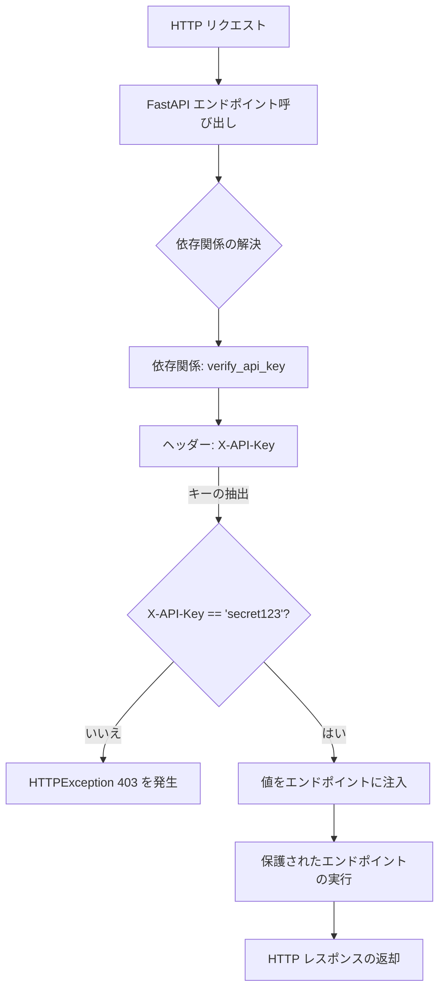

### 🎯 学習目標
- 依存性注入（Dependency Injection: DI）パターンの概念と、Webフレームワークにおけるその利点を説明できる。
- FastAPIの `Depends` 関数を使用して、依存関係を構築しルートに登録できる。
- 階層的な依存関係チェーン（他の依存関係に依存する依存関係）を設計できる。
- 依存関係を利用してHTTPヘッダーを検証し、APIエンドポイントを保護できる。
- ユニットテストにおいて、依存関係をモック（Mock）やテスト用の値にオーバーライド（差し替え）できる。

### 🧩 中核概念（なぜ）
ソフトウェア工学における**依存性注入（Dependency Injection: DI）**とは、オブジェクトや関数が依存している他のサービスやオブジェクトを内部で直接生成するのではなく、外部から受け取るようにするデザインパターンです。

Webアプリケーション開発において、異なるエンドポイントハンドラーは以下のような重複した共通処理を頻繁に必要とします。
- データベース接続（セッション）の確立。
- 認証トークンやクレデンシャルの抽出と検証。
- カスタムリクエストヘッダー（APIキーなど）の妥当性検証。
- ページネーションパラメータやフィルタリングポリシーの適用。

依存性注入を使用しない場合、これらのロジックを各ルートハンドラーの内部に手動で書き込む必要があります。これはコードの重複、密結合を引き起こし、ユニットテスト（データベース接続のモック化など）を著しく困難にします。

FastAPIには、組み込みの非常に強力な依存性注入フレームワークが用意されています。開発者は `Depends` 関数を使用するだけで依存関係を宣言できます。FastAPIは、依存関係の解決、ハンドラーへの戻り値の注入、データベースセッションのクローズといった接続ライフサイクルの管理、および同一リクエスト内での依存関係キャッシュの管理をすべて自動で行います。

### 🔁 ロジックと動作

#### 依存関係グラフの解析と実行
FastAPIはルートのシグネチャをスキャンし、エンドポイントの依存関係を表す有向非巡回グラフ（DAG）を構築します。HTTPリクエストが送信されると、処理は以下のように実行されます。



### 📝 注釈付きサンプル

#### 1. 基本的な共通パラメータ依存関係（ページネーション）
複数のエンドポイントで同じクエリパラメータを何度も宣言する代わりに、共通の依存関係関数を1つ定義します。
```python
from fastapi import FastAPI, Depends

app = FastAPI()

# これが依存関係関数です
def common_parameters(q: str | None = None, skip: int = 0, limit: int = 100):
    return {"q": q, "skip": skip, "limit": limit}

@app.get("/items/")
def read_items(commons: dict = Depends(common_parameters)):
    # FastAPIは common_parameters を実行し、クエリパラメータを解析して、
    # 返された辞書を commons に注入します。
    return commons

@app.get("/users/")
def read_users(commons: dict = Depends(common_parameters)):
    return commons
```

#### 2. 依存性注入によるエンドポイントのセキュリティ保護
依存関係は、エンドポイントハンドラーが実行される前に `HTTPException` を発生させて処理を中断させることができます。
```python
from fastapi import FastAPI, Depends, Header, HTTPException, status

app = FastAPI()

# カスタムAPIキーヘッダーが正しいかチェックする依存関係
def verify_api_key(x_api_key: str = Header(..., description="API Key for route security")):
    if x_api_key != "secret123":
        raise HTTPException(
            status_code=status.HTTP_403_FORBIDDEN, 
            detail="Forbidden: Invalid API Key"
        )
    return x_api_key

# verify_api_key によって保護されたエンドポイント
@app.get("/secure")
def secure_endpoint(api_key: str = Depends(verify_api_key)):
    # このハンドラーは verify_api_key が正常に値を返した場合にのみ実行されます
    return {"status": "authenticated", "key_used": api_key}
```

### ❌ よくある間違い

**間違い 1: `Depends` の中で依存関係関数を渡す代わりに呼び出し実行してしまう**
```python
from fastapi import FastAPI, Depends

app = FastAPI()

def get_db():
    return "DatabaseConnection"

@app.get("/data")
def read_data(db = Depends(get_db())):  # 間違い: 関数に丸括弧を付けて実行してはいけません。
    return {"db": db}
```
```text
TypeError: 'str' object is not callable
```
```python
from fastapi import FastAPI, Depends

app = FastAPI()

def get_db():
    return "DatabaseConnection"

@app.get("/data")
def read_data(db = Depends(get_db)):  # 正しい: 関数オブジェクトの参照自体を渡します。
    return {"db": db}
```
> `Depends` の引数には、関数やクラスなどの「呼び出し可能オブジェクト（callable）」を渡す必要があります。FastAPIは、リクエストが到達するたびにその関数を自動的に実行します。`Depends(get_db())` と書くと、アプリ起動時などに関数自体が実行され、その戻り値の静的な値が `Depends` に渡されるためエラーになります。

**間違い 2: 依存関係の値がリクエストをまたいで永続的に共有されると仮定する**
```python
from fastapi import FastAPI, Depends

app = FastAPI()

counter = 0

def increment_counter():
    global counter
    counter += 1
    return counter

@app.get("/count")
def get_count(current_count: int = Depends(increment_counter)):
    # 間違い: グローバル状態などのミュータブルな状態変化に依存関係を利用する
    return {"count": current_count}
```
```text
# 直接のエラーは発生しませんが、同時実行性が損なわれ、本番環境でレースコンディションが発生します。
```
```python
# 依存関係はステートレス（状態を持たない）であるべき、または個別の接続（DBセッションなど）を管理するべきです。
# 共有状態が必要な場合は、スレッドセーフな接続プールやDBを介して制御します。
```
> FastAPIの依存関係は、リクエストが発生するたびに動的に解決されます。依存関係の中でグローバル変数を書き換えたり、ミュータブルな共有状態に依存したりすることは、非同期処理の競合（レースコンディション）やメモリリークを招くため、避けるべきアンチパターンです。

### 💡 コツ・イディオム
- **`Annotated` の活用**: `Annotated` を使用して依存関係を宣言すると、関数シグネチャにデフォルト値を混在させずに済み、可読性と静的解析の効率が向上します。
  ```python
  from typing import Annotated
  from fastapi import Depends
  
  # すっきりと明示的で読みやすい宣言
  @app.get("/items/")
  def read(commons: Annotated[dict, Depends(common_parameters)]):
      return commons
  ```
- **クラスベースの依存関係**: 設定パラメータを保持したり、状態を管理したい場合は、Pythonのクラスを依存関係として使用できます。
  ```python
  class Pagination:
      def __init__(self, limit: int = 10, skip: int = 0):
          self.limit = limit
          self.skip = skip
  
  # FastAPIは自動的に Pagination(limit, skip) インスタンスを生成します
  @app.get("/users/")
  def read_users(pagination: Pagination = Depends()):
      return {"limit": pagination.limit, "skip": pagination.skip}
  ```
- **サブ依存関係**: 依存関係関数の中からさらに別の依存関係を呼び出すことができます。これにより、認証、権限チェック、データベース接続などの共通部品を細かく分割・再利用できます。

### 🧠 深掘り（内部の仕組み）
<details><summary>依存関係の解決グラフ、キャッシュ、および yield の動作</summary>

FastAPIの依存性注入システムは、コンパイル工程に似たグラフ解決アルゴリズムを使用しています。

1. **有向非巡回グラフ（DAG）の構築**: アプリケーション起動時に、FastAPIは各ルートのパラメータを走査し、循環参照がないことを確認した上で依存関係の木（ツリー）を構築します。
2. **デフォルトキャッシュ（`use_cache=True`）**: ツリー内の複数の依存関係が同じサブ依存関係（例: 共通の `get_settings()` など）を必要とする場合、FastAPIは1回のリクエスト中にそのサブ依存関係を**一度だけ**実行します。得られた結果をキャッシュして同一リクエスト内で再利用するため、データベース接続の重複クエリなどを防ぐことができます。キャッシュを無効にしたい場合は `Depends(dependency, use_cache=False)` と定義します。
3. **`yield` によるリソースのクリーンアップ**: FastAPIは `return` ではなく `yield` を使用する依存関係をサポートしています。これにより、処理のセットアップを行い、結果をエンドポイントに引き渡した後、レスポンス送信が完了したタイミングでクリーンアップ処理（終了処理）を実行できます。
   ```python
   def get_db_session():
       db = SessionLocal()
       try:
           yield db  # ここでDBセッションオブジェクトが注入される
       finally:
           db.close()  # エンドポイントの処理およびレスポンス送信が終わった後に実行される
   ```
   この仕組みにより、エンドポイント内で例外が発生した場合でも、確実にデータベースセッションをクローズすることができます。
</details>

### 🏋️ 演習
リクエストヘッダー `X-API-Key` が `"secret123"` であるかどうかをチェックする依存関係関数 `verify_api_key` を実装してください。もしキーが正しくないか不足している場合は、ステータスコード `403` (Forbidden) の `HTTPException` を発生させてください。

```python
from fastapi import FastAPI, Depends, Header, HTTPException, status

app = FastAPI()

# X-API-Key == "secret123" をチェックする verify_api_key 依存関係を実装してください
```

### ✅ 自己チェック
1. FastAPIの依存関係において、`return` を使う場合と `yield` を使う場合の動作の違いは何ですか？
2. 同一エンドポイントの2つの依存関係がどちらも共通のサブ依存関係 `get_settings()` を参照している場合、デフォルトで `get_settings()` は何回実行されますか？
3. ユニットテストを作成する際、FastAPIで定義された依存関係をテスト用の模擬オブジェクト（Mock）に差し替えるにはどうすればいいですか？
<details><summary>解答</summary>

1. `return` を使用する依存関係は値を返して即座に終了します。`yield` を使用する依存関係は、一度値を返した（yieldした）後に一時停止し、レスポンスの送信が終わった後で `yield` 以降のコードを実行し、クリーンアップ（接続の切断など）を行えます。
2. デフォルトでは **1回** だけ実行されます。FastAPIは、同一リクエストの生存期間中、同じ依存関係の呼び出し結果をキャッシュします。
3. アプリケーションオブジェクトの `app.dependency_overrides` 辞書に差し替えルールを設定します。
   ```python
   app.dependency_overrides[verify_api_key] = mock_verify_api_key
   ```
   これにより、テスト実行時のみ認証チェックをスキップさせるなどの実装が簡単に行えます。
</details>

### 📌 まとめ
- **依存性注入（DI）**は、エンドポイントのコードを外部接続やビジネスロジックから切り離し、再利用性とテスト容易性を高めるためのパターンです。
- FastAPIの `Depends` 関数は、ルートの実行フロー中に解決する依存関係コールバックを登録するために使用されます。
- 依存関係は、リクエストの妥当性検証を行ったり、`HTTPException` を発生させて不正なアクセスを早期にブロックしたりできます。
- `yield` を利用した依存関係により、レスポンス送信後にデータベースセッションのクローズなどの終了処理（ティアダウン）を自動で安全に行うことができます。
