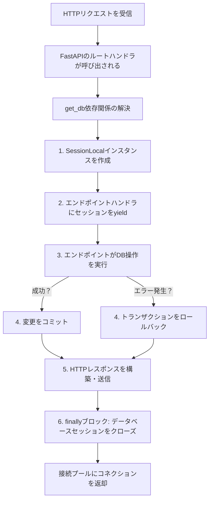

### 🎯 学習目標
- 現代のWeb開発におけるオブジェクト関係マッピング（ORM）の役割を説明できる。
- SQLAlchemyを使用して、データベースエンジン、セッションファクトリ、ベースモデルを設定できる。
- 宣言的（Declarative）なSQLAlchemyモデルを定義してデータベーススキーマを設計できる。
- FastAPIの依存性注入システムと`yield`を使用して、リクエストスコープのセッション依存関係を作成できる。
- 自動的な接続クリーンアップを備えた堅牢なCRUDエンドポイントを実装できる。

### 🧩 中核概念（なぜ）
初期のWebアプリケーションでは、開発者はアプリケーションロジック内に生のSQLクエリを記述してデータベースとやり取りしていました。この方法は機能はするものの、重大な問題を引き起こしました。SQLの構文エラーが実行時まで検出されず、コードの重複が多くなり、開発者がデータベースの行を手動でアプリケーションオブジェクトにマッピングする必要がありました。

**オブジェクト関係マッパー（ORM）**は、オブジェクト指向プログラミング（Pythonのクラス）と関係データベース（SQLのテーブル）の間の架け橋として機能します。
- **Pythonのクラス**は**データベースのテーブル**にマッピングされます。
- **クラスの属性**は**テーブルの列（カラム）**にマッピングされます。
- **オブジェクトのインスタンス**は**テーブルの行（レコード）**にマッピングされます。

FastAPIには、組み込みのデータベースレイヤーは含まれていません。代わりに、Pythonで最も人気があり機能豊富なORMである**SQLAlchemy**と自然に組み合わせて使用されます。

SQLAlchemyをFastAPIと統合するには、次の3つの主要コンポーネントを連携させます。
1. **エンジン（Engine）**: 接続を管理し、SQLAlchemyクエリをデータベース固有のSQL方言に変換し、接続プール（Connection Pool）を維持するコアインターフェース。
2. **SessionLocal**: リクエストスコープのデータベーストランザクション用に構成されたセッションファクトリ。リクエストごとに独自のセッションが取得され、独立したトランザクションが可能になります。
3. **宣言的ベース（Declarative Base）**: スキーマのメタデータを維持する基本クラス。SQLAlchemyがスキーマを追跡および初期化できるように、すべてのモデルはこのベースクラスを継承します。

### 🔁 ロジックと動作

データベース接続を必要とするFastAPIエンドポイントにHTTPリクエストが送信されると、セッションは依存性注入によって管理される構造化されたライフサイクルを通過します。



依存関係で`yield`を使用することが重要です。これにより、エンドポイントが実行されてレスポンスが送信された後に必ず`finally`ブロックが実行され、接続リークを防ぐことができます。

### 📝 注釈付きサンプル

以下は、データベースの設定、データベースモデル、およびFastAPIのルートがどのように統合されるかを示す完全な実装です。

#### 1. データベース設定 (`database.py`)
```python
from sqlalchemy import create_engine
from sqlalchemy.orm import sessionmaker, declarative_base

# データベースURLの定義（ここではSQLiteのインメモリを使用）
DATABASE_URL = "sqlite:///./app.db"

# 1. エンジンの作成。'connect_args={"check_same_thread": False}' はSQLiteでマルチスレッド動作させるために必要
engine = create_engine(DATABASE_URL, connect_args={"check_same_thread": False})

# 2. SessionLocalファクトリの作成。トランザクション制御のためautocommitとautoflushはFalseにする
SessionLocal = sessionmaker(autocommit=False, autoflush=False, bind=engine)

# 3. モデル用の宣言的ベースクラスの作成
Base = declarative_base()
```

#### 2. 宣言的モデル定義 (`models.py`)
```python
from sqlalchemy import Column, Integer, String, Boolean
from database import Base

class Product(Base):
    __tablename__ = "products"  # DB内の物理的なテーブル名を指定

    # SQLAlchemyの型にマッピングされるテーブルの列を定義
    id = Column(Integer, primary_key=True, index=True)
    name = Column(String, nullable=False, index=True)
    price = Column(Integer, nullable=False)
    in_stock = Column(Boolean, default=True)
```

#### 3. FastAPIエンドポイント統合 (`main.py`)
```python
from fastapi import FastAPI, Depends, HTTPException, status
from sqlalchemy.orm import Session
from typing import Annotated

from database import engine, Base, SessionLocal
import models

# データベースにテーブルを自動作成（開発目的のみ）
Base.metadata.create_all(bind=engine)

app = FastAPI()

# yieldを使用したデータベースセッションの依存関係ジェネレータ
def get_db():
    db = SessionLocal()
    try:
        yield db  # セッションをエンドポイントのパラメータに注入
    finally:
        db.close()  # レスポンス送信後に自動的にクローズされる

# 依存関係をより綺麗に書くためのAnnotated型エイリアス
DbSession = Annotated[Session, Depends(get_db)]

@app.post("/products/", status_code=status.HTTP_201_CREATED)
def create_product(name: str, price: int, db: DbSession):
    # データベースモデルのインスタンス化
    db_product = models.Product(name=name, price=price)
    
    db.add(db_product)      # オブジェクトのステージング
    db.commit()             # データベースに変更を保存
    db.refresh(db_product)  # データベースのデフォルト値（生成されたidなど）でインスタンスを更新
    return db_product

@app.get("/products/{product_id}")
def read_product(product_id: int, db: DbSession):
    # SQLAlchemy ORMを使用したデータベース問い合わせ
    product = db.query(models.Product).filter(models.Product.id == product_id).first()
    if not product:
        raise HTTPException(
            status_code=status.HTTP_404_NOT_FOUND, 
            detail="Product not found"
        )
    return product
```

### ❌ よくある間違い

**間違い 1: リクエスト間で単一のグローバルデータベースセッションを共有する**
```python
from fastapi import FastAPI
from database import SessionLocal

app = FastAPI()
db = SessionLocal()  # 間違い: グローバルに単一のセッションインスタンスを共有している

@app.get("/items")
def get_items():
    return db.query(Item).all()
```
```text
StateError: Object deleted or session closed.
ResourceClosedError: This transaction has already been closed.
```
```python
from fastapi import FastAPI, Depends
from sqlalchemy.orm import Session
from database import SessionLocal

app = FastAPI()

def get_db():
    db = SessionLocal()
    try:
        yield db
    finally:
        db.close()

@app.get("/items")
def get_items(db: Session = Depends(get_db)):  # 正しい: リクエストスコープのセッションを使用する
    return db.query(Item).all()
```
> 同時実行されるリクエスト間で単一のグローバルSQLAlchemyセッションを共有すると、マルチスレッドの競合、異なるユーザーリクエスト間のデータ混在、データベースのロック、メモリリークが発生します。セッションオブジェクトは本質的にスレッドセーフではなく、リクエストごとに生成および破棄する必要があります。

**間違い 2: データベースへの書き込み操作のコミット（commit）を忘れる**
```python
@app.post("/users")
def create_user(name: str, db: Session = Depends(get_db)):
    user = User(name=name)
    db.add(user)
    # 間違い: db.commit()がありません。変更はステージングされましたが、確定されていません。
    return user
```
```text
# エラーはスローされませんが、実際のデータベースに変更は保存されません。
```
```python
@app.post("/users")
def create_user(name: str, db: Session = Depends(get_db)):
    user = User(name=name)
    db.add(user)
    db.commit()  # 正しい: トランザクションを確定するためにコミットする
    db.refresh(user)
    return user
```
> `db.add()`を呼び出すだけでは、SQLAlchemyのローカルメモリに変更をステージングするだけです。`db.commit()`を呼び出さないと、リクエストの終了時にセッションがクローズされた際にトランザクションが暗黙的にロールバックされ、データ変更が失われます。

**間違い 3: セッションをクローズした後に遅延ロード（Lazy Load）属性にアクセスする**
```python
def get_user_items_bad():
    db = SessionLocal()
    user = db.query(User).first()
    db.close()
    # 間違い: セッションクローズ後に遅延リレーションシップ 'items' にアクセスしている
    return user.items 
```
```text
sqlalchemy.orm.exc.DetachedInstanceError: Parent instance <User at 0x7f8> is not bound to a Session; lazy load operation of attribute 'items' cannot proceed
```
```python
# 解決策1: クローズ前に属性にアクセスする
# 解決策2: クエリでEagerロード（即時読み込み）を使用する
from sqlalchemy.orm import joinedload

def get_user_items_good():
    db = SessionLocal()
    try:
        user = db.query(User).options(joinedload(User.items)).first()
        return user.items
    finally:
        db.close()
```
> デフォルトでは、SQLAlchemyのリレーションシップは遅延ロードされます。`user.items`にアクセスすると、SQLAlchemyはそれらを取得するためにデータベースクエリを実行しようとします。すでにセッションが閉じられている場合、クエリを実行するための接続がないため、`DetachedInstanceError`がスローされます。

### 💡 コツ・イディオム
- **`Annotated` 依存関係の使用**: 複数のルート定義にわたって毎回 `Depends(get_db)` を繰り返すのを避けるため、型エイリアス（例：`DbSession = Annotated[Session, Depends(get_db)]`）を作成しておくと、コードが大幅にクリーンになります。
- **スクリプト用コンテキストマネージャ**: FastAPIのルート外（CLIコマンド、バックグラウンドスクリプト、テストのセットアップなど）でデータベースにアクセスする必要がある場合は、コンテキストマネージャを作成してセッションのクリーンアップを自動化します。
  ```python
  from contextlib import contextmanager

  @contextmanager
  def db_session():
      db = SessionLocal()
      try:
          yield db
          db.commit()
      except Exception:
          db.rollback()
          raise
      finally:
          db.close()
  ```
- **リレーションシップのEagerロード**: リレーションシップを持つモデルを照会する際は、`joinedload`（1対多/多対1）または`selectinload`（多対多）を使用して「N+1クエリ問題」を防止します。

### 🧠 深掘り（内部の仕組み）
<details><summary>Unit of Work、Identity Map、およびSQLAlchemyセッション</summary>

SQLAlchemyのセッションレイヤーは、2つの古典的なソフトウェアデザインパターンを実装しています：**Unit of Work** と **Identity Map**。

#### 1. Identity Map（アイデンティティマップ）パターン
データベースからレコードをロードすると、SQLAlchemyはそれをプライマリキーによって内部レジストリで追跡します。同じセッション内で同じオブジェクトに対して2回クエリを実行した場合：
```python
user1 = db.query(User).filter_by(id=1).first()
user2 = db.query(User).filter_by(id=1).first()
assert user1 is user2  # True! Pythonのメモリ空間上で全く同じオブジェクトを指します
```
これにより、`user1`に加えられた変更が直ちに`user2`に反映され、同じリクエスト内で実行されている異なるコードコンポーネント間でデータの整合性が維持されます。

#### 2. Unit of Work（作業単位）パターン
セッションは保留中のトランザクションのリストを保持します。`db.add()`を呼び出しても、データベースには何も即時に送信されません。`db.commit()`の実行時、またはクエリ実行により強制的にフラッシュ（flush）された際に、SQLAlchemyはすべての挿入、更新、削除を分析し、外部キー制約の違反を防ぐように並べ替えてから、単一のバッチとして一括実行します。

#### セッションにおけるオブジェクトの状態
ORMオブジェクトは、セッションのライフサイクル内で次の4つのいずれかの状態をとります。
1. **Transient（一時的）**: オブジェクトは作成されましたが（`user = User()`）、まだセッションに関連付けられていません。データベース上に対応するレコードは存在しません。
2. **Pending（保留中）**: オブジェクトがセッションに追加されました（`db.add(user)`）。次回のフラッシュまたはコミット時にデータベースに書き込まれます。
3. **Persistent（永続的）**: オブジェクトがデータベースに保存され、セッションによって追跡されています。属性の変更が監視されます。
4. **Detached（分離）**: セッションがクローズされました（`db.close()`）。オブジェクトはメモリ上に残りますが、データベース接続からは切り離されています。
</details>

### 🏋️ 演習
SQLiteのインメモリデータベース設定を実装し、以下を含む`User`モデルを作成してください。
1. 整数型の主キー `id`
2. 文字列型の列 `name`

次に、`get_db`という名前のFastAPI用データベースセッション生成依存関係関数を作成してください。このジェネレータは、データベースセッションを初期化してyieldし、finallyブロックで適切にクローズされることを保証する必要があります。

```python
from sqlalchemy import create_engine, Column, Integer, String
from sqlalchemy.orm import sessionmaker, declarative_base

# SQLiteのインメモリデータベースをセットアップし、idとnameを持つUserモデルを作成してください。
# session localをyieldするget_dbセッションジェネレータを作成してください。
```

### ✅ 自己チェック
1. エンドポイントハンドラ内で手動でセッションを作成してクローズする代わりに、FastAPIの依存関係注入を使用することが推奨されるのはなぜですか？
2. SQLAlchemyにおける `db.commit()` と `db.flush()` の違いは何ですか？
3. SQLite接続で `connect_args={"check_same_thread": False}` を設定することは、FastAPIでのエラーを防ぐ上でどのように役立ちますか？
<details><summary>自己チェックの解答</summary>

1. ルートハンドラ内でセッションの作成とクローズを手動で管理すると、同じようなボイラープレートコードが重複し、ルートの実行中にエラーが発生した際にクローズ処理がスキップされ、接続リークが発生しやすくなります。`yield`を使用した依存性注入は、実行時エラーに関係なく常にクローズを保証します。
2. `db.flush()`は、保留中のSQL命令（挿入、更新、削除）をデータベースサーバのトランザクションバッファに送信し、新しいレコードにIDを割り当てますが、トランザクションは確定（コミット）しません。`db.commit()`はフラッシュされた変更を完全に保存し、トランザクションを終了します。
3. デフォルトでSQLiteはデータの破損を防ぐため、複数のスレッドからの同じ接続へのアクセスを制限します。FastAPIのルートは非同期スレッドで並行して動作することがあるため、この制限によりエラーが発生します。リクエストごとに個別のセッション接続を持つため、このチェックをオフにしても安全です。
</details>

### 📌 まとめ
- **ORM** はオブジェクト指向のクラスと関係データベースのテーブルをマッピングし、SQL操作を抽象化します。
- **SQLAlchemy Engine** が接続を確立し、**SessionLocal** がトランザクションインスタンスを提供します。
- FastAPIの依存関係注入（`Depends`）と `yield` を組み合わせることで、接続のライフサイクル管理が自動化されます。
- セッション内のオブジェクトレコードは、**Identity Map** と **Unit of Work** パターンによって管理されます。
- データの変更をデータベースに反映させるには必ず `db.commit()` を呼び出し、処理完了後は確実にセッションをクローズします。
