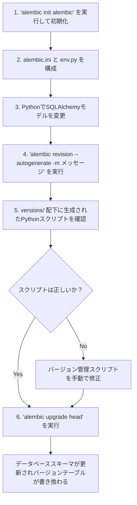

### 🎯 学習目標
- プロダクションアプリケーションのライフサイクルにおけるデータベースマイグレーションの役割を説明できる。
- Python/FastAPI環境でAlembicを初期化し、構成できる。
- 自動リビジョン生成（autogenerate）をサポートするために、`env.py`を変更してデータベースモデルのメタデータを指すように設定できる。
- SQLAlchemyモデルからデータベースリビジョンスクリプトを自動生成できる。
- コマンドラインツールを使用して、データベーススキーマのアップグレードおよびダウングレードを実行できる。

### 🧩 中核概念（なぜ）
開発の初期段階では、SQLAlchemyの `Base.metadata.create_all(bind=engine)` を使用して、起動するたびにデータベースを再作成することができます。しかし、本番環境（プロダクション）では、テーブルを削除すると顧客データやアプリケーションのデータがすべて消去されてしまうため、このアプローチは使えません。

さらに、SQLAlchemyの `create_all()` には設計上の制限があります。それは「存在しないテーブルのみを作成する」という点です。Python側で既存のモデルに新しい列（カラム）を追加しても、`create_all()` は何もしないため、アプリケーションと実際のデータベースが不一致な状態になってしまいます。

**データベースマイグレーション**は、データベーススキーマをバージョン管理されたコードとして管理することで、この問題を解決します。
- スキーマの変更（テーブルの追加、列の削除など）は、増分スクリプト（リビジョン）として表現されます。
- マイグレーションスクリプトは、順次実行してスキーマをアップグレードすることも、逆順に実行して元の状態にダウングレードすることも可能です。

**Alembic**は、SQLAlchemyの公式データベースマイグレーションツールです。データベーススキーマにおける「Git」のような役割を果たします。
- データベース内部に専用のバージョン管理用テーブルを作成し、現在のデータベースのバージョンを追跡します。
- モデルの変更を自動的に検出し、対応するSQLステートメントを含む移行スクリプトを生成するコマンドラインインターフェースを提供します。

Alembicを構成するには、主に次の3つのコンポーネントを使用します。
1. `alembic.ini`: データベース接続文字列やログ設定が含まれる設定ファイル。
2. `env.py`: Alembicコマンド実行時に呼び出されるPythonスクリプト。データベースエンジンに接続し、AlembicのトランザクションレイヤーをSQLAlchemyモデルにマッピングします。
3. `versions/`: 増分となるデータベース変更を表す、タイムスタンプ付きの自動生成されたPythonスクリプトが格納されるディレクトリ。

### 🔁 ロジックと動作

データベーススキーマを変更する標準的な開発フローは、次の手順で構成されます。



`alembic revision --autogenerate` を実行すると、Alembicは現在の実際のデータベーススキーマを調査し、Pythonファイル（`Base.metadata`）で定義された構造と比較します。その後、両者を同期するために必要な `upgrade()` および `downgrade()` ブロックを含むリビジョンスクリプトを自動的に生成します。

### 📝 注釈付きサンプル

#### 1. Alembicの初期化
プロジェクトのルートディレクトリで、初期化コマンドを実行します。
```bash
alembic init alembic
```
これにより、以下のファイル構造が作成されます。
- `alembic.ini` (グローバル設定)
- `alembic/` (移行環境ディレクトリ)
  - `env.py` (実行用スクリプト)
  - `script.py.mako` (移行スクリプトのテンプレート)
  - `versions/` (移行スクリプトのリポジトリ)

#### 2. `alembic.ini` の構成
`alembic.ini` を開き、データベース接続URLを設定します。
```ini
# alembic.ini
sqlalchemy.url = sqlite:///./app.db
```

#### 3. `alembic/env.py` でのモデルの接続
自動生成機能（autogenerate）を有効にするには、`alembic/env.py` を開き、モデルのメタデータをインポートするように変更します。
```python
# alembic/env.py
from logging.config import fileConfig
from sqlalchemy import engine_from_config
from sqlalchemy import pool

from alembic import context

# 1. 自身のデータベース構成から Base クラスとモデルをインポートする
from database import Base
import models  # Baseのメタデータにテーブルを登録するため、モデルを必ずインポートする

config = context.config
if config.config_file_name is not None:
    fileConfig(config.config_file_name)

# 2. スキーマの比較を可能にするため、ターゲットメタデータを割り当てる
target_metadata = Base.metadata
```

#### 4. マイグレーションスクリプトの生成
説明メッセージを指定して、移行ファイルを生成します。
```bash
alembic revision --autogenerate -m "create user table"
```
Alembicは `alembic/versions/` 以下にファイルを作成します（例: `4a52b31f79e2_create_user_table.py`）:
```python
# alembic/versions/4a52b31f79e2_create_user_table.py
"""create user table

Revision ID: 4a52b31f79e2
Revises: 
Create Date: 2026-06-27 12:00:00.000000
"""
from alembic import op
import sqlalchemy as sa

# リビジョン識別子
revision = '4a52b31f79e2'
down_revision = None
branch_labels = None
depends_on = None

def upgrade() -> None:
    # 1. データベースを更新するために自動生成されたコマンド
    op.create_table(
        'users',
        sa.Column('id', sa.Integer(), nullable=False),
        sa.Column('name', sa.String(), nullable=True),
        sa.PrimaryKeyConstraint('id')
    )

def downgrade() -> None:
    # 2. 移行を元に戻すためのコマンド
    op.drop_table('users')
```

#### 5. マイグレーションの実行
生成された変更をデータベースに適用します。
```bash
alembic upgrade head
```
これにより、データベースの構造が更新され、バージョン追跡用テーブルに `4a52b31f79e2` が書き込まれます。

### ❌ よくある間違い

**間違い 1: `env.py` の中で対象モデルのインポートを忘れる**
```python
# alembic/env.py
from database import Base
# 間違い: 'import models' がありません（Baseのメタデータが空になります）
target_metadata = Base.metadata
```
```text
INFO  [alembic.runtime.migration] Context class SQLiteContext.
INFO  [alembic.autogenerate.compare] Detected removed table 'users'
```
```python
# alembic/env.py
from database import Base
import models  # 正しい: SQLAlchemyがテーブルを登録できるようにモデルをインポートする
target_metadata = Base.metadata
```
> Alembicは、Pythonがモデルをインポートして `Base.metadata` レジストリにテーブルを登録することに依存しています。`env.py` でモデルをインポートせず `Base` のみをインポートした場合、`Base.metadata` は空に見えます。その結果、Alembicはすべてのモデルが削除されたと判断し、データベース内の既存のすべてのテーブルを削除（drop）するリビジョンを生成してしまいます。

**間違い 2: 自動生成されたマイグレーションスクリプトを手動で検証するのを忘れる**
```bash
# 間違い: --autogenerate は完璧であると想定し、確認せずにアップグレードを実行する
alembic revision --autogenerate -m "rename description column"
alembic upgrade head
```
```text
# データが消失しました！列の名前変更ではなく、削除後に再作成されてしまいました。
```
```python
# 正しい: 生成された移行ファイルを開いて内容を確認する。
# 自動生成された列の削除/追加指示を、列の名前変更（alter_column）に変更します。
def upgrade() -> None:
    op.alter_column('items', 'description', new_column_name='details')
```
> Alembicの `--autogenerate` には設計上の制限があります。たとえば、列やテーブルの名前変更（リネーム）を検出できません。名前変更を「古い列の削除（データ削除）」と「新しい列の追加」として解釈するため、本番データが失われる致命的な原因になります。適用する前に必ず移行ファイルの内容を目視で確認してください。

**間違い 3: チーム開発環境でマイグレーション履歴の競合を発生させる**
```bash
# 開発者Aが新しいリビジョン（リビジョンID: A1）をコミットした
# 開発者Bが同じベースブランチから新しいリビジョン（リビジョンID: B1）をコミットした
alembic upgrade head
```
```text
alembic.util.exc.CommandError: Multiple heads are present; please specify the head revision on which to operate
```
```bash
# 正しい: ブランチをマージするか、マージリビジョンを作成する
alembic merge A1 B1 -m "merge revisions"
alembic upgrade head
```
> 複数の開発者が同時に別々のGitブランチでマイグレーションを生成すると、データベース履歴に複数の並行する「ヘッド」が発生します。Alembicはどの変更を先に適用すべきか判断できません。この場合、`alembic merge` コマンドを使用してマージリビジョンを生成し、競合を解決する必要があります。

### 💡 コツ・イディオム
- **データベースURLを動的に読み込む**: `alembic.ini` に本番環境のデータベースの認証情報をハードコードしないでください。代わりに、`env.py` 内で環境変数から接続文字列を動的に読み込むように設定します。
  ```python
  # alembic/env.py
  import os
  
  # システムの環境変数で設定を上書きする
  config.set_main_option("sqlalchemy.url", os.getenv("DATABASE_URL"))
  ```
- **`alembic current` の実行**: このコマンドを使用して、現在アクティブなデータベースに適用されている正確なリビジョンIDを確認できます。
- **`alembic history --verbose` の実行**: このコマンドを使用して、すべてのデータベース移行を時系列で表示し、依存関係やリビジョンIDを確認できます。

### 🧠 深掘り（内部の仕組み）
<details><summary>alembic_versionテーブルと自動生成（Autogenerate）の内部動作</summary>

#### `alembic_version` テーブル
マイグレーションを実行すると、Alembicは対象データベース内にバージョン追跡用のテーブルを維持します。
```sql
CREATE TABLE alembic_version (
    version_num VARCHAR(32) NOT NULL,
    CONSTRAINT alembic_version_pkc PRIMARY KEY (version_num)
);
```
このテーブルには、現在の最新バージョン（ヘッド）のリビジョンIDを格納する1行のみが存在します。`alembic upgrade head` を実行すると、Alembicは以下の処理を行います。
1. このテーブルをクエリして、現在のリビジョンIDを読み取ります。
2. `versions/` 内のマイグレーションスクリプトをスキャンし、`down_revision` が順番に繋がっている移行ファイルを特定します。
3. トランザクション内でそれらの `upgrade()` メソッドを実行します。
4. `version_num` を適用したターゲットヘッドのIDに更新します。

#### 自動生成（Autogenerate）の仕組み
`--autogenerate` が有効な場合、Alembicはデータベースに接続し、メタデータの検査（データベースリフレクション）を行います。その後、実際のデータベース列、インデックス、制約を `target_metadata` と照らし合わせます。

Alembicが検出できる変更：
- テーブルの追加および削除
- 列の追加、削除、および型の変更
- インデックスの追加および削除

Alembicが**検出できない**変更：
- 列またはテーブル名の変更（削除/追加として解釈されます）
- 特別に設定されていないカスタム制約や外部キーの変更
- テーブルのパーティション設定など
</details>

### 🏋️ 演習
`alembic.ini` の模擬設定を検証する `validate_alembic_config` という名前の構成テキストバリデータを作成してください。このバリデータは、設定テキストを行単位で分割し、`script_location` の値が `"alembic"` に設定されている定義が含まれているかどうかを検証する必要があります。

```python
# 模擬的な alembic.ini のテキスト設定を検証する設定パーサーを作成してください。
# 設定には "script_location = alembic" の定義が含まれている必要があります。
def validate_alembic_config(config_text):
    pass
```

### ✅ 自己チェック
1. `Base.metadata.create_all()` が既存のテーブルのスキーマ変更を反映できないのはなぜですか？
2. マイグレーション実行が途中で失敗した場合、データベースはどうなりますか？
3. `versions/` ディレクトリ内に複数のファイルが存在する場合、Alembicはマイグレーションの順序をどのように追跡しますか？
<details><summary>自己チェックの解答</summary>

1. `Base.metadata.create_all()` は、単にデータベース内に該当するテーブル名が存在するかどうかをチェックします。テーブルがすでに存在する場合、そのテーブルに対するSQL実行を完全にスキップするため、追加された列や変更された制約は適用されません。
2. PostgreSQLなどのトランザクション対応のDDLをサポートするデータベースでは、マイグレーションのロールバックにより失敗前の状態に完全に戻り、整合性が維持されます。MySQLやSQLiteのようなトランザクション非対応のDDLを使用するデータベースでは、一部の変更が適用されたまま途中で止まるため、手動での復旧が必要になります。
3. Alembicのスクリプトには、自身のIDを表す `revision` と、1つ前の移行を表す `down_revision` というメタデータが含まれています。これにより、線形な履歴を表す「連結リスト（Linked List）」構造が形成され、順序が追跡されます。
</details>

### 📌 まとめ
- **データベースマイグレーション**は、アプリケーションデータを保護しつつ、スキーマ変更をバージョン管理されたコードとして追跡します。
- **Alembic**は、モデルのメタデータを読み込み、コマンドラインツールを実行することで移行処理を管理します。
- 自動生成（autogenerate）を機能させるために、`env.py` でモデルをインポートし、`Base.metadata` をターゲットにするよう必ず構成します。
- 偶発的なデータ消失を防ぐため、適用する前に必ず自動生成されたリビジョンスクリプトを手動でレビューしてください。
- マイグレーションの実行には `alembic upgrade head` を使用し、バージョン履歴を適切に管理します。
