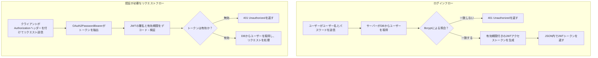

### 🎯 学習目標
- ユーザーの認証情報を保護する上でのパスワードハッシュ化（bcrypt）の役割を説明できる。
- ヘッダー（Header）、ペイロード（Payload）、署名（Signature）を含むJSON Web Token（JWT）の構造を説明できる。
- Pythonで適切な有効期限を持つJWTアクセストークンを生成・検証できる。
- 認証情報を抽出するために、FastAPIの `OAuth2PasswordBearer` セキュリティ依存関係を統合できる。
- APIエンドポイントを保護するための完全な認証ワークフローを実装できる。

### 🧩 中核概念（なぜ）
現代のWeb APIを構築する際、セキュリティは最優先事項です。パスワードをプレーンテキストのままデータベースに保存することは、重大なセキュリティの脆弱性になります。万が一データベースが漏洩した場合、すべてのユーザーアカウントが危険にさらされます。そのため、パスワードは **bcrypt** のような暗号化ハッシュアルゴリズムを使用して暗号化する必要があります。ハッシュ化は一方向関数であり、パスワードからハッシュを計算することはできますが、ハッシュから元のパスワードを復元することはできません。

ユーザーの身元が確認された後、サーバーはそのユーザーからの後続のリクエストを識別する方法を必要とします。従来のWebアプリケーションではセッションを使用し、サーバー側にセッションIDを保存し、クライアント側にクッキーを保存していました。しかし、ステートレスなREST APIにおいては、**JSON Web Token（JWT）**が業界標準となっています。

JWTは、2者間でクレーム（情報）をやり取りするための、コンパクトで自己完結型、かつURLセーフなトークンです。
- **コンパクト（Compact）**: トークンは十分に小さいため、URL、POSTパラメータ、またはHTTPヘッダー内に含めて送信できます。
- **自己完結型（Self-contained）**: トークンに必要なすべてのユーザー情報（ペイロード）が含まれているため、リクエストごとにデータベースに繰り返し問い合わせる必要がありません。

JWTは、ドット（`.`）で区切られた以下の3つの部分から構成されます。
1. **ヘッダー（Header）**: トークンのタイプ（JWT）と署名アルゴリズム（例: HS256）を含みます。
2. **ペイロード（Payload）**: クレーム（ユーザーID、有効期限、スコープなど）を含みます。
3. **署名（Signature）**: エンコードされたヘッダー、エンコードされたペイロード、およびサーバー側のシークレットキーを指定されたアルゴリズムで結合して作成されます。これにより、クライアントがトークンを改ざんできないようにします。

FastAPIは `OAuth2PasswordBearer` などの組み込みツールを提供し、`Authorization: Bearer <token>` ヘッダーからのトークンの抽出を自動化し、再利用可能なセキュリティ依存関係の作成を容易にします。

### 🔁 ロジックと動作

以下は、トークン認証ワークフローを表すフローチャートです。



### 📝 注釈付きサンプル

#### 1. Bcryptによるパスワードハッシュ化
ユーザーの認証情報を安全に保護するために、`passlib` と `bcrypt` バックエンドを使用してパスワードをハッシュ化します。
```python
from passlib.context import CryptContext

# ハッシュ化と検証を行うCryptContextを作成
pwd_context = CryptContext(schemes=["bcrypt"], deprecated="auto")

def hash_password(password: str) -> str:
    # ランダムなソルトを生成し、パスワードをハッシュ化する
    return pwd_context.hash(password)

def verify_password(plain_password: str, hashed_password: str) -> bool:
    # プレーンテキストのパスワードを保存されたハッシュ値と照合する
    return pwd_context.verify(plain_password, hashed_password)
```

#### 2. JWTの発行とデコード
ローカルのシークレットキーを使用してJSON Web Tokenを作成・解析するために、`PyJWT` を使用します。
```python
import datetime
import jwt
from fastapi import HTTPException, status

SECRET_KEY = "your-extremely-secure-secret-key"
ALGORITHM = "HS256"

def create_access_token(data: dict, expires_delta: datetime.timedelta):
    to_encode = data.copy()
    expire = datetime.datetime.utcnow() + expires_delta
    # 有効期限クレーム（'exp'）をペイロードに追加
    to_encode.update({"exp": expire})
    encoded_jwt = jwt.encode(to_encode, SECRET_KEY, algorithm=ALGORITHM)
    return encoded_jwt

def decode_access_token(token: str):
    try:
        # 署名と有効期限を自動的にデコードおよび検証
        payload = jwt.decode(token, SECRET_KEY, algorithms=[ALGORITHM])
        return payload
    except jwt.ExpiredSignatureError:
        raise HTTPException(
            status_code=status.HTTP_401_UNAUTHORIZED,
            detail="Token has expired",
            headers={"WWW-Authenticate": "Bearer"},
        )
    except jwt.InvalidTokenError:
        raise HTTPException(
            status_code=status.HTTP_401_UNAUTHORIZED,
            detail="Invalid token credentials",
            headers={"WWW-Authenticate": "Bearer"},
        )
```

#### 3. OAuth2PasswordBearerによるルートの保護
FastAPIは、依存関係（Dependency）を使用してセキュリティパラメータを抽出します。`OAuth2PasswordBearer` クラスは、リクエストの認可ヘッダーからトークンを抽出します。
```python
from fastapi import FastAPI, Depends, HTTPException, status
from fastapi.security import OAuth2PasswordBearer

app = FastAPI()

# OAuth2フロー用のトークンURLエンドポイントを定義
oauth2_scheme = OAuth2PasswordBearer(tokenUrl="token")

# 現在のユーザーを取得するための依存関係
async def get_current_user(token: str = Depends(oauth2_scheme)):
    payload = decode_access_token(token)
    username: str = payload.get("sub")
    if username is None:
        raise HTTPException(
            status_code=status.HTTP_401_UNAUTHORIZED,
            detail="Could not validate credentials"
        )
    return {"username": username}

# 現在のユーザーの依存関係を使用した保護されたルート
@app.get("/users/me")
def read_users_me(current_user: dict = Depends(get_current_user)):
    return current_user
```

### ❌ よくある間違い

**間違い 1: アルゴリズムを明示的に指定せずにJWTをデコードする**
```python
# 間違い: トークンをデコードする際に algorithms リストを省略している
payload = jwt.decode(token, SECRET_KEY)
```
```text
TypeError: decode() missing 1 required keyword-only argument: 'algorithms'
```
```python
# 正しい: 許可する検証アルゴリズムを明示的に定義する
payload = jwt.decode(token, SECRET_KEY, algorithms=["HS256"])
```
> PyJWTでは、`jwt.decode()` を呼び出す際に `algorithms` パラメータを明示的に指定する必要があります。この要件は、攻撃者がトークンヘッダーを非対称アルゴリズム（RS256など）から対称アルゴリズム（HS256など）に変更して署名検証をバイパスする「アルゴリズム混乱攻撃」を防ぐために設けられています。

**間違い 2: 有効期限エラーを捕捉せずにJWTをデコードする**
```python
# 間違い: try-except による処理を行わずにJWTペイロードにアクセスしている
def get_user_from_token(token: str):
    payload = jwt.decode(token, SECRET_KEY, algorithms=["HS256"])
    return payload["sub"]
```
```text
jwt.exceptions.ExpiredSignatureError: Signature has expired
```
```python
# 正しい: ExpiredSignatureErrorをキャッチしてHTTP例外をスローする
def get_user_from_token(token: str):
    try:
        payload = jwt.decode(token, SECRET_KEY, algorithms=["HS256"])
        return payload["sub"]
    except jwt.ExpiredSignatureError:
        raise HTTPException(status_code=401, detail="Token expired")
    except jwt.InvalidTokenError:
        raise HTTPException(status_code=401, detail="Invalid token")
```
> JWTの有効期限はデコード中に検証されます。トークンが期限切れの場合、`jwt.decode` は `ExpiredSignatureError` を発生させます。この例外をキャッチして適切に処理しないと、クライアントに明確な認証エラー（401）を返す代わりに、サーバーが未処理の内部サーバーエラー（500）を引き起こしてしまいます。

### 💡 コツ・イディオム
- **SECRET_KEYを安全に保つ**: プロダクション（本番環境）のソースコード内に `SECRET_KEY` を直接ハードコードしてはいけません。システム環境変数を使用し、設定モジュール（例: `os.getenv("SECRET_KEY")`）経由で読み込むようにしてください。
- **短いトークンの有効期限**: トークンが盗まれた場合のセキュリティリスクを最小限に抑えるために、アクセストークンの有効期限は短く（例: 15〜30分）保ちます。セッションを延長するにはリフレッシュトークンを使用します。
- **"sub" クレーム**: JWTペイロードの標準サブジェクト（`"sub"`）クレームには、常にユーザーの一意の識別子（データベースIDやユーザー名など）を格納します。

### 🧠 深掘り（内部の仕組み）
<details><summary>JWTとBcryptのソルト処理の仕組み</summary>

#### Bcryptがレインボーテーブル攻撃を防ぐ方法
SHA256のような標準的なハッシュ関数をパスワードに対して実行すると、同じパスワードからは常にまったく同じハッシュ値が生成されます。攻撃者がデータベースにアクセスした場合、あらかじめ数百万の一般的なパスワードのハッシュ値を計算しておき（**レインボーテーブル**）、保存されたハッシュ値と高速に照合できてしまいます。

Bcryptは、ハッシュ化の際に行われるランダムな **ソルト（Salt）** 追加によってこの問題を軽減します。
- 2人のユーザーが同じパスワード `"password123"` を設定していても、ソルトがランダムであるため、生成されるハッシュ値はまったく異なります。
- Bcryptはソルトを最終的な出力文字列（例: `$2b$12$R9h/cIPz...`）の中に直接埋め込むため、検証関数はそこからソルトを抽出してプレーンテキストのパスワードに適用し、結果を比較することができます。
- Bcryptは意図的に計算が遅くなるように設計（ストレッチング）されており、ブルートフォース（総当たり）攻撃による解析コストを極めて高くしています。

#### JWTペイロードのセキュリティ
JWTのペイロードは **暗号化されていない**（単に署名されているだけである）ことを忘れてはなりません。ペイロードはBase64URLでエンコードされているだけなので、トークンを受け取った人なら誰でも簡単にデコードして読むことができます。
- [jwt.io](https://jwt.io) にトークンを貼り付けるだけで、誰でも簡単にJWTペイロードを検査できます。
- そのため、生のパスワードやAPIトークン、プライベートな個人情報などの機密データをペイロードに含めてはいけません。
- **署名（Signature）** 部分は、データがサーバーによって発行された後に変更されていないことのみを保証します。ペイロードが改ざんされた場合、サーバーの秘密鍵による署名の検証で失敗します。
</details>

### 🏋️ 演習
2つのユーティリティ関数 `generate_token(username, expires_delta_mins)` と `decode_token(token)` を作成してください。`generate_token` は、サブジェクト（`sub`）クレームにユーザー名を含み、指定された分数で有効期限が切れるJWTを作成する必要があります。`decode_token` はトークンを検証し、ユーザー名を返す必要があります。

```python
import jwt
import datetime

SECRET_KEY = "supersecret"

# generate_token(username, expires_delta_mins) を実装し、JWTトークンを返します
# decode_token(token) を実装し、usernameを返します
```

### ✅ 自己チェック
1. ペイロードを誰でも読み取れるにもかかわらず、JWTが安全であるとされる理由は何ですか？
2. クライアントからJWTトークンを送信する際に使用される、標準的なHTTPヘッダー名とそのフォーマットは何ですか？
3. PyJWTは検証中に期限切れのトークンをどのように自動処理しますか？
<details><summary>自己チェックの解答</summary>

1. JWTは **署名（Signature）** によって保護されています。ペイロードを誰でもデコードして読み取ることはできますが、サーバーだけが持つ秘密鍵（シークレットキー）を使わない限り、署名を無効にせずに内容を改ざんすることはできません。
2. クライアントは、`Authorization` HTTPヘッダーに `Bearer ` プレフィックスを付けてトークンを送信します（例: `Authorization: Bearer <トークン文字列>`）。
3. PyJWTの `jwt.decode()` は、トークン内の `"exp"` クレームと現在のUTC時刻を自動的に比較します。現在時刻が有効期限を過ぎている場合、自動的に `ExpiredSignatureError` 例外を発生させます。
</details>

### 📌 まとめ
- Bcryptを使用した **パスワードハッシュ化** により、プレーンテキストのユーザー認証情報がデータベースに保存されるのを防ぎます。
- **JWT** は、ヘッダー、ペイロード、暗号署名を含む自己完結型のセキュリティクレームを表現します。
- **トークンの署名** は秘密鍵を使用してサーバー上の整合性を検証し、トークンのペイロードはクライアントから読み取ることができます。
- **FastAPIのセキュリティ依存関係** は、ヘッダーの解析とトークンの抽出を自動化し、安全なエンドポイント保護を可能にします。
