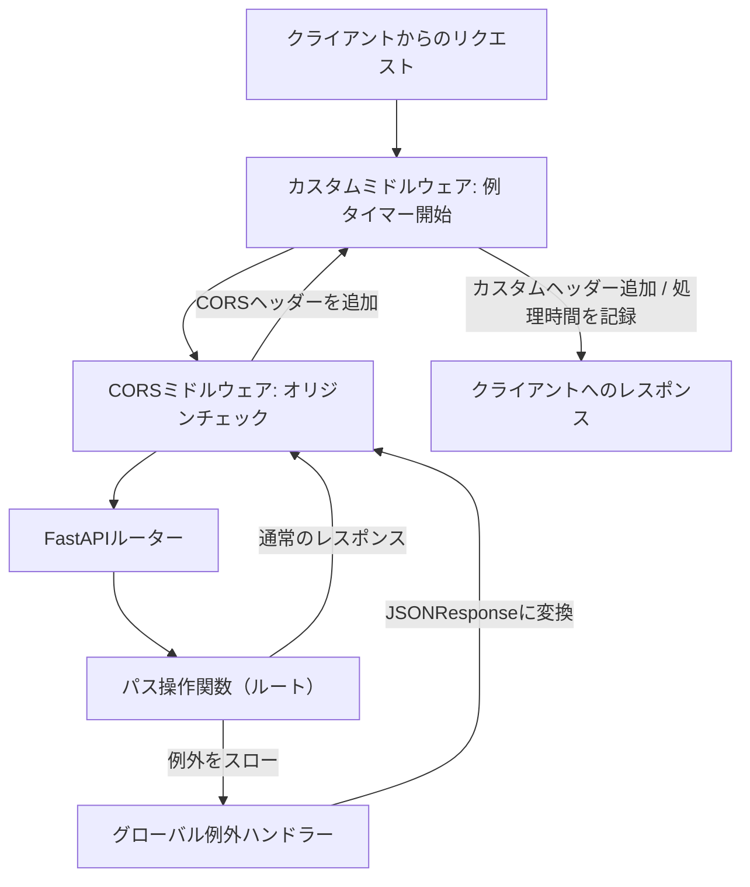

### 🎯 学習目標
- HTTP要求・応答ライフサイクルにおけるミドルウェア（Middleware）の役割を説明できる。
- カスタムミドルウェアを使用して、受信するリクエストおよび送信するレスポンスをインターセプトし、変更できる。
- クロスドメイン要求（CORS）を保護・有効化するために、CORS（Cross-Origin Resource Sharing）ヘッダーを構成できる。
- アプリケーション固有の検証やビジネスロジックのエラーを表すカスタム例外を定義できる。
- 構造化された使いやすいJSONレスポンスを返すために、FastAPIにグローバル例外ハンドラーを登録できる。

### 🧩 中核概念（なぜ）
Webアプリケーションを開発する際、受信するすべてのリクエストや送信するすべてのレスポンスに対して、一貫して特定のロジックを実行したいことがよくあります。例えば、すべてのリクエストの処理時間を記録したり、ヘッダーを検証したり、レスポンスを圧縮したりする場合です。これらのロジックをすべてのルートハンドラー関数（パス操作関数）の中に個別に記述すると、コードの重複が発生します。**ミドルウェア（Middleware）**は、リクエストがルートに到達する前にインターセプトし、レスポンスがクライアントに返される前に変更することで、この問題を解決します。

ミドルウェアのもう一つの重要な機能は、**CORS（Cross-Origin Resource Sharing：オリジン間リソース共有）**の管理です。セキュリティ上の理由から、現代のWebブラウザは「同一起源ポリシー（Same-Origin Policy）」を強制しています。これにより、あるドメイン（例: `https://frontend.com`）でホストされているフロントエンドアプリケーションから、別のドメイン（例: `https://api.com`）のAPIに対する非同期要求（AJAXリクエスト）の送信がブロックされます。CORSヘッダーを使用すると、サーバーが特定のドメイン（オリジン）を明示的に信頼していることをブラウザに伝え、安全なクロスドメイン通信が可能になります。

最後に、リクエスト処理中にはエラーが発生することがあります（データベースクエリの失敗、要求されたリソースの不在など）。アプリケーション内で発生した標準的なPython例外を処理（キャッチ）しないままにすると、FastAPIはリクエストパイプラインを中断し、一般的なエラーである「500 Internal Server Error」を返してしまいます。**カスタム例外**を定義し、グローバルな**例外ハンドラー（Exception Handler）**を登録することで、これらの特定の例外を捉え、クライアントにとって分かりやすい「404 Not Found」などの構造化されたJSONレスポンスに変換できます。これにより、APIの利便性とデバッグのしやすさが向上します。

### 🔁 ロジックと動作

以下は、ミドルウェア、ルーター、例外ハンドラーがどのように相互作用するかを示す、リクエスト・レスポンスライフサイクルのフローチャートです。



例外が発生すると、ルーターは通常の処理をバイパスし、発生した例外クラスに一致する登録済みの例外ハンドラーを検索します。ハンドラーは標準のHTTPレスポンスを生成し、そのレスポンスは再びミドルウェアレイヤーを通過してからクライアントに届きます。

### 📝 注釈付きサンプル

#### 1. カスタムHTTPミドルウェア
`@app.middleware("http")` デコレータを使用して、各リクエストの処理時間を計算するカスタムミドルウェアを作成できます。
```python
import time
from fastapi import FastAPI, Request

app = FastAPI()

@app.middleware("http")
async def add_process_time_header(request: Request, call_next):
    # 1. リクエストがルートハンドラーに到達する前に実行されるロジック
    start_time = time.time()
    
    # 2. リクエストを下流に渡し、レスポンスを取得する
    response = await call_next(request)
    
    # 3. ルート処理が完了した後に実行され、レスポンスを変更するロジック
    process_time = time.time() - start_time
    response.headers["X-Process-Time"] = str(process_time)
    
    return response
```

#### 2. CORSミドルウェアの構成
FastAPIには、オリジン間ヘッダーを簡単に管理するための `CORSMiddleware` が組み込まれています。
```python
from fastapi.middleware.cors import CORSMiddleware

# クロスサイトリクエストを許可するオリジン（ドメイン）のリストを定義
origins = [
    "http://localhost:3000",
    "https://myfrontendapp.com",
]

app.add_middleware(
    CORSMiddleware,
    allow_origins=origins,            # 指定したオリジンからのリクエストを許可
    allow_credentials=True,           # リクエストにクッキーを含めることを許可
    allow_methods=["*"],              # すべてのHTTPメソッド（GET, POSTなど）を許可
    allow_headers=["*"],              # すべてのHTTPヘッダーを許可
)
```

#### 3. カスタム例外とグローバルハンドラー
独自のアプリケーション例外を定義し、例外ハンドラーを使用してグローバルに捕捉します。
```python
from fastapi import FastAPI, Request
from fastapi.responses import JSONResponse

# 1. カスタムのPython例外クラスを定義
class ItemLimitExceededError(Exception):
    def __init__(self, limit: int):
        self.limit = limit

app = FastAPI()

# 2. デコレータを使用して例外ハンドラーを登録
@app.exception_handler(ItemLimitExceededError)
async def item_limit_exception_handler(request: Request, exc: ItemLimitExceededError):
    # 3. 適切なステータスコードを伴う構造化されたJSONResponseを返す
    return JSONResponse(
        status_code=400,
        content={"error": "Invalid request", "detail": f"Cannot add more than {exc.limit} items."}
    )

@app.get("/items/add")
def add_item(count: int):
    if count > 10:
        # カスタム例外を発生させる
        raise ItemLimitExceededError(limit=10)
    return {"message": "Items added successfully"}
```

### ❌ よくある間違い

**間違い 1: カスタムミドルウェアで `call_next(request)` の `await` を忘れる**
```python
# 間違い: call_next を await せずに呼び出している
@app.middleware("http")
async def process_time_middleware(request: Request, call_next):
    response = call_next(request)
    response.headers["X-Process-Time"] = "0.01"
    return response
```
```text
AttributeError: 'coroutine' object has no attribute 'headers'
```
```python
# 正しい: await を使用して call_next を呼び出し、レスポンスオブジェクトを取得する
@app.middleware("http")
async def process_time_middleware(request: Request, call_next):
    response = await call_next(request)
    response.headers["X-Process-Time"] = "0.01"
    return response
```
> `call_next` は非同期のコルーチンであり、下流のリクエスト実行パイプラインを表します。これを `await` しない場合、Pythonは実際の `Response` インスタンスではなくコルーチンオブジェクトを返します。コルーチンオブジェクトに対してヘッダーを設定しようとすると `AttributeError` が発生し、アプリケーションがクラッシュします。

**間違い 2: 例外ハンドラーで Response インスタンスの代わりに辞書型（dict）を返す**
```python
# 間違い: ハンドラーからプレーンな辞書オブジェクトを返している
@app.exception_handler(ItemLimitExceededError)
def exception_handler_wrong(request: Request, exc: ItemLimitExceededError):
    return {"error": "Limit exceeded"}
```
```text
AssertionError: The response returned by the exception handler must be an instance of starlette.responses.Response
```
```python
# 正しい: 明示的に JSONResponse オブジェクトを返している
@app.exception_handler(ItemLimitExceededError)
def exception_handler_correct(request: Request, exc: ItemLimitExceededError):
    return JSONResponse(status_code=400, content={"error": "Limit exceeded"})
```
> FastAPIの例外ハンドラー機構（基盤であるStarlette）では、ハンドラーが `Response` のサブクラス（`JSONResponse` や `HTMLResponse`、`PlainTextResponse` など）の有効なインスタンスを返す必要があります。生の辞書（dict）や文字列を返すと、内部の実行時アサーションチェックに失敗し、エラーになります。

### 💡 コツ・イディオム
- **CORSミドルウェアの登録順序**: ブラウザからのプリフライト（事前チェック）リクエストをカスタム認証やロギングのミドルウェアよりも先にインターセプトできるように、`CORSMiddleware` は常にミドルウェアスタックの最上部（追加する順番の最初）付近に登録してください。
- **ベース例外パターン**: 多くのカスタム例外がある場合は、共通の基底クラス（例: `class BaseAppException(Exception)`）から継承させます。これにより、`BaseAppException` に対して1つの例外ハンドラーを登録するだけで、すべてのカスタムエラーを一元的に捕捉し、統一されたフォーマットで応答させることができます。
  ```python
  @app.exception_handler(BaseAppException)
  def base_exception_handler(request: Request, exc: BaseAppException):
      return JSONResponse(status_code=400, content={"error": str(exc)})
  ```
- **`request.state` によるコンテキストの受け渡し**: ミドルウェア内でリクエスト状態（state）にカスタムデータ（例: `request.state.user_role = "admin"`）を追加し、後でパス操作関数内で読み取ることができます。

### 🧠 深掘り（内部の仕組み）
<details><summary>ミドルウェアの実行順序とCORSプリフライト</summary>

#### ASGIミドルウェアの玉ねぎ（オニオン）モデル
FastAPIアプリケーションは、ASGI（Asynchronous Server Gateway Interface）仕様に基づいて動作します。ASGIにおけるミドルウェアは、玉ねぎの層のように機能します。
- 受信するリクエストは、外側の層から内側の層に向かって進みます。
- 送信するレスポンスは、内側の層から外側の層に向かって戻ります。

`app.add_middleware(MiddlewareClass)` を呼び出すと、FastAPIはそれらを順次登録します。玉ねぎモデルのため、**最後に追加されたミドルウェアが最初に受信リクエストを処理し（最も外側の層）、最初に追加されたミドルウェアがルーターに最も近くなります（最も内側の層）**。ミドルウェア同士が互いの処理結果に依存している場合は、この登録順序に十分注意してください。

#### CORSプリフライトとOPTIONSリクエスト
`http://localhost:3000` でホストされているフロントエンドアプリケーションが、`http://localhost:8000/api` に対してJSONデータを含む `POST` リクエストを送信しようとする際、ブラウザは自動的に最初にHTTPの `OPTIONS` リクエストを送信します。これを **プリフライトリクエスト（Preflight Request）** と呼びます。
- プリフライトリクエストは、サーバーが `http://localhost:3000` からのオリジン、および `Content-Type` などのカスタムヘッダーを許可しているかどうかを確認します。
- サーバーが `Access-Control-Allow-Origin: http://localhost:3000` や `Access-Control-Allow-Methods: POST` などのヘッダーを返すと、ブラウザは本番の `POST` リクエストを送信します。
- FastAPIの `CORSMiddleware` は、受信した `OPTIONS` プリフライトリクエストを即座にインターセプトして構成された適切なヘッダーを応答するため、リクエストがルーターに到達してアプリケーションサーバーのリソースを無駄に消費するのを防ぎます。
</details>

### 🏋️ 演習
リソースの `name` を引数に取るカスタム例外 `ResourceNotFoundError` を作成してください。次に、FastAPIアプリケーションでこの例外をキャッチし、HTTPステータスコード404と `{"error": "<name> not found"}` というフォーマットのJSONデータを返すカスタム例外ハンドラーを実装してください。

```python
from fastapi import FastAPI, Request
from fastapi.responses import JSONResponse

class ResourceNotFoundError(Exception):
    def __init__(self, name: str):
        self.name = name

app = FastAPI()

# ResourceNotFoundError に対するカスタム例外ハンドラーを実装してください
```

### ✅ 自己チェック
1. 検証チェックが失敗した場合、ミドルウェアはどのようにしてリクエストがルーターに到達するのをブロックしますか？
2. CORS検証がFastAPIバックエンドではなくWebブラウザ側で実行されるのはなぜですか？
3. FastAPIで処理される場合、Starletteの `HTTPException` と標準的なPythonの例外との違いは何ですか？
<details><summary>自己チェックの解答</summary>

1. ミドルウェアは、`await call_next(request)` を呼び出す代わりに、直接 `JSONResponse`（例: 401 Unauthorized）を生成して返すことができます。これにより、リクエストの流れが途中で遮断され（ショートサーキット）、ルーターに到達しなくなります。
2. CORSは、悪意のあるスクリプトが別のドメインに対してユーザーに無断で不正リクエストを送信するのを防ぐために、ブラウザが強制するセキュリティ機構です。バックエンドは許可ヘッダーを提供するだけであり、リクエストの完了を実際にブロックするかどうかを判定するのはブラウザ側です。
3. FastAPIにはStarletteの `HTTPException` 用の組み込みハンドラーがあり、自動的に適切なJSONレスポンスに変換します。一方、標準的なPythonの例外は、カスタム例外ハンドラーで明示的にキャッチしない限りデフォルトでは捕捉されず、すべて「500 Internal Server Error」として処理されます。
</details>

### 📌 まとめ
- **ミドルウェア**はリクエストとレスポンスのサイクル全体をインターセプトし、グローバルなデータ処理や機能追加を可能にします。
- **CORSヘッダー**は、ブラウザを跨ぐクロスドメインリクエストを許可し、フロントエンドとバックエンドの正常な接続に不可欠です。
- **カスタム例外**は特定のビジネスエラーをカプセル化し、未処理のエラーによる詳細な情報の外部流出を防ぎます。
- **グローバル例外ハンドラー**は、Pythonで発生したエラーを `JSONResponse` などの標準化されたHTTPレスポンスにマッピングします。
