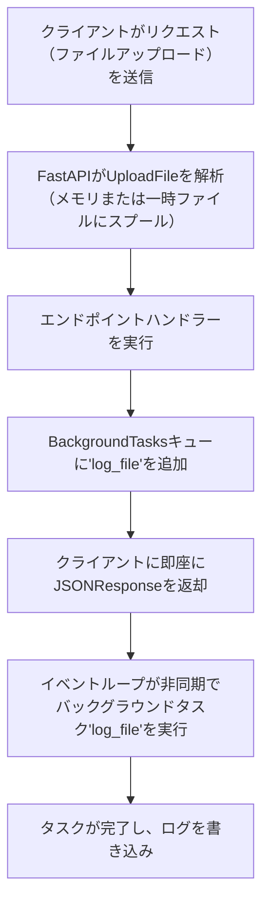

### 🎯 学習目標
- FastAPIにおける `bytes` を使用したファイルアップロードと `UploadFile` の違いを説明できる。
- `UploadFile` と `File` コンポーネントを使用して、ファイルのアップロード用ルートハンドラーを実装できる。
- `BackgroundTasks` を使用してタスクをバックグラウンドにオフロードする際の、HTTPリクエスト・レスポンスのライフサイクルを説明できる。
- クライアントへのHTTPレスポンスをブロックせずに、時間のかかる処理をバックグラウンドで実行するように構成できる。
- ファイルのアップロードを処理し、バックグラウンドタスクをトリガーするルートに対する、エンドツーエンドの統合テストを作成できる。

### 🧩 中核概念（なぜ）
Webアプリケーションの開発では、クライアントからファイル（プロフィール画像、文書、スプレッドシートなど）を受信したり、完了までに数秒から数分かかる処理（確認メールの送信、アップロードされたデータの解析、レポートの生成など）を実行したりするケースが多々あります。

従来の同期的なWebフレームワークでは、クライアントがファイルをアップロードし、サーバーがリクエストハンドラー内で即座にその処理を実行すると、接続が開いたままになり、クライアントは処理全体が完了するまでレスポンスを待たなければなりませんでした。多くのクライアントが同時にこのような時間のかかる処理を実行すると、サーバーのワーカースレッド（またはプロセス）が枯渇し、タイムアウトやユーザー体験の大幅な低下を招きます。

FastAPIは、これら2つの課題を以下の強力な機能で解決します。
1. **`UploadFile`**: Starletteをベースにしたこのクラスは、受信データをストリーミングすることで、大容量ファイルのアップロードを効率的に処理します。ファイル全体をサーバーのRAM（メモリ）に直接読み込む raw な `bytes` とは異なり、`UploadFile` は設定された上限（1MB）までしかメモリに保持しません。ファイルサイズがこれを超えた場合は、自動的にディスク上の一時ファイルに書き出す（スプールする）ため、メモリ不足によるサーバークラッシュ（OOMエラー）を防ぎます。
2. **`BackgroundTasks`**: クライアントへのHTTPレスポンスを返した*後*に、特定の処理を実行できるようにします。タスクを `BackgroundTasks` に追加することで、FastAPIはクライアントに即座にレスポンス（例: `{"status": "queued"}`）を返し、その後、指定された関数を非同期（イベントループ上、または別スレッド）で実行します。これにより、APIの高速で安定した応答性を維持できます。

### 🔁 ロジックと動作

以下のフローチャートは、ファイルのアップロードによってバックグラウンドタスクが開始されるライフサイクルを示しています。



バックグラウンドタスクを含むリクエスト処理が完了すると、FastAPIは登録されたタスクを確保し、クライアントにレスポンスのペイロードとヘッダーを送信します。その後、登録された関数をただちに実行します。バックグラウンド関数が標準の同期関数（`def`）として定義されている場合、FastAPIはそれを外部のスレッドプールで実行します。非同期関数（`async def`）として定義されている場合、FastAPIはそれをメインのASGIイベントループ上で直接スケジュールします。

### 📝 注釈付きサンプル

#### 1. `UploadFile` を使用したファイルのアップロード
以下は、アップロードされたファイルを受け取り、メタデータを取得して内容を読み込むルートです。
```python
from fastapi import FastAPI, File, UploadFile

app = FastAPI()

@app.post("/upload-metadata")
async def get_file_metadata(file: UploadFile = File(...)):
    # 1. メタデータ属性へのアクセス
    filename = file.filename
    content_type = file.content_type
    
    # 2. ファイルの内容を非同期で読み込む
    content = await file.read()
    
    # 3. システムリソースを解放するため、必ずファイルを閉じる
    await file.close()
    
    return {
        "filename": filename,
        "content_type": content_type,
        "size_bytes": len(content)
    }
```

#### 2. バックグラウンドでのタスク実行
`BackgroundTasks` を使用して、レスポンス送信後にメッセージのログ出力やデータ処理を行います。
```python
from fastapi import FastAPI, BackgroundTasks

app = FastAPI()

def write_notification(email: str, message: str):
    # 時間のかかるメール送信処理をシミュレート
    with open("log.txt", mode="a") as log:
        log.write(f"Notification to {email}: {message}\n")

@app.post("/send-notification/{email}")
def send_notification(email: str, background_tasks: BackgroundTasks):
    # 関数とその引数をキューに追加
    background_tasks.add_task(write_notification, email, message="Welcome to our platform!")
    
    # クライアントへ即座にレスポンスを返す
    return {"message": "Notification is being sent in the background"}
```

#### 3. アップロード処理とバックグラウンドタスクの組み合わせ
ファイルを受け取り、クライアントには "processing" ステータスを返し、バックグラウンドでファイル名をログに記録するルートです。
```python
from fastapi import FastAPI, BackgroundTasks, UploadFile, File

app = FastAPI()
PROCESSED_FILES = []

def log_file(filename: str):
    # シミュレートされたバックグラウンドタスク処理
    PROCESSED_FILES.append(filename)

@app.post("/upload")
def upload_file(background_tasks: BackgroundTasks, file: UploadFile = File(...)):
    # レスポンス送信後に実行されるログ出力タスクを追加
    background_tasks.add_task(log_file, file.filename)
    
    # クライアントへ即座にフィードバックを返す
    return {"status": "queued"}
```

### ❌ よくある間違い

**間違い 1: `async def` 関数内で、`UploadFile` のコンテンツを `await` せずに同期的に読み込もうとする**
```python
# 間違い: async ルート内で await を使わずにファイルを読み込んでいる
@app.post("/upload")
async def upload(file: UploadFile = File(...)):
    content = file.read()
    return {"size": len(content)}
```
```text
RuntimeWarning: coroutine 'UploadFile.read' was never awaited
TypeError: object coroutine can't be used in 'len()'
```
```python
# 正しい: UploadFile の非同期メソッドに対して await を使用する
@app.post("/upload")
async def upload(file: UploadFile = File(...)):
    content = await file.read()
    return {"size": len(content)}
```
> `UploadFile.read()` は、内部で非ブロッキングのディスクI/Oを実行するため非同期メソッド（コルーチン）となっています。`async def` ルート内で実行する場合は、実際のバイトデータを取得するために必ず `await` キーワードを付与する必要があります。これを怠るとコルーチンオブジェクト自体が返され、警告が発生するだけでなく、`len()` の引数に渡した際などに `TypeError` を引き起こします。

**間違い 2: ルート関数の引数宣言で `File(...)` を指定し忘れたため、FastAPIがクエリパラメータと誤認する**
```python
# 間違い: 引数のデフォルト値として File() が不足している
@app.post("/upload")
def upload(file: UploadFile):
    return {"filename": file.filename}
```
```text
pydantic_core._pydantic_core.ValidationError: 1 validation error for Request
query -> file
  Field required [type=missing, input_value={}, input_type=dict]
```
```python
# 正しい: File(...) を指定してマルチパートのフォームデータとして解析するようにFastAPIへ指示する
@app.post("/upload")
def upload(file: UploadFile = File(...)):
    return {"filename": file.filename}
```
> デフォルトでは、FastAPIはリクエストボディのPydanticモデルではない単純な引数を、クエリパラメータまたはJSONボディパラメータとして扱います。`UploadFile` 引数に対して明示的に `File(...)` または `File(None)` を割り当てないと、FastAPIはクエリパラメータ内を探索するため、クライアントが `multipart/form-data` としてファイルをアップロードした際に、必須パラメータが見つからないというバリデーションエラーが発生します。

### 💡 コツ・イディオム
- **ストリームとメモリの節約**: ファイルのヘッダー情報やメタデータ（ファイル名、メディアタイプなど）を確認するだけで十分な場合は、`file.read()` でファイル全体を読み込む必要はありません。メモリ使用量を抑えるため、直接 `file.filename` や `file.content_type` を参照してください。
- **スプールしたファイルは必ず閉じる**: `await file.read()` を使って内容を読み込んだ後は、`await file.close()` を呼び出します。これにより、ディスク上の一時ファイルが確実に削除され、ストレージ領域のリークを防ぐことができます。
- **バックグラウンドタスクにおける `def` と `async def` の使い分け**:
  - バックグラウンドタスクが同期的なブロッキングI/O（通常のファイル書き込み、同期型データベースクエリ、CPU負荷の高い計算など）を含む場合は、通常の関数 `def` として定義します。FastAPIはそれを自動的に別のスレッドで実行します。
  - バックグラウンドタスクが非同期I/O（`httpx.AsyncClient` を使用した外部API呼び出しなど）である場合は、`async def` として定義し、スレッドを作成することなくメインイベントループ上で非ブロッキングに実行します。

### 🧠 深掘り（内部の仕組み）
<details><summary>FastAPIのBackgroundTasksスレッドモデル</summary>

FastAPIの `BackgroundTasks` はStarletteの機能を継承しています。タスクが登録されると、サーバーはHTTPレスポンスをクライアントに送出した後にタスクを実行します。Starletteがタスクを実行するスレッドモデルは、タスク関数の定義方法によって以下のように異なります。

1. **同期関数 (`def`)**:
   `def task_func()` と定義された場合、Starletteは `anyio`（非同期並行処理ライブラリ）が管理する外部のスレッドプール上でこの関数を実行します。これにより、同期的なブロッキング処理（同期型のSQLAlchemy接続やファイルI/O）が発生しても、FastAPIのシングルスレッドイベントループがブロッキングされるのを防ぎ、他の受信リクエストを引き続き並行して処理できます。
   
2. **非同期関数 (`async def`)**:
   `async def task_func()` と定義された場合、Starletteはメインのイベントループスレッド上で直接その関数を `await` して実行します。この非同期タスクの中に、CPUを占有する処理や、同期的な `time.sleep()` などのブロッキング処理が含まれている場合、イベントループ全体がその秒数だけ停止（フリーズ）してしまい、すべてのユーザーに対するAPIレスポンスが一時的に停止します。そのため、`async def` でのバックグラウンドタスクには非ブロッキングな非同期処理のみを含めるようにしてください。
</details>

### 🏋️ 演習
FastAPIアプリケーションに `POST /upload` エンドポイントを実装してください。このエンドポイントはファイルアップロード（マルチパートフォームデータ）を受け取り、`BackgroundTasks` を使用して、グローバルなリスト `PROCESSED_FILES` にファイルのファイル名（`filename`）を追加します。クライアントには、即座にレスポンス `{"status": "queued"}` を返してください。

```python
from fastapi import FastAPI, BackgroundTasks, UploadFile, File

app = FastAPI()
PROCESSED_FILES = []

def log_file(filename: str):
    PROCESSED_FILES.append(filename)

# UploadFileを受け取り、バックグラウンドでPROCESSED_FILESにファイル名を追加するPOST /uploadルートを実装してください
```

### ✅ 自己チェック
1. 大容量ファイルのアップロードにおいて、 raw な `bytes` の代わりに `UploadFile` を使用する最大のメリット（メモリ観点）は何ですか？
2. バックグラウンドタスク関数を `async def` で定義し、その中で `time.sleep(10)` を呼び出すと何が起こりますか？
3. FastAPIの `TestClient` を使用して、非同期で動作するバックグラウンドタスクをテストするにはどうすればよいですか？
<details><summary>自己チェックの解答</summary>

1. `UploadFile` はファイルを一度にメモリ上に展開せず、1MBまではメモリ上に保持し、それを超えると自動的にディスク上の一時ファイルにスプールします。raw な `bytes` ではファイルデータ全体を直接 RAM に展開するため、ユーザーが大容量ファイルをアップロードした際にサーバーがメモリ不足でクラッシュする原因になります。
2. タスクが `async def` で定義されているため、メインのイベントループ上で同期実行（await）されます。その中で `time.sleep(10)` のようなブロッキング処理を行うと、イベントループ自体が10秒間ロックされ、その間、サーバーは他の一切のリクエストを処理できなくなります（サーバー全体のハング）。
3. FastAPIの `TestClient` を使ったテスト環境では、バックグラウンドタスクは同期的に処理されます。`client.post()` を呼び出すと、テストクライアントはレスポンスが生成された直後に（呼び出し元に制御を戻す前に）バックグラウンドタスクの処理をその場で実行します。そのため、リクエストの直後にタスク実行結果（リストにファイル名が追加されているかなど）を `assert` で検証することができます。
</details>

### 📌 まとめ
- **ファイルのアップロード**: FastAPIの `UploadFile` は、ストリーミングおよびディスクスプーリング機能を備えたモダンなアップロード用インターフェースを提供し、サーバーの過度なメモリ消費を抑制します。
- **BackgroundTasks**: HTTPレスポンスの送信後に処理を実行する仕組みで、メール通知の送信やログ出力などの時間のかかるタスクに適しています。
- **スレッドモデル**: `def` で宣言されたタスクは外部のスレッドプールで実行され、`async def` で宣言されたタスクはメインのイベントループ上で非同期的に実行されます。
- **テスト**: `TestClient` を使用するテストでは、バックグラウンドタスクは同期的に即座に実行されるため、結果の検証が非常に容易になります。
