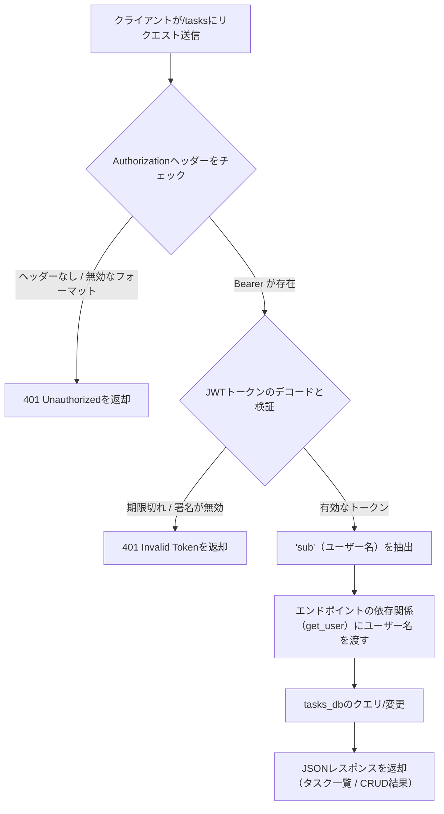

### 🎯 学習目標
- バリデーション、セキュリティ、依存性注入、例外処理などの複数のFastAPIコンポーネントを1つのシステムに統合できる。
- JSON Web Token（JWT）認証を使用してAPIエンドポイントを保護できる。
- クライアントからのリクエストボディを検証するためのカスタム Pydantic スキーマを作成できる。
- 認証トークンを抽出し、デコードおよび検証するための再利用可能な依存関係（Dependency）を構築できる。
- 認証およびCRUD処理のパイプライン全体を検証するための包括的な統合テストを作成できる。

### 🧩 中核概念（なぜ）
現実のソフトウェア開発では、各機能を完全に独立して構築することはほとんどありません。本番環境で動作するAPIには、以下の複数の共通関心事（Cross-Cutting Concerns）がシームレスに機能することが求められます。
1. **リクエストの検証（バリデーション）**: ビジネスロジックが実行される前に、クライアントからのペイロードの構造が正しいことを保証する（**Pydantic**を使用）。
2. **セキュリティと認証**: クライアントの身元を確認し、特定のルートに認証されたユーザーのみがアクセスできるように制限する（**JWT**と**OAuth2PasswordBearer**を使用）。
3. **依存性注入（Dependency Injection）**: 認証やバリデーションのロジックをルートハンドラー関数から分離し、宣言的な記述によってルートを保護する（**`Depends`**を使用）。
4. **構造化されたエラー処理**: 認証失敗、データ無効、またはリソースが存在しない場合に、適切なHTTPステータスコードと明確なエラーメッセージを返す（**`HTTPException`**を使用）。

この応用演習（Capstone）では、これらの主要コンポーネントを統合して、安全なタスク管理REST APIを構築します。ユーザーはまず `/login` エンドポイントで認証を行ってトークンを取得する必要があります。その後、以降のリクエストの `Authorization` ヘッダーにこのトークンを含めて送信します。バックエンドはトークンを自動的に抽出して検証し、デコードエラーを適切に処理した上で、検証に成功した場合にのみ、要求されたリソースを返します。

### 🔁 ロジックと動作

以下のフローチャートは、セキュアなAPIにおけるリクエスト・レスポンスのライフサイクルを示しています。



クライアントが `GET /tasks` のような保護されたエンドポイントにリクエストを送信すると、以下の処理が行われます。
1. リクエストはまず `OAuth2PasswordBearer` 依存関係に送られ、`Authorization: Bearer <token>` ヘッダーがスキャンされます。ヘッダーが存在しない場合、自動的に `401 Unauthorized` エラーがスローされます。
2. 抽出されたトークンは、カスタム依存関係関数 `get_user` に渡されます。
3. この関数は、アプリケーションで設定された署名用シークレットキーとアルゴリズムを使用してトークンをデコードします。
4. トークンが有効であれば、ユーザー情報が抽出され、引数としてルートハンドラーに渡されます。
5. デコードに失敗した場合（有効期限切れ、署名の改ざん、形式無効など）、依存関係は `HTTPException(status_code=401)` を発生させます。

### 📝 注釈付きサンプル

以下は、Pydanticバリデーション、JWTトークン署名、および依存性注入を統合した安全なREST APIの完全な実装例です。

```python
import jwt
from fastapi import FastAPI, Depends, HTTPException, status
from fastapi.security import OAuth2PasswordBearer
from pydantic import BaseModel

# 1. 署名用のシークレットキーとアルゴリズムの定義
SECRET = "capstone-secret-key"
ALGORITHM = "HS256"

app = FastAPI()

# 2. ログインエンドポイントを指し示す OAuth2 セキュリティスキームの定義
oauth2_scheme = OAuth2PasswordBearer(tokenUrl="login")

# 3. Pydantic リクエストモデルの定義
class LoginRequest(BaseModel):
    username: str
    password: str

class TaskCreate(BaseModel):
    title: str

class Task(BaseModel):
    id: int
    title: str

# メモリ内データベースのシミュレーション
tasks_db = []
task_id_counter = 1

# 4. JWTトークンを生成するログインエンドポイントの実装
@app.post("/login")
def login(req: LoginRequest):
    # 簡易的な認証チェック
    if req.username == "alice" and req.password == "password123":
        # ユーザー識別子をJWTペイロードにエンコード
        token = jwt.encode({"sub": req.username}, SECRET, algorithm=ALGORITHM)
        return {"token": token, "token_type": "bearer"}
    
    raise HTTPException(
        status_code=status.HTTP_401_UNAUTHORIZED,
        detail="Incorrect username or password"
    )

# 5. JWTを検証し、ユーザー情報を抽出する依存関係関数の作成
def get_user(token: str = Depends(oauth2_scheme)):
    try:
        # トークンの署名をデコードして検証
        payload = jwt.decode(token, SECRET, algorithms=[ALGORITHM])
        user = payload.get("sub")
        if user is None:
            raise HTTPException(status_code=401, detail="Invalid token payload")
        return user
    except jwt.InvalidTokenError:
        raise HTTPException(
            status_code=status.HTTP_401_UNAUTHORIZED,
            detail="Invalid or expired token"
        )

# 6. Depends(get_user) を使用した保護されたエンドポイントの実装
@app.get("/tasks")
def get_tasks(user: str = Depends(get_user)):
    # タスクデータベースを返す (ユーザー認証に成功した場合のみ到達可能)
    return tasks_db

@app.post("/tasks")
def create_task(task_in: TaskCreate, user: str = Depends(get_user)):
    global task_id_counter
    new_task = Task(id=task_id_counter, title=task_in.title)
    tasks_db.append(new_task.model_dump())
    task_id_counter += 1
    return new_task
```

### ❌ よくある間違い

**間違い 1: 本番環境のソースコード内に機密シークレットキーをハードコードする**
```python
# 間違い: コード内に直接シークレットキーを記述している
SECRET = "capstone"
```
```text
(Security vulnerability warning: hardcoded secrets detected in source file)
```
```python
# 正しい: 環境変数から設定用のシークレットキーを取得する
import os
SECRET = os.getenv("JWT_SECRET_KEY", "default-fallback-insecure-dev-key")
```
> ソースコード内にシークレットキーを直接記述すると、GitHubなどのバージョン管理システムにソースコードをコミットした際に情報が流出する重大なセキュリティリスクがあります。流出したキーを入手した第三者は、任意の有効なJWTトークンを偽造して認証を完全にバイパスできるようになります。シークレットキーは必ず環境変数から読み込むようにしてください。

**間違い 2: JWTライブラリが発生させるデコードエラーをキャッチし忘れる**
```python
# 間違い: InvalidTokenErrorをキャッチせずにトークンをデコードしている
def get_user(token: str = Depends(oauth2_scheme)):
    payload = jwt.decode(token, SECRET, algorithms=["HS256"])
    return payload["sub"]
```
```text
jwt.exceptions.DecodeError: Signature verification failed
```
```python
# 正しい: try-exceptブロックでデコード処理を囲み、HTTPExceptionを発生させる
def get_user(token: str = Depends(oauth2_scheme)):
    try:
        payload = jwt.decode(token, SECRET, algorithms=["HS256"])
        return payload["sub"]
    except jwt.InvalidTokenError:
        raise HTTPException(status_code=401, detail="Invalid token")
```
> `jwt.decode` 関数は、署名検証に失敗したとき、形式が不正なとき、あるいは期限切れのときに、様々な例外（`DecodeError` や `ExpiredSignatureError` など）を発生させます。依存関係関数内でこれらの例外を適切にキャッチしないと、例外がそのままASGIサーバーまで伝播してしまい、クライアントに `401 Unauthorized` を返す代わりに、予期しないサーバーエラーを示す `500 Internal Server Error` が返されてしまいます。

### 💡 コツ・イディオム
- **ステートレストークン**: JWTはステートレス（状態を持たない）です。サーバーは検証のたびにセッションデータベースに問い合わせる必要はありません。改ざん防止の暗号署名が施されたペイロード自体に必要なすべての表明（ID、クレーム、有効期限など）が含まれています。
- **依存関係の再利用**: `get_user` をベースにして、さらに複雑な認可処理（例: `get_active_user` や `get_admin_user`）を作成し、アプリケーション全体で異なる権限を容易に強制することができます。
- **テスト用ヘッダーのプレフィックス**: `TestClient` を使用して保護されたエンドポイントをテストする場合は、`Authorization` ヘッダーに必ず `Bearer ` プレフィックスを付けて送信してください（例: `{"Authorization": f"Bearer {token}"}`）。

### 🧠 深掘り（内部の仕組み）
<details><summary>JWTの署名検証とアルゴリズムの安全性</summary>

JSON Web Tokenはドット（`.`）で区切られた3つのパートで構成されます。
1. **Header（ヘッダー）**: トークンのタイプ（JWT）と署名アルゴリズム（例: HS256）を含みます。
2. **Payload（ペイロード）**: クレーム（ユーザー識別子 `sub` や有効期限 `exp` など）を含みます。
3. **Signature（署名）**: トークンの真正性を検証します。

署名は、以下の擬似アルゴリズムに基づいて計算されます。
```text
Signature = HMAC-SHA256(base64UrlEncode(Header) + "." + base64UrlEncode(Payload), SECRET_KEY)
```
クライアントからJWTが送信されると、サーバーは以下の手順で真正性を検証します。
- トークンをドットで3つに分解します。
- 送信されてきた Header と Payload、およびサーバーが保持する `SECRET_KEY` を用いて、サーバー側で新しい署名を再計算します。
- 再計算した署名と、トークン内の Signature パートが完全に一致するかを比較します。
- 一致すれば、ペイロードが改ざんされていないこと、およびサーバーの `SECRET_KEY` を所有している人物によって生成された真正なトークンであることを保証できます。
- もしデコード時に `algorithms` パラメータを指定しなかったり、ヘッダーに記述されたアルゴリズムを動的に許可（例: "none" アルゴリズムを許可）してしまったりすると、悪意のあるクライアントが署名チェックをバイパスできてしまいます。デコードの際は必ず `algorithms=["HS256"]` のように許可するアルゴリズムを明示してください。
</details>

### 🏋️ 演習
Pydanticによるバリデーション、リストによる疑似的なデータベース処理、およびJWTセキュリティを統合したREST APIを構築してください。ユーザー（`alice` / `password123`）を認証してJWTトークンを返す `/login` エンドポイント、ユーザーの身元を抽出・検証する依存関係関数 `get_user`、および保護された `GET /tasks` エンドポイントを実装する必要があります。

```python
import jwt
from fastapi import FastAPI, Depends, HTTPException, status
from fastapi.security import OAuth2PasswordBearer
from pydantic import BaseModel

# JWT認証、Pydanticバリデーション、およびシミュレートされたCRUD REST APIエンドポイントを実装してください。
```

### ✅ 自己チェック
1. クライアントがJWTトークンのペイロードデータを改ざんしていないことを、サーバーはどのように検証しますか？
2. FastAPIの依存性注入において、`OAuth2PasswordBearer` はどのような役割を果たしますか？
3. `jwt.InvalidTokenError` を適切にキャッチしてハンドリングしない場合、APIが 401 ではなく 500 エラーを返すのはなぜですか？
<details><summary>自己チェックの解答</summary>

1. サーバーは、受け取ったヘッダーとペイロード、および自身のシークレットキーを使用して署名を再計算します。再計算した署名がトークンに添付されている署名と一致すれば、改ざんされていないことが証明されます。
2. `OAuth2PasswordBearer` は、FastAPIに対してセキュリティスキームが存在することを伝えるクラスです。リクエストのヘッダーから `Authorization` を探し、`Bearer <token>` の形式でトークンを抽出し、そのトークン文字列を依存関係の戻り値として自動的に渡します。
3. Python内で発生した例外が `try-except` でキャッチされない場合、コールスタックを遡って伝播します。最終的にFastAPI/Starletteフレームワークのルートハンドラーによってキャッチされ、フレームワーク側は「サーバーが処理中にクラッシュした」とみなし、一般的な 500 Internal Server Error をクライアントに返します。
</details>

### 📌 まとめ
- **応用演習の統合**: 実際のAPIセキュリティは、Pydanticスキーマによる検証、依存性注入による疎結合化、およびJWT暗号署名検証の連携によって実現します。
- **JWT検証**: クライアントから送られたクレームを、データベースに毎回アクセスすることなく、サーバー側のシークレットキーで検証できるため、ステートレスで高速な認可処理が可能です。
- **エラー処理**: 依存関係の内部で例外を適切に捕捉して `HTTPException` に変換することで、サーバーエラー（500）の発生を防ぎ、クライアントに正しい 401 ステータスコードを返します。
- **テスト**: `TestClient` を使用してリクエストヘッダーに `Authorization` トークンを設定し、アクセス制御ロジックが正しく機能しているかをシミュレート検証できます。
