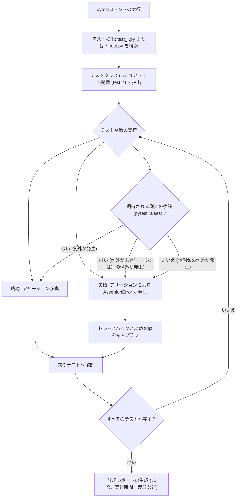

### 🎯 学習目標
- 自動テストの重要性と、なぜPythonの組み込みの `unittest` モジュールよりも `pytest` が広く好まれているのかを理解する。
- `pytest` コマンドラインインターフェースを使用してテストを実行し、テストの自動検出ルールを理解する。
- 標準的なテスト関数を作成し、Pythonの標準的な `assert` 文を使用して動作を検証する。
- `@pytest.mark.parametrize` を活用して、1つのテスト関数で複数の入力と出力をテストする。
- `pytest.raises` コンテキストマネージャを使用して、不正な入力に対して適切な例外が発生することを確認する。

### 🧩 中核概念（なぜ）
テストは、プロフェッショナルなソフトウェア開発において必要不可欠なプロセスです。自動テストは、アプリケーションが正しく動作することを確認し、コードの修正による予期せぬ不具合の再発（デグレード）を防ぎ、リファクタリングや機能拡張を行う際の安全網を提供します。

Pythonの標準ライブラリには `unittest` フレームワークが含まれていますが、現在ではオープンソースの **`pytest`** ライブラリが業界標準となっています。`pytest` が好まれる主な理由は以下の通りです。
1. **シンプルなアサーション**: `self.assertEqual(a, b)` や `self.assertRaises(ValueError)` のような専用のメソッドを覚える必要はなく、標準的なPythonの `assert a == b` を記述するだけで動作します。`pytest` は内部でこれらをインターセプトし、詳細な失敗情報を出力するように書き換えます。
2. **テストの自動検出**: テストを手動で登録する必要はありません。プロジェクトディレクトリで `pytest` コマンドを実行するだけで、ワークスペース内のテストファイルを自動的にスキャンして実行します。
3. **データ駆動のパラメータ化**: 成功パターン、境界値、エラー値などの複数のシナリオをテストする際、パラメータのリストをテスト関数に直接渡すことができるため、重複コードを削減しDRY（Don't Repeat Yourself）を保てます。
4. **コンテキストによる例外検証**: `with pytest.raises(...)` を使用して、無効な入力が渡されたときに期待されるエラーが正確に発生するかどうかを直感的にテストできます。

### 🔁 ロジックと動作

以下のフローチャートは、`pytest` がどのようにテストを検出し、アサーションを検証し、最終的な実行レポートを出力するかの流れを示しています。



`pytest` を実行すると以下のステップが自動で行われます。
1. 現在のディレクトリ以下のフォルダを再帰的にスキャンします。
2. `test_*.py` または `*_test.py` に一致するファイルをターゲットにします。
3. それらのファイル内から、`test_` で始まる関数、または `Test` で始まるクラス内のメソッドを収集します。
4. 各テスト関数を実行します。`AssertionError` またはキャッチされない例外が発生した場合、そのテストは「失敗」と判定され、詳細な比較（差分）が出力されます。例外が発生せずに終了すれば「成功」と判定されます。

### 📝 注釈付きサンプル

以下は、簡単な計算モジュール `calculator.py` と、対応するテストスイート `test_calculator.py` の例です。

**`calculator.py`**
```python
def add(a, b):
    return a + b

def divide_numbers(a, b):
    if b == 0:
        raise ValueError("Cannot divide by zero.")
    return a / b
```

**`test_calculator.py`**
```python
import pytest
from calculator import add, divide_numbers

# 1. 成功ケースを検証する標準的なユニットテスト
def test_addition_simple():
    # 標準的な Python の assert のみを使用します
    assert add(2, 3) == 5
    assert add(-1, 1) == 0

# 2. pytest.raises を使用したエラーパスのテスト
def test_divide_by_zero_raises_error():
    # divide_numbers の呼び出しで ValueError が発生することを確認します
    with pytest.raises(ValueError) as exc_info:
        divide_numbers(10, 0)
    
    # 発生したエラーメッセージの内容もアサートできます
    assert str(exc_info.value) == "Cannot divide by zero."

# 3. パラメータ化テストを使用して、重複コードなしで複数のパターンを検証
@pytest.mark.parametrize(
    "a, b, expected",
    [
        (6, 2, 3.0),
        (5, 2, 2.5),
        (-10, 2, -5.0),
        (0, 5, 0.0)
    ]
)
def test_divide_numbers_parameterized(a, b, expected):
    # この関数は、上のリストから a, b, expected を受け取りながら計4回実行されます
    assert divide_numbers(a, b) == expected
```

### ❌ よくある間違い

**間違い 1: テストファイル名やテスト関数名が命名規則に違反しており、テストが検出されない**
```python
# 間違い: ファイル名が run_tests.py で、関数名が test_ から始まっていない
def check_addition():
    assert add(2, 3) == 5
```
```text
collected 0 items

============================= no tests ran in 0.01s =============================
```
```python
# 正しい: ファイル名を test_calculator.py にし、関数名を test_ から始める
def test_addition():
    assert add(2, 3) == 5
```
> `pytest` は自動検出を行うために厳格な命名規則を採用しています。テストファイルは `test_*.py` または `*_test.py` である必要があり、テスト関数は `test_` で始まる必要があります。また、テストクラスは `Test*` で定義し、`__init__` コンストラクタを含めてはいけません。

**間違い 2: 例外をスローするコードを `pytest.raises` ブロックで囲んでいないため、テストがクラッシュする**
```python
# 間違い: 例外をスローする関数を直接呼び出してしまい、テスト全体が異常終了する
def test_divide_by_zero_crash():
    divide_numbers(5, 0)  # ValueError が発生し、テストが中断される
```
```text
calculator.py:6: in divide_numbers
    raise ValueError("Cannot divide by zero.")
E   ValueError: Cannot divide by zero.

=========================== FAILURES ===========================
___________________________ test_divide_by_zero_crash ___________________________
...
```
```python
# 正しい: pytest.raises コンテキストマネージャを使って例外の発生をアサートする
def test_divide_by_zero_handled():
    with pytest.raises(ValueError):
        divide_numbers(5, 0)
```
> 関数が発生させるはずの例外を `with pytest.raises(例外クラス):` で捕捉しない場合、Pythonはそれをキャッチされなかったエラーとして扱います。これによりテストの実行が途中で中断され、テスト結果は「失敗」となります。

### 💡 コツ・イディオム
- **特定のテストを実行する**: テストファイルパスの後に `::` とテスト関数名を指定して実行できます: `pytest test_calculator.py::test_addition_simple`。
- **名前の検索フィルタ**: 名前に特定の文字列が含まれるテストのみを実行するには、`-k` オプションを使用します: `pytest -k "divide"`。
- **変数の詳細なトレースバック**: アサーションが失敗すると、`pytest` はアサーション内の各変数がどのような値だったかを詳細に可視化します。手動で `print` デバッグを行う必要はありません。
- **最初の失敗で即時停止する**: テストが1つでも失敗した時点で実行を止めたい場合は、`-x` フラグを使用します。

### 🧠 深掘り（内部の仕組み）
<details><summary>Pytestの「アサーションの書き換え (Assertion Rewriting)」</summary>

通常のPythonの `assert` 文は、失敗した際に詳細な情報を保持しない `AssertionError` をスローするだけです。では、なぜ `pytest` は失敗時に変数の中身まで詳細に表示できるのでしょうか？

これは `pytest` が導入している **アサーションの書き換え (Assertion Rewriting)** という機能によるものです。`pytest` はテストコードを実行する前に、Pythonのインポートシステムにフック（Hook）をかけます。テストモジュールがロードされるタイミングで、ソースコードをパースして抽象構文木（AST: Abstract Syntax Tree）を作成します。

そして、テストコード内のすべての `assert` ノードを検出し、実行時に左辺と右辺の変数の値や式の評価結果を一時的にキャッシュして表示用メッセージを組み立てるような複雑なバイトコードへと動的に書き換えます。

例えば：
```python
assert x == y
```
という記述は、以下のような論理構造を持つバイトコードへとメモリ上で書き換えられます。
```python
if not (x == y):
    explanation = f"assert {x} == {y}"
    raise AssertionError(explanation)
```
このASTの操作はバックグラウンドで透過的に行われるため、開発者は単純なアサーションコードを書くだけで、非常に強力なエラーレポートの恩恵を受けられます。
</details>

### 🏋️ 演習
2つの引数を受け取り、`a / b` の結果を返す `divide(a, b)` 関数を実装してください。除数 `b` が `0` の場合は `ValueError` を発生させるようにしてください。

```python
import pytest

# a / b を返す divide(a, b) 関数を実装してください。b == 0 の場合は ValueError を発生させます。
```

### ✅ 自己チェック
1. `pytest` がテストを自動検出するために、ファイルや関数にどのような名前を付ける必要がありますか？
2. パラメータ化テスト（`@pytest.mark.parametrize`）を使用する最大のメリットは何ですか？
3. テスト対象の関数が意図通りに例外を発生させることを確認するには、どうすればよいですか？
<details><summary>自己チェックの解答</summary>

1. テストファイル名は `test_*.py` または `*_test.py` とし、テスト関数名は `test_` で始まる必要があります。
2. 同一のテストロジックに対して、複数の入力値と期待される出力値のパターンを、コードの重複なしで効率的にテストできる点です。
3. 例外が発生する処理を `with pytest.raises(例外クラス):` というコンテキストマネージャで囲んで実行します。
</details>

### 📌 まとめ
- **自動テストの重要性**: コードの正しさを保証し、リファクタリングを容易にし、意図せぬ不具合（デグレード）を防ぐために必須。
- **シンプルな assert 文**: 冗長なメソッド呼び出しを使わずに、通常のPythonの `assert` を記述するだけで十分な検証が可能。
- **テスト自動検出機能**: `test_*.py` や `*_test.py` などのファイル名、`test_` で始まる関数を自動的に収集して実行。
- **パラメータ化**: `@pytest.mark.parametrize` により、多様なテストケースを簡潔かつDRYに実装可能。
- **例外の検証**: `pytest.raises` を使用して、エラーハンドリングの処理が正しく動作するかを安全にテスト。
