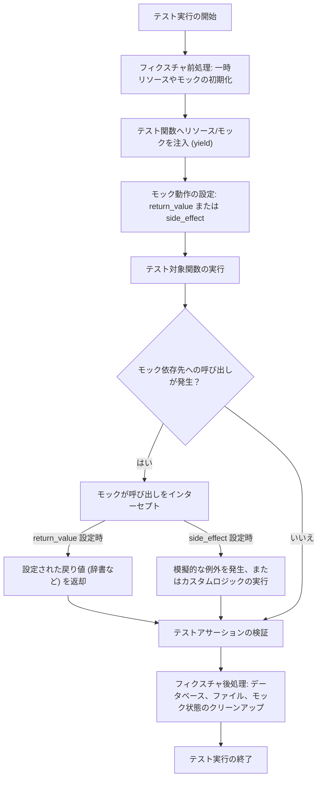

### 🎯 学習目標
- `yield` ステートメントを使用して、テストのセットアップ（前処理）とクリーンアップ（後処理）を処理する再利用可能な `pytest` フィクスチャを作成する。
- フィクスチャのスコープ（`function` や `module` など）を適切に管理し、テスト間の独立性を保ちながら実行速度を最適化する。
- `unittest.mock.MagicMock` を使用して、テスト対象のコンポーネントを外部のAPI呼び出しやサイドエフェクトから切り離す。
- モックオブジェクトの `return_value` と `side_effect` を設定し、正常系と異常系の実行パスを検証する。
- pytest の `monkeypatch` フィクスチャや `unittest.mock.patch` コンテキストマネージャを使用して、変数、環境変数、またはクラスの属性を動的に置換する。

### 🧩 中核概念（なぜ）
アプリケーションが成長するにつれ、単一のコードブロックが完全に孤立して実行されることは稀になります。多くの場合、データベースにアクセスしたり、ファイルを読み書きしたり、外部APIと通信したりします。テストの実行がこれらの外部環境（サイドエフェクト）に依存していると、ユニットテストの動作が遅くなり、複雑化し、不安定（非決定論的）になります。

これらの問題を解決するために、高度なテストでは次の2つの概念を使用します。
1. **フィクスチャ (Fixtures)**: テストが実行される前に、固定され予測可能なリソースの基準線（データベース接続、一時フォルダ、事前設定されたモックなど）を提供し、テスト後にそれらを確実にクリーンアップする仕組みです。前処理と後処理のロジックをアサーションから分離することで、テストコードの重複を排除しDRY原則を維持します。
2. **モック (Mocks)**: 実際の依存関係の動作を制御可能な方法で模倣した、模擬的なオブジェクトです。サードパーティの気象APIを呼び出すHTTPクライアントなどの遅延が発生する依存関係をモックに置き換えることで、特定のレスポンス（正常なJSONデータや、HTTPタイムアウトなどのエラー状態）に対するコードの挙動を即座にかつ安定してテストできます。

`unittest.mock.MagicMock` は `Mock` のサブクラスであり、Pythonのマジックメソッド（`len()` の呼び出し、`obj['key']` などのインデックスアクセス、`with` コンテキストマネージャなど）を自動的にサポートしているため、Pythonにおける依存関係のモック化のデファクトスタンダードとなっています。

### 🔁 ロジックと動作

以下のフローチャートは、`pytest` フィクスチャ（前処理と後処理）とモックの依存関係を組み合わせたテスト実行のライフサイクルを示しています。



フィクスチャとモックを用いたテストを実行する際、以下の流れで進行します。
1. `pytest` は、テスト関数の引数で要求されているフィクスチャを特定します。
2. フィクスチャ内のコードが `yield` ステートメントに到達するまで実行されます（前処理フェーズ）。
3. `yield` されたリソース（モックオブジェクトなど）がテスト関数にインジェクション（注入）されます。
4. テストは、モックが返すべき戻り値（`return_value`）または発生させるべき例外（`side_effect`）を設定します。
5. テスト対象の関数が実行され、実際の外部接続の代わりにモックを呼び出します。
6. テストが結果を検証（アサート）します。
7. テスト関数が終了すると、制御は再びフィクスチャに戻り、`yield` ステートメントの後のコードが実行され、リソースが解放されます（後処理フェーズ）。

### 📝 注釈付きサンプル

以下は、データベース接続とメール送信クライアントに依存する `UserProcessor` クラスを含む `service.py` と、フィクスチャ、モック、モンキーパッチの使い方を示すテストファイル `test_service.py` の例です。

**`service.py`**
```python
import os

class UserProcessor:
    def __init__(self, db_client, email_client):
        self.db = db_client
        self.email = email_client

    def process_user_registration(self, user_id, email_address):
        # 1. DB からユーザーがアクティブか確認する
        user = self.db.find_user(user_id)
        if not user or not user.get("active"):
            return "User Not Eligible"
        
        # 2. 環境変数から実行環境を取得する
        env = os.getenv("APP_ENV", "development")
        
        # 3. メールを送信し、ステータスを返す
        try:
            status = self.email.send(email_address, f"Welcome! Env: {env}")
            return "Success" if status else "Email Failed"
        except Exception:
            return "Notification System Error"
```

**`test_service.py`**
```python
import pytest
from unittest.mock import MagicMock, patch
from service import UserProcessor

# 1. 依存するモックオブジェクトを初期化するフィクスチャを定義
@pytest.fixture
def mock_dependencies():
    # 前処理フェーズ: データベースとメール送信のモックを作成
    db_mock = MagicMock()
    email_mock = MagicMock()
    
    # 辞書としてテスト関数にモックを注入
    yield {
        "db": db_mock,
        "email": email_mock
    }
    
    # 後処理フェーズ: テストごとにモックの状態をリセット
    db_mock.reset_mock()
    email_mock.reset_mock()

# 2. return_value を用いて正常な登録処理を検証するテスト
def test_registration_success(mock_dependencies):
    db = mock_dependencies["db"]
    email = mock_dependencies["email"]
    
    # 依存オブジェクトの戻り値を設定
    db.find_user.return_value = {"id": 101, "active": True}
    email.send.return_value = True
    
    processor = UserProcessor(db, email)
    result = processor.process_user_registration(101, "test@example.com")
    
    assert result == "Success"
    # 引数 101 を伴って find_user が1回呼び出されたことを確認
    db.find_user.assert_called_once_with(101)

# 3. side_effect を用いてメール送信で例外が発生した際の処理を検証するテスト
def test_registration_email_throws_exception(mock_dependencies):
    db = mock_dependencies["db"]
    email = mock_dependencies["email"]
    
    db.find_user.return_value = {"id": 101, "active": True}
    
    # メール送信時に例外を発生させるよう設定
    email.send.side_effect = Exception("SMTP server down")
    
    processor = UserProcessor(db, email)
    result = processor.process_user_registration(101, "test@example.com")
    
    assert result == "Notification System Error"

# 4. monkeypatch フィクスチャを使用して環境変数をモック化するテスト
def test_registration_with_monkeypatch(mock_dependencies, monkeypatch):
    db = mock_dependencies["db"]
    email = mock_dependencies["email"]
    
    db.find_user.return_value = {"id": 102, "active": True}
    email.send.return_value = True
    
    # このテストの間だけ、APP_ENV 環境変数を "production" に設定
    monkeypatch.setenv("APP_ENV", "production")
    
    processor = UserProcessor(db, email)
    processor.process_user_registration(102, "prod@example.com")
    
    # メール送信メソッドに渡された引数を検証
    email.send.assert_called_once_with("prod@example.com", "Welcome! Env: production")
```

### ❌ よくある間違い

**間違い 1: 可変な状態を持つフィクスチャに対してスコープを広く設定しすぎてテスト間で状態が漏洩する**
```python
# 間違い: モジュールスコープで定義され、テスト実行中にリストの状態が共有されてしまう
@pytest.fixture(scope="module")
def shared_list():
    yield []
```
```text
test_service.py:12: AssertionError: assert [1, 2] == [2]
```
```python
# 正しい: スコープをデフォルトの "function" にし、テストごとに空のリストを取得する
@pytest.fixture(scope="function")
def clean_list():
    yield []
```
> フィクスチャのスコープを `module` や `session` に設定すると、そのファイルやテストセッション全体で1度しか実行されません。もしあるテストがそのオブジェクトを書き換えた場合（リストへの要素追加やDBレコードの登録）、その後に実行される別のテストが汚染された状態を引き継ぐことになり、実行順序によって合否が変わる「不安定なテスト（Flaky tests）」の原因となります。

**間違い 2: 例外を発生させたいときに、side_effect ではなく return_value に例外オブジェクトをセットしてしまう**
```python
# 間違い: 例外クラスのインスタンスが戻り値として返されるだけで、スローはされない
mock_email.send.return_value = Exception("SMTP Connection Failed")
```
```text
E   AssertionError: assert 'Success' == 'Notification System Error'
E     - Success
E     + Notification System Error
```
```python
# 正しい: side_effect を使用して例外をスローさせるように設定する
mock_email.send.side_effect = Exception("SMTP Connection Failed")
```
> `return_value = Exception()` と指定すると、Pythonはそれを「例外オブジェクトが返された」ものとして処理します。呼び出し側の関数は例外オブジェクトを単なる通常の返り値（真値として評価される）として受け取るため、`try-except` ブロックでエラーをキャッチできません。モックに例外を発生させたい場合は、必ず `side_effect` を使用してください。

### 💡 コツ・イディオム
- **モック呼び出しの引数検証**: `mock_obj.assert_called_once()` や `mock_obj.assert_called_with(*args, **kwargs)` を使って、依存オブジェクトが想定通りの引数で呼び出されたかを厳格にテストできます。
- **仕様に基づいたモックの作成 (autospec)**: パッチを適用する際、`autospec=True` を設定すると、モック化された元のオブジェクトの実際のシグネチャを模倣します。これにより、元のオブジェクトに存在しない無効なメソッドを呼び出そうとした場合に即座にエラーになり、モックと実装の乖離を防ぎます。
- **名前空間への注意**: `unittest.mock.patch` を使用してインポートされたクラスをパッチする場合、定義元ではなく**インポートされた先（使用されている場所）**のパスを指定します。`service.py` 内で `from database import Client` とインポートされているなら、`patch('database.Client')` ではなく `patch('service.Client')` と指定します。

### 🧠 深掘り（内部の仕組み）
<details><summary>pytestのフィクスチャ依存関係解決の仕組み</summary>

Pytestは、テストを実行する前に、有向非巡回グラフ（DAG: Directed Acyclic Graph）アルゴリズムを使用してフィクスチャの依存関係を解析・解決します。

テスト関数がロードされると以下のステップが実行されます。
1. 関数のシグネチャを解析し、引数の名前（パラメータ名）を抽出します。
2. そのパラメータ名と一致する登録済みのフィクスチャを検索します。
3. もしフィクスチャ自体が他のフィクスチャに依存している場合（例：DBフィクスチャが設定ファイルフィクスチャに依存しているなど）、依存グラフを再帰的にビルドします。
4. 依存の循環（Fixture AがBに依存し、BがAに依存する状態）を検出した場合は、テストの実行を即座に中止し、`FixtureLookupError` を発生させます。
5. 解析された有向グラフに従って、フィクスチャを順次実行します。各フィクスチャにおいて：
   - `yield` ステートメントの前の処理を実行します。
   - 生成された（yieldされた）値をメモリにキャッシュします。
   - そのキャッシュした値を次の依存フィクスチャ、またはテスト関数に渡します。
6. テストが終了（または失敗）すると、pytestは実行パスを逆順にたどります。`yield` を行った各フィクスチャに対して、`yield` ステートメントより後ろのクリーンアップ処理を初期化とは逆の順序で安全に実行します。
</details>

### 🏋️ 演習
`api_client.get()` を呼び出し、レスポンスの JSON 辞書から `"data"` フィールドを取得して返す `fetch_data(api_client)` 関数を実装してください。もし `api_client.get()` が例外を発生させた場合は、例外をキャッチして `"fallback"` という文字列を返却してください。

```python
from unittest.mock import MagicMock

# api_client.get() を呼び出し、レスポンスの JSON から "data" フィールドを返す fetch_data(api_client) を作成してください。
# 例外が発生した場合は "fallback" を返します。
```

### ✅ 自己チェック
1. フィクスチャで `yield` を使用した場合、前処理と後処理はどのように実行されますか？
2. モックを設定する際、`return_value` と `side_effect` の違いは何ですか？
3. 可変な状態を持つフィクスチャに対して `module` スコープを適用すると、どのような問題が発生しますか？
<details><summary>自己チェックの解答</summary>

1. `yield` キーワードより前の文は前処理としてテスト前に実行され、`yield` で返された値がテストに渡されます。テストの完了後、`yield` より後の文が後処理として実行されます。
2. `return_value` はモックが呼び出された際に返される静的な値です。`side_effect` は呼び出された際に例外を発生させたり、呼び出しごとに異なる値を順次返したり、カスタム関数を実行したりするためのものです。
3. フィクスチャがモジュール内のすべてのテストで1度しか生成・共有されないため、テストでデータが変更されると以降のテストに影響し、実行順によって失敗する不安定なテストになります。
</details>

### 📌 まとめ
- **フィクスチャによる状態管理**: 前処理と後処理をアサーションから分離し、テストコードをシンプルでDRYに保つ。
- **フィクスチャスコープの役割**: `function` から `session` までの適切なライフサイクル管理により、実行速度向上とデータ分離を両立。
- **モックによる依存関係の分離**: 外部接続（API、DB、ファイル）を模擬オブジェクトに置き換え、テストを高速かつ安定して動かす。
- **MagicMock**: 特殊メソッドを含むPythonのインターフェースを柔軟に模倣するモックの主要ツール。
- **Monkeypatch / Patch**: 既存のモジュールや環境を動的にモック化し、製品コードに変更を加えることなくテストシナリオを制御。
