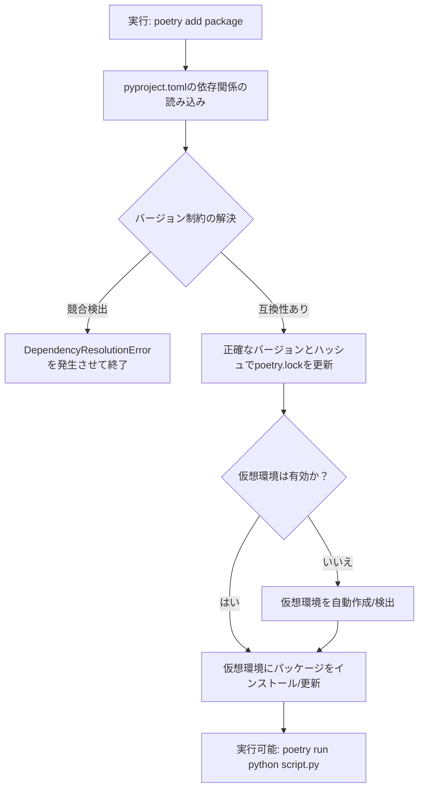

### 🎯 学習目標
- グローバル環境への pip インストールや生の `requirements.txt` を使用することの構造的な限界を説明できる。
- 仮想環境がどのようにプロジェクトの依存関係を隔離し、環境汚染を防ぐかを説明できる。
- `pyproject.toml` メタデータファイルを記述・設定し、パッケージの範囲を管理できる。
- Poetry のコマンド（`init`、`add`、`install`、`run`、`build`）を適用してプロジェクトのライフサイクルを管理できる。
- 依存関係グループ（`main` と `dev`）を管理し、本番環境とローカル開発環境を区別できる。
- `poetry.lock` のロック機構と、それがどのように複数マシン間での再現可能なビルドを保証するかを説明できる。

### 🧩 中核概念（なぜ）
現代のソフトウェア開発において、アプリケーションはサードパーティのライブラリに依存します。これらのライブラリを効果的に管理することは、プロジェクトの安定性と開発者の生産性にとって不可欠です。

#### 1. Pip の限界とグローバル環境
デフォルトでは、Python のパッケージマネージャーである `pip` はパッケージをグローバルまたはユーザー空間にインストールします。もし 2 つのプロジェクトが同じパッケージの異なるバージョンを必要とする場合（例：プロジェクト A が `Django==3.2` を、プロジェクト B が `Django==4.2` を必要とする場合）、それらは同じ環境に共存できません。一方をインストールすると、もう一方が上書きされてしまいます。

これを解決するために、歴史的には `requirements.txt` と手動の仮想環境が使用されてきました。しかし、`requirements.txt` には深刻な問題があります。
- **ロックファイルがない**: 最上位の依存関係はリストされますが、推移的依存関係（依存関係の依存関係）はロックされません。サブ依存関係に破壊的なアップデートがあると、ビルドが突然失敗します。
- **フラットな名前空間**: 意図的に選択したパッケージと、サブ依存関係として自動的にインストールされたパッケージが混在します。
- **整合性の検証がない**: パッケージのハッシュ値が記録されないため、ソースの改ざんに対して脆弱です。

#### 2. 仮想環境
仮想環境とは、特定のバージョンの Python インストールと追加のパッケージ群を含む、自己完結したディレクトリツリーのことです。これにより、プロジェクトの依存関係が他のプロジェクトやシステム全体の Python から隔離されます。

#### 3. Poetry が解決すること
Poetry は、Python における最新の依存関係管理およびパッケージングツールです。`pip`、`virtualenv`、`setup.py`、`requirements.txt` を統一されたワークフローに置き換えます。
- **決定論的な解決**: 高度な競合ソルバーを使用して、すべての依存関係に互換性のあるバージョンを見つけ出します。
- **厳密なロック**: すべてのパッケージの正確なバージョンと暗号ハッシュを含む `poetry.lock` ファイルを生成します。
- **単一の真実のソース**: すべての設定、メタデータ、依存関係、ビルドスクリプトは、`pyproject.toml` という標準ファイルに保存されます。

### 🔁 ロジックと動作

以下のフローチャートは、Poetry を使用して依存関係を追加する際のワークフローと、環境がどのように管理されるかを示しています。



Poetry を使用する場合：
1. コマンド（`poetry add fastapi` など）を実行します。
2. Poetry は `pyproject.toml` からバージョン要件を解析し、すべての依存関係にわたって競合がないかチェックします。
3. 有効な場合、Poetry はファイルをダウンロードし、そのハッシュ値を計算して、詳細を `poetry.lock` に保存します。
4. 仮想環境が存在するかチェックします。存在しない場合、Poetry はキャッシュディレクトリ（または設定されている場合はプロジェクトフォルダ）に仮想環境を自動的に作成します。
5. ロックファイルに記録された正確なバージョンを仮想環境にインストールします。

### 📝 注釈付きサンプル

#### 1. 標準的な `pyproject.toml` の構成
以下は、現代的な Poetry 設定ファイルの注釈付きの例です。

```toml
[tool.poetry]
name = "my-awesome-app"
version = "0.1.0"
description = "依存関係管理を備えたFastAPIアプリケーション"
authors = ["Your Name <you@example.com>"]
readme = "README.md"
packages = [{include = "my_awesome_app"}] # 配布するパッケージを定義します

[tool.poetry.dependencies]
python = "^3.10" # Pythonバージョン >= 3.10 かつ < 4.0 を要求
fastapi = "^0.100.0" # FastAPI >=0.100.0 かつ <0.101.0 をインストール (セマンティックバージョニング)
uvicorn = {extras = ["standard"], version = "^0.22.0"} # オプション機能付きの依存関係

[tool.poetry.group.dev.dependencies]
# 開発またはテスト中のみ必要な依存関係
pytest = "^7.4.0"
black = "^23.7.0"
httpx = "^0.24.1"

[build-system]
# PEP 517ビルドバックエンドを宣言（Pythonがパッケージをインストールする方法）
requires = ["poetry-core"]
build-backend = "poetry.core.masonry.api"
```

#### 2. 必須コマンドの解説

新しいプロジェクト構造を作成する：
```bash
poetry new my-project
```

既存のプロジェクト内で Poetry を初期化する：
```bash
poetry init
```
*インタラクティブなプロンプトが起動し、`pyproject.toml` の作成をガイドします。*

本番用依存関係を追加する：
```bash
poetry add requests
```

開発用の依存関係を追加する：
```bash
poetry add pytest --group dev
```

仮想環境を手動で有効化せずに、環境のコンテキスト内でスクリプトを実行する：
```bash
poetry run python main.py
```

仮想環境内に手動でシェルを起動する：
```bash
poetry shell
```

`poetry.lock` に宣言されたすべての依存関係をインストールする（クローン直後に最適）：
```bash
poetry install
```

プロジェクトを配布可能なホイール（wheel）およびソースアーカイブにパッケージ化する：
```bash
poetry build
```

### ❌ よくある間違い

**間違い 1: 配布可能な Poetry パッケージ内で、`__file__` を使った相対パスでパッケージリソースを読み込もうとする**
```python
# my_package/reader.py
import os
def read_config():
    # 一部の環境でのホイールインストールやzipインポート時に失敗する
    config_path = os.path.join(os.path.dirname(__file__), "data/config.json")
    with open(config_path, "r") as f:
        return f.read()
```
```text
Traceback (most recent call last):
  File "reader.py", line 5, in read_config
FileNotFoundError: [Errno 2] No such file or directory: '/usr/local/lib/python3.10/site-packages/my_package/data/config.json'
```
```python
# my_package/reader.py
from importlib import resources
def read_config():
    # すべての配布形式にわたってパッケージのリソースファイルに正しくアクセスする
    return resources.files("my_package").joinpath("data/config.json").read_text()
```
> `__file__` のようなファイルシステムパスを使用すると、パッケージがディスク上に解凍されたディレクトリとしてインストールされていることを前提としてしまいます。パッケージがホイールや zip 形式にコンパイルされたり、特定のサンドボックスで実行されたりすると、直接のファイルシステムアクセスは失敗します。`importlib.resources` ライブラリは、パッケージのデータファイルを安全に読み込むための最新の Python 標準手法です。

**間違い 2: テスト実行時に local パッケージファイルをインポートするため、手動で `sys.path.append` ハックを使用する**
```python
# tests/test_core.py
import sys
import os
# ローカルのソースコードをインポートするためのハック
sys.path.append(os.path.abspath("../src"))
import my_package
```
```text
Traceback (most recent call last):
  File "test_core.py", line 5, in <module>
    import my_package
ModuleNotFoundError: No module named 'my_package'
```
```python
# tests/test_core.py
# sys.path ハックは不要です。エディタブルモードでインストールするために `poetry install` を実行します。
import my_package
```
> `sys.path.append` ハックをハードコーディングすると、コードベースが脆弱になり、環境依存になります。Poetry は、パッケージをエディタブルモード（`poetry install`）でインストールすることでこれを解決し、開発やテスト中であっても、どのディレクトリからでもパッケージやモジュールをシームレスにインポートできるようにします。

### 💡 コツ・イディオム
- **プロジェクト内仮想環境（In-Project venv）**: 仮想環境を中央のキャッシュディレクトリではなく、プロジェクトディレクトリ内の `.venv` に作成するよう Poetry に設定します。これにより、VS Code などの IDE がインタープリターを自動検出しやすくなります。
  ```bash
  poetry config virtualenvs.in-project true
  ```
- **ロックファイルをコミットする**: `poetry.lock` は常に Git にコミットしてください。これにより、開発チーム、CI/CD ランナー、およびデプロイサーバーが完全に同一の依存関係ツリーをインストールすることを保証できます。
- **依存関係の書き出し**: Poetry を直接サポートしていないプラットフォーム（古い Elastic Beanstalk など）用に `requirements.txt` を生成する必要がある場合は、以下のように出力します。
  ```bash
  poetry export -f requirements.txt --output requirements.txt
  ```

### 🧠 深掘り（内部の仕組み）
<details><summary>PoetryのPubGrubアルゴリズムがどのように依存関係のバージョンを解決するか</summary>

Poetry は、依存関係の解決に **PubGrub** アルゴリズムのバリアントを使用しています。パッケージを再帰的に検索して最初のミスマッチで失敗する単純なリゾルバーとは異なり、PubGrub は**バックトラックのない探索**と**導出（derivation）による競合解決**の概念に基づいて動作します。

パッケージの要求時：
1. **制約のコンパイル**: Poetry は `pyproject.toml` から制約を読み取り、PyPI などのリポジトリに問い合わせてパッケージ、バージョン、およびその依存関係のグラフを取得します。
2. **意思決定**: パッケージを選択し、互換性のある最新のバージョンを選択して、その依存関係をキューに追加します。
3. **競合の検出**: 矛盾（例：パッケージ A は `urllib3 >= 2.0` を必要とし、パッケージ B は `urllib3 < 2.0` を必要とする）が発生した場合、PubGrub は単にエラーを投げるだけではありません。
4. **導出**: 競合を引き起こした選択の連鎖をトレースします。現在の意思決定セットが無効である理由を示す論理的証明（原因）を「導出」します。
5. **バックトラッキング**: その原因に関連する決定のみをロールバックし、競合原因を新しい制約として登録します。これにより、ソルバーが同じ行き止まりを再評価するのを防ぎ、解決速度を劇的に向上させ、解決に失敗した場合には非常にわかりやすく実用的なエラーメッセージを提供します。
</details>

### 🏋️ 演習
`pyproject.toml` の設定テキストをパースする関数 `validate_poetry_config(config_text)` を作成してください。依存関係セクション `[tool.poetry.dependencies]` が存在し、`python` バージョンが宣言されている場合は `True` を返し、それ以外の場合は `False` を返します。

```python
# pyproject.toml の設定テキストをチェックするパーサーを記述してください。
# [tool.poetry.dependencies] が存在し、"python" のバージョン宣言が含まれている場合は True を返します。
def validate_poetry_config(config_text):
    pass
```

### ✅ 自己チェック
1. なぜ `poetry.lock` を常にバージョン管理（Git）にコミットすべきなのでしょうか？
2. 仮想環境を有効にするための `poetry shell` を実行せずに、仮想環境内でコマンドを実行できるコマンドは何ですか？
3. `pyproject.toml` 内でパッケージを開発専用の依存関係として宣言するにはどうすればよいですか？
<details><summary>自己チェックの解答</summary>

1. `poetry.lock` をコミットすることで、すべての開発者、テストスイート、および本番環境が全く同じパッケージをインストールすることを保証し、バージョンの乖離や予期しないサブ依存関係の更新から保護できます。
2. `poetry run <command>` 構文（例：`poetry run python main.py` または `poetry run pytest`）を使用できます。
3. `[tool.poetry.group.dev.dependencies]` セクションの下に追加するか、CLI で `poetry add <package> --group dev` コマンドを実行します。
</details>

### 📌 まとめ
- **Pip の限界**: グローバルインストールはバージョンの競合を引き起こし、`requirements.txt` はサブ依存関係をロックできません。
- **Poetry**: パッケージのメタデータ、環境隔離、パブリッシングを統合した、包括的なパッケージおよび依存関係管理ツール。
- **pyproject.toml**: メタデータと依存関係を含む、PEP 518/621 で定義された単一の設定ファイル形式。
- **poetry.lock**: 依存関係グラフを暗号学的にロックし、異なる環境間での再現可能なビルドを保証。
- **コマンドの基本**: `poetry init` でプロジェクトを設定し、`poetry add` で依存関係を追加、`poetry install` で復元、`poetry run` で仮想環境のコンテキスト内でコードを実行。
