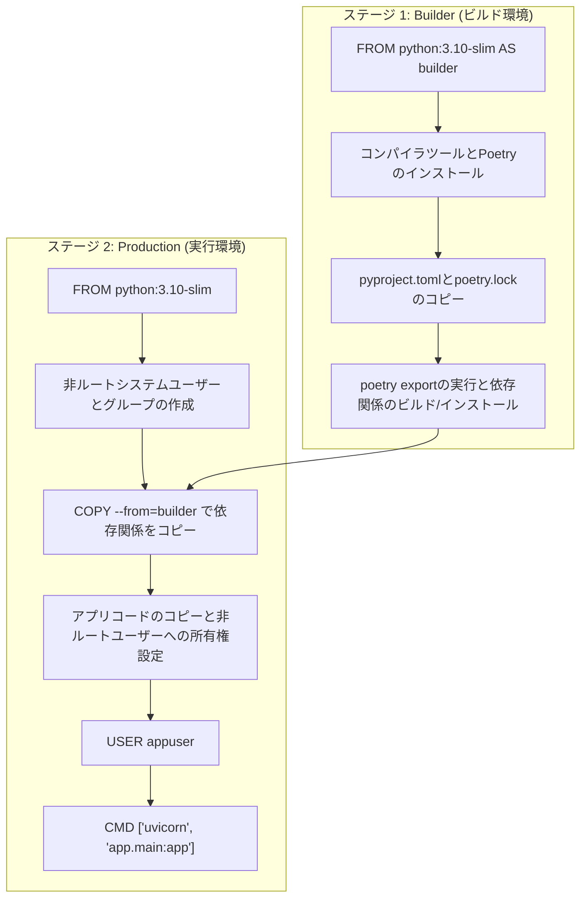

### 🎯 学習目標
- 仮想マシンとコンテナの構造的な違いを説明できる。
- プロジェクトのニーズに基づいて、適切な Python ベースイメージ（default、slim、alpine）を評価・選択できる。
- Python Web サービス向けに、安全で本番環境品質の `Dockerfile` スクリプトを作成できる。
- マルチステージビルドを活用してイメージサイズを最適化し、本番環境のセキュリティ脆弱性を低減できる。
- `USER` 命令を使用して、非ルート（non-root）コンテキスト下でコンテナを安全に実行するように設定できる。
- `docker-compose.yml` を使用して、マルチコンテナアーキテクチャ（Python Web アプリ ＋ データベース）を調整・構築できる。

### 🧩 中核概念（なぜ）
ソフトウェアシステムが複雑になるにつれ、「自分のマシンでは動く」という問題が開発の大きなボトルネックになります。OS、システムライブラリ、ローカル設定の違いが、予期しないバグを引き起こします。コンテナ化は、アプリケーションと必要なすべての依存関係を標準化されたユニットにパッケージ化することで、この問題を解決します。

#### 1. コンテナと仮想マシンの比較
- **仮想マシン (VM)**: アプリケーション、必要なバイナリ、そして**ゲストオペレーティングシステム全体**をパッケージ化します。物理ハードウェアをエミュレートするハイパーバイザーの上で実行されます。そのため、VM は重く（数ギガバイト）、起動が遅く（数分）、CPU やメモリのオーバーヘッドが大きくなります。
- **コンテナ**: ホストオペレーティングシステムのカーネルを共有します。Linux カーネルの機能である**名前空間 (namespaces)**（プロセスツリー、ネットワークアダプター、マウントポイントなどを隔離する）と**コントロールグループ (cgroups)**（CPU やメモリなどのリソースを制限する）を使用します。コンテナは非常に軽量で（数メガバイト）、ほぼ瞬時に起動し（数秒）、パフォーマンスのオーバーヘッドがほぼゼロです。

#### 2. ベースイメージの選択戦略
Python の `Dockerfile` を作成する際、ベースイメージの選択がパフォーマンス、サイズ、コンパイルの互換性を左右します。
- `python:3.10`: Debian ベース。GCC などのビルドツールやコンパイラ、開発用ヘッダー一式が含まれています。サイズが大きく（約 900MB）、デプロイに時間がかかります。
- `python:3.10-slim`: Debian ベースですが、不要な開発用パッケージやビルドツールが削除されています。軽量（約 120MB）であり、動的な C コンパイルを必要としない本番アプリケーションに強く推奨されます。
- `python:3.10-alpine`: Alpine Linux ベース。非常に小さく（約 50MB）、GNU C ライブラリ (`glibc`) の代わりに `musl libc` を使用します。魅力的に見えますが、Alpine は C 拡張を含むパッケージ（`numpy`、`pandas`、`cryptography` など）のインストールを極めて遅くする可能性があります。これは、事前ビルドされた Python ホイールが通常 `glibc` 向けにビルドされているためです。Alpine ではこれらのパッケージをソースからコンパイルする必要があり、結局のところ重いコンパイラツールのインストールが必要になります。

#### 3. マルチステージビルド
標準的なビルドでは、依存関係を取得・構築するためにコンパイラ（GCC など）やパッケージマネージャー（Poetry など）が必要です。これらのビルドツールを最終イメージに残しておくと、イメージサイズが肥大化し、本番環境がセキュリティ脅威にさらされます（コンテナが侵害された場合、コンパイラがあると攻撃者がエクスプロイトを実行しやすくなります）。

**マルチステージビルド**は、単一の `Dockerfile` 内で複数の `FROM` 命令を使用します。最初のステージ（「builder」）でアプリケーションをコンパイルし、ビルドされた成果物（ホイール、ライブラリ、サイトパッケージ）**のみ**を 2 番目のステージ（「runner」）にコピーします。コンパイラツールは残されないため、小さく極めて安全な本番用イメージが作成されます。

#### 4. 非ルート実行（Non-Root Execution）
デフォルトでは、Docker コンテナのプロセスは `root` ユーザー（管理者）として実行されます。もし攻撃者がアプリケーションのリモートコード実行の脆弱性を悪用した場合、コンテナ内で root 権限を取得することになり、コンテナから脱出してホストシステムを侵害する危険性が高まります。非特権ユーザーの `USER` を宣言することで、攻撃を受けた場合の被害範囲を制限できます。

### 🔁 ロジックと動作

以下のフローチャートは、開発用/コンパイラツールを本番用の実行環境から分離する、マルチステージ Docker ビルドのプロセスを示しています。



マルチステージビルドの流れ：
1. Docker はステージ 1 を開始し、ビルド用依存関係（コンパイラやパッケージマネージャーなど）をインストールします。
2. 依存関係がローカルフォルダ（Python の site-packages など）にコンパイルまたはビルドされます。
3. Docker は、新しくクリーンなベースイメージを使用してステージ 2 を開始します。
4. ステージ 2 の内部で、非ルートのシステムユーザーとグループが作成されます。
5. コンパイル済みの依存関係（依存関係のみ）が、ステージ 1 からステージ 2 にコピーされます。
6. アプリケーションのソースコードがコピーされ、ディレクトリの所有権が変更され、ユーザーコンテキストが非ルートユーザーに切り替わります。
7. 安全で軽量なコンテナが実行されます。

### 📝 注釈付きサンプル

#### 1. Poetry を使用した安全なマルチステージ `Dockerfile`
以下は、マルチステージパターンと非ルート実行を実装した本番環境対応の `Dockerfile` です。

```dockerfile
# --- ステージ 1: 依存関係の構築とコンパイル ---
FROM python:3.10-slim AS builder

WORKDIR /app

# C拡張モジュールのコンパイルに必要なビルド依存関係のインストール
RUN apt-get update && apt-get install -y --no-install-recommends \
    build-essential \
    && rm -rf /var/lib/apt/lists/*

# 依存関係管理のために Poetry をインストール
RUN pip install --no-cache-dir poetry

COPY pyproject.toml poetry.lock ./

# 標準の requirements.txt にエクスポートし、ユーザー空間に依存関係をインストール
RUN poetry export --without-hashes -f requirements.txt --output requirements.txt \
    && pip install --no-cache-dir --user -r requirements.txt

# --- ステージ 2: 最終的な軽量実行イメージ ---
FROM python:3.10-slim AS runner

WORKDIR /app

# アプリケーションを安全に実行するためのシステムグループとユーザーの作成
RUN groupadd -r appgroup && useradd -r -g appgroup -d /home/appuser -m appuser

# builder ステージから事前コンパイルされたユーザーパッケージのみをコピー
COPY --from=builder /root/.local /home/appuser/.local
COPY . .

# 非ルートユーザーがファイルを読み取れるようにフォルダの所有権を調整
RUN chown -R appuser:appgroup /app

# ローカルパッケージを PATH 環境変数に追加
ENV PATH=/home/appuser/.local/bin:$PATH
ENV PYTHONUNBUFFERED=1

# セキュリティコンテキストを非ルートユーザーに切り替え
USER appuser

EXPOSE 8080

CMD ["uvicorn", "main:app", "--host", "0.0.0.0", "--port", "8080"]
```

#### 2. `docker-compose.yml` によるオーケストレーション
以下は、Web アプリケーションを分離されたブリッジネットワーク上の PostgreSQL データベースにマッピングする `docker-compose.yml` 設定です。

```yaml
version: '3.8'

services:
  web:
    build: 
      context: .
      dockerfile: Dockerfile
    ports:
      - "8080:8080" # ホストマシンのポート 8080 をコンテナのポート 8080 にマッピング
    environment:
      - DB_HOST=db # Dockerの内部DNSを使用してPostgreSQLコンテナに接続
      - DB_PORT=5432
      - DB_USER=postgres
      - DB_PASSWORD=secret
    depends_on:
      - db # webコンテナの開始前にdbコンテナが起動していることを保証

  db:
    image: postgres:15-alpine
    environment:
      - POSTGRES_DB=mydb
      - POSTGRES_USER=postgres
      - POSTGRES_PASSWORD=secret
    volumes:
      - pgdata:/var/lib/postgresql/data # データベースのレコードをホストマシン上に永続化

volumes:
  pgdata: # コンテナのライフサイクルを超えてデータを保護するための永続ボリュームを宣言
```

### ❌ よくある間違い

**間違い 1: Docker コンテナ内で非ルートユーザーとして Web サーバーをポート 80 で起動しようとする**
```python
# app.py
# Dockerfile で非ルート USER として実行している場合
from http.server import HTTPServer, SimpleHTTPRequestHandler
server = HTTPServer(("0.0.0.0", 80), SimpleHTTPRequestHandler)
server.serve_forever()
```
```text
Traceback (most recent call last):
  File "app.py", line 4, in <module>
    server = HTTPServer(("0.0.0.0", 80), SimpleHTTPRequestHandler)
PermissionError: [Errno 13] Permission denied
```
```python
# app.py
# 非特権ポート (8080) で非ルート USER として実行する
from http.server import HTTPServer, SimpleHTTPRequestHandler
server = HTTPServer(("0.0.0.0", 8080), SimpleHTTPRequestHandler)
server.serve_forever()
```
> Linux では、1024 未満のポート（特権ポート）へのバインドには root 権限が必要です。セキュリティのベストプラクティスに従って非ルートユーザー（例：`USER appuser`）でコンテナを実行する場合、アプリケーションは 8080 などの非特権ポートにバインドし、ホスト側でポート 80 にマッピングする必要があります。

**間違い 2: コンテナ内のデータベース接続にローカルループバック IP `127.0.0.1` をハードコーディングする**
```python
# db.py
import psycopg2
# ローカルループバックIPをハードコーディングすると、ホストデータベースではなくコンテナ自体を指してしまう
conn = psycopg2.connect(host="127.0.0.1", database="mydb", user="postgres")
```
```text
Traceback (most recent call last):
  File "db.py", line 4, in <module>
    conn = psycopg2.connect(host="127.0.0.1", ...)
psycopg2.OperationalError: connection to server at "127.0.0.1", port 5432 failed: Connection refused
```
```python
# db.py
import os
import psycopg2
# 環境変数または docker-compose のサービス名からデータベースホスト名をロードする
db_host = os.getenv("DB_HOST", "db")
conn = psycopg2.connect(host=db_host, database="mydb", user="postgres")
```
> コンテナの内部において、`127.0.0.1` はホストマシンや他のデータベースコンテナではなく、そのコンテナ自体を指します。Docker ブリッジネットワーク内では、コンテナ同士は Docker の内蔵 DNS によって解決されるサービス名（例：`db`）を使用するか、環境変数経由で正しいホストアドレスを取得して接続する必要があります。

### 💡 コツ・イディオム
- **Docker キャッシュレイヤーの最適化**: Docker はイメージビルドのレイヤーをキャッシュします。変更頻度が「最も低い」命令から「最も高い」命令の順に記述します。
  - *非推奨*: 依存関係をインストールする前にソースコードをコピーする（`COPY . .`）。ソースコードを変更するたびにキャッシュが無効化され、依存関係の再インストールが強制されます。
  - *推奨*: 依存関係リストをコピーしてパッケージをインストールし、その後にソースコードをコピーします。
- **`.dockerignore` の使用**: プロジェクトのルートに `.dockerignore` ファイルを作成し、大容量ファイルや機密ファイル（`.venv/`、`.git/`、`__pycache__/`、`.env` など）が Docker ビルドコンテキストに送信されるのを防ぎます。
- **ベースイメージのバージョン固定**: 本番コンテナの構築に `FROM python:latest` や `FROM python:3.10` を使用しないでください。マイナーバージョンの変更で構成が壊れる可能性があります。常に具体的なバージョン（例：`FROM python:3.10.12-slim`）を固定します。

### 🧠 深掘り（内部の仕組み）
<details><summary>Linux の名前空間（Namespaces）とコントロールグループ（Cgroups）がコンテナを隔離する方法</summary>

物理ハードウェアをシミュレートするためにハイパーバイザーに依存する仮想マシンとは異なり、Docker コンテナはホスト Linux カーネル上でネイティブに実行されます。この隔離は、主に 2 つのカーネル機能によってオペレーティングシステムレベルで実現されます。

#### 1. Linux 名前空間 (名前空間によるリソース仮想化)
名前空間は、グローバルシステムリソースを抽象化でラップし、名前空間内のプロセスに対して、隔離されたリソースの独自インスタンスを持っているように見せかけます。
- **PID 名前空間**: プロセス ID 番号を隔離します。コンテナ内で実行されているアプリケーションは自身をプロセス ID 1（PID 1）と認識しますが、ホストマシン上では通常の高い番号のプロセス（例：PID 48210）として見えます。
- **NET 名前空間**: ネットワークコントローラー、ルーティングテーブル、ポートを隔離します。各コンテナは独自の仮想ループバックインターフェースと IP アドレスを取得します。
- **MNT 名前空間**: ファイルシステムのマウントポイントを隔離します。コンテナは自身のファイルシステムマウントのみを表示し、ホストのルートシステムからは遮断されます。
- **UTS 名前空間**: ホスト名と NIS ドメイン名を隔離します。
- **IPC 名前空間**: プロセス間通信リソースを隔離します。
- **USER 名前空間**: ユーザー ID をマッピングします。コンテナ内のユーザー ID 0（root）をホスト上の非特権ユーザー ID にマッピングできるため、万が一コンテナから脱出されてもホストの root 権限取得を防ぐことができます。

#### 2. コントロールグループ / Cgroups (リソース制限)
名前空間がコンテナ間の「相互の視認」を防ぐのに対し、**cgroups** はコンテナによるホストリソースの「枯渇」を防ぎます。ハードウェアリソースの消費を割り当てて監視します。
- 最大メモリ割り当て量を制限します（メモリリークを起こしたコンテナを、ホストの OOM (Out-Of-Memory) キラーが作動する前に停止させます）。
- CPU コアの使用率と実行サイクルを制限します。
- ディスク I/O の読み取り/書き込み速度を制限します。
- コンテナごとのネットワークトラフィックを測定・監査します。
</details>

### 🏋️ 演習
Dockerfile 文字列をパースするバリデーションスクリプトを記述してください。セキュリティのため、Dockerfile に非ルートユーザーとして実行する `USER` 命令があることを確認します。`USER` 命令が含まれている場合は `True` を返し、そうでない場合は `False` を返します。

```python
# Dockerfile文字列をパースするバリデーションスクリプトを記述してください。
# セキュリティのため、Dockerfileに非ルートユーザーとして実行するUSER命令があることを確認します。
def validate_dockerfile(dockerfile_text):
    pass
```

### ✅ 自己チェック
1. Dockerfile で `USER appuser` のように非ルートユーザーを指定している場合、コンテナ内の Web サーバーをポート 80 で起動しようとすると失敗するのはなぜですか？
2. `python:3.10-slim` イメージと比較して、`python:3.10-alpine` イメージを使用するメリットとデメリットは何ですか？
3. `__pycache__` や `.git` などのローカル開発フォルダがビルド中に Docker デーモンに送信されるのを防ぐにはどうすればよいですか？
<details><summary>自己チェックの解答</summary>

1. Linux ベースの OS では、1024 未満の特権ポートにバインドできるのは root ユーザーのみです。非ルートユーザーで実行する場合は、非特権ポート（例：8080）にバインドし、Docker 経由でホストのポート 80 にマッピングする必要があります。
2. `alpine` はサイズが小さい（50MB vs 120MB）ですが、`musl libc` を使用しています。Cコンパイルが必要なパッケージ（`numpy` や `cryptography` など）は、事前ビルドされたホイールを利用できず、ソースからコンパイルする必要があるため、ビルドに時間がかかり、コンパイラツールのインストールが必要になります。`slim` は互換性が高く、インストールが迅速です。
3. `Dockerfile` と同じディレクトリに `.dockerignore` ファイルを作成し、それらのディレクトリを記述します。
</details>

### 📌 まとめ
- **コンテナ**: VM とは異なり、ホスト OS カーネルを共有し、名前空間と cgroups を用いて軽量な隔離を実現します。
- **ベースイメージ**: サイズの面で `slim` を優先し、C 拡張ホイールとの互換性を考慮して `alpine` の使用を慎重に判断します。
- **マルチステージビルド**: ビルドステージで依存関係を構築し、必要な成果物のみを実行ステージにコピーすることで、サイズとセキュリティを最適化します。
- **非ルート USER**: コンテナ内のプロセスを非管理ユーザーで実行し、コンテナ侵害時のホストへの影響を制限します。
- **Docker Compose**: 単一の YAML ファイルでアプリケーション、ネットワーク、データベースを宣言し、マルチコンテナ構築を簡素化します。
