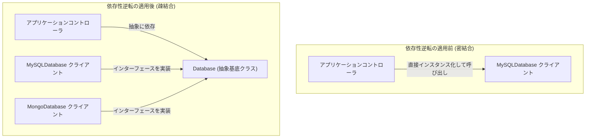

### 🎯 学習目標
- SOLIDと呼ばれる5つのソフトウェア設計原則を定義し、コードベースの保守性に与える影響を説明できる。
- 単一責任の原則（SRP）を適用して、巨大なクラスを凝集度の高い小さな単位に分割できる。
- Pythonの抽象基底クラス（ABC）を使用して、拡張に対して開かれ、修正に対して閉じられたシステム（OCP）を設計できる。
- クラス階層をリスコフの置換原則（LSP）に照らし合わせて検証し、実行時の型エラーを防止できる。
- 多重継承を利用して、肥大化したインターフェースをクライアント固有の細分化された契約（ISP）に分離できる。
- 依存性逆転の原則（DIP）を適用し、密結合なシステムを抽象に依存する疎結合なアーキテクチャに再構築できる。

### 🧩 中核概念（なぜ）
「ただ動作するコード」を書くことは、開発の第一歩にすぎません。システムが成長するにつれて、ソフトウェアは読みやすく、保守しやすく、変更に適応できる必要があります。構造化された設計ガイドラインがないと、コードベースは**硬直性**（変更しにくい）、**脆弱性**（変更によって無関係な部分が壊れる）、**不動性**（再利用しにくい）といった問題に直面します。

**SOLID**原則は、Robert C. Martin（アンクル・ボブ）によって提唱された、これらの問題に対処するための5つの設計指針です。

#### 1. 単一責任の原則 (Single Responsibility Principle - SRP)
*クラスを変更する理由は、1つだけでなければならない。*
- **現実世界の例**: プロのシェフは料理を作ることに専念します。テーブルの片付け、会計、店舗のセキュリティ管理までは行いません。店舗のセキュリティ方法が変わっても、シェフの業務内容には影響しないはずです。
- **Pythonでの文脈**: データベースへのアクセス、データのフォーマット、メール送信をすべて行う「神クラス（God Class）」を作るのではなく、それぞれに特化した3つのクラスを記述します。

#### 2. 開放閉鎖の原則 (Open/Closed Principle - OCP)
*ソフトウェアのエンティティ（クラス、モジュール、関数など）は、拡張に対して開いており、修正に対して閉じていなければならない。*
- **現実世界の例**: 壁のコンセント。新しい電気製品（拡張）を使う際、建物の配線（修正）を直接いじることなく、プラグを差し込むだけで利用できます。
- **Pythonでの文脈**: データ型をチェックする長い `if/elif` チェーンを使って動作を分岐させるのではなく、ポリモーフィズム（多態性）と抽象基底クラス（ABC）を利用します。

#### 3. リスコフの置換原則 (Liskov Substitution Principle - LSP)
*派生型（サブクラス）は、呼び出し側の実行を壊すことなく、基本型（スーパクラス）と完全に置き換え可能でなければならない。*
- **現実世界の例**: おもちゃのアヒル。見た目や鳴き声が本物のアヒルそっくりでも、動かすのに電池が必要な場合、本物のアヒルと生態系の中でそのまま置き換えるとエラー（不都合）が生じます。
- **Pythonでの文脈**: サブクラスで引数の型を限定したり、戻り値の型を拡張したり、親クラスで定義されていないドキュメント化されていない例外を発生させたりしてはいけません。

#### 4. インターフェース分離の原則 (Interface Segregation Principle - ISP)
*クライアントは、使用しないメソッドへの依存を強制されてはならない。*
- **現実世界の例**: 印刷、スキャン、FAXの機能を持つ複合機。印刷機能しか使わないユーザーは、スキャンモジュールの設定や操作方法まで理解・設定する必要はありません。
- **Pythonでの文脈**: Pythonにはネイティブの `interface` キーワードがありませんが、小さく特化した抽象基底クラスを作成することでこれを実現します。巨大な1つのインターフェースを定義するのではなく、複数の小さなABCから多重継承します。

#### 5. 依存性逆転の原則 (Dependency Inversion Principle - DIP)
*上位モジュールは下位モジュールに依存してはならない。両者は抽象に依存すべきである。*
- **現実世界の例**: コンピュータのUSBポート。マザーボード（上位）は、接続されるのがUSBメモリかキーボード（下位）かを知りません。両者は「USB規格（抽象）」に従っています。
- **Pythonでの文脈**: クラスの内部で具体的なデータベースやAPIクライアントを直接インスタンス化するのではなく、抽象的な依存関係をコンストラクタ経由で注入（Dependency Injection）します。

### 🔁 ロジックと動作

以下のフローチャートは、依存性逆転の原則を適用する前と適用した後のシステム結合度の違いを示しています。



疎結合な設計では：
1. `アプリケーションコントローラ` は、`Database (ABC)` で定義された契約（メソッド定義）のみに依存します。
2. 異なるデータベースエンジン（MySQL、MongoDBなど）がこの契約を実装します。
3. データベース技術を変更する際、`アプリケーションコントローラ` のコードを書き換える必要はありません。

### 📝 注釈付きサンプル

以下は、SOLID原則に準拠して設計された、通知およびユーザー管理システムです。

```python
from abc import ABC, abstractmethod

# --- 1. インターフェース分離の原則 (ISP) ---
# 単一の巨大なインターフェースではなく、特定の役割に特化した個別のインターフェースを定義します。

class Sender(ABC):
    @abstractmethod
    def send(self, recipient: str, message: str) -> None:
        pass

class Logger(ABC):
    @abstractmethod
    def log_status(self, message: str) -> None:
        pass

# --- 2. 開放閉鎖の原則 (OCP) ＆ 依存性逆転の原則 (DIP) ---
# 具体的な通知システムは、Senderの抽象インターフェースを実装します。

class EmailSender(Sender):
    def send(self, recipient: str, message: str) -> None:
        # メール送信のシミュレーション
        print(f"Email sent to {recipient}: {message}")

class SMSSender(Sender):
    def send(self, recipient: str, message: str) -> None:
        # SMS送信のシミュレーション
        print(f"SMS sent to {recipient}: {message}")

# --- 3. 単一責任の原則 (SRP) ---
# 各クラスは1つの責任のみを持ちます（Userはデータ保持、UserNotifierはメッセージ処理、ConsoleLoggerはログ出力）。

class User:
    def __init__(self, username: str, email: str, phone: str):
        self.username = username
        self.email = email
        self.phone = phone

class ConsoleLogger(Logger):
    def log_status(self, message: str) -> None:
        print(f"[LOG]: {message}")

class UserNotifier:
    # DIP: 具体的なクラスではなく、抽象（SenderおよびLogger）を注入します。
    def __init__(self, sender: Sender, logger: Logger):
        self.sender = sender
        self.logger = logger

    def notify_user(self, user: User, message: str) -> None:
        # LSP: EmailSenderやSMSSenderを安全に置き換えて使用できます。
        self.logger.log_status(f"Attempting notification to {user.username}")
        
        # 宛先情報に基づいて適切な通信チャネルを選択
        if "@" in user.email:
            self.sender.send(user.email, message)
        else:
            self.sender.send(user.phone, message)
            
        self.logger.log_status("Notification process complete")

# --- 動作確認 ---
if __name__ == "__main__":
    # 依存関係のセットアップ
    email_channel = EmailSender()
    logger_service = ConsoleLogger()
    
    # 上位オーケストレータに依存関係を注入
    notifier = UserNotifier(sender=email_channel, logger=logger_service)
    
    user = User("alice_dev", "alice@example.com", "+1234567890")
    notifier.notify_user(user, "Welcome to SOLID Python design!")
```

### ❌ よくある間違い

**間違い 1: 抽象インターフェースに依存せず、サブクラス固有のメソッドを直接呼び出す**
```python
# 間違い：抽象インターフェースを使用せず、サブクラス固有のメソッドを直接呼び出している
class PaymentManager:
    def process_payment(self, processor, amount):
        # processorが常にPaypalProcessorであると仮定してしまっている
        processor.make_paypal_charge(amount)
```
```text
Traceback (most recent call last):
  File "main.py", line 4, in process_payment
    processor.make_paypal_charge(amount)
AttributeError: 'StripeProcessor' object has no attribute 'make_paypal_charge'
```
```python
# 正解：PaymentProcessorインターフェースで定義された抽象メソッドを使用する
class PaymentManager:
    def process_payment(self, processor: PaymentProcessor, amount: float):
        processor.process(amount)
```
> 抽象インターフェース（`process`）に依存せず、サブクラス固有のメソッド（`make_paypal_charge`）を直接呼び出すと、呼び出し側のクラスが具体的なサブクラスと密結合になってしまいます。新しい決済プロセッサが追加された場合、実行時に `AttributeError` が発生し、依存性逆転の原則（DIP）および開放閉鎖の原則（OCP）に違反することになります。

**間違い 2: サブクラスでメソッドの引数を変更することによるLSP違反**
```python
class BasicStorage:
    def save(self, data: str) -> None:
        print(f"Saved: {data}")

class SecureFileStorage(BasicStorage):
    # LSP違反: 必須パラメータを追加してメソッドシグネチャを変更している
    def save(self, data: str, encryption_key: str) -> None:
        print(f"Encrypted and saved with {encryption_key}: {data}")
```
```text
Traceback (most recent call last):
  File "main.py", line 8, in <module>
    storage.save("Confidential Data")
TypeError: save() missing 1 required positional argument: 'encryption_key'
```
```python
class BasicStorage:
    def save(self, data: str) -> None:
        print(f"Saved: {data}")

class SecureFileStorage(BasicStorage):
    def __init__(self, encryption_key: str):
        self.encryption_key = encryption_key

    # 親クラスのメソッドシグネチャをそのまま維持する
    def save(self, data: str) -> None:
        print(f"Encrypted and saved with {self.encryption_key}: {data}")
```
> サブクラスでメソッドのパラメータを変更すると、親クラスのインターフェースを期待している呼び出し側のコードが壊れます。暗号化キーやファイルパスなどのサブクラス固有の依存関係は、コンストラクタ（`__init__`）を介して注入し、オーバーライドするメソッドのシグネチャは親クラスと一致させるべきです。

### 💡 コツ・イディオム
- **ABCは最小限にする**: 1つの抽象クラスに多数のメソッドを詰め込まないでください。単一メソッドのABC（例: `Renderable`、`Serializable`）は、ISPとSRPに最もよく準拠します。
- **ダックタイピングとABC**: Pythonは実行時に動的なダックタイピング（Duck Typing）をサポートしていますが、大規模なプロジェクトでは明示的に `abc.ABC` を継承することで、`mypy` による静的解析を有効にし、設計意図を他の開発者に明確に伝えることができます。
- **早期の過剰設計を避ける**: 単純なコードに最初からSOLID原則を無理に適用する必要はありません。リファクタリングはコードベースが成長した際に行うものです。サブシステムの具体的な実装が複数必要になることが見込まれる場合にのみ、抽象化を導入してください。

### 🧠 深掘り（内部の仕組み）
<details><summary>メタクラスのインターセプト：CPythonにおける抽象基底クラスの仕組み</summary>

Pythonにおける抽象基底クラス（ABC）は、JavaやC#のような組み込みの言語プリミティブではありません。代わりに、Pythonのメタクラス（Metaclass）システムを使用して動的に実装されています。

`abc.ABC` を継承するクラスを定義すると、メタクラスとして `ABCMeta` が設定されます。

```python
class ABC(metaclass=ABCMeta):
    __slots__ = ()
```

クラス作成時（定義時）に、`ABCMeta` メタクラスはクラスの属性辞書をスキャンし、`@abstractmethod` デコレータが付いた関数を探します。そして、それらのメソッド名を `__abstractmethods__` という内部のセット（`set`）に登録します。

クライアントがそのクラスをインスタンス化しようとすると、以下の手順が実行されます。
1. Pythonはクラスのアロケータメソッド `__new__` を呼び出します。
2. CPythonの内部オブジェクト作成実装は、対象クラスに空でない `__abstractmethods__` 属性が存在するかどうかをチェックします。
3. 抽象メソッド名が1つでも含まれている場合、Pythonはメモリ割り当てをブロックし、`TypeError` を発生させます。

```python
# 内部的な仕組みのイメージ表現
class ConcreteSubclass(ParentABC):
    def my_method(self):
        return "Implemented"

# サブクラスがすべての抽象メソッドを実装していない場合：
# ConcreteSubclass.__abstractmethods__ に未実装のメソッド名が残り続けるため、
# インスタンス化が拒否されます。
```
</details>

### 🏋️ 演習
抽象基底クラス `PaymentProcessor` を作成し、抽象メソッド `process(amount: float) -> str` を定義してください。次に、`PaymentProcessor` を継承する具現クラス `PaypalProcessor` を実装し、`process` メソッドが `"Processed {amount} via Paypal"` という形式の文字列を返すようにしてください。

```python
from abc import ABC, abstractmethod

# Abstract Class PaymentProcessor を定義し、抽象メソッド process(amount: float) -> str を作成してください。
# PaymentProcessor を継承する具現クラス PaypalProcessor を実装してください。
```

### ✅ 自己チェック
1. SRP（単一責任の原則）と OCP（開放閉鎖の原則）の主な違いは何ですか？
2. サブクラスが親クラスの公開メソッドに対して `NotImplementedError` を発生させるようにした場合、どの原則に違反しますか？
3. Pythonで複数の抽象インターフェースを安全に組み合わせるにはどうすればよいですか？
<details><summary>自己チェックの解答</summary>

1. SRPはクラスの複雑さを軽減し、クラスを変更する理由が1つだけに限定されるようにすることを目指します。OCPは構造的な拡張性に関わり、テスト済みの既存コードを変更することなく、継承やポリモーフィズムを通じて新機能を追加できるようにすることを目指します。
2. リスコフの置換原則（LSP）です。呼び出し側のコードが親クラスの型を期待している場合、すべての公開メソッドが正常に実行されることを前提とします。`NotImplementedError` をスローすることは、その契約を破る行為です。
3. Pythonは多重継承をサポートしているため、特定の機能に特化した小さな抽象基底クラス（ABC）を定義し、それらを複数継承することができます（例: `class ModernPrinter(Printer, Scanner):`）。
</details>

### 📌 まとめ
- **単一責任の原則 (SRP)**: クラスを小さく抑え、1つの役割に集中させることで、変更の影響範囲を最小限にします。
- **開放閉鎖の原則 (OCP)**: 既存のテスト済みコードを変更することなく、継承や多態性によって拡張できる設計にします。
- **リスコフの置換原則 (LSP)**: サブクラスが、親クラスのメソッド定義や期待される動作の契約に完全に準拠するようにします。
- **インターフェース分離の原則 (ISP)**: 巨大なインターフェースを避け、クライアントに応じた小さくモジュール化されたインターフェースを作成します。
- **依存性逆転の原則 (DIP)**: 具体的な実装クラスではなく、抽象（ABC）に依存させることで、疎結合な関係を築きます。
