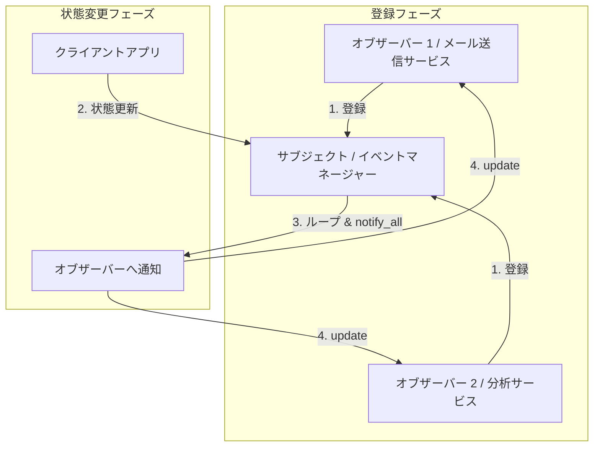

### 🎯 学習目標
- デザインパターンを生成（Creational）、構造（Structural）、振る舞い（Behavioral）の3つのカテゴリに分類できる。
- Pythonのメタクラス（Metaclass）を使用して、スレッドセーフな **Singleton** パターンを実装できる。
- **Factory Method** パターンを使用して、結合度の低い柔軟なインスタンス化レイヤーを構築できる。
- **Strategy** パターンを使用して、実行時に動的に交換可能なアルゴリズムシステムを設計できる。
- **Observer** パターンを使用して、イベント駆動型のパブリッシュ・サブスクライブ（出版・購読）アーキテクチャを構築できる。
- Python特有の機能（ファーストクラス関数、デコレータ、クロージャ）を活用して、クリーンで簡潔なパターンを作成できる。

### 🧩 中核概念（なぜ）
**デザインパターン**とは、ソフトウェア設計における一般的な問題に対する、再利用可能で構造化されたテンプレート（設計の雛形）です。ゼロから解決策をその都度設計するのではなく、実証済みの設計パターンを採用することで、コードの可読性や拡張性を大幅に向上させることができます。

デザインパターンは主に以下の3つに分類されます。
1. **生成（Creational）**: オブジェクトの作成メカニズムに焦点を当てます（例: Singleton、Factory）。
2. **構造（Structural）**: クラスやオブジェクトを組み合わせて、より大きな構造を作ることに焦点を当てます（例: Decorator、Adapter）。
3. **振る舞い（Behavioral）**: オブジェクト間のアルゴリズムの調整や責任の割り当てに焦点を当てます（例: Strategy、Observer）。

古典的なデザインパターンは、C++やJavaといった静的型付け言語で考案されましたが、Pythonの動的な性質や「ファーストクラス関数（関数を第一級オブジェクトとして扱える仕様）」のサポートにより、Pythonでは非常に少ない記述量（ボイラープレート）でこれらのパターンを実装できます。

#### Pythonにおける主要なパターン
- **Singleton**: アプリケーション全体でクラスのインスタンスがグローバルにただ1つだけ存在することを保証し、それへのグローバルなアクセスポイントを提供します。（ユースケース: データベース接続プール、ロガー、グローバル設定）
- **Factory Method**: オブジェクト作成のインターフェースを定義しますが、実際に作成されるオブジェクトの型はサブクラスやパラメータによって決定します。（ユースケース: ファイルパーサー、データベースクライアント生成）
- **Strategy**: アルゴリズムの集合を定義し、それぞれをカプセル化して、実行時に交換可能にします。Pythonでは、関数を直接引数として渡せるため、古典的なOOP戦略クラスを作る必要がありません。
- **Observer**: 複数の「オブザーバー（監視者）」が1つの「サブジェクト（監視対象）」を監視し、サブジェクトの状態が変化したときに自動的に通知を受け取る1対多の関係を定義します。（ユースケース: イベントシステム、パブリッシュ・サブスクライブアーキテクチャ）

### 🔁 ロジックと動作

以下のフローチャートは、**Observerパターン**のイベント駆動型通知メカニズムを示しています。



このシステムでは：
1. オブザーバーは、サブジェクトからの通知を受け取るために自身を登録します。
2. サブジェクトの状態が変化すると、登録されているすべてのオブザーバーをループ処理します。
3. サブジェクトは、各オブザーバーの標準フックメソッド（`update()` など）を呼び出し、更新された状態情報を送信します。

### 📝 注釈付きサンプル

以下は、メタクラスによる **Singleton**、**Factory Method**、関数を利用した **Strategy**、および **Observer** パターンを実装したPythonスクリプトです。

```python
from abc import ABC, abstractmethod
from typing import Callable, List, Dict

# ==========================================
# 1. 生成パターン: Singletonパターン (メタクラス)
# ==========================================
class SingletonMeta(type):
    # クラスのインスタンスをキャッシュする辞書
    _instances: Dict = {}

    def __call__(cls, *args, **kwargs):
        # クラスのインスタンス化をインターセプト：まだ存在しない場合のみ新規作成
        if cls not in cls._instances:
            cls._instances[cls] = super().__call__(*args, **kwargs)
        return cls._instances[cls]

class DatabaseConnectionPool(metaclass=SingletonMeta):
    def __init__(self):
        self.connection_string = "postgresql://db.local:5432"
        print("Database Connection Pool Initialized.")

# ==========================================
# 2. 生成パターン: Factory Methodパターン
# ==========================================
class Document(ABC):
    @abstractmethod
    def read(self) -> str:
        pass

class JSONDocument(Document):
    def read(self) -> str:
        return '{"key": "value"}'

class CSVDocument(Document):
    def read(self) -> str:
        return "header1,header2\nvalue1,value2"

class DocumentFactory:
    # ファイル形式に応じて適切な具現クラスを生成する
    @staticmethod
    def get_document(file_type: str) -> Document:
        if file_type == "json":
            return JSONDocument()
        elif file_type == "csv":
            return CSVDocument()
        raise ValueError(f"Unknown document format: {file_type}")

# ==========================================
# 3. 振る舞いパターン: Strategyパターン (Pythonic)
# ==========================================
# 戦略を表す抽象クラスの代わりに、関数型（Callable）を定義します
DiscountStrategy = Callable[[float], float]

def regular_discount(price: float) -> float:
    return price * 0.95

def holiday_discount(price: float) -> float:
    return price * 0.80

class Order:
    def __init__(self, price: float, discount_strategy: DiscountStrategy):
        self.price = price
        self.discount_strategy = discount_strategy

    def calculate_total(self) -> float:
        # 動的に戦略を適用する
        return self.discount_strategy(self.price)

# ==========================================
# 4. 振る舞いパターン: Observerパターン
# ==========================================
class Observer(ABC):
    @abstractmethod
    def update(self, message: str) -> None:
        pass

class Subject:
    def __init__(self):
        self._observers: List[Observer] = []

    def attach(self, observer: Observer) -> None:
        self._observers.append(observer)

    def notify(self, message: str) -> None:
        for observer in self._observers:
            observer.update(message)

class EmailNotifier(Observer):
    def update(self, message: str) -> None:
        print(f"[Email Notification] sending event: {message}")

# --- 動作確認 ---
if __name__ == "__main__":
    # Singletonのテスト
    db1 = DatabaseConnectionPool()
    db2 = DatabaseConnectionPool()
    print(f"Are DB instances identical? {db1 is db2}") # 期待される出力: True

    # Factory Methodのテスト
    doc = DocumentFactory.get_document("json")
    print(f"Read Document: {doc.read()}")

    # Strategyのテスト
    order_regular = Order(100.0, regular_discount)
    order_holiday = Order(100.0, holiday_discount)
    print(f"Regular Total: {order_regular.calculate_total()}") # 期待される出力: 95.0
    print(f"Holiday Total: {order_holiday.calculate_total()}") # 期待される出力: 80.0

    # Observerのテスト
    pub = Subject()
    sub = EmailNotifier()
    pub.attach(sub)
    pub.notify("System deployment complete!")
```

### ❌ よくある間違い

**間違い 1: マルチスレッド環境におけるスレッドセーフでないSingletonの実装**
```python
class SimpleSingleton:
    _instance = None
    # ロック制御のない単純な実装
    def __new__(cls):
        if not cls._instance:
            cls._instance = super().__new__(cls)
        return cls._instance
```
```text
Traceback (most recent call last):
  # 同時実行コンテキストにおいて、同一性検証が失敗する：
  AssertionError: db1 is db2 is False
```
```python
import threading

class SafeSingleton:
    _instance = None
    _lock = threading.Lock()

    def __new__(cls):
        # パフォーマンス向上のためのダブルチェックロッキングパターン
        if not cls._instance:
            with cls._lock:
                if not cls._instance:
                    cls._instance = super().__new__(cls)
        return cls._instance
```
> マルチスレッドシステムにおいて、複数のスレッドが同時に `if not cls._instance` を評価すると、両方のスレッドで新しいオブジェクトが作成されてしまいます。`threading.Lock` を用いたダブルチェックロッキングパターンを使用することで、スレッドセーフを保証しつつ、インスタンス生成後のパフォーマンス低下を防ぎます。

**間違い 2: クラスベースのボイラープレートによるPythonのStrategyパターンの過剰設計**
```python
from abc import ABC, abstractmethod

# 単一の計算ロジックに不要なクラス階層を作成し、Pythonicなシンプルさを損なっている
class Strategy(ABC):
    @abstractmethod
    def run(self, a, b): pass

class AddStrategy(Strategy):
    def run(self, a, b): return a + b

class Calculator:
    def __init__(self, strategy: Strategy):
        self.strategy = strategy
```
```text
Traceback (most recent call last):
  File "main.py", line 12, in <module>
    calc = Calculator(AddStrategy) # クラスのインスタンスではなくクラスそのものを渡してしまっている
  File "main.py", line 8, in calculate
    return self.strategy.run(a, b)
TypeError: run() missing 1 required positional argument: 'b'
```
```python
from typing import Callable

# クリーンで直感的：関数を直接戦略（Strategy）として使用する
class Calculator:
    def __init__(self, strategy: Callable[[int, int], int]):
        self.strategy = strategy

    def calculate(self, a: int, b: int) -> int:
        return self.strategy(a, b)
```
> Pythonにおいて、Javaスタイルのインターフェースや具現クラスによる戦略のラップは不要なボイラープレートです。Pythonの関数は第一級オブジェクトであるため、変数への代入、コンストラクタへの引き渡し、および直接の呼び出しが可能です。

### 💡 コツ・イディオム
- **モジュールをSingletonとして使う**: Pythonのモジュールは最初にインポートされたときにのみ実行され、以降のインポートでは `sys.modules` 内の同じ名前空間が参照されます。多くの場合、Singletonクラスを作成する代わりに、モジュールレベルで変数や関数を宣言するだけで十分です。
- **辞書マッピングによるFactoryの実装**: 工場クラス（Factory）に長い `if/elif/else` を書く必要はありません。辞書にクラスの型をマッピングしておくことで、スッキリ記述できます。
  ```python
  CREATORS = {"json": JSONDocument, "csv": CSVDocument}
  # 動的かつスマートにインスタンス化
  doc = CREATORS[file_type]()
  ```
- **クロージャで戦略の状態を保持する**: 戦略が特定の「状態（設定データ）」を保持する必要がある場合、クラスの代わりにクロージャを利用すると簡潔になります。
  ```python
  def make_multiplier(factor: float):
      return lambda x: x * factor # 状態（factor）を保持する戦略関数を返す
  ```

### 🧠 深掘り（内部の仕組み）
<details><summary>メタクラスのインターセプト：__call__を介したクラスの呼び出し制御</summary>

Pythonで `conn = DatabaseConnectionPool()` のようにクラスをインスタンス化するとき、Pythonは直接 `DatabaseConnectionPool` の `__new__` メソッドを呼び出しているわけではありません。実際には、クラスオブジェクトのクラス（つまり、そのクラスの「メタクラス」）の `__call__` メソッドが呼び出されています。

オブジェクトの初期化パイプラインは以下の通りです。
1. `DatabaseConnectionPool` クラス自体は `SingletonMeta` メタクラスの「インスタンス」です。
2. `DatabaseConnectionPool()` の評価は、`SingletonMeta.__call__(DatabaseConnectionPool)` を呼び出します。
3. メタクラス内のカスタム `__call__` はこの要求を割り込み（インターセプト）します。
   - すでにインスタンスが `_instances` 辞書にキャッシュされている場合、そのキャッシュを即座に返します。
   - キャッシュがない場合、`super().__call__()`（これは元のクラスの `__new__` と `__init__` を順番に実行します）を呼び出してオブジェクトを作成し、キャッシュに格納したのち返します。

```python
# メタクラスによる制御のモデル表現
class SingletonMeta(type):
    _instances = {}
    
    def __call__(cls, *args, **kwargs):
        # インスタンス化の前に割り込みを行う
        if cls not in cls._instances:
            cls._instances[cls] = super().__call__(*args, **kwargs)
        return cls._instances[cls]
```

メタクラスによるSingleton実装は、通常のクラスメソッドや `__new__` による実装よりも堅牢です。開発者が不注意にクラスをインスタンス化しようとしても、必ず同一のインスタンスが保証されるためです。
</details>

### 🏋️ 演習
Strategyパターンに準拠した `Calculator` クラスを実装してください。コンストラクタは1つの戦略関数を受け取ります。`Calculator` クラスには、注入された戦略関数に引数 `a` と `b` を渡して実行する `calculate(self, a, b)` メソッドを実装してください。

```python
# 計算のためのStrategyパターンを実装してください。
# 動的な計算戦略（加算、乗算など）を受け取るCalculatorクラスを作成します。
class Calculator:
    pass
```

### ✅ 自己チェック
1. なぜカスタムの `__new__` メソッドの実装よりも、メタクラスによる Singleton 実装が好まれるのですか？
2. ファーストクラス関数を利用して、軽量な Observer パターンを Python でどのように実装できますか？
3. コンストラクタを直接呼び出す代わりに、Factory Method パターンを使用すべきなのはどのようなケースですか？
<details><summary>自己チェックの解答</summary>

1. メタクラスを使用すると、インスタンス化の制御ロジックをクラス本体のビジネスロジックから分離できます。カスタム `__new__` を実装した親クラスを継承した場合、サブクラスで意図せず Singleton の挙動が壊れたり、初期化が複数回走ったりしやすくなります。
2. 抽象クラス `Observer` を定義する代わりに、呼び出されるコールバック関数のリスト（`List[Callable[[str], None]]`）を登録しておき、イベント発生時に順次実行するだけでシンプルに実装できます。
3. インスタンス化するべき具現クラスの正確な型が、実行時まで決定できない場合や、オブジェクト生成にあたって複雑な初期設定（APIクライアントの接続確立など）のロジックをビジネスロジックから隠蔽したい場合に使用します。
</details>

### 📌 まとめ
- **Singleton**: インスタンスがグローバルに1つだけ生成されるように制限します。メタクラスによる実装が最もスマートです。
- **Factory Method**: オブジェクト生成の結合度を下げ、キーやフォーマットに基づいて動的にクラスをインスタンス化します。
- **Strategy**: アルゴリズムを実行時に交換可能にします。Pythonでは関数そのものを渡すことで、余計なクラス階層を排除できます。
- **Observer**: 出版・購読モデルを構築し、サブジェクトの変更イベントを監視役のオブザーバーに疎結合のまま一斉通知します。
