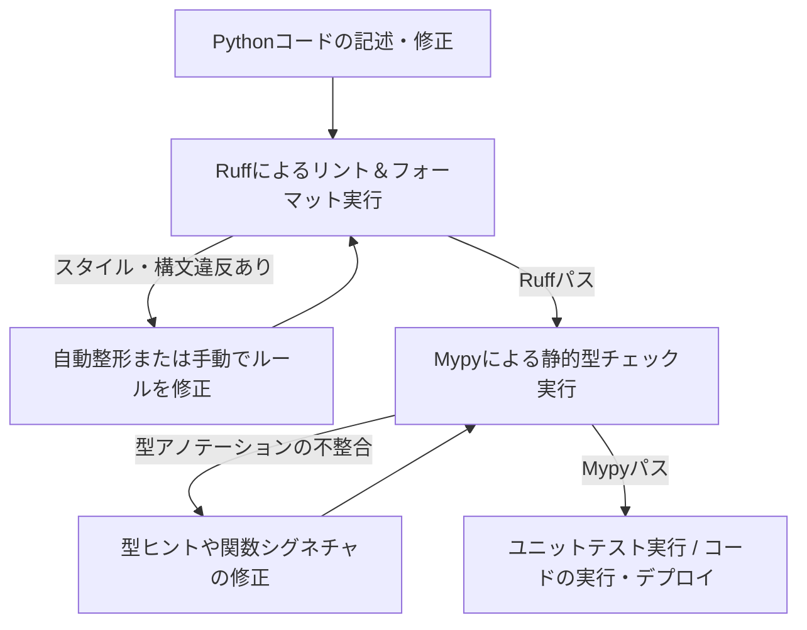

### 🎯 学習目標
- 静的解析（Static Analysis）と実行時チェック（Runtime Checks）の根本的な違いを説明できる。
- コード検証ツールを、リンター（構造やバグパターンの検出）とフォーマッター（コード整形の自動化）に分類して理解する。
- 読みやすいPythonコードを書くための標準仕様である PEP 8 の基本要件を説明できる。
- 高性能なオールインワンツール **Ruff** を使用して、コードの整形とリントを実行できる。
- 静的型チェッカー **Mypy** を構成し、厳格な型判定ルールを適用できる。
- 型ヒント（`typing` モジュール）を活用して、自己文書化された型安全な関数を記述できる。

### 🧩 中核概念（なぜ）

大規模なソフトウェア開発において、コードの品質と一貫性を維持することは極めて重要です。コードベースが大きくなるにつれて、手動でコーディングスタイルの違反や未使用のインポート、潜在的な型エラーを見つけることは困難になります。静的解析ツールは、コードを実行することなくプログラムを評価し、これらの問題を自動的に検出します。

#### 1. 静的解析と実行時チェック
- **静的解析**: ソースコードを実行せずに解析する手法。ロジックの構造、構文の妥当性、コーディングスタイルの遵守状況、および型の整合性をチェックし、開発の早期段階で潜在的なエラーを特定します。
- **実行時チェック**: プログラムの実行中に検出されるエラー（例: 文字列と整数を加算しようとしたときにスローされる `TypeError` など）。ユニットテストなどの実行時テストは重要ですが、実行されたパス上のバグしかキャッチできません。

#### 2. リンター（Linter）とフォーマッター（Formatter）
- **リンター**: 構文エラー、バグになりやすい構造、PEP 8 などのスタイル違反、複雑度、セキュリティの脆弱性を解析するツール。（例: Flake8, Pylint, Pycodestyle）
- **フォーマッター**: スペース、改行位置、クォーテーションの統一など、スタイル仕様に沿ってコードを自動的に書き換えるツール。記述スタイルの好みを巡る議論を不要にします。（例: Black, YAPF）

#### 3. PEP 8 と型チェックの要件
PEP 8 は Python の公式スタイルガイドです。スペースの使い方、命名規則（関数名は `snake_case`、クラス名は `PascalCase`）、1行の最大文字数（伝統的には79文字、現代のプロジェクトでは88文字や100文字が一般的）などが定められています。Python は動的型付け言語ですが、PEP 484 で**型ヒント（Type Hinting）**が導入され、静的解析ツールによる型安全性の検証が可能になりました。

#### 4. 現代の標準ツール: Ruff と Mypy
これまでの Python プロジェクトでは、Black（フォーマッター）、Flake8（リンター）、isort（インポート順序の整理）、autoflake（未使用インポートの削除）といった複数のツールを個別にインストールする必要がありました。
- **Ruff**: Rust で書かれた、非常に高速なオールインワンのリンター・フォーマッターです。従来のツールと比べて10倍〜100倍高速であり、Black、Flake8、isort などの機能をこれ1つで代替できます。
- **Mypy**: Python の標準的な静的型チェッカーです。変数、引数、戻り値の型が、アノテーション（型ヒント）に適合しているかどうかを検証します。

---

### 🔁 ロジックと動作

静的検証は、コードの自動化されたゲートキーパーとして機能します。以下のフローチャートは、開発者がコードを実行またはデプロイする前に Ruff と Mypy を使用するワークフローを示しています。



このパイプラインでは：
1. **Ruff** がレイアウト、書式、構文違反、および不要なインポートを整理・修正します。
2. **Mypy** がセマンティック解析を行い、変数のスコープや関数のシグネチャを追跡して型安全性を保証します。
3. 両方のチェックを通過することで、実行時テストに進む前に、コードの記述スタイルと型定義の整合性が保証されます。

---

### 📝 注釈付きサンプル

Ruff と Mypy を使用する際は、プロジェクトのルートディレクトリに `pyproject.toml` という設定ファイルを作成するのが一般的です。

#### 1. 設定ファイル（`pyproject.toml`）
```toml
# Ruffの設定
[tool.ruff]
line-length = 88
target-version = "py310"

[tool.ruff.lint]
# Pyflakes (F), Autopep8/Pycodestyle (E, W), isort (I), Bugbear (B) ルールを有効化
select = ["E", "F", "W", "I", "B"]
ignore = []

[tool.ruff.format]
quote-style = "double"
indent-style = "space"

# Mypyの設定
[tool.mypy]
python_version = "3.10"
warn_return_any = true
warn_unused_configs = true
disallow_untyped_defs = true  # すべての関数に型定義を必須にする
```

#### 2. 静的解析前のコード（PEP 8違反、未使用インポート、型バグあり）
```python
# bad_code.py
import sys  # 未使用のインポート (Ruff F401)
import os

def calculate_average(numbers):  # 型定義がない (Mypy disallow_untyped_defs)
    total = sum(numbers)
    # 不適切なインデントとスペース
    return total/len(numbers)

# リストの代わりに文字列を渡している
print(calculate_average("not-a-list")) # 実行時にTypeErrorが発生するが、動的解析ではスルーされる！
```

#### 3. リファクタリング後（Ruff と Mypy のチェックを通過するコード）
```python
# good_code.py
from typing import List

# 型定義を追加：numbersはfloatまたはintのリストで、戻り値はfloat
def calculate_average(numbers: List[float]) -> float:
    # ゼロ除算エラーを防ぐための境界値ハンドリング
    if not numbers:
        return 0.0
    return sum(numbers) / len(numbers)

# 正しい型定義を持った変数を作成
valid_numbers: List[float] = [10.0, 20.0, 30.0]
print(calculate_average(valid_numbers))  # 静的に検証され、安全に実行可能
```

---

### ❌ よくある間違い

**間違い 1: 可変（Mutable）オブジェクトを関数のデフォルト引数として宣言する**
```python
# Ruffルール B006 が作動: デフォルト引数に可変オブジェクトを使用してはいけない
def add_user(username: str, roles: list[str] = []) -> dict:
    roles.append(username)
    return {"user": username, "roles": roles}
```
```text
bad_code.py:2:45: B006 Do not use mutable data structures for argument defaults
```
```python
from typing import Optional

def add_user(username: str, roles: Optional[list[str]] = None) -> dict:
    if roles is None:
        roles = []
    roles.append(username)
    return {"user": username, "roles": roles}
```
> Python のデフォルト引数は関数の定義時に一度だけ評価されるため、引数 `roles` を明示せずに呼び出したすべての処理で同じリストオブジェクトが共有されてしまいます。Ruff は静的コードルール `B006` によってこの潜在的なバグを即座に検出します。

**間違い 2: 変数の初期化時に型宣言を怠り、Mypyで `Any` にフォールバックしてしまう**
```python
# Mypyエラー: 関数の引数や戻り値に型定義が不足している
def process_data(data) -> str:
    return data.strip()
```
```text
error: Function is missing a type annotation  [no-untyped-def]
```
```python
def process_data(data: str) -> str:
    return data.strip()
```
> 厳密な静的型チェック設定（`disallow_untyped_defs = true`）のもとでは、Mypy はすべての引数と戻り値に型定義を要求します。型定義を省略すると暗黙的に `Any` 型とみなされ、静的型チェックの恩恵を受けられなくなります。

---

### 💡 コツ・イディオム

- **Ruffの自動実行**: エディタの保存時に Ruff が自動フォーマットを実行するように設定しましょう。コマンドラインからは以下のように実行します。
  ```bash
  ruff format .   # コードをその場で自動整形
  ruff check .    # リントチェックを実行
  ruff check --fix .  # 修正可能なリントエラー（未使用インポートなど）を自動修正
  ```
- **モダンなコレクションの型表記**: Python 3.9 以降では、`typing` モジュールから `List` や `Dict` などをインポートする必要はありません。標準の小文字のコレクション型をそのまま使用できます。
  ```python
  def count_words(phrases: list[str]) -> dict[str, int]:
      return {}
  ```
- **特定の警告を安全に無視する**: どうしても検証ツールをパスさせたい箇所がある場合は、コメントで明示的に指示します。Ruff では `# noqa: <ルールID>`、Mypy では `# type: ignore` を使用します。
  ```python
  import unused_lib  # noqa: F401
  bad_types: int = "string"  # type: ignore
  ```

---

### 🧠 深掘り（内部の仕組み）
<details><summary>抽象構文木（AST）と型推論システム</summary>

ツールはプログラムを実行することなく、どのようにしてコードを評価しているのでしょうか？

#### Ruff の AST 解析
Ruff は実行されると、Rust で書かれた高速なパーサーを使用して、Python のソースコードを **抽象構文木（AST: Abstract Syntax Tree）** に変換します。AST は、コードの構文構造を階層的なツリー形式で表現したものです。
たとえば、`a = 1 + 2` というコードは以下のようなツリー構造になります。
```text
Assign
  ├── targets: Name(id="a")
  └── value: BinOp(left=Num(1), op=Add, right=Num(2))
```
Ruff はこの木構造を巡回し、マルチコア CPU を活かして非効率的なパターンやフォーマット違反、論理バグを並列処理で検出します。

#### Mypy のセマンティック型推論
プログラムをビルドするときに型チェックを行うコンパイル言語とは異なり、Mypy はコードを解析し、スコープ（シンボルテーブル）を解決した上で **型推論（Type Inference）** を行います。Mypy は以下を追跡します。
1. **変数代入**: 一度文字列を代入した変数に、後から整数を代入していないかの検証。
2. **関数境界**: 関数に渡された実引数が、定義された型アノテーションと一致しているかの検証。
3. **ジェネリクスとサブタイプ**: 複雑なコレクションやクラス継承における、共変性・反変性の制約検証。

Python 自体は実行時まで動的な性質を保ちますが、これらの静的解析ツールを導入することで、コンパイル工程を持たない Python においても高度な堅牢性を確保できます。
</details>

---

### 🏋️ 演習
関数 `process_values` に適切な型ヒントを記述してください。この関数は整数のリストを受け取り、浮動小数点数のリストを返します。厳格な静的型チェックに適合するように修正してください。

```python
# 静的型チェックをパスするために、動的型のシグネチャを修正してください。
# 関数 process_values は整数のリストを受け取り、浮動小数点数のリストを返します。
def process_values(values):
    pass
```

---

### ✅ 自己チェック
1. コードフォーマッターとコードリンターの根本的な違いは何ですか？
2. Flake8、Black、isort などの従来のツールを組み合わせて使う代わりに、Ruff を導入するメリットは何ですか？
3. プロジェクトにおいて Mypy を用いた厳格な静的型チェックを実施するにはどうすればよいですか？
<details><summary>自己チェックの解答</summary>

1. **リンター**はコード構造と構文ルールを検査し、バグ、未使用の記述、または悪い設計パターンを検出します。**フォーマッター**はスペース、改行、クォーテーションの配置などのレイアウトを自動的に再構築し、スタイルを一貫させます。
2. **Ruff** は Rust で実装されているため、従来の Python 製ツールより最大 100 倍高速に動作します。また、フォーマット、リント、インポート並び替えの設定を1つのツールと設定ファイル（`pyproject.toml`）に集約できます。
3. `pyproject.toml` 内で `disallow_untyped_defs = true` などの厳格なフラグを有効化したうえで、コマンドラインから `mypy <対象ディレクトリ>` を実行します。これにより、すべての関数定義にアノテーションが強制され、静的にチェックされます。
</details>

---

### 📌 まとめ
- **静的解析**は、コードを実行する前に構文や型エラーを検証し、バグが本番環境に混入するのを防ぎます。
- **Ruff** は超高速なフォーマットとリント機能を提供し、Black、Flake8、isort の役割を1台でこなします。
- **Mypy** は型アノテーションを利用して、変数や関数の引数・戻り値の型安全性を検証します。
- これらのチェックを CI/CD やローカル開発に組み込むことで、バグのない美しいコードベースを維持できます。
