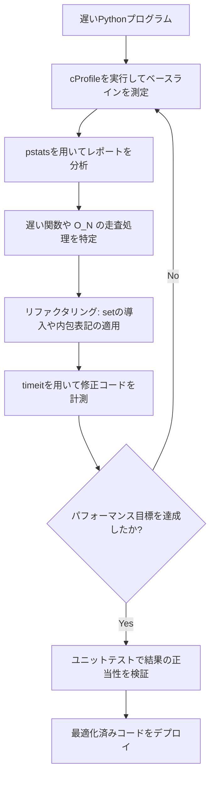

### 🎯 学習目標
- ビッグオー（Big O）記法を用いて、アルゴリズムの実行時間やメモリの計算量を評価できる。
- Python標準の `cProfile` モジュールを使用して、プログラム全体のマクロプロファイリング診断を実行できる。
- `pstats` を用いてプロファイリングレポートを分析し、実行時のボトルネックを特定できる。
- `timeit` を使用してマイクロベンチマークを実行し、異なる記述方法の実行速度を比較できる。
- リストでの $O(N)$ 検索から、set（集合）での $O(1)$ ルックアップへ変換する最適化を適用できる。
- ジェネレータ式やリスト内包表記を適切に使い分け、メモリ効率と実行速度に優れたコードを書ける。

### 🧩 中核概念（なぜ）

「未熟な最適化は諸悪の根源である」というのは、著名なコンピュータ科学者ドナルド・クヌース（Donald Knuth）の言葉です。コードを最適化する前に、まず実行速度を**測定（Measure）**し、実際のボトルネックがどこにあるのかを**特定（Identify）**する必要があります。

#### 1. 計算量解析（Big O）
Big O 記法は、入力サイズが無限大に近づくときのアルゴリズムの実行時間の増え方を表します。
- **$O(1)$ （定数時間）**: 入力サイズに関わらず実行時間は一定です。例: 辞書（`dict`）のキー検索、集合（`set`）のメンバーシップ検証。
- **$O(N)$ （線形時間）**: 実行時間は入力サイズ $N$ に比例して増加します。例: リスト（`list`）内の線形検索。
- **$O(N^2)$ （二乗時間）**: 実行時間は入力サイズ $N$ の二乗に比例して増加します。例: リスト要素を検索するネストされた二重ループ。

#### 2. プロファイリングとベンチマークの違い
- **プロファイリング（マクロ測定）**: プログラム全体の実行時の動作を分析し、どの関数が何回呼び出され、どれだけの時間を費やしているかを把握する手法。Python では標準の **`cProfile`** を使用します。
- **ベンチマーク（マイクロ測定）**: 小さなコードブロックや個々の式の実行時間を測定する手法。Python では **`timeit`** を使用し、小さなコードを数万回繰り返し実行して平均的な実行速度を計測します。

#### 3. Pythonにおける代表的な最適化戦略
1. **set（集合）のルックアップを使用する**: リストでの `x in list` は、要素を先頭から順に走査するため $O(N)$ の処理になります。リストを事前に `set` に変換しておけば、ハッシュテーブルの仕組みを利用して `x in set` を $O(1)$ で実行できます。
2. **リスト内包表記 vs forループ**: リスト内包表記は Python インタプリタの内部（C言語レベル）で高速に実行されるため、通常の `for` ループで `append()` を繰り返すよりも高速です。
3. **ジェネレータによるメモリ節約**: ジェネレータ（`yield` やジェネレータ式 `(...)`）は、値を一度にすべてメモリに展開せず、必要なときに1つずつ評価（遅延評価）するため、リストに比べてメモリ消費が極めて少なくなります。

---

### 🔁 ロジックと動作

パフォーマンスの最適化には、計測と修正のフィードバックループが必要です。以下のフローチャートは、測定、診断、マイクロベンチマーク、および最適化の適用サイクルを示しています。



このシステムでは：
1. 開発者はコードが遅い原因を推測するのではなく、**`cProfile`** を使用して実行時間の長い関数を特定します。
2. ボトルネックが特定されたら、アルゴリズムの計算量を改善します（例: リストを set に変換）。
3. その後、**`timeit`** を使って、リファクタリング後のコードがベースラインよりも確実に高速化されたかを検証します。

---

### 📝 注釈付きサンプル

#### 1. `cProfile` と `pstats` によるプロファイリング
以下は、処理が遅い検索関数を含むプログラムをプロファイリングするスクリプトです。

```python
import cProfile
import pstats
import time

def slow_list_search(size: int):
    # 大きな整数のリストを作成
    dataset = list(range(size))
    # リストに対する線形検索を繰り返す (各検索は O(N))
    found_count = 0
    for query in range(size // 10):
        if query in dataset:
            found_count += 1
    return found_count

def fast_set_search(size: int):
    # リストを set（集合）に変換 (O(N) のコストが1回発生)
    dataset = set(range(size))
    # 定数時間での検索を繰り返す (各検索は O(1))
    found_count = 0
    for query in range(size // 10):
        if query in dataset:
            found_count += 1
    return found_count

if __name__ == "__main__":
    size_parameter = 50000
    
    # プロファイラの初期化と実行
    profiler = cProfile.Profile()
    profiler.enable()
    
    # 関数の実行
    slow_list_search(size_parameter)
    fast_set_search(size_parameter)
    
    profiler.disable()
    
    # プロファイリング結果のソートと出力
    stats = pstats.Stats(profiler).sort_stats('tottime')
    stats.print_stats(10)  # 最も遅い上位10つの呼び出しを出力
```

`pstats` レポートの主な出力項目：
- `ncalls`: その関数が呼び出された回数。
- `tottime`: その関数単体の合計実行時間（呼び出した子関数の処理時間は除く）。
- `cumtime`: その関数と、その中で呼び出されたすべての子関数の合計実行時間。
- `filename:lineno(function)`: 該当コードのファイル名、行番号、関数名。

#### 2. `timeit` によるマイクロベンチマーク
リスト内包表記と通常のループ処理の速度差を測定します。

```python
import timeit

# ループ処理のセットアップとコード
loop_setup = "data = list(range(1000))"
loop_code = """
result = []
for x in data:
    result.append(x * 2)
"""

# リスト内包表記（C言語レベルで高速実行される）
comp_code = """
result = [x * 2 for x in data]
"""

# それぞれのコードを 10,000 回実行して時間を計測
loop_time = timeit.timeit(stmt=loop_code, setup=loop_setup, number=10000)
comp_time = timeit.timeit(stmt=comp_code, setup=loop_setup, number=10000)

print(f"Standard Loop time: {loop_time:.4f} seconds")
print(f"List Comprehension time: {comp_time:.4f} seconds")
print(f"Speedup factor: {loop_time / comp_time:.2f}x")
```

---

### ❌ よくある間違い

**間違い 1: ネストされた可変（Mutable）リストを set に変換して検索を最適化しようとする**
```python
dataset = [[1, 2], [3, 4], [5, 6]]
# 検索を高速化するために set へ変換しようとする
dataset_set = set(dataset)
```
```text
Traceback (most recent call last):
  File "main.py", line 3, in <module>
    dataset_set = set(dataset)
TypeError: unhashable type: 'list'
```
```python
dataset = [[1, 2], [3, 4], [5, 6]]
# サブリストをタプル（不可変）に変換してハッシュ可能にする
dataset_set = {tuple(item) for item in dataset}
```
> set の要素はハッシュ可能（不可変オブジェクト）でなければなりません。リストは可変（Mutable）であるため、そのまま set の要素に指定すると `TypeError` が発生します。サブリストをタプルに変換することで、ハッシュ値が定義され、$O(1)$ の高速ルックアップを利用できるようになります。

**間違い 2: ループ内で文字列結合演算子（`+=`）を繰り返して文字列を構築する**
```python
def build_paragraph(words: list[str]) -> str:
    paragraph = ""
    for word in words:
        paragraph += word + " "
    return paragraph
```
```text
Traceback (most recent call last):
  File "benchmark.py", line 5, in <module>
    assert run_benchmark(build_paragraph) < 0.1
AssertionError: execution timeout on 100,000 iterations
```
```python
def build_paragraph(words: list[str]) -> str:
    return " ".join(words) + " " if words else ""
```
> Python の文字列は変更不可能（Immutable）なオブジェクトです。ループ内で `+=` を使用すると、イテレーションごとに新しい文字列オブジェクトがメモリ上に確保され、既存の内容がすべてコピーされるため、時間計算量が $O(N^2)$ に悪化します。`.join()` メソッドを使用すると、メモリ確保が一度で行われるため $O(N)$ の線形時間で実行できます。

---

### 💡 コツ・イディオム

- **変換は1回、検索は複数回**: サイズ $N$ のリストを set に変換する処理には $O(N)$ の時間がかかります。検索を1回しか行わないのであれば、set への変換オーバーヘッドにより、リストを直接走査するより遅くなります。set 化が有効なのは、複数回（$M > 1$ 回）の検索を行う場合に限られます。
- **メモリを節約するジェネレータ式**: リスト全体をメモリに保持する必要がなく、集計処理（`sum()` など）や順次処理を行うだけの場合は、大括弧 `[]` を外してジェネレータ式を使用します。
  ```python
  # メモリ効率◎ (ジェネレータ): 要素を1つずつ評価して集計
  total_sum = sum(x * x for x in range(1000000))
  
  # メモリ効率✕ (リスト内包表記): 100万要素のリストをメモリに展開してから集計
  total_sum = sum([x * x for x in range(1000000)])
  ```
- **ローカル変数キャッシュ**: Python は、グローバル変数やオブジェクト属性（`self.attribute`）よりも、ローカル変数のルックアップを高速に行います。ループ内で何度も参照する属性がある場合は、ローカル変数に退避させておきましょう。
  ```python
  attr = self.attribute
  for x in data:
      process(attr, x)
  ```

---

### 🧠 深掘り（内部の仕組み）
<details><summary>ハッシュ衝突、負荷係数、およびsetの内部動作</summary>

なぜ Python の set 検索はこれほど高速なのでしょうか？ハッシュテーブルの内部の仕組みを探ってみましょう。

#### setにおけるメンバーシップ確認の手順
`x in dataset_set` を評価するとき、Python は set 内の全要素を走査しません。
1. Python は `hash(x)` を呼び出し、オブジェクトのハッシュ値を取得します。
2. ハッシュ値とテーブルサイズに基づき、set の内部メモリテーブルのインデックスにマッピングします。
3. マッピングされたスロットが空であれば `False` を返します。対象オブジェクトが格納されていれば `True` を返します。
4. 異なるオブジェクトが格納されている場合（**ハッシュ衝突**）、Python は疑似乱数的なプロービング（探索順序）に従って別のスロットを順次検査します。

このハッシュ検索アルゴリズムにより、**$O(1)$ の定数時間**での検索が実現しています。

#### トレードオフ：速度とメモリ
この高速性は、メモリ消費量を増やすことで実現しています。Python の set は、ハッシュ衝突を防ぐために **負荷係数（Load Factor）**（テーブル容量に対する格納要素の比率）を低く保つ必要があります。
- set の空き容量が $1/3$ 以下（要素が $2/3$ を超える）になると、Python は自動的にテーブルサイズを拡大し、ハッシュ値の再配置を行います。
- そのため、同じ要素数を保持していても、`set` は `list` より数倍多くのメモリを消費します。

```text
メモリ消費量の比較例（64ビット環境のPythonでの概算）:
1,000要素のリスト: 約 8 KB
1,000要素のセット: 約 32 KB
```
検索速度が重要視される場面では set を使用し、メモリ消費量を最小限に抑えたい場面ではリストやジェネレータを活用するという判断が重要です。
</details>

---

### 🏋️ 演習
以下の検索処理を最適化してください。入力の `dataset_list` を set（集合）に変換することで、O(1) の高速なメンバーシップチェックを有効にし、`queries_list` の要素のうち何個がデータセットに存在するかをカウントして返してください。

```python
# 大きなデータセットのリスト内における検索ルックアップを最適化します。
# 入力のデータセットリストをset（集合）に変換し、O(1)のメンバーシップテストを有効にしてください。
def optimize_search(dataset_list, queries_list):
    # データセット内に存在するクエリの数を返します
    pass
```

---

### ✅ 自己チェック
1. ルックアップを最適化するためにリストを set に変換する処理が、かえって非効率になってしまうのはどのようなケースですか？
2. `cProfile` のレポートにおける `tottime` と `cumtime` の違いは何ですか？
3. ジェネレータ式は、リスト内包表記と比較してどのようにメモリを節約しますか？
<details><summary>自己チェックの解答</summary>

1. 対象のコレクションに対して検索（ルックアップ）を1回しか実行しない場合です。リストを set に変換するコストは $O(N)$ であるため、検索が1回だけの場合は変換のオーバーヘッドの方が大きくなります。
2. `tottime` はその関数単体の処理時間（呼び出した他のサブ関数の実行時間を除く）を表します。`cumtime` はその関数および呼び出されたすべてのサブ関数の累計実行時間を表します。
3. リスト内包表記は、要素のリスト全体をメモリ上に即座に構築・配置します。一方、ジェネレータ式は必要に応じて要素を1つずつ生成（遅延評価）するため、データサイズに関わらずメモリ使用量を一定（$O(1)$）に抑えられます。
</details>

---

### 📌 まとめ
- **計算量解析**を利用して、処理が遅い原因を Big O 記法に基づき数学的に特定します。
- **`cProfile`** はプログラムのコールツリー全体を分析し、`tottime` などの指標からボトルネックとなっている関数を明らかにします。
- **`timeit`** を使って、小さなコード片の実行速度（構文による違い）を測定し比較します。
- **set（集合）** は $O(1)$ の定数時間検索を提供し、大きなコレクションに対する linear search（$O(N)$）を劇的に高速化します。
- **ジェネレータ**は必要に応じて要素を生成することで、メモリを大幅に節約した反復処理を可能にします。
