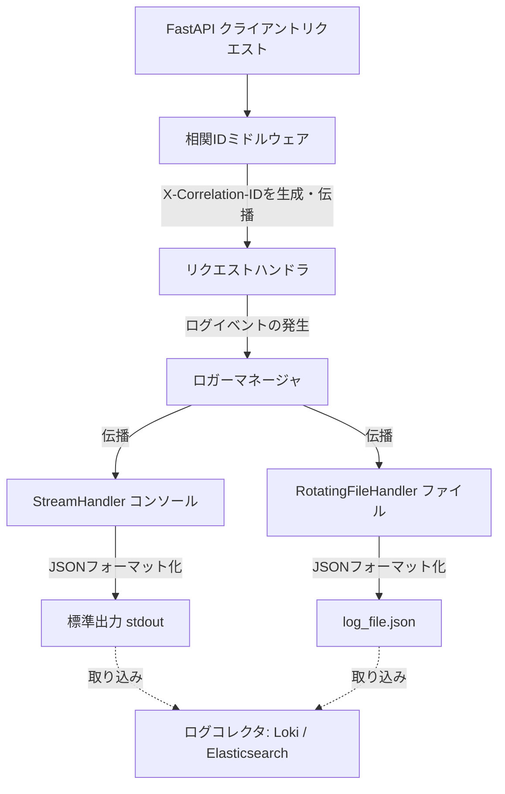

### 🎯 学習目標
- 5つの標準ログレベルの違いを理解し、システムの適切なイベントに適用できる。
- ロガー（Logger）、ハンドラ（Handler）、フォーマッタ（Formatter）、および伝播（Propagation）ルールを設定できる。
- `dictConfig` を用いて動的な設定を行い、ロギング環境とコードを切り離すことができる。
- Loki や Elasticsearch などのログ収集・インデックスシステムに対応した構造化 JSON ログを実装できる。
- `RotatingFileHandler` を使用してログローテーションを設定し、ディスク容量の枯渇を防ぐことができる。
- FastAPI のミドルウェアにリクエストごとの相関ID（Correlation ID）を組み込み、エンドツーエンドのリクエスト追跡を実現できる。

### 🧩 中核概念（なぜ）

#### 1. なぜ `print()` はロギングの代わりにならないのか
プロダクション環境のアプリケーションにおいて、デバッグ目的で `print()` を使用することはアンチパターンです。
- **レベルの欠如**: `print()` では、単なる情報、警告、あるいは重大なシステムエラーを区別できません。
- **出力先の制御が困難**: `print()` はデフォルトで `stdout`（標準出力）に出力されます。特定のメッセージをログファイル、メール、またはアラートシステムへ振り分けるのが困難です。
- **パフォーマンスへの影響**: 同期的な `print()` 処理は、高負荷時にI/O操作をブロックし、パフォーマンスを大幅に低下させます。
- **メタデータの不足**: `print()` の出力には、タイムスタンプ、スレッドID、モジュール名、行数などの実行コンテキストが含まれません。

#### 2. ログレベル（Logging Levels）
Python の標準 `logging` ライブラリは、5つの整数ベースのログレベルを定義しています。
- **DEBUG (10)**: 開発時やトラブルシューティング時の詳細な診断情報。
- **INFO (20)**: システムの正常な起動やリクエスト処理の完了などの一般的なイベント。
- **WARNING (30)**: 実行は継続できるものの、将来のエラーにつながる可能性のある軽微な異常や非推奨機能の使用。
- **ERROR (40)**: 特定の操作が失敗したことを示す重大な例外。
- **CRITICAL (50)**: データベース接続の喪失やメモリ不足など、即座に対処が必要な致命的なシステム障害。

#### 3. ハンドラとフォーマッタ
- **ロガー（Logger）**: アプリケーションコードがログメッセージを送信するためのエントリポイントインターフェース。
- **ハンドラ（Handler）**: ログメッセージをコンソール、ローカルファイル、ソケット、ネットワークストリームなどの指定された宛先に転送するコンポーネント。代表的なものに `StreamHandler`、`FileHandler`、`RotatingFileHandler` があります。
- **フォーマッタ（Formatter）**: 最終的なログレコードの文字列フォーマットを定義するコンポーネント。
- **伝播（Propagation）**: 子ロガーで出力されたログを親ロガー（ルートロガーなど）へ転送するかどうかを決定するルール。

#### 4. 可観測性（Observability）と構造化ロギング
可観測性とは、システムの外部出力（メトリクス、ログ、トレース）のみから、システム内部の状態をどれだけ理解できるかを示す指標です。
- **構造化JSONロギング**: 標準的なテキスト形式のログは、正規表現での解析が困難です。ログを JSON オブジェクトとして出力することで、機械可読性が向上します。Loki、Elasticsearch、Datadog などのログ集約ツールは JSON のプロパティを直接インデックスできるため、特定のユーザーIDやレスポンス時間でログを迅速に検索・分析できます。
- **相関ID（Correlation ID）**: 相関ID（またはリクエストID）は、各 HTTP リクエストに対して生成される一意の文字列です。リクエストのライフサイクル中に実行されるすべてのログにこの相関IDを付与することで、分散システムや並行処理の中でも、特定のリクエストの実行フローを一気に追跡できます。

---

### 🔁 ロジックと動作

以下は、FastAPI アプリケーションにおいて HTTP リクエストが処理される際、相関IDが生成、伝播、フォーマットされ、インデックスされる流れを示しています。



1. **リクエスト受信**: ミドルウェアがリクエストをインターセプトし、相関IDを抽出（または新規生成）してコンテキストローカルなストレージに保存します。
2. **ログの出力**: ハンドラでビジネスロジックが実行され、その過程でログが出力されます。
3. **伝播とフォーマット**: ロガーがイベントを受け取り、登録されたハンドラに送ります。JSONフォーマッタは、コンテキストから相関IDを取得して JSON レコードに追加します。
4. **ログ集約**: ログコレクタ（Fluentbit や Logstash など）が標準出力やログファイルからデータを読み込み、ログダッシュボードにインデックスします。

---

### 📝 注釈付きサンプル

#### 1. `dictConfig` による設定の分離
Python コード内に命令的なスタイルでロギングを設定するのではなく、設定辞書（JSON や YAML からの読み込みも可能）を使用します。これにより、開発環境（コンソール出力）と本番環境（ファイル/JSON出力）の設定を簡単に切り替えることができます。

```python
import logging.config

LOGGING_CONFIG = {
    "version": 1,
    "disable_existing_loggers": False,
    "formatters": {
        "standard": {
            "format": "%(asctime)s [%(levelname)s] %(name)s: %(message)s"
        },
    },
    "handlers": {
        "console": {
            "class": "logging.StreamHandler",
            "level": "DEBUG",
            "formatter": "standard",
            "stream": "ext://sys.stdout",
        },
        "file": {
            "class": "logging.handlers.RotatingFileHandler",
            "level": "INFO",
            "formatter": "standard",
            "filename": "app.log",
            "maxBytes": 1048576,  # 1 MB
            "backupCount": 3,
            "encoding": "utf8",
        },
    },
    "root": {
        "handlers": ["console", "file"],
        "level": "DEBUG",
    },
}

# 設定辞書を適用
logging.config.dictConfig(LOGGING_CONFIG)
logger = logging.getLogger("app.module")

logger.info("アプリケーションが正常に初期化されました。")
logger.warning("設定のオーバーライドが検出されました。")
```

#### 2. カスタム JSON ログフォーマッタの作成
Loki などの本番用インデクサー向けに、`logging.Formatter` をサブクラス化し、`format()` メソッドをオーバーライドして JSON 形式で出力します。

```python
import logging
import json
import datetime

class StructuredJSONFormatter(logging.Formatter):
    def format(self, record: logging.LogRecord) -> str:
        log_entry = {
            "timestamp": datetime.datetime.utcnow().isoformat(),
            "level": record.levelname,
            "logger": record.name,
            "message": record.getMessage(),
        }
        
        # 例外が発生している場合はトレースバックを含める
        if record.exc_info:
            log_entry["exception"] = self.formatException(record.exc_info)
            
        return json.dumps(log_entry)

# JSONフォーマッタを指定してハンドラをセットアップ
handler = logging.StreamHandler()
handler.setFormatter(StructuredJSONFormatter())
logger = logging.getLogger("structured_logger")
logger.addHandler(handler)
logger.setLevel(logging.INFO)

logger.info("JSON構造化ログの出力例です。")
```

#### 3. FastAPI でのコンテキストに応じたリクエスト追跡（相関IDミドルウェア）
`contextvars` を使用して、非同期タスク間で相関IDを安全に保持し、カスタムロギング時にそれを取得して埋め込みます。

```python
import logging
import json
import datetime
import uuid
import contextvars
from fastapi import FastAPI, Request
from starlette.middleware.base import BaseHTTPMiddleware

# リクエストごとの相関IDを保持するコンテキスト変数
correlation_id_ctx = contextvars.ContextVar("correlation_id", default="N/A")

class ContextualJSONFormatter(logging.Formatter):
    def format(self, record: logging.LogRecord) -> str:
        log_entry = {
            "timestamp": datetime.datetime.utcnow().isoformat(),
            "level": record.levelname,
            "message": record.getMessage(),
            "correlation_id": correlation_id_ctx.get() # contextvarsから相関IDを取得
        }
        return json.dumps(log_entry)

# FastAPIの初期化
app = FastAPI()

class CorrelationIDMiddleware(BaseHTTPMiddleware):
    async def dispatch(self, request: Request, call_next):
        # ヘッダーから相関IDを取得するか、なければ新規生成
        correlation_id = request.headers.get("X-Correlation-ID", str(uuid.uuid4()))
        token = correlation_id_ctx.set(correlation_id)
        try:
            response = await call_next(request)
            response.headers["X-Correlation-ID"] = correlation_id
            return response
        finally:
            correlation_id_ctx.reset(token)

app.add_middleware(CorrelationIDMiddleware)

# ロギング設定
logger = logging.getLogger("api")
handler = logging.StreamHandler()
handler.setFormatter(ContextualJSONFormatter())
logger.addHandler(handler)
logger.setLevel(logging.INFO)

@app.get("/items")
async def read_items():
    logger.info("ユーザーがアイテム一覧の取得をリクエストしました")
    return {"items": ["item1", "item2"]}
```

---

### ❌ よくある間違い

**間違い 1: ロガーの呼び出し時に文字列の即時評価（f-stringなど）を行ってしまう**
```python
import logging
# 不必要な文字列結合や関数の即時実行による非効率なログの呼び出し
logging.debug(f"計算結果: {run_expensive_calculation()}")
```
```text
Traceback (most recent call last):
  File "app.py", line 5, in <module>
    logging.debug(f"計算結果: {run_expensive_calculation()}")
NameError: name 'run_expensive_calculation' is not defined
```
```python
import logging
# % プレースホルダを使用した遅延評価のロギング
logging.debug("計算結果: %s", run_expensive_calculation())
```
> f-string などの即時文字列結合を使用すると、現在のログレベルが設定（例: WARNING）より低く、ログが出力されない場合であっても、変数の展開や `run_expensive_calculation()` の実行が即座に行われてしまいます。プレースホルダ形式を使用すれば、ロギングモジュールは実際に書き込みが行われるまで評価を遅延させます。

**間違い 2: 例外ロギング時のスタックトレースの欠落**
```python
import logging
try:
    1 / 0
except ZeroDivisionError as e:
    logging.error(f"エラーが発生しました: {e}")
```
```text
ERROR:root:エラーが発生しました: division by zero
```
```python
import logging
try:
    1 / 0
except ZeroDivisionError:
    logging.exception("ゼロ除算エラーが発生しました")
```
> 例外を単なる文字列として `logging.error()` に渡すと、発生したエラーのスタックトレースが破棄されてしまいます。`logging.exception()` を呼び出す（または `exc_info=True` を設定する）ことで、Python は自動的にカレント例外コンテキストを取得し、スタックトレース全体をログに記録するため、本番環境でのデバッグが非常に容易になります。

---

### 💡 コツ・イディオム

- **ロガーの命名には `__name__` を使用する**: ロガーを初期化する際は、常に `logging.getLogger(__name__)` を使用します。これにより、ログ名がモジュールパスと一致し、フォルダやクラスごとに細かくログレベルを設定できるようになります。
- **ログローテーションは必須**: 本番環境で通常の `FileHandler` を使用してはいけません。サイズ制限のないログファイルは最終的にディスクを圧迫し、OSをクラッシュさせます。必ず `RotatingFileHandler`（サイズ基準）や `TimedRotatingFileHandler`（時間基準）を使用し、適切な `backupCount`（保存ファイル数）を設定してください。
- **標準出力（Stdout）への集約**: Docker や Kubernetes などのコンテナ環境では、ログをファイルに書き出すのではなく、標準出力（stdout/stderr）に直接書き出すようにします。コンテナ内でのファイル処理は避け、コンテナオーケストレーション層にストリームをキャプチャさせてログコレクタへ転送させます。

---

### 🧠 深掘り（内部の仕組み）
<details><summary>スレッドセーフ、伝播、および非同期コードにおける ContextVars</summary>

#### 1. Python ロギングにおけるスレッドセーフ（Thread-Safety）
Python 標準の `logging` モジュールはスレッドセーフです。ログハンドラは、共有する I/O リソースへのアクセスをシリアル化するために、内部でスレッドロック（`threading.RLock`）を使用しています。これにより、複数のスレッドから同時にログが出力された場合でも、ログが混ざり合ったり破損したりするのを防ぎます。ただし、ロックの獲得処理が発生するため、マルチスレッドを多用する高負荷アプリケーションでは、わずかな同期オーバーヘッドが発生します。

#### 2. ログ伝播（Propagation）の仕組み
ロガーがログレコードを受信すると、以下のステップで処理されます。
1. ロガー自身のレベルを確認します。レコードのレベルが設定レベルより低ければ破棄します。
2. レベル確認を通過した場合、ロガーに直接登録されているすべてのハンドラにレコードが送られます。
3. `propagate` が `True`（デフォルト）の場合、ロガー名階層に従って親ロガー（例: `app.submodule` の場合は `app`、最終的にはルートロガー）にレコードが引き渡されます。
4. 親ロガーのハンドラは、**親ロガー自体のログレベル設定に関係なく**レコードを処理します。もし重複してログが出力されるのを防ぎたい場合は、子ロガーで `logger.propagate = False` を設定します。

#### 3. ContextVars vs Thread-Local Storage
従来のマルチスレッドアプリケーションでは、スレッド間のデータを分離するために `threading.local()` が使われてきました。しかし、FastAPI などの非同期アプリケーションでは、1つの OS スレッド上で複数の非同期タスク（コルーチン）が交互に実行されます。
- 非同期コードで `threading.local` を使用すると、タスクが切り替わった際にデータが漏洩し、競合状態が発生します。
- `contextvars` は、タスクごとのローカルコンテキストを隔離します。各非同期タスクは自分自身の状態コピーを保持するため、コルーチンが `await` で中断・再開された際にも変数が安全に切り替わり、非同期ロギングの際にも正しい相関IDを参照できます。
</details>

---

### 🏋️ 演習
ログをフォーマットする関数 `format_json_log(level: str, message: str) -> str` を作成してください。
この関数は、`level`、`message`、`timestamp`（UTC の ISO 形式）のフィールドを含む構造化された JSON 文字列を返します。

```python
import json

# ログをフォーマットする関数 `format_json_log(level: str, message: str) -> str` を作成してください。
# この関数は、level、message、timestamp のフィールドを含む構造化された JSON 文字列を返します。
def format_json_log(level: str, message: str) -> str:
    pass
```

---

### ✅ 自己チェック
1. 無制限に肥大化するログファイルからシステムディスクを保護するために使用すべきハンドラは何ですか？
2. 独自ハンドラを持つ子ロガーにおいて `propagate` を `True` に設定すると何が起きますか？
3. FastAPI のような非同期（async）アプリケーションで `threading.local` が信頼できないのはなぜですか？
<details><summary>自己チェックの解答</summary>

1. `RotatingFileHandler`（または `TimedRotatingFileHandler`）を使用することで、ファイルサイズの上限を設定し、`backupCount` に基づいて古いファイルを自動的にローテーション・削除できます。
2. ログメッセージが、子ロガーのハンドラと親ロガー（またはルートロガー）のハンドラの双方によって処理されるため、重複して（2回）出力されます。
3. 非同期アプリケーションは、単一の OS スレッド上で複数のコルーチンを同時に実行します。`threading.local` はスレッドごとに値を隔離するため、スレッドを共有する異なる非同期リクエスト間でデータが漏洩する原因となります。
</details>

---

### 📌 まとめ
- `print()` の代わりに **`logging`** を使用することで、ログレベルの分類、出力先のルーティング、設定の動的な変更、構造化フォーマットの適用が可能になります。
- **`dictConfig`** を使用すると、ロギングの構成レイアウトをアプリケーションロジックから綺麗に分離できます。
- **構造化JSONログ** は、Loki などの収集エンジンがログ属性をパースなしで直接インデックス化できるようにします。
- **相関ID** は、非同期ミドルウェアや分散サービス間でリクエストの実行の流れを紐付けるために不可欠です。
- **`contextvars`** は、非同期コルーチンのイベントループ内でリクエストの状態（相関IDなど）を安全に分離・保持します。
