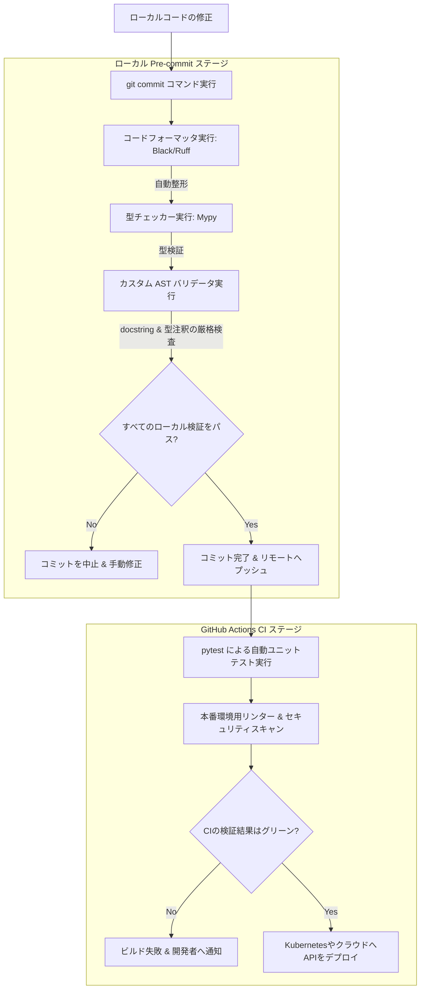

### 🎯 学習目標
- 継続的インテグレーション（CI）における静的検証ワークフローを設計・統合できる。
- コードをコミットする前にフォーマット、静的解析、型チェックを自動化するローカルの pre-commit フックを構築できる。
- 抽象構文木（AST）を使用して、Python コードの内部構造を解析できる。
- `ast` モジュールを用いてカスタムバリデータを作成し、「型ヒントやドキュメンテーション文字列（docstring）の必須化」などの独自の設計制約をプログラムレベルで適用できる。
- 終了コード（Exit Code）によるゲートキーピングの仕組みを構築し、基準を満たさないコードがブランチ履歴に入るのを防ぐことができる。

### 🧩 中核概念（なぜ）

#### 1. なぜCI/CDによる検証の自動化が重要なのか
プロの開発現場において、手動でのコードレビューだけに頼ることはヒューマンエラーの原因になります。継続的インテグレーション（CI）は、検証プロセスを自動化します。
- **一貫性**: マージされるすべてのコードが、同一のスタイル、品質基準、および型注釈のガイドラインに従っていることを保証します。
- **フェイルファスト（Fail Fast）**: デグレーション（先祖返り）、フォーマットの乱れ、および型のエラーを数分以内に自動で検出・指摘し、バグが本番環境へ入り込むのを防ぎます。
- **人間の手間の削減**: 構文、書式、静的解析などの機械的な検証を自動チェックに任せることで、シニアエンジニアがコードロジックのレビューに集中できます。

#### 2. Pre-Commit フック vs. CI パイプライン
信頼性の高いワークフローでは、検証を以下の二重のレイヤーで実施します。
- **ローカルの Pre-commit フック**: 開発者のローカル環境で `git commit` が実行される直前にフック（インターセプト）して検証を行います。検証が失敗した場合、コミット処理自体が中止されます。これにより、リモートサーバーでのビルド時間を節約し、Git コミット履歴を綺麗に保てます。
- **CI パイプライン（リモート）**: コードがリポジトリにプッシュされた後、Git サーバー（GitHub Actions、GitLab CI など）上で実行されます。マージ前の最終的な「正当性の保証（ゲートキーパー）」として機能します。

#### 3. 代表的な検証ツール
- **リンター / フォーマッタ（Ruff / Black）**: コードスタイルを統一し、使用されていないインポートの削除や書式の乱れを自動修正します。
- **静的型チェッカー（Mypy）**: 型の定義を追跡し、型注釈に違反しているコードを検出します。
- **カスタムバリデータ（AST）**: 標準のリンターだけでは「APIエンドポイントの関数には必ずドキュメンテーション文字列（docstring）を書くこと」や「データベースのモデルクラスは必ず特定のベースクラスを継承すること」といったプロジェクト独自の規約を強制できません。Python の抽象構文木（AST）を利用することで、コードの構造をプログラムでパースし、これらを検証できます。

---

### 🔁 ロジックと動作

以下は、コードがローカル環境でコミットされ、リモートの CI で検証されて本番環境へデプロイされるまでのライフサイクルを示すアーキテクチャフロー図です。



1. **ローカルコミットの捕捉**: `git commit` を実行すると、pre-commit スクリプトが自動起動します。
2. **ローカルチェックの実行**: 整形、型検証、およびカスタム AST 解析が実行されます。
3. **リモートへのプッシュとCI**: ローカル検証をパスするとコミットが成立し、プッシュできます。CI サーバーはプッシュを検知してクリーンな環境を作成し、`pytest` を用いたテストスイートの実行やセキュリティ監査を行います。
4. **デプロイ**: すべての CI ステージが正常終了（終了コード `0`）すると、API がビルドされてリリースされます。

---

### 📝 注釈付きサンプル

#### 1. 抽象構文木（AST）を利用したカスタムコード検証
AST は、ソースコードをプログラミング言語の構文ルールに基づくノードのツリー構造に変換したものです。以下のスクリプトは、ファイル内の AST を走査し、すべての関数に型ヒントと docstring が書かれているかチェックします。

```python
import ast

def inspect_source_code(source_code: str) -> dict:
    # ソースコードをパースして AST ツリーを構築
    tree = ast.parse(source_code)
    
    report = {
        "missing_docstrings": [],
        "missing_annotations": [],
        "errors": 0
    }
    
    # ツリー内のすべてのノードを走査
    for node in ast.walk(tree):
        # 関数定義（FunctionDef）のノードのみを対象にする
        if isinstance(node, ast.FunctionDef):
            func_name = node.name
            
            # ドキュメンテーション文字列 (docstring) のチェック
            docstring = ast.get_docstring(node)
            if not docstring:
                report["missing_docstrings"].append(func_name)
                report["errors"] += 1
                
            # 引数の型注釈のチェック
            for arg in node.args.args:
                # メソッドの場合、'self' や 'cls' はチェックから除外する
                if arg.arg in ("self", "cls"):
                    continue
                if arg.annotation is None:
                    report["missing_annotations"].append(f"{func_name}.{arg.arg}")
                    report["errors"] += 1
                    
            # 戻り値の型注釈のチェック
            if node.returns is None:
                report["missing_annotations"].append(f"{func_name}.returns")
                report["errors"] += 1
                
    return report

# 検証対象のサンプルコード
snippet = """
def add(x: int, y: int) -> int:
    '''2つの数値を足し合わせます。'''
    return x + y

def log_message(msg):
    print(msg)
"""

results = inspect_source_code(snippet)
print(results)
# 出力結果: {'missing_docstrings': ['log_message'], 'missing_annotations': ['log_message.msg', 'log_message.returns'], 'errors': 3}
```

#### 2. 模擬的な Pre-commit フック用スクリプト
Pre-commit フックや CI の処理は、プロセスの終了コード（Exit Code）に依存しています。`sys.exit(0)` を返すと成功、それ以外の非ゼロの終了コード（例: `sys.exit(1)`）を返すと失敗とみなされ、Git コミットの実行を中止したり、CI ビルドをレッド（失敗）にしたりします。

```python
import sys
import ast

def run_gatekeeper(file_path: str) -> None:
    print(f"[*] 解析中のファイル: {file_path}...")
    try:
        with open(file_path, "r", encoding="utf-8") as f:
            source = f.read()
            
        tree = ast.parse(source)
        errors_found = 0
        
        for node in ast.walk(tree):
            if isinstance(node, ast.FunctionDef):
                # 戻り値の型注釈がない関数を検出
                if node.returns is None:
                    print(f"[!] エラー: 関数 '{node.name}' に戻り値の型注釈がありません。")
                    errors_found += 1
                    
        if errors_found > 0:
            print("[-] 検証失敗。コードを修正してください。")
            sys.exit(1) # コミットまたはCIビルドを中止させる
            
        print("[+] 検証に合格しました。")
        sys.exit(0) # 成功終了
        
    except SyntaxError as e:
        print(f"[-] コード内に構文エラーがあります: {e}")
        sys.exit(1)
```

#### 3. 模擬的な CI パイプラインランナー
Python で作成した簡単なシミュレーションプログラムで、連続した検証ステップを実行します。

```python
import subprocess
import sys

def run_step(command: list[str]) -> bool:
    print(f"[*] 実行中: {' '.join(command)}")
    result = subprocess.run(command, capture_output=True, text=True)
    if result.returncode != 0:
        print(f"[-] ステップ失敗。エラー内容:\n{result.stderr or result.stdout}")
        return False
    print("[+] ステップ合格。")
    return True

def run_pipeline() -> None:
    # 1. 自動整形のチェック (black または ruff)
    if not run_step(["black", "--check", "."]):
        sys.exit(1)
        
    # 2. 静的型チェックの実行 (mypy)
    if not run_step(["mypy", "."]):
        sys.exit(1)
        
    # 3. ユニットテストの実行 (pytest)
    if not run_step(["pytest", "tests/"]):
        sys.exit(1)
        
    print("[SUCCESS] すべてのパイプライン検証ステージを通過しました。デプロイ準備完了。")
    sys.exit(0)
```

---

### ❌ よくある間違い

**間違い 1: 例外処理を行わずに raw ファイルの解析を試みる**
```python
import ast
def check_syntax(code: str):
    # 例外ハンドリングなしでASTのパースを実行
    tree = ast.parse(code)
    return "VALID"
```
```text
Traceback (most recent call last):
  File "validator.py", line 4, in check_syntax
    tree = ast.parse(code)
  File "/usr/lib/python3.10/ast.py", line 50, in parse
    return compile(source, filename, mode, flags,
  File "<unknown>", line 1
    def bad_func(x
                 ^
SyntaxError: unexpected EOF while parsing
```
```python
import ast
def check_syntax(code: str) -> str:
    try:
        ast.parse(code)
        return "VALID"
    except SyntaxError:
        return "INVALID"
```
> `ast.parse()` は、入力の文字列が有効な Python 構文でない場合に `SyntaxError` を送出します。検証用ツール内でこれが発生すると、ツール自体がクラッシュしてパイプラインが異常終了してしまいます。構文エラーはキャッチして「不合格」の結果として穏便に返す必要があります。

**間違い 2: メソッドの第一引数（self / cls）に対して無意味な型注釈チェックをしてしまう**
```python
import ast
def verify_no_missing_annotations(src: str) -> bool:
    tree = ast.parse(src)
    for node in ast.walk(tree):
        if isinstance(node, ast.FunctionDef):
            for arg in node.args.args:
                if arg.annotation is None:
                    return False
    return True
```
```text
Traceback (most recent call last):
  File "test_pipeline.py", line 6, in <module>
    # 有効なメソッド内の 'self' に型注釈がないため検証に失敗する
    assert verify_no_missing_annotations("class User:\n    def run(self):\n        pass") == True
AssertionError
```
```python
import ast
def verify_no_missing_annotations(src: str) -> bool:
    tree = ast.parse(src)
    for node in ast.walk(tree):
        if isinstance(node, ast.FunctionDef):
            for i, arg in enumerate(node.args.args):
                # インスタンスメソッドやクラスメソッドの第一引数 'self' や 'cls' はスキップする
                if i == 0 and arg.arg in ("self", "cls"):
                    continue
                if arg.annotation is None:
                    return False
    return True
```
> Python のオブジェクト指向プログラミング（OOP）において、インスタンスメソッドの `self` やクラスメソッドの `cls` には型注釈は不要です（型チェッカーがコンテキストから自動で理解するため）。これらを除外しないと、一般的なクラスを含んだコードが不当に検証エラーとなってしまいます。

---

### 💡 コツ・イディオム

- **`pre-commit` フレームワークの利用**: `.git/hooks/pre-commit` に生の Bash スクリプトを手動で書くのではなく、Python 製の `pre-commit` ライブラリを使用してください。依存関係の自動インストール、ステージングされたファイルのみを対象とする最適化、環境のキャッシュなどを自動で管理してくれます。
- **フェイルファストとコスト意識**: CI パイプラインを組む際は、実行時間の短い静的チェック（Ruff, Black）を先頭に配置し、実行に時間のかかるテスト（pytest, 結合テスト）を最後に実行するようにします。これにより、素早いフィードバックが得られ、無駄なビルドサーバー代を抑えられます。
- **正規表現ではなく AST を使う**: コードの文法チェックやインポートルールの検索に、正規表現（regex）を使用してはいけません。正規表現はコメント内の文字やインデントの変化などで容易に誤検知を起こします。文法の解析には、常に Python 内蔵の `ast` モジュールを使用してください。

---

### 🧠 深掘り（内部の仕組み）
<details><summary>抽象構文木（AST）、NodeVisitorによる走査、および CI プロセスの終了コード</summary>

#### 1. 抽象構文木（AST）とは？
コンパイラやインタプリタは、ソースコードを実行する前に、まず文字列トークンを解析して抽象構文木（AST）と呼ばれる構造を構築します。
- 木（ツリー）の各ノードがコードの要素に対応しています。例えば、`FunctionDef` ノードは関数の定義を表し、`BinOp` ノードは `+` などの二項演算を表し、`Call` は関数の呼び出しを表します。
- このツリーをたどることで、ツールはコードを実行することなく、その意味論的な構造を正しく把握できます。
- Python は標準モジュールとして `ast` を提供しており、ソースコードから AST を抽出、分析、あるいはノードを変更して再コンパイルすることができます。

#### 2. NodeVisitor によるスマートな走査
`ast.walk()` をループで回してすべてのノードを愚直に探索する代わりに、`ast.NodeVisitor` クラスを継承すると、特定のノードだけをスマートに処理できます。

```python
import ast

class MethodAnnotationValidator(ast.NodeVisitor):
    def visit_FunctionDef(self, node: ast.FunctionDef):
        # 探索中に FunctionDef ノードが見つかると、このメソッドが自動で呼ばれる
        if node.returns is None:
            print(f"[-] 戻り値の型がないメソッドを検出: {node.name}")
        # 子ノードへの探索を継続させる
        self.generic_visit(node)

# 使用例:
# validator = MethodAnnotationValidator()
# validator.visit(tree)
```

#### 3. オペレーティングシステムと終了コード（Exit Codes）
あらゆるシェルコマンドは、実行終了時に終了ステータスコード（`0` 〜 `255` の整数）をオペレーティングシステムに返します。
- **`0`**: コマンドが正常に完了したことを示します。
- **非ゼロ（`1`, `2`, `127` など）**: エラーが発生したことを示します。
GitHub Actions などの CI エンジンは、ワークフロー内のステップを順次実行します。いずれかのステップが非ゼロの終了コードを出力すると、CI は即座に実行を停止し、ビルド結果を「レッド（失敗）」にしてマージをブロックします。したがって、検証スクリプトはエラー検出時に `sys.exit(1)` などの非ゼロ値で終了する必要があります。
</details>

---

### 🏋️ 演習
パイプラインバリデータ `verify_pipeline(code_module_src: str) -> str` を実装し、以下をチェックしてください：
1. 型注釈：すべての関数が型ヒントを持っていること。 "PASS" または "FAIL" を返します。

```python
import sys

# パイプラインバリデータ `verify_pipeline(code_module_src: str) -> str` を実装し、以下をチェックしてください：
# 1. 型注釈：すべての関数が型ヒントを持っていること。 "PASS" または "FAIL" を返します。
def verify_pipeline(code_module_src: str) -> str:
    pass
```

---

### ✅ 自己チェック
1. リモートの CI サーバーだけに頼るのではなく、ローカルの pre-commit フックを使用するメリットは何ですか？
2. 構文が壊れているコード文字列を `ast.parse()` に渡すと、どのような Python 例外が投げられますか？
3. CI エンジンは、シェルスクリプト内の特定のステップが失敗したかどうかをどうやって判断しますか？
<details><summary>自己チェックの解答</summary>

1. コミットを作成する前にフォーマットや型エラーをローカルで即座に検知・修正できるため、リモート CI の余分なビルド待機時間を減らし、リポジトリのコミット履歴をきれいに保つことができます。
2. `SyntaxError` 例外が投げられます。
3. 実行されたプロセスの終了コード（Exit Code）を確認し、それが `0` 以外であれば「失敗」と判定します。
</details>

---

### 📌 まとめ
- **CI パイプライン**は、チーム全体のコード品質と規約の遵守を自動検証するための重要なインフラです。
- **Pre-commit フック**は、不完全なコードのコミットを防ぎ、開発者に最速のフィードバックを提供します。
- **抽象構文木（AST）**は、コードを実行することなくその文法と構造をプログラムで読み解くための強力なツールです。
- **`ast.parse` と `ast.walk`** を利用することで、標準のツールでは強制できない独自の規約チェックを容易に自動化できます。
- **終了コード（Exit Code）**は、コマンドの成否を連携し、ビルドやデプロイプロセスの続行・停止を判定する基礎システムです。
