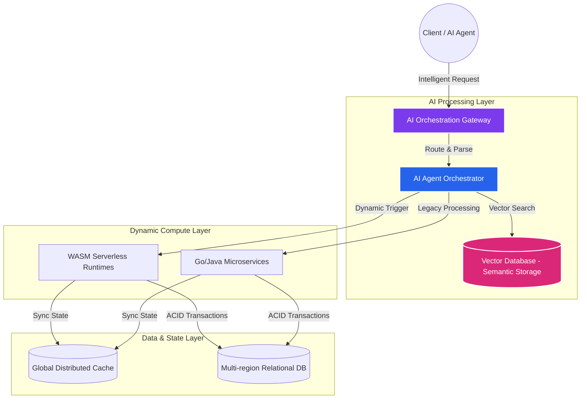

# Day 01: 旅の始まり - System Designとは何か？ 🏗️

**System Design Master** (🔊) (システムデザインマスター) の旅へようこそ！今日から、単なるプログラマーからエリート **System Architect** (🔊) (システムアーキテクト - システム設計者) へとマインドセットをシフトする、革新的な道が始まります。

テクノロジーの世界には、中堅開発者とシニアエンジニアを隔てる、目に見えないが頑丈な境界線が存在します。その境界線は、あなたがいくつのプログラミング言語を知っているかではなく、何百万人、あるいは何億人ものアクティブユーザーを処理する回復力のあるシステムを設計し、運用できる能力があるかどうかです。今日、私たちはその境界線を打ち破ります。

---

## 🪝 THE HOOK：「ブラックフライデー」の悲劇と100万ドル帝国の崩壊

あなたが急成長中のEC系スタートアップの最高技術責任者（CTO）であると想像してください。年間で最大の「ブラックフライデー」のメガセールに向けて半年間綿密な準備を重ね、マーケティングチームは大規模なトラフィックを呼び込みました。**Concurrent Users** (🔊) (同時実行ユーザー - コネクション数) は通常の200倍に跳ね上がります。

ちょうど00:00、時計の針が重なりました。突然、中央監視ダッシュボードがシステムの死を示す深い血の赤へと染まります。
- 最初の2秒以内で、**Database Connection Pool** (🔊) (データベース・コネクションプール) が完全に枯渇します。
- アプリケーションサーバーの **CPU** 使用率が100%に達し、一連の **Cascading Failures** (🔊) (連鎖的障害 - カスケードダウン) が引き起こされます。
- スレッドが深刻なデッドロック（Deadlock）に陥り、RAMの過負荷によって無限の **Garbage Collection (GC) Pause Loops** が誘発されます。
- 顧客はチェックアウトに進めず、**502 Bad Gateway** や **504 Gateway Timeout** のエラー画面を繰り返し見ることになります。

システムが完全に麻痺したわずか1時間で、あなたのスタートアップは **120万ドル** の直接的な売上機会を失いました。しかし、それ以上に恐ろしいのは、何年もかけて築き上げてきたブランドに対する顧客の「信頼」が完全に崩壊してしまったことです。

**失敗の原因はどこにあったのでしょうか？** コードベースを詳しく調べてみると、開発者が書いたコードは1行残らず高度に最適化されていました。検索アルゴリズムはすべてO(1)またはO(log N)の計算量で実行されていました。失敗の原因はコードにはありません。**System Design** (🔊) (システムデザイン - システム設計) の欠陥にありました。あなたは「平屋の小さな家」を建てたのに、そこに10万人収容のスタジアムの観客を詰め込もうとしたのです。

人間をエージェントとして代替する **Autonomous AI Agents** (🔊) (自律型AIエージェント - AIエージェント) が毎秒数千回もの複雑なリクエストを自動的に送信する2026年のAI時代において、インフラへの負荷は指数関数的に高まっています。回復力のあるシステムの設計はもはや「あれば望ましい贅沢品」ではなく、トラフィックの嵐の中でもあなたとあなたのビジネスを生き残らせるための「究極の生存スキル」なのです。

---

## 🎭 ANALOGY：東京という大都市を計画する芸術

システム設計の本質を真に理解するために、コンピュータの画面から一歩離れて、3700万人以上の住民を抱える世界最大の超巨大都市 **東京** の都市計画をどのように進めているか観察してみましょう：

| 側面 | Coding (プログラミング - 家を建てること) 🏠 | System Design (システム設計 - 都市計画) 🏙️ |
| :--- | :--- | :--- |
| **焦点** | 微視的な詳細に集中する (Microscopic view) | 巨視的な全体像に焦点を当てる (Macroscopic view) |
| **作業** | レンガを積み、ドアを取り付け、配線し、セメントを混ぜる。壁が割れないようにし、ドアがスムーズに開閉するようにする。 | 用途地域地域（ゾーニング）の設定、交通網、電気・水供給の計画、危機管理。 |
| **要件** | コードがコンパイルされ、アルゴリズムが最適化され、構文エラーがないこと。 | コンポーネント間の調整、耐障害性、人口増加に伴うスケーラビリティ。 |
| **障害** | 電球の破裂、蛇口の水漏れ（局所的な簡単な修理で解決可能）。 | 都市全体の交通渋滞、ダムの決壊、大規模な停電（システム全体の災害）。 |

一軒の美しい家を建てる方法しか知らない場合、人口が1000万人に跳ね上がったとき、あなたの唯一のアドバイスは「もっと高い家を建てなさい」（**Vertical Scaling**）ということになります。しかし、本物の **System Architect** は、環状道路、地下鉄の乗り換え拠点、多重化されたバックアップ電力網、および分散型の変電所を設計します（**Horizontal Scaling**）。目標は、一つの地区で火災や停電が発生しても、都市の99.99%が明るいまま正常に稼働し続けることを保証することです。

---

## ⚙️ UNDER THE HOOD：トレードオフの科学（妥協と最良の選択）

### 1. システム設計の定義
**System Design** (🔊) とは、特定のビジネスおよび技術的要件を満たすために、システムのアーキテクチャ、コンポーネント、インターフェース、およびデータを定義するプロセスです。

「完璧なシステム」などというものは存在せず、あるのは「制約の中で最も適切なシステム」だけです。システム設計におけるすべての決定は、**Trade-off** (🔊) (トレードオフ - 妥協と妥当選択) です。書き込み速度を極限まで高めたいですか？それならば、データが一瞬だけすべての場所で一致しない可能性（結果整合性）を受け入れなければなりません。100%の可用性を実現したいですか？それならば、インフラコストが3倍に膨れ上がることを許容する必要があります。

### 2. システム設計における要件
何かを設計する前に、以下の2種類の要件を明確に区別しなければなりません：
- **Functional Requirements (機能要件)**: システムが何をしなければならないか。
  *例*: 「ユーザーは動画をアップロードできる」「ユーザーは投稿にコメントできる」。
- **Non-functional Requirements (NFRs - 非機能要件)**: システムがどれだけうまく機能するか。これこそがシステム設計の主戦場です。
  *例*: 「システムのレイテンシは200ミリ秒未満でなければならない」「システムは99.99%の信頼性を達成しなければならない」。

### 3. 2026年におけるシステム設計の4大柱

#### A. Scalability (スケーラビリティ - 拡張性) (🔊)
リソースを増強することによって、システムが増加する負荷を処理する能力。
-   **Vertical Scaling (スケールアップ - 垂直スケール)**: 単一のサーバーをより強力なハードウェアにアップグレードすること（高速なCPU、大容量のRAM）。ソフトウェアアーキテクチャはシンプルに保てますが、物理的な限界に達しやすく、**Single Point of Failure (SPOF)** (🔊) (単一障害点 - エスピーオーエフ) を生み出します。
-   **Horizontal Scaling (スケールアウト - 水平スケール)**: ネットワーク接続された低コストなサーバーを複数追加すること。大規模システムにおいては必須の手段ですが、データ同期の難易度は上がります。

#### B. Availability (アベイラビリティ - 可用性) (🔊)
システムが稼働し続け、ユーザーのリクエストに対して応答できる時間の割合。
-   「9の数（The Nines）」で測定されます：
    -   **99.9% (Three Nines)**: 許容される年間最大ダウンタイムは **8.76時間**（中規模プロジェクトで許容される基準）。
    -   **99.999% (Five Nines)**: 許容される年間最大ダウンタイムはわずか **5.26分**！これは通信、フィンテック、医療システムのゴールドスタンダードです。
-   データの冗長化（**Redundancy** (🔊)）と自動系切り替え機能（**Failover** (🔊)）によって実現されます。

#### C. Reliability (リライアビリティ - 信頼性) (🔊)
一部のハードウェアまたはソフトウェアコンポーネントが故障しても、システムが正しく動作し続ける能力（**Fault Tolerance** (🔊) (耐障害性 - フォールトトレランス)）。可用性が高いシステムであっても、破損したデータを頻繁に返したり、顧客のレコードを紛失したりする場合は、信頼性が高い（Reliable）とは言えません。

#### D. AI-Adaptability (AI適応性 - エーアイアプタビリティ - 2026年の新たな柱) (🔊)
2026年の環境において、システムはもはや静的ではありません。モダンなインフラは軽量な Edge LLMs を統合し、リアルタイムでユーザーの行動を分析し続け、トラフィックの急増を事前に予測して、ネットワークやストレージリソースが枯渇する前に動的に先回りして割り当てます。

---

## 🏗️ 2026年の次世代分散型システムアーキテクチャ

以下は、2026年に広く採用されている最先端のAIネイティブ分散アーキテクチャの全体像です：

2026年までに、アーキテクチャはモノリシックな設計や単純なマイクロサービスをはるかに超えて進化しました。**AI Orchestration Gateway** はリクエスト（単なるREST APIだけでなく、AIエージェントからの自然言語コマンドも含む）を受け取り、**Vector DB** を通じて意味論的意図を解釈し、**WebAssembly (WASM)** ランタイム上で動作する超高速サーバーレス関数をトリガーして、コールドスタート時間を1ミリ秒未満に抑えます。

---

## 💻 SYSTEM DESIGN INTERVIEW：Big Tech標準の面接フレームワーク

グローバルテック企業（Google、Meta、Netflixなど）のシステム設計面接では、いきなり図を描いたりテクノロジーを選定したりしては絶対にいけません。そのような行動は不合格に直結します。以下の4ステップのフレームワークを厳格に守らなければなりません：

### ステップ1：要件の明確化と設計範囲の決定 (Requirements Clarification)
明確な質問を投げかけ、設計上の制約を理解します。
- *機能面*: 「ユーザーは何ができますか？リアルタイムチャットをサポートする必要がありますか？」
- *規模面*: 「システムの1日あたりのアクティブユーザー数（DAU）はどれくらいですか？成長予測は？」

### ステップ2：概算見積もり (Back-of-the-envelope estimation)
簡単な計算を行い、ハードウェアやネットワークリソースの必要量を推測します：
-   **QPS (Queries Per Second - 1秒あたりのクエリ数)**: 1日あたり1億人のDAUを抱え、各ユーザーが平均して1日あたり10回リクエストを送る場合：
    $$\text{1日の総リクエスト数} = 100,000,000 \times 10 = 1,000,000,000 \text{ リクエスト}$$
    $$\text{平均 QPS} = \frac{1,000,000,000}{86400 \text{ 秒}} \approx 11,574 \text{ QPS}$$
    $$\text{ピーク時 QPS} = 11,574 \times 3 \approx 35,000 \text{ QPS}$$
-   **ネットワーク帯域幅とストレージ**: アップロードされる画像やユーザーのデータを保存するために、1日にどれだけのSSDストレージアレイが必要になるかを算出します。

### ステップ3：概略設計 (High-level Design)
大きな箱（ボックス）を使ってアーキテクチャの全体図を描きます：
- クライアントは **DNS** を経由して **Load Balancer** に接続します。
- **Load Balancer** はトラフィックを **Application Servers** (Webサーバー) に分散します。
- **Application Servers** は **Cache (Redis)** および **Database** と通信します。

### ステップ4：詳細設計 (Deep Dive)
シニアレベルの実力をここでアピールします：
- 単一障害点（SPOF）をどのように排除しますか？ (マルチリージョンでのActive-Active構成を採用する)。
- 毎秒発生する大量の同時書き込みをどのように処理しますか？ (Kafkaのようなメッセージブローカーを導入する)。

---

## ☁️ SYSTEM DESIGN IN PRACTICE：アーキテクトとしての思考プロセス

**現実の課題:「5億人のユーザーを抱える、Instagramのような画像共有ソーシャルシステムを設計せよ」**

-   **中堅開発者の思考**:
    「画像のアップロードAPIを素早く処理するために、Node.jsかGoを選びます。画像とユーザー情報を保存するためにPostgresデータベースを構築し...」 -> **このアプローチは実装の詳細にフォーカスしすぎており、面接官に十分な印象を与えることはできません。**

-   **本物のシステムアーキテクトの思考**:
    「5億人のユーザー規模を考慮し、まずシステムの特性を分析します：
    1.  このシステムは極めて **Read-heavy** (読み込み重視) な性質を持っています。ユーザーは画像をアップロードするよりも、画像を閲覧する回数が100倍以上多くなります。したがって、データベースの **Read Replicas** (読み取り専用レプリカ) を使用し、グローバルに分散された **CDN** を組み合わせて、画像のアクセスレイテンシを最小限に抑えます。
    2.  画像のアップロードは、非同期処理（**Asynchronous processing**）として実装します。ユーザーが画像をアップロードすると、ファイルはまず Kafka のようなメッセージキュー（**Message Queue**）に送られます。バックグラウンドのワーカーが自動で画像圧縮、メタデータ抽出、およびサムネイル生成を裏で行うため、ユーザーは処理の完了を待つ必要がありません。
    3.  ペタバイト規模の画像ファイルをコスト効率よく保存するために、Blobオブジェクトストレージ（AWS S3など）を使用し、データのライフサイクルポリシーを策定します。新しい画像は超高速なSSDアレイ（Hot Storage）に保存し、30日以上経過した画像は自動的に安価なディスクアレイ（Cold Storage）へと移行します」

---

## 📝 クイッククイズ：あなたの「アーキテクトとしての知性」をチェックしよう

**問1: 高い可用性（High Availability）を持ちながら、信頼性が低い（Unreliable）システムとは、具体的にどのような挙動を示しますか？**
A. システム全体が頻繁に完全にクラッシュし、何日もアクセスできなくなる。
B. システムは常に素早く応答するが、返されるデータが頻繁に破損していたり、失われていたり、顧客のアカウント残高が誤って表示されたりする。
C. トラフィックが急増したときに、システムが水平拡張できない。

**問2: 銀行の決済システムを設計することになりました。データベースに対する最も重要な要件は何ですか？**
A. 事前のルールなしに、データベースのスキーマを動的にいつでも自由に変更できること。
B. すべての送金トランザクションの整合性と原子性を保証するために、絶対的にACID特性に準拠していること。
C. データの消失リスクを考慮せず、最も高速に非同期で書き込めること。

**問3: データベースサーバーの単一障害点（SPOF）を完全に排除できるソリューションはどれですか？**
A. 既存のデータベースサーバーにより強力なCPUを購入して差し込む。
B. データベースのレプリケーション（Primary-Secondary Replication）を構築し、自動フェイルオーバー（Failover）メカニズムと組み合わせる。
C. 開発者のSQLクエリを最適化する。

**問4: 垂直スケール（Vertical Scaling）と水平スケール（Horizontal Scaling）の根本的な違いは何ですか？**
A. 垂直スケールは安価なサーバーを多数追加し、水平スケールはより高価なサーバーを購入すること。
B. 垂直スケールは単一サーバーのハードウェアスペックを増強することであり、水平スケールは負荷を分散するためにサーバーをクラスタに追加すること。
C. 両者とも物理的な限界は同一である。

**問5: 設計の初期段階において、なぜ「概算見積もり（Back-of-the-envelope estimation）」ステップが極めて重要なのですか？**
A. プログラマーが書くべきコードの行数を把握するため。
B. アーキテクトが必要なハードウェア、ネットワーク帯域、およびストレージの容量を正しく算出し、過剰設計（Over-engineering）や深刻なリソース不足を防ぐため。
C. CEOに提出する財務報告書を作成するため。

---

**正解と詳細な解説:**
1.  **B** - 可用性は「稼働時間」を測定し、信頼性は結果の「正確性と完全性」を測定します。ダウンしないが計算ミスを連発するシステムは「Unreliable」です。
2.  **B** - 金融取引には絶対的な正確性が必要です。原子性（Atomicity）は、取引の途中で資金が消滅しないことを保証します。
3.  **B** - 冗長化された予備サーバーを用意することで、メインデータベースが故障した際に即座にセカンダリに引き継ぎ、運用を継続できます。
4.  **B** - 1台のマシンのスペックアップ（垂直）には物理的な限界が存在します。分散したマシンを追加する（水平）アプローチは、無限にスケーラブルです。
5.  **B** - 見積もりは適切なテクノロジー選定を可能にします。データ量がわずか10GBであれば、複雑な Hadoop や Cassandra の構築は必要ありません。

---

おめでとうございます、戦士たちよ！初日の学習を無事に完了しました。今日、あなたはプログラマーのマインドセットを超えて、システムアーキテクトのガウンを身にまといました。明日は、グローバルなデータ伝送の「神経系」である **Networking & Protocols (ネットワークとプロトコル)** について深く学びましょう。

📊 **単語数: 2618語**
