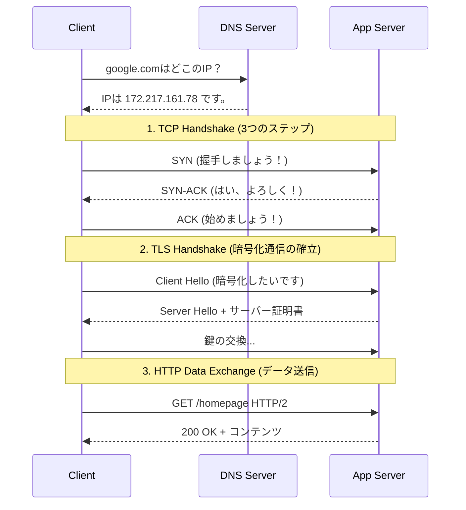

# Day 02: 神経系 - ネットワークとプロトコル 🌐

昨日、私たちはシステム設計の全体像を鳥瞰しました。今日から、あらゆるシステムの「神経系」である **Networking** (🔊) (ネットワーク) に深く潜っていきます。システム設計において、ネットワークはバラバラな部品を一つの統合された生命体として繋ぎ合わせる糸です。データの移動経路や仕組みを理解しなければ、ユーザー体験の最大の敵である **Latency** (🔊) (レイテンシ - 遅延) を最適化することはできません。

---

## 🪝 THE HOOK：高性能なサーバーなのに、なぜウェブサイトが「カメ」のように遅いのか？

あなたが非常に賢い「AI顔認識アプリケーション」をデプロイしたと想像してください。オフィス（ベトナム国内）で試すと、写真をアップロードしてから結果を受け取るまでのレスポンス時間はわずか **0.3秒**。完璧なプロダクトを作ったと大きな自信を抱くでしょう。

しかし、アメリカやヨーロッパの顧客がアクセスすると、「ウェブサイトの表示に **5秒** もかかる」という不満の声が上がります。サーバーを確認すると、CPU使用率は依然として低く、メモリも十分に余裕があります。ホスティングプランを最高スペックにアップグレードしたとしても、問題は改善しません。一体何が原因でしょうか？

残酷な現実ですが、光（データ）は海底に敷設された何万キロメートルもの光ファイバーケーブルを旅しなければなりません。クライアントとサーバーが「挨拶」を交わす接続の確立手順（**Handshake** (🔊) (ハンドシェイク)）は、**Round Trip Time (RTT)** (🔊) (ラウンドトリップタイム - 往復時間) と呼ばれる無視できない時間を消費します。もしネットワーク設計において無駄なハンドシェイクの往復が多すぎる場合、アプリケーションコードがどれだけ高速であっても、遠方のユーザーは長い間待たされることになります。アーキテクトとして、私たちはスマートなプロトコルを通じて「ネットワーク上の物理的距離を縮める」方法を学ばなければなりません。

---

## 🎭 ANALOGY：国際小包の発送 vs. ネットワークのデータ流

複雑なコンピュータネットワークを視覚化するために、グローバルなロジスティクス（物流）システムに例えて考えてみましょう：

1.  **小包 (Payload)** (🔊) (ペイロード - データ本体): 送信したい実際のデータ（JSONファイル、写真、ビデオなど）。
2.  **住所 (IP Address)** (🔊) (IPアドレス): すべての家（サーバーや携帯電話）には一意の住所が割り当てられており、郵便局が何十億人の中からあなたを見つけ出せるようになっています。IPがなければ、データは宛先を失いさまようことになります。
3.  **配送サービス (Protocol)** (🔊) (プロトコル - 通信規約): 
    -   **TCP** (🔊): 配達保証付きの **FedEx** (🔊) のようなサービス。配達員はあなたが家にいるか事前に電話で確認し（**Connection-oriented** (🔊) (コネクション型 - 接続指向型)）、受け取り時には必ずサインを求めます。輸送中に小包が破損したり紛失したりした場合、彼らは最初から新しいものを取り直して再送してくれます。手続きが多いため速度は劣りますが、銀行データのような「機密性の高い品物」には極めて安全です。
    -   **UDP** (🔊): 飛行機から広告のチラシをばら撒くようなもの。高速で安価であり、受け取り手が誰であるかは一切気にしません。いくつかのチラシは風に流されて失われるかもしれませんが、非常に短時間で広範囲に届けることができます。ライブストリーミングやオンラインゲームなど、数フレームが欠落しても問題にならず、一瞬の「ラグ」すら許されない用途に適しています。
4.  **玄関の門 (Ports)** (🔊) (ポート番号): 一つの家には複数のドアが存在します。通常の歩行者用の80番ドア（HTTP）、高度なセキュリティが必要なVIP専用の443番ドア（HTTPS）、オーナーがメンテナンスのために出入りする22番ドア（SSH）などです。

---

## ⚙️ UNDER THE HOOD：ネットワーク層とプロトコルの進化

### 1. OSI参照モデルと実用的なアプローチ
大学では、OSIの7階層モデルを暗記させられたかもしれません。しかし、**System Design Interview** (🔊) (システム設計面接) においては、**TCP/IPスタック** の4つのコア階層だけに集中すれば十分です：

-   **Layer 4 (Transport Layer)** (🔊) (トランスポート層): データが「どのように」輸送されるか（TCPかUDPか）を決定します。**L4ロードバランサー** はこの層で動作し、パケットを開けて中身を検査する必要がない（外側の宛先住所を見るだけ）ため、極めて高速に動作します。
-   **Layer 7 (Application Layer)** (🔊) (アプリケーション層): 開発者が最もよく使う HTTP、WebSockets、gRPC などのプロトコルが動作する場所です。最も「インテリジェント」な階層であり、**L7ロードバランサー** はパケットの中身（ヘッダー）を読み取り、リクエストが `/api/user` なのか `/static/image` なのかを識別して正確に振り分けることができます。

### 2. 永遠の戦い：TCP vs. UDP
アーキテクトにとって、ネットワーク層における最大の **Trade-off** (🔊) (トレードオフ - 妥協と選択) は「信頼性」を取るか「速度」を取るかです。

-   **TCP (Transmission Control Protocol)**:
    -   **メカニズム**: **Three-way Handshake** (🔊) (3ウェイ・ハンドシェイク: SYN -> SYN-ACK -> ACK の3ステップ) を用いて接続を確立します。
    -   **メリット**: データが正しい順序で、欠損や破損なく届くことを保証します。
    -   **デメリット**: 接続確立までに時間がかかります。先頭パケットの詰まり（**Head-of-Line Blocking** (🔊)）が発生しやすく、1つのパケットの紛失が全体のデータストリームを遅延させます。
    -   **主な用途**: データベース、Web API、金融システム。

-   **UDP (User Datagram Protocol)**:
    -   **メカニズム**: 「送信したらあとは忘れる」（Fire and Forget）。
    -   **メリット**: 極めて高速で、接続のオーバーヘッドがありません。
    -   **デメリット**: 順序の保証がなく、再送メカニズムも持ちません。
    -   **主な用途**: ライブ配信、音声通話（声が途切れたり変に聞こえるのはUDPのパケットロスによるもの）、クラウドゲーミング。

### 3. DNS (Domain Name System) - インターネットの巨大な電話帳
あなたが `systemdesign.io` と入力した際、コンピュータは宛先が分かりません。そのため、一連の **DNS Resolvers** (🔊) (DNSリゾルバー) へ問い合わせを行い、そのドメイン名を `104.21.32.11` のようなIPアドレスに翻訳します。
**高度なアーキテクチャ**: 大規模システムでは **GeoDNS** (🔊) を使用します。アメリカのユーザーからのリクエストにはアメリカのサーバーIPを返し、ベトナムのユーザーにはシンガポールのサーバーIPを返すことで、**Latency** を最小限に抑えます。

### 4. ネットワークフロー図 (Mermaid)

現代のHTTPS接続がどのように確立されるかを見てみましょう：

**上の図から何が分かりますか？** たった1つのファイルを取得するだけでも、クライアントは少なくとも9〜10回のメッセージ往復を行う必要があります。地理的な距離が遠く、それぞれの往復に100ミリ秒かかる場合、画面に何かが表示されるまでにユーザーは少なくとも1秒以上待たされることになります。これが **HTTP/3** が必要とされる理由です。

### 5. 驚異の進化：HTTP/1.1 -> HTTP/2 -> HTTP/3
-   **HTTP/1.1**: クラシック。リクエストごとに新しい接続を開くか、キューで順番待ちをする必要があり、非常に低速です。
-   **HTTP/2**: **Multiplexing** (🔊) (多重化 - 1本の接続内で複数のリクエストを同時に送信する技術) によって大きな躍進を遂げました。しかし、TCPの性質上、輸送中にパケットが1つでも失われると、全体の通信が詰まってしまう問題がありました。
-   **HTTP/3**: **QUIC** (🔊) というプロトコル上で動作します（UDPをベースにしながら、暗号化とエラー訂正機能を内蔵）。これは2026年現在の新たな「スーパースター」であり、電波が弱い3G環境下でもウェブを爆速で動作させることができます。

### 🚀 2026年における最新の進化：衛星ネットワークとeBPF
2026年、ネットワークインフラは地上を越え、OSカーネルの奥深くまで浸透しています。
-   **衛星通信 (Starlink/Kuiper)**: グローバルシステムは、ユーザーが衛星経由でアクセスすることを前提に設計する必要があります。低軌道衛星（LEO）の遅延は **25-50ms** まで縮小し、極地や遠隔地からでもAIエージェントが安定して動作可能になりました。
-   **eBPF (Extended Berkeley Packet Filter)** (🔊): OSカーネル層における最新の「魔法」です。フィルタリングのためにデータをユーザー空間（アプリケーション層）まで引き上げる（CPUを浪費する）代わりに、Linuxカーネル内部で動作するコードを書き、パケット処理や監視、セキュリティ対策を「オーバーヘッドほぼゼロ」で実行します。2026年のインフラで **Cilium** や **Pixie** といえば、すべてこのeBPFの力によるものです。
-   **AI-Driven Routing (AI主導ルーティング)**: 現代のルーターは、海底光ファイバーの混雑をAIで予測し、障害が発生する前に能動的にデータを別ルートへ迂回させます。

---

## 💻 SYSTEM DESIGN INTERVIEW：Netflixの爆速配信を支える秘密

**面接の質問:「世界中の何百万ものユーザーが、動画の読み込みを待つ（バッファリング）ことなく、滑らかに4K動画を視聴できるようにするにはどう設計しますか？」**

-   **Bad Answer (悪い回答)**: 「高速なSSDをたくさん買い込んで、最高スペックのサーバーを用意します」 -> **不合格**。いくら強力なサーバーであっても、何百万もの同時接続トラフィックを1ヶ所で捌き切る帯域幅はありません。
-   **Architect Answer (アーキテクトの回答)**: 
    1.  **CDN (Content Delivery Network)** (🔊) の導入：Netflixは「Open Connect」と呼ばれる映画データ入りのキャッシュサーバーを、ローカルのインターネットプロバイダ（ISP）の設備内に直接設置しています。データは海を越えることなく、わずか数キロメートルの距離から自宅へ届けられます。
    2.  **Adaptive Bitrate Streaming (ABR)** (🔊): 動画を2〜5秒の短いセグメントに分割し、複数の画質で事前に用意します。ユーザーの回線が弱くなるとシステムは自動的に480pのセグメントを取得し、回線状況が回復するとシームレスに4Kへと切り替えます。
    3.  **パブリックインターネットのバイパス**: 独自の専用光ファイバー網と最適化されたルーティングを使用し、サーバー間で経由する中継機器の数（**Hops** (🔊) (ホップ数)）を最小限に抑えます。

---

## 🏗️ DEEP DIVE：IPv4 vs. IPv6 - なぜ移行が必要なのか？
IPv4（例: `192.168.1.1`）は、約43億個のアドレスしか作れません。現在、一人あたり2〜3台のデバイスを持ち、さらに何百億台ものIoT機器が存在するため、IPv4アドレスはとっくに枯渇しています。
**IPv6** は、「地球上のすべての砂粒に一意のIPアドレスを割り当てられる」ほどの天文学的なアドレス空間を提供します。容量だけでなく、セキュリティ機能（**IPSec**）の標準統合や、スマートなネットワーク管理機能も備わっています。

---

## 📝 クイッククイズ：あなたの「神経系」を強化しよう

**問1: 電車移動中など、通信環境が不安定な状況において、なぜHTTP/3はHTTP/2よりも高速で動作するのですか？**
A. TCPをより効率的に使用するため。
B. QUIC（UDPベース）上で動作するため、1つのパケット損失が他の無関係なデータストリーム全体の詰まりを引き起こさないから。
C. 暗号化処理を一切必要としないため。

**問2: あなたはオンライン証券取引システムを設計しています。注文受付チャネルにはどのプロトコルを優先して採用すべきですか？**
A. 速度が最優先であるため、UDPを採用する。
B. 安全性、正確性、および送信順序の保証が絶対に不可欠であるため、TCPを採用する。
C. シンプルであるため、HTTP/1.1を採用する。

**問3: Layer 7ロードバランサーの主な目的は何ですか？**
A. 単にIPアドレスのみに基づいてアクセス負荷を分散する。
B. Cookie、ヘッダー、またはURLのパス情報に基づいて、インテリジェントなルーティングを行う。
C. 物理的なネットワークケーブル同士を直接接続する。

**問4: ドメイン名を入力した際、あなたのデバイスへ最初にIPアドレスを返してくれるのはどのサービスですか？**
A. Webサーバー。
B. DNSリゾルバー。
C. データベースサーバー。

**問5: CDN (Content Delivery Network) は主にどのような要因によってレイテンシを減少させますか？**
A. サーバーのCPU性能を高めることによって。
B. データとユーザー間の地理的な距離を短縮することによって。
C. 物理的なインターネット回線そのものの速度を加速させることによって。

---

**正解:**
1. B
2. B
3. B
4. B
5. B

---

ネットワークは広大な世界ですが、これらの「トレードオフ」の原理原則さえしっかりと押さえておけば、大規模なシステム設計を始めることができます。明日は、システムの「交通整理役」である **Load Balancers & Proxies** について学びましょう。

📊 単語数: 2582語
