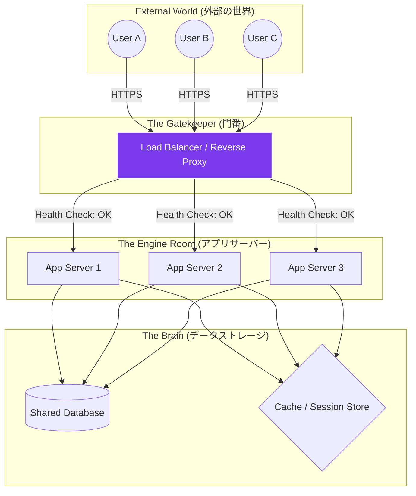

# Day 03: 交通整理の警官 - ロードバランサーとプロキシ 👮‍♂️

**System Design Master** (🔊) への旅の3日目へようこそ。最初の2日間で、私たちはシステム設計の全体像と、データがネットワークを移動する仕組みを把握しました。ここで、さらに大きな課題を考えてみましょう。「何百万ものアクセス要求が、たった一つのポイントに殺到したらどうなるでしょうか？」

どんなに「モンスター級」に高性能なサーバーであっても、CPU、メモリ、帯域幅には物理的な限界が存在します。全世界のユーザーをたった一台のサーバーで捌こうとするのは、システム設計ではなく「ギャンブル」です。今日は、システムアーキテクチャにおける偉大な「交通整理の警官」である **Load Balancers** (🔊) (ロードバランサー - 負荷分散装置) と **Proxies** (🔊) (プロキシ - 代理サーバー) について学びます。

---

## 🪝 THE HOOK：「スーパーサーバー」に約束された死と、致命的な脆弱性SPOF

あなたの会社は爆発的な成長を遂げています。アクセス数は毎週10倍に跳ね上がります。資金力のあるCEOは、数十万ドルを投じて「地球上で最も強力なサーバー」（256コアCPU、4TBメモリ、超高速NVMeストレージ）を購入することを決定しました。あなたは「これで絶対にサーバーがダウンすることはない！」と胸をなでおろすでしょう。

しかし、現実は想像以上に残酷です：

**シナリオ1 - インフラの天変地異**: ある嵐の夜、データセンターが停電に陥るか、この「スーパーサーバー」のメモリの1枚が故障します。サーバーが1台しかないため、会社のサービスは瞬時にインターネットから完全に消滅します。これが **Single Point of Failure (SPOF)** (🔊) (単一障害点) と呼ばれる致命的な弱点です。

**シナリオ2 - 物理的な壁**: ユーザー数がさらに100倍に膨れ上がります。このスーパーサーバーでさえ、あまりの超高負荷に悲鳴を上げ始めます。これ以上アップグレードしたくても、市場にはこれより強力なパーツは存在しません。あなたは **Vertical Scaling** (🔊) (垂直スケール - スケールアップ) の限界天井に達したのです。

この時、真のアーキテクトは静かに微笑みながらこう言います。「一つの超高層ビルを建てるのではなく、何百もの小さな家が集まる村を作りなさい」と。その村を効率的に管理するために、スマートな調整役が必要となります。それこそが **Load Balancing** (🔊) (負荷分散) です。

---

## 🎭 ANALOGY：ミシュラン星付きレストランの経営とスマートな交通整理

あなたが、常に満席で行列が途絶えない超高級レストランのマネージャーであると想像してください：

1.  **Server**: 厨房で忙しく働くシェフたち。
2.  **Request**: 店の外で長い行列を作って待っているお客様。
3.  **Vertical Scaling**: より鋭いナイフや最新の調理器具を買い与え、たった一人のシェフに光の速さで料理を作るよう強制します。しかし人間には限界があり、やがて燃え尽きて致命的なミスを犯すでしょう。
4.  **Horizontal Scaling** (🔊) (水平スケール - スケールアウト): 10人の新しいシェフを雇い、それぞれに得意分野の役割を割り当てます。この方がコストも安く、必要に応じて何人でも増やすことができます。
5.  **Load Balancer**: 入り口に立つ **Maitre d'** (🔊) (メイトル・ディ - 給仕長) の役割を果たします。
    -   新しいお客様のグループが到着すると、給仕長は厨房の様子を素早く確認します。もしシェフAが魚の調理で忙しく、シェフBの手が空いているなら、お客様をシェフBの席へと案内します。
    -   もしシェフの一人が指を怪我して休まなければならなくなった場合（サーバーのダウン）、給仕長はそれを瞬時に把握し、そのシェフにお客様の注文を回すのを直ちにストップします（**Health Check** (🔊) (ヘルスチェック)）。
    -   お客様（ユーザー）は入り口の給仕長と会話するだけでよく、奥の厨房に何人のシェフがいるのか、中がどれほど混乱しているかを知る必要はありません。お客様にとって、サービスは常に滞りなく提供され続けます。

---

## ⚙️ UNDER THE HOOD：ロードバランサー、リバースプロキシ、APIゲートウェイ

### 1. プロキシの分類：フォワードプロキシ vs. リバースプロキシ (最も混同しやすい概念！)
アーキテクトとして、これら2つの「代理人」の違いを明確に区別できなければなりません：

-   **Forward Proxy** (🔊) (フォワードプロキシ): **ユーザー側**に立ちます。あなたの代わりに外部のインターネットへ問い合わせに行きます。
    -   *例*: ブロックされたサイトにアクセスするためのVPN。(ユーザー -> プロキシ -> インターネット) 外部の世界からはプロキシのIPアドレスしか見えず、あなたの存在は隠されます。
-   **Reverse Proxy** (🔊) (リバースプロキシ - 逆プロキシ): **システム（サーバー）側**に立ちます。サーバー陣を代表してユーザーと通信を行います。
    -   *例*: Facebookのような巨大サイトには数百万のサーバーがありますが、ユーザーが知っているアドレスは `facebook.com` の一つだけです。あなたが実際に接続しているのは、このリバースプロキシです。(インターネット -> リバースプロキシ -> 内部サーバー群)

**ロードバランサーは、本質的に「負荷分散機能」を追加した特別なリバースプロキシの一種です。**

### 2. 「交通整理の警官」の頭脳（負荷分散アルゴリズム）(🔊)
ロードバランサーはランダムに仕事を割り振るわけではありません。厳格な論理規則に従っています：

-   **Round Robin** (🔊) (ラウンドロビン): 円を描くように順番に均等に割り振ります。リクエスト1はサーバーA、リクエスト2はサーバーBへ...（すべてのサーバーのスペックが同等である場合に適しています）。
-   **Least Connections** (🔊) (リーストコネクション - 最小接続数): 現在最も接続数が少なく、手の空いているサーバーに優先的にリクエストを送ります。処理時間が異なる処理（例: 単なる画像閲覧 vs. 重い動画のダウンロード）が混在する場合に極めて有効です。
-   **Weighted Algorithm (重み付けアルゴリズム)**: サーバーAがサーバーBの2倍の性能を持つ場合、高い「重み」を設定し、より多くの仕事を担当させます。
-   **IP Hash**: クライアントのIPアドレスに基づいて計算を行い、特定のユーザーからのアクセスを常に同じ特定のサーバーに誘導します。接続状態を保持する **Sticky Session** (🔊) (スティッキーセッション) を維持するために極めて重要です。

### 3. 負荷分散型アーキテクチャの全体像 (Mermaid)

**ロードバランサーの高度な機能:**
-   **SSL Termination** (🔊) (SSLターミネーション - SSL複合化処理): ロードバランサーが非常に重いHTTPS暗号の解読処理を一手に引き受け、内部のバックエンドサーバーには「生の暗号化されていないデータ」を送信します。これによりアプリサーバーのCPU負荷が大幅に軽減され、アプリのビジネスロジック処理に専念できるようになります。
-   **Layer 4 vs. Layer 7**: L4はIPとポート番号のみを見て振り分けます（極めて高速）。L7はCookieやURLパスなど、リクエストの中身まで深く解読して振り分けます（非常にインテリジェントであり、例えば `/video` へのリクエストを動画専用サーバー群へルーティングさせることができます）。
-   **Transformation (データ変換)**: レガシーな内部システムに合わせて、データのフォーマット（例: XMLからJSONへ）を変換します。

### 🌐 2026年現在の進化：Service MeshとAmbient Mesh
2026年現在、ロードバランサーは単にゲートに立つ「1台の物理マシン」ではありません。
-   **Service Mesh (Istio/Linkerd)**: システムが数千のマイクロサービスに分割されると、サービス間の通信管理は悪夢になります。Service Meshは、アプリケーションコードを一切変更することなく、サービス間に安全、確実、かつ可視化された通信ネットワーク層を構築します。
-   **Ambient Mesh**: 各サービスと並行して動作していた従来の「Sidecar（サイドカープロキシ）」を排除する新たなアプローチであり、インフラコストとネットワーク遅延を最大50%削減します。
-   **AI-Predictive Balancing**: 現代の分散コーディネーターはAIを活用し、フラッシュセールの開始前など、アクセスが急増する5〜10分前に「予測」して先回りしてサーバーを起動します。過負荷になってからスケールアウトを始める遅れを解消しました。

---

## 💻 SYSTEM DESIGN INTERVIEW：「Sticky Session」とState（状態）の難題

**面接の質問:「あるユーザーがログインし、カートの情報がサーバーAのメモリ内に保存されました。しかし次の瞬間、ロードバランサーがそのユーザーをサーバーBに誘導してしまいました。ユーザーはカートが空になり、強制ログアウトされたように見えてしまいます。この大惨事をどう防ぎますか？」**

これは、あなたのシステム思考能力を試す極めて一般的な「罠」質問です。

-   **Bad Answer (悪い回答)**: 「IP HashやSticky Sessionアルゴリズムを使って、そのユーザーのアクセスを永続的にサーバーAに固定（縛り付け）します」 -> **不合格**。もしサーバーAが突然ダウンした場合、そのユーザーのデータは完全に失われます。この設計は **スケーラブル（拡張可能）ではありません**。
-   **Architect Answer (アーキテクトの回答)**:
    1.  **Stateless Architecture** (🔊) (ステートレスアーキテクチャ) の設計: Webサーバーにユーザーの状態（ログインセッションやカートの中身など）を一切持たせないように設計します。
    2.  **Distributed Session Store (分散型セッションストア)**: セッション情報やカートデータは、超高速な中央集権型キャッシュである **Redis** (🔊) に保存します。
    3.  ロードバランサーがユーザーをサーバーA、B、あるいはZのどこに誘導したとしても、各サーバーは即座にRedisへ「このユーザーのカートの中身は何か？」と問い合わせを行い、シームレスに処理を実行します。これこそが、現代のあらゆる大規模システムの標準的な設計手法です。

---

## 🏗️ CASE STUDY：なぜ「海賊版サイト（Pirate Bay）」や大規模サイトは絶対に死なないのか？
彼らは地理的に分散された **Load Balancing** と匿名化された **Reverse Proxies** を駆使しています。たとえ一国の政府があるサーバー群を物理的に差し押さえたとしても、ロードバランサーは数ミリ秒以内に自動的かつ瞬時に、他国で稼働している別のサーバー群へアクセスを迂回させます。これこそが、高い可用性（**High Availability** (🔊)）の真の強みです。

---

## 📝 クイッククイズ：交通整理の警官の実力を試そう

**問1: リバースプロキシはフォワードプロキシと何が異なりますか？**
A. ユーザーのプライバシーを保護するためにユーザー側に立つ。
B. 外部のユーザーと通信する際、バックエンドサーバー群を代表し、サーバー群を保護するためにシステム側に立つ。
C. 単なる物理的なネットワークケーブルの延長である。

**問2: 「Least Connections」アルゴリズムは「Round Robin」と比べてどのような点で優れていますか？**
A. 常に最も美しいIPアドレスのサーバーを選択する。
B. 単に順番に均等に割り振るのではなく、サーバーの実際の負荷状況（どれだけ手が空いているか）を把握して割り振る。
C. 物理的なネットワークの伝送速度を速くする。

**問3: 「SSL Termination」はシステムにどのように貢献しますか？**
A. セキュリティをさらに強固にする。
B. 面倒なHTTPSの暗号復号処理をロードバランサーが引き受けることで、バックエンドサーバーのCPU負荷を軽減する。
C. 古くなったSSL接続を切断する。

**問4: ロードバランサーが、あるサーバーが「Health Check」に合格しなかったことを検知した場合、どうなりますか？**
A. 管理者や警察に通報する。
B. そのサーバーが正常に復帰するまで、ユーザーからのリクエストを自動的にそのサーバーへ転送するのを停止する。
C. そのサーバーに保存されている全コードを自動削除する。

**問5: 現代のシステム設計において、なぜ「Stateless Server」が好まれるのですか？**
A. データの保存スペースが小さくて済むため。
B. システムを容易に拡張（スケール）させることができ、一部のサーバーが故障してもデータ消失やセッション切断を防げるため。
C. サーバーの電気消費量を節約できるため。

---

**正解:**
1. B
2. B
3. B
4. B
5. B

---

これにて負荷分散と交通整理の学習は完了です。次のことを胸に刻んでください：**「システムの生命線は、障害への耐性と、負荷を分け合う能力にある」**。明日は、システムの「万能の記憶力」である **Caching Strategies（キャッシュ戦略）** について学びましょう。

📊 単語数: 2516語
