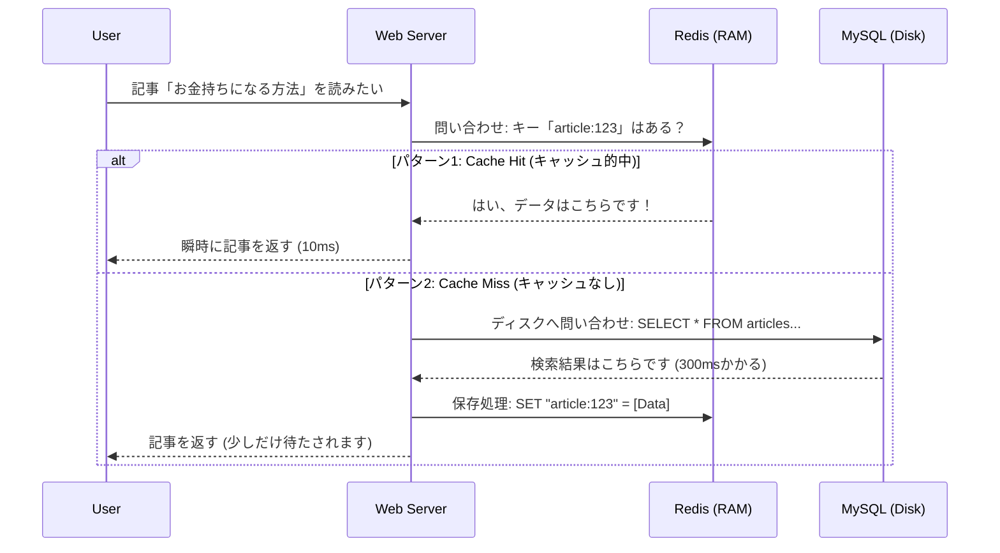

# Day 04: グローバルメモリ - キャッシュ戦略 🧠

Day 4へようこそ！昨日はロードバランサーを用いた高度なトラフィックの交通整理について学びました。今日は、システムに圧倒的な超高性能をもたらすために、アーキテクトが絶対に「マスター」しなければならない技術である **Caching** (🔊) (キャッシング - 一時記憶) について学習します。システム設計の世界には有名な格言があります。「コンピュータサイエンスにおいて難しい問題は2つしかない。キャッシュの無効化と名前付けだ」と。なぜキャッシュの破棄はこれほどまでに難しいのでしょうか？その秘密に迫りましょう。

---

## 🪝 THE HOOK：「バイラルトラフィック」の悪夢とデータベースの突然死

あなたがスポーツニュースサイトを運営していると想像してください。普段は1時間あたり約5,000人のアクティブユーザーを抱え、システムは非常にスムーズに稼働しています。しかし突然、代表チームが劇的な優勝を飾り、何百万人ものファンが一斉に喜びを分かち合うために「たった一つの同じ記事」へ殺到しました。

**シナリオ1 - キャッシュのない悲劇**:
1人のユーザーが記事を読むたびに、サーバーはデータベースに対してSQLクエリを発行します：`SELECT * FROM articles WHERE id = 123`。
1分間に100万回のアクセスが発生すると、データベースはディスク（SSDであっても）上の全く同じ場所を叩く100万回もの「**同一クエリ**」によって拷問を受けることになります。ディスクは加熱し、クエリのキューは無限に積み上がり、**Bottleneck** (🔊) (ボトルネック - 処理の滞り) が発生し、最終的にデータベースは「脳卒中」（クラッシュ）を起こします。最も重要なビジネスの「ゴールデンタイム」にシステム全体が完全停止するのです。

**シナリオ2 - キャッシュによる奇跡**:
最初のユーザーが訪れた際、サーバーはデータベースに問い合わせを行い、その結果を「超高速なメモリ」（**RAM** (🔊)）に保存します。
その後の999,999回のリクエストに対して、サーバーはわざわざデータベースに問い合わせを行いません。メモリからデータを直接取り出し、わずか数マイクロ秒で瞬時に応答を返します。データベースは他のクエリの処理に完全に集中でき、トラフィックが数千倍に跳ね上がっても、ウェブサイトは絹のように滑らかに稼働し続けます。

キャッシュの導入こそが、アマチュア向けの単純なアプリケーションと、FacebookやGoogleのようなグローバルスケールのモンスタープラットフォームを分ける決定的な境界線なのです。

---

## 🎭 ANALOGY：キッチンの冷蔵庫 vs. 遠くのスーパーマーケット

キャッシュの戦略を深く理解するために、日々の「料理のワークフロー」に例えて考えてみましょう：

1.  **元のデータ (Database)**: 郊外にある **巨大スーパーマーケット** のようなものです。必要なものは何でも揃っていますが、家から5キロメートルも離れています。卵が1個必要になるたびに、バイクに乗って出かけ、駐車場を探し、レジの行列に並んで、家まで戻ってこなければなりません。これは多大な時間と手間がかかります（**High Latency** (🔊) (高い遅延)）。
2.  **一時記憶 (Cache)**: キッチンのすぐそばにある **冷蔵庫** のようなものです。少量の食材しか保存できませんが、ドアを開けて取り出すのにわずか3秒しかかかりません。
3.  **コストとトレードオフ**: 冷蔵庫は容量が小さく高価です（RAMの容量は小さく、ディスクストレージに比べて容量単価が非常に高い）。そのため、スーパーマーケット丸ごと冷蔵庫に入れることは不可能です。最も頻繁に使う食材だけを選別して保存する必要があります。
4.  **古くなったデータ (Stale Data)**: 冷蔵庫の肉がとっくに傷んでいるのに、それに気づかず調理してゲストに出してしまったら（データベース側の値が変更されたのに、キャッシュが更新されていない）、ゲストはデータ食中毒を起こしてしまいます。ここで重要になるのが、**Cache Invalidation** (🔊) (キャッシュ・インバリデーション - キャッシュの無効化) の戦略です。つまり、「いつ古いものを捨てて新しいものを冷蔵庫に入れるか」という意思決定です。

---

## ⚙️ UNDER THE HOOD：キャッシュアーキテクチャと生死を分ける意思決定

### 1. キャッシュはいたる所に存在する (Multi-layer Caching)
真の「マスター」システムは、インフラのあらゆる階層にキャッシュを配置しています：

-   **Client-side Cache** (🔊) (クライアントサイド・キャッシュ - ブラウザキャッシュ): ユーザーのブラウザにCSS、JS、ロゴ画像をローカル保存し、次回アクセス時のネットワーク帯域幅の無駄遣いを防ぎます。
-   **CDN Cache (Content Delivery Network)** (🔊) (CDNキャッシュ): 容量の大きい静的コンテンツをユーザーに最も物理的に近い衛星サーバーに保持します（例: 東京のユーザーはアメリカのサーバーではなく、東京のCDNサーバーから画像を取得します）。
-   **Web Server Cache**: あらかじめレンダリング済みのHTMLパーツを保存することで、WebサーバーのCPU処理を大幅に軽減します。
-   **Application Cache** (🔊) (アプリケーションキャッシュ): **Redis** (🔊) や **Memcached** (🔊) などの有名なインメモリデータストアを使用し、複雑な計算結果やログイン中のセッション情報を保持します。
-   **Database Cache**: データベース自体も、頻繁に使用されるクエリ結果をメモリ上に保持する **Buffer Pool** と呼ばれる専用の一時記憶領域を持っています。

### 2. キャッシュの書き込みポリシー (Cache Writing Policies)
アーキテクトとして、システムが新規データをどのように書き込むかを選択する必要があります：

-   **Cache-Aside (Lazy Loading)** (🔊) (キャッシュ・アサイド) - *最も一般的*:
    -   流れ: アプリはまずキャッシュを確認します。存在する場合（Hit）はそれを返し、存在しない場合（Miss）はデータベースから読み出し、それをキャッシュに保存してからユーザーに返します。
    -   メリット: キャッシュサーバーがクラッシュしても、データベースから直接読み込めるため、システム全体は稼働し続けます。
-   **Write-Through** (🔊) (ライトスルー): データをキャッシュとデータベースの両方に同時に書き込みます。
    -   メリット: キャッシュの中身が常に最新であることを保証できます。
    -   デメリット: 両方への書き込み完了を待つ必要があるため、書き込み性能が低下します。
-   **Write-Back (Write-Behind)**: データをまずキャッシュだけに超高速で書き込み、バックグラウンドの「ワーカー」が裏で非同期にデータベースへ書き込みを同期します。
    -   メリット: TikTokの「いいね」のような、超高頻度の書き込み処理に絶大な効果を発揮します。
    -   デメリット: データベースに書き込まれる前にキャッシュ（RAM）が停電などで失われた場合、データが永久に失われます（**Data Loss Risk** (🔊) (データ損失リスク)）。

### 3. スマートキャッシングのデータフロー (Mermaid)

### 4. 冷蔵庫が一杯になったとき：破棄アルゴリズム (Eviction Policies) (🔊)
メモリ容量が満杯になると、新しいデータを保存するために古いデータを削除しなければなりません。何を捨てるべきでしょうか？
-   **LRU (Least Recently Used)** (🔊): 「最後にアクセスされてから最も時間が経過している古いデータ」を捨てます。これは最も合理的で強力なアルゴリズムです。「最近使われたものは、近い将来にも再度使われる可能性が高い」という原理に基づいています。
-   **LFU (Least Frequently Used)**: 過去のアクセス総回数が「最も少ないもの」から順番に捨てます。
-   **FIFO (First-In First-Out)**: 冷蔵庫に「最初に入れたもの」から順番にゴミ箱に送ります。

---

## 💻 SYSTEM DESIGN INTERVIEW：キャッシュ・スタンピードの脅威への対抗策

**面接の質問:「キャッシュのおかげで完璧に動作しているシステムがあります。しかし突然、最もアクセス頻度の高い極めて重要なキャッシュキーが有効期限切れ（Expire）になりました。その瞬間、偶然にも10万人のユーザーが一斉にアクセスしてきました。キャッシュが空のため、10万のリクエストが同時にデータベースへ直撃します。データベースの爆発を防ぐにはどう設計しますか？」**

インフラ工学において、この破滅的な現象は **Cache Stampede** (🔊) (キャッシュ・スタンピード) または **Thundering Herd** と呼ばれます。

-   **Bad Answer (悪い回答)**: 「キャッシュの有効期限（TTL）を1ヶ月のように非常に長く設定して、切れないようにします」 -> **不合格**。これでは、データが更新されたときに古い情報が表示され続け、使い物になりません。
-   **Architect Answer (アーキテクトの回答)**:
    1.  **Locking (Mutex)** (🔊) (ミューテックス・ロックによる排他制御): キャッシュが空になった瞬間、データベースへのアクセス権を「たった一つのリクエスト」だけに制限し、他のリクエストは待機させます。その一つのリクエストがキャッシュを更新し終えた後、待機していた99,999人のリクエストはデータベースに行かずに、新しく更新されたキャッシュからデータを取得します。
    2.  **Random TTL (Jitter)** (🔊) (ジッターによる有効期限のランダム化): すべてのキャッシュキーが同じ秒数で同時に失効しないように、有効期限に数秒のランダムな「ブレ（ジッター）」を加えます（例: キー1は60秒、キー2は65秒で失効）。これにより失効のタイミングが分散され、データベースへの負荷が平準化されます。
    3.  **Soft Expiration (事前予測リロード)**: キャッシュキーが実際に失効する少し前に、バックグラウンドの非同期タスクが自動的に最新データを先回りして取得（Pre-fetch）し、ユーザーの通信を阻害することなくキャッシュを新鮮に保ちます。

---

## 🏗️ DEEP DIVE：Redis vs. Memcached - どちらの「武器」を選択するか？
-   **Memcached**: シンプル、超高速、マルチスレッド（Multi-threading）。極小の静的オブジェクトや、シンプルなKey-Valueのみを高速にキャッシュしたい場合に適しています。
-   **Redis**: リスト、セット、ハッシュなどの複雑なデータ構造をネイティブサポートし、データをディスクに保存（永続化）できるため停電でも消失せず、レプリケーションも標準対応。現在の大規模モダンアーキテクチャのほぼすべてがRedisを採用しています。

---

## 📝 クイッククイズ：あなたの「万能の記憶力」をチェックしよう

**問1: 「Cache-Aside」キャッシュ戦略の最大のメリットは何ですか？**
A. 世界で最も高速な書き込み速度を実現できる点。
B. 耐障害性の高さ：キャッシュサーバーがダウンしても、システムはデータベースから直接読み込んで稼働を継続できる点。
C. メモリ（RAM）を一切消費しない点。

**問2: なぜシステムキャッシュとして、RAMの代わりに高速なSSDを使わないのですか？**
A. SSDはRAMほどセキュリティが強固ではないため。
B. RAMのアクセス速度は、SSDよりも数千倍高速であるため。
C. SSDは故障しやすいため。

**問3: 「Cache Hit Ratio（キャッシュヒット率）」とは何ですか？**
A. 全リクエストの中で、キャッシュからデータを取得できた割合。この比率が高いほどシステムは高速になります。
B. 空いているメモリ（RAM）の残り割合。
C. 1日あたりにキャッシュが手動クリアされた回数。

**問4: LRUアルゴリズムはどのような原理に基づいて動作しますか？**
A. 最近アクセスされたばかりの最も新鮮なデータを優先して残す。
B. 容量の最も小さいデータを優先して残す。
C. ランダムにデータを削除する。

**問5: 「Cache Stampede」現象の最も危険な部分は何ですか？**
A. ユーザーの通信パケット代を浪費させる点。
B. キャッシュ失効の瞬間にデータベースへ突発的な超巨大負荷が集中し、システム全体をクラッシュさせる点。
C. メモリ（RAM）容量を満杯にしてしまう点。

---

**正解:**
1. B
2. B
3. A
4. A
5. B

---

Day 4が完了しました！キャッシングはトレードオフの高度なアートです。この技術をマスターしたあなたは、速度の切符を手に入れました。明日は、あらゆるシステムにおける「真実の源泉」である **SQL vs. NoSQL Databases** に迫ります。

📊 単語数: 2542語
