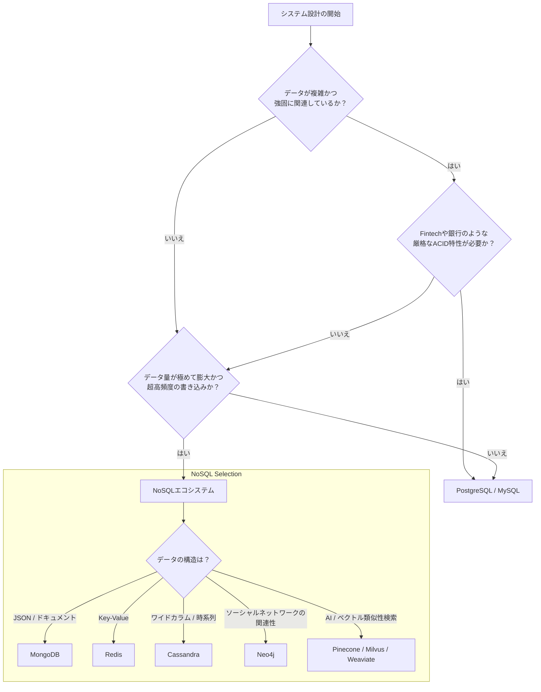

# Day 05: 真実の源泉 - SQL vs NoSQL 🗄️

第一週目の最終日へようこそ、戦士たちよ！私たちはこれまでにネットワークファブリック、負荷分散、そしてキャッシュについて旅をしてきました。今日は、あらゆるエンタープライズの「魂」とコアバリューを保持する最も重要なレイヤーである **Databases** (🔊) (データベース - 永続的データ格納庫) に触れます。

技術の世界には、伝統的な **SQL** (🔊) (SQL - 関係データベース) とモダンな **NoSQL** (🔊) (NoSQL - 非関係データベース) の二大陣営による、終わりなき論争が存在します。しかし、真の **System Design Master** (🔊) は決してどちらか一方の狂信的な信者にはなりません。彼らはビジネス上の課題を冷静に分析し、最も適切なツールを選択します。今日、あなたはその意思決定の方法を学びます。

---

## 🪝 THE HOOK：ピーク時にデータベースが「ストライキ」を起こすとき

あなたが **MasterSocial** という壮大なソーシャルメディアアプリケーションを構築していると想像してください。

**フェーズ1**: 無料で安定しており、最も使い慣れている MySQL (SQL) から開発をスタートします。システムはユーザー数が10,000人規模までは非常に美しく動作します。`Users`、`Posts`、`Comments` などのデータテーブルは強固に関連付けられており、あなたは自信を持って **JOIN** (🔊) (JOIN - 表結合) クエリを実行してデータを取り出します。

**フェーズ2 - 拡張の悪夢**: アプリケーションが爆発的に成長し、ユーザー数が1億人に達しました。毎秒何十万もの投稿が作成され、何百万もの「いいね」が送信されます。
- 数十億行を超えるテーブル間での `JOIN` 操作は絶望的に遅くなり、たった一つの結果を得るのに数十秒もかかるようになります。
- 書き込みスループット（**Write Throughput** (🔊)）の処理は拷問のようになり、データベースのCPU使用率は常に100%に張り付きます。
- アカウントの種類に応じて柔軟に変更できる新しい「ユーザーのステータス」機能を追加したくなりました。しかし、数十億行のレコードがあるテーブルに対してスキーマ変更（**Schema Alteration** (🔊)）を実行した結果、データベースが何時間もロック（Locked）され、システム全体が完全に麻痺してしまいます。

この時、あなたは気づくのです。伝統的な図書館（SQL）の整然とした秩序が、巨大な物流倉庫（NoSQL）の急速な拡張において、巨大な障壁になっているということに。

---

## 🎭 ANALOGY：国立図書館 (SQL) vs. アマゾンの超巨大倉庫 (NoSQL)

この違いを理解するために、物理的なオブジェクトの整理方法に例えて比較してみましょう：

1.  **SQL (Relational Database)**: 非常に厳格な **国立図書館** のようなものです。
    - すべての本は、著者名、ジャンル、ISBNコードに基づいて、棚に精密に分類されていなければなりません。
    - 本ではないもの（例えば音楽CDなど）を預けようとすると、図書館は「規則に適合していない」として受け付けを拒否します（**Strict Schema** (🔊) (厳格なスキーマ)）。
    - すべての情報は高度に一貫しています。ある場所で著者の名前を修正すると、図書館はすべての索引カードにその変更が確実に反映されることを保証します（**Data Integrity** (🔊) (データ整合性)）。
    - 関連性の管理（どの本がどの著者に属しているか）は、図書館の絶対的な十八番（特権）です。

2.  **NoSQL (Non-relational Database)**: アマゾンの **超巨大物流倉庫** のようなものです。
    - テレビからクッキーの箱、小さな針まで、あらゆる種類の荷物が混在しています。各アイテムは全く異なるサイズと属性を持っています。
    - 事前に構造を宣言する必要はありません。商品を箱に放り込み、ラベル（キー）を貼り付ければ完了です（**Flexible Schema** (🔊) (柔軟なスキーマ)）。
    - 倉庫が満杯になったときは、倉庫を壊して高いビルを建て直す必要はありません。単に隣に新しい倉庫をもう一つ借りるだけです。数千の小さく、同時に稼働する倉庫を効率的に管理することこそが、NoSQLの得意分野です（**Horizontal Scaling** (🔊) (水平スケール - スケールアウト)）。

---

## ⚙️ UNDER THE HOOD：一貫性 vs. スケールの闘い

### 1. SQL (Relational Database)：精密性を司る神々
代表的な例: **PostgreSQL, MySQL, Oracle, SQL Server**。

-   **データモデル**: テーブル（Tables）形式で保存されます。テーブル間のデータは外部キー（Foreign Keys）によって関連付けられます。
-   **ACID特性 (MANDATORY)** (🔊) (ACID特性 - トランザクション保証): 金融機関や銀行が常にSQLを選択する最大の理由です。
    -   **A - Atomicity (原子性)**: 「すべて実行されるか、全く実行されないか」のどちらか。（送金処理は両端で完全に成功するか、完全に巻き戻されるかの二択です）。
    -   **C - Consistency (一貫性)**: データは常に定義された論理ルールに厳格に従います。
    -   **I - Isolation (独立性)**: 並行して実行されるトランザクション同士が、お互いのデータを破壊することはありません。
    -   **D - Durability (永続性)**: 一度書き込みが完了すれば、突然の停電が発生してもデータは失われません。
-   **トレードオフ**: 複数のサーバーに水平分散（スケールアウト）させることが極めて困難です。なぜなら、100台の独立したマシン間で同時にACIDトランザクションを保証することは、膨大なオーバーヘッドを伴うからです。

### 2. NoSQL (Non-relational)：速度を司る怪物たち
代表的な例: **MongoDB (Document), Cassandra (Column-family), Redis (Key-value), Neo4j (Graph)**。

-   **柔軟な構造**: データ形式はJSON、Key-Valueペア、あるいはソーシャルネットワークのグラフ構造など多岐にわたります。システムを止めることなく、いつでも新しいフィールドを追加できます。
-   **CAP定理 (MANDATORY)** (🔊) (CAP定理): 分散システムにおいて、以下の3つの要素を同時にすべて満たすことはできません：
    1.  **Consistency (一貫性)**: すべてのノードで同時に同じデータが見えること。
    2.  **Availability (可用性)**: すべてのリクエストが常に成功または失敗の応答を受け取れること。
    3.  **Partition Tolerance (分断耐性)**: ネットワークの一部が不通になってもシステムが稼働し続けること。
    NoSQLデータベースの多くは **A** と **P** を選択し、システムが「絶対に死なない」ことと引き換えに、一時的な一貫性を犠牲にします。データは数秒かけて同期され、最終的に一致します（**Eventual Consistency** (🔊) (結果整合性)）。

### 3. データベース選択の決定木 (Mermaid Logic)

### 4. 💡 2026年のトレンド：ベクトルデータベースの台頭
AIエージェントの時代（2026年）において、データは単なるテキストや数値だけでなく、**ベクトル埋め込み（Vector Embeddings）** としても扱われます。
-   **課題**: 従来のSQL/NoSQLデータベースでは、「意味的な類似性（Semantic Similarity）」を高速かつ効率的に検索できません。
-   **解決策**: 専用の **Vector Databases**（Pinecone, Milvusなど）を使用するか、PostgreSQLの **pgvector** 拡張機能を利用します。
-   **アーキテクチャ**: 2026年のモダンなシステムはすべて、全文検索（SQL）とベクトル検索（AI）を組み合わせた **Hybrid Search** を統合し、ユーザーに最も精度の高い結果を提供します。

### 5. シャーディングとレプリケーション：SQLをパワーアップさせる技術
NoSQLに比べて水平スケールが難しいSQLですが、負荷に耐えるための戦術が存在します：
-   **Replication (レプリケーション)**: 1台のマスター（Primary/Master）を「書き込み用」とし、複数台のレプリカ（Replicas）を「読み込み用」として使用します。これにより、読み込み速度が数十倍に向上します。
-   **Sharding** (🔊) (シャーディング - データベース分割): データを複数の物理サーバーに分散配置します。例えば、ユーザー名がA〜Mのデータはサーバー1へ、N〜Zはサーバー2へ保存します。ただし、2つの異なるシャードにまたがる `JOIN` クエリの実行は、パフォーマンス上の悪夢となります。

---

## 💻 SYSTEM DESIGN INTERVIEW：最適な武器を選択する挑戦

**質問:「Facebookの通知（Notifications）システムを設計してください。毎秒1,000万件の通知が生成されます。ユーザーは最新の通知を即座に確認できる必要があります。」**

-   **Bad Answer (悪い回答)**: 「SQLが得意なのでMySQLを使います」 -> **不合格**。MySQLは、システムをフリーズさせずに毎秒1,000万件の同時 `INSERT` 処理を処理し続けることはできません。
-   **Architect Answer (アーキテクトの回答)**:
    1.  **特徴の分析**: このシステムは超高頻度の書き込み（Write-heavy）が求められます。また、通知の構造は動的に変化します（いいねの通知、コメントの通知、タグ付けの通知など）。過去の古いデータが読み直される頻度は極めて低いです。
    2.  **提案**: **NoSQLのColumn-family**型データベースである **Cassandra** (🔊) または **BigTable** を採用します。
    3.  **理由**: Cassandraは毎秒数百万件もの書き込みを高速処理するように設計されており、新しいノードを追加するだけで極めて簡単に水平拡張（Horizontal Scaling）が可能です。また、通知がユーザーに届くまでに1秒程度の遅延が発生しても実害はないため、厳密な即時一貫性は必要ありません。

---

## 🏗️ DEEP DIVE：多くのケースにおいて、やはりSQLが王様である！
NoSQLがSQLに完全に取って代わると誤解する人が多くいます。しかし実際には、Facebook、Google、Uberなどは、お金やユーザー認証に関わる最も重要なコアレイヤーにおいて、今でもSQL（Spanner、VitessなどのNewSQLを含む）を使用しています。SQLはデータの「正しさ」に対して絶対的な安心感を提供してくれるからです。

---

## 📝 クイッククイズ：あなたの「アーキテクトとしての知性」をチェックしよう

**問1: ACID特性のうち、送金トランザクション処理が途中で失敗した場合に、すべての変更を完全に巻き戻して最初の状態に戻すことを保証するプロパティはどれですか？**
A. 一貫性 (Consistency)
B. 原子性 (Atomicity)
C. 永続性 (Durability)

**問2: なぜNoSQLはビッグデータやリアルタイム性の高いシステムで好まれるのですか？**
A. 無料で利用できるため。
B. 水平拡張（Horizontal Scaling）が非常にシンプルであり、極めて高い書き込みスループットを誇るため。
C. セキュリティがより強固であるため。

**問3: CAP定理において、分散システムは3つの要素のうち1つを必ず犠牲にする必要があるとされています。NoSQLデータベースが通常犠牲にするのはどの要素ですか？**
A. 一貫性（Consistency - 即時一貫性）
B. 可用性 (Availability)
C. 分断耐性 (Partition Tolerance)

**問4: NoSQLではなくSQLを選択すべきなのは、どのような状況ですか？**
A. データが完全に非構造化されている場合。
B. データの整合性が極めて重要であり、複雑なリレーションを多用するクエリを頻繁に実行する場合。
C. サーバーの購入費用を節約したい場合。

**問5: 「Database Sharding」とは何ですか？**
A. 古い履歴データを削除するプロセスのこと。
B. 巨大なデータベースを小さな断片に分割し、それぞれ異なる物理サーバーに配置して負荷を分散させること。
C. データベースサーバーのCPUをアップグレードすること。

---

**正解:**
1. B
2. B
3. A
4. B
5. B

---

おめでとうございます！**System Design Master** 第一週目の5日間の旅が完了しました。あなたは最も強固な土台となる基礎パーツを手に入れました。週末はゆっくりと休んでください。来週からは、何百万人もの同時アクセスをリアルに捌くシステムを設計する「嵐のゾーン」へと突入します！

📊 単語数: 2512語
