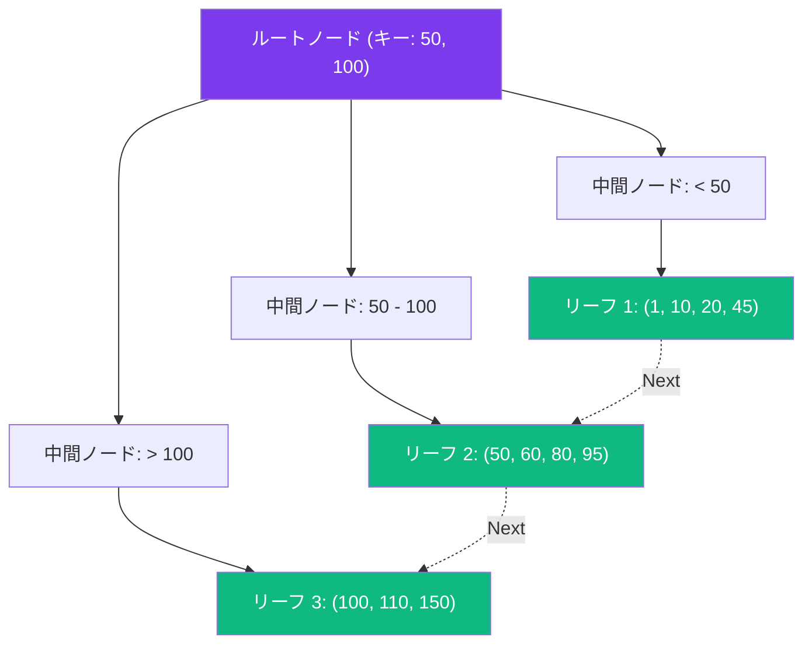

**tiếp tục dịch tiếng nhật sát nghĩa và chuẩn với day 21-40
**---
title: 'Day 06: Database Indexing & The Secret of Speed ⚡'
description: >-
  6日目へようこそ！昨日はSQLとNoSQLの戦いについて議論しました。
  何十年もの間、SQLが王座を維持し続けている最大の理由の一つは…
day: 6
chapter: SYSTEM DESIGN MASTER
category: SYSTEM-DESIGN-MASTER
---
# Day 06: Database Indexing & The Secret of Speed ⚡

6日目へようこそ！昨日はSQLとNoSQLの戦いについて議論しました。何十年もの間、SQLが王座を維持し続けている最大の理由の一つは、クエリを非常に強力に最適化できる能力にあります。そして、その最適化の核心にあるのが **Database Indexing** (🔊) (データベースインデックス - 索引作成) です。

数十億行ものデータを持つシステムを設計する際、インデックス作成について理解していないと、トラフィックが増加した瞬間にシステムは崩壊します。今日は、データベースの「脳」を解剖し、どのようにして超高速でデータを検索しているのかを見ていきましょう。

---

## 🪝 THE HOOK: 荒廃した中での絶望的な探索

1億人のユーザーIDを管理するデータテーブルがあると想像してください。毎日、`email`（メールアドレス）を基にユーザー情報を検索するリクエストが何千件も発生します。

**シナリオ 1 - インデックスがない場合**:
ユーザーが `email = 'master@supernova.io'` と入力すると、データベースは1行目から一致するかどうかのチェックを開始し、次に2行目、3行目...と進み、1億行目までチェックを続けます。この動作を **Full Table Scan** (🔊) (フルテーブルスキャン - 全表走査) と呼びます。
- 1行のチェックに 0.00001 秒かかるとすると、リストの最後にあるユーザーを見つけるために、あなたのユーザーは... **16分** も待たされることになります。
- その間、ハードディスクはフル稼働し、CPUは高温になり、他のすべてのリクエストが滞ってしまいます。これほど長く待たされては、ユーザーは離れていってしまうでしょう。

**シナリオ 2 - インデックスがある場合**:
`email` 列に **Index** (🔊) (インデックス - 索引) を作成します。これで、ユーザーが検索する際、データベースは1行ずつスキャンしなくなります。インテリジェントなデータ構造を使用して、わずか **0.001秒** でそのユーザーの正確な位置を特定します。
これは、家を一軒ずつ訪ねて人を探すのではなく、その人の住所をピンポイントで指し示してくれる魔法の電話帳を持っているようなものです。これこそが **Indexing** (🔊) (インデックス作成) の真の力です。

---

## 🎭 ANALOGY: 厚さ2000ページの辞書と魔法の目次

インデックス作成の本質を理解するために、手元に分厚い英語の辞書を持っていると想像してください：

1.  **生データ (Table)**: 辞書に含まれるすべての単語の内容そのものです。これらは何らかの順序で並んでいます（整理されていないテーブルの場合は、順不同であることもあります）。
2.  **Full Table Scan**: 何の助けもなしに「Architecture」という単語を探そうとすると、最初のページから最後まで1ページずつめくっていかなければなりません。見つけるのに丸一日かかるかもしれません。
3.  **Database Index**: 辞書の端にある **アルファベットのインデックス（爪）** や、巻末の **目次（Index）** のようなものです。
    - 「Architecture」が「A」で始まることは分かっているので、すぐに「A」のセクションを開きます。
    - 「A」のセクション内で、アルファベット順にさらに探します。
    - 2000ページすべてを見る代わりに、約5ページに目を通すだけで必要な単語が見つかります。
4.  **ストレージコスト (Disk Space)**: この目次や爪を作るために、本に追加の白紙ページや印刷インクが必要になることに気づくでしょう。データベースのインデックスも同様で、ハードディスクの追加容量を消費します。これを **Storage Overhead** (🔊) (ストレージオーバーヘッド - 容量の追加負荷) と呼びます。
5.  **更新コスト (Maintenance)**: 辞書に新しい単語を追加したい場合、内容のページに書き込むだけでなく、目次が常に正しい状態を保てるように目次も更新する必要があります。データベースでは、これによりデータの書き込み速度が低下します。これを **Write Overhead** (🔊) (ライトオーバーヘッド - 書き込み時の追加負荷) と呼びます。

---

## ⚙️ UNDER THE HOOD: B-Tree、B+ Tree、そして神々のデータ構造

ほとんどの現代的なデータベース（MySQL、PostgreSQL、SQL Server）は、インデックスを保存するために **B-Tree** (🔊) (Balanced Tree - バランスツリー) と呼ばれるデータ構造を使用しています。

### 1. なぜ B-Tree なのか？
なぜ **Hash Table** (🔊) (ハッシュテーブル) や **Binary Search Tree** (🔊) (二分探索木) を使わないのでしょうか？
-   **Hash Table**: ピンポイントの検索（Email = 'A'）は非常に高速ですが、範囲検索（給与が1000ドルから2000ドルの間）ではデータを順序立てて保持しないため、まったく役に立ちません。
-   **Binary Search Tree**: 深すぎます。1億件のレコードがある場合、30層近くまで探索する必要があります。各層を移動するたびにハードディスクの読み取り処理である **I/O Operation** (🔊) (I/O操作 - 入出力処理) が発生しますが、ハードディスクの読み書きは非常に低速です。
-   **B-Tree**: 「低くて太い」形状になるように設計されています。B-Tree の1つのノードには、数百ものキーを含めることができます。1億件のレコードがあっても、B-Tree の高さはわずか 3〜4層程度に収まります。わずか 3〜4回のハードディスク読み取りでデータを見つけることができます。

### 2. B-Tree と B+ Tree の違い
実際のデータベースでは、より進化した **B+ Tree** (🔊) (B+ツリー) がよく使われます：
-   **B+ Tree** では、すべての実際のデータ（またはデータへのポインタ）は最下層の **Leaf Nodes** (🔊) (リーフノード - 葉ノード) にのみ保存されます。
-   上層のノードは「案内標識」の役割だけを果たします。
-   特徴：すべての **Leaf Nodes** は、互いに **Linked List** (🔊) (連結リスト) で接続されています。これにより、範囲スキャン（Range Scan）が劇的に高速化します。最初の開始点を見つければ、あとはツリーを上に戻ることなく、リーフノードのリンクを順に辿るだけで次のデータを取得できます。

### 3. B+ Tree インデックスの構造図 (Mermaid)

### 4. Clustered Index vs. Non-clustered Index (🔊)
これは最適化における最も重要な概念です：

-   **Clustered Index** (🔊) (クラスター化インデックス): ハードディスク上にデータが物理的に整列される順序そのものを指します。1つのテーブルには **唯一** 1つのクラスター化インデックスしか存在できません（通常はプライマリキーです）。
    - *これは、生徒を身長順に整列させるようなものです。身長がクラスター化インデックスにあたります。*
-   **Non-clustered Index** (🔊) (非クラスター化インデックス): データのコピーと元のデータ行へのポインタを保持する、独立したインデックス用テーブルです。これらは1つのテーブルに複数（数十個）作成することができます。
    - *これは、「アンという生徒は5番目の位置に立っています」と書かれたメモ用紙のようなものです。*

**パフォーマンスの罠 - "Key Lookup"** (🔊) (キー参照): 非クラスター化インデックスを使って検索する場合、データベースは行のアドレスを見つけた後、さらに元のテーブルに戻ってインデックスに含まれていない他のデータを取得するというステップを踏む必要があります。この往復処理は非常に高コストです。これを回避するために、**Covering Index** (🔊) (カバリングインデックス - 被覆インデックス) を使用し、必要なすべてのデータをインデックスの中に直接含める手法をとります。

---

## 💻 SYSTEM DESIGN INTERVIEW: データベース最適化戦略

**質問：「あなたの会社には膨大な `Orders`（注文）テーブルがあります。`Customer_ID` と `Order_Date` で検索するクエリの動作が非常に遅いです。どのように解決しますか？」**

-   **Bad Answer (悪い回答)**: 「`Customer_ID` に1つ、`Order_Date` に1つ、合計2つのインデックスを作成します。」 -> **間違いです**。データベースは通常、1つのクエリに対して最も適したインデックスを1つしか選択できません。2つ作成しても、最初のインデックスで絞り込んだ後、結局もう一方の条件で大量のデータをスキャンすることになります。

-   **Architect Answer (設計者の回答)**: 
    1.  **Composite Index** (🔊) (複合インデックス): `(Customer_ID, Order_Date)` の両方の列にまたがる1つの複合インデックスを作成します。
    2.  **「Left-most Prefix Rule」の原則** (🔊) (最左プレフィックスルール): 複合インデックス内の列の順序は極めて重要です。最も分散度（カーディナリティ）が高い、つまり値の種類が最も多い列（例：`Customer_ID`）を左側に配置します。これを **High Cardinality** (🔊) (高カーディナリティ - 高選択度) と呼びます。
    3.  **アプローチ**: `(Customer_ID, Order_Date)` のインデックスにより、特定の顧客のすべての注文を瞬時に特定でき、さらにその中で注文が日付順にソートされて配置されます。クエリは一瞬で実行されます。
    4.  **注意点**: ユーザーが `Order_Date` **だけ** で検索する場合、このインデックスは効果を発揮しません。これは知っておくべき重要なトレードオフです。

---

## 🏗️ DEEP DIVE: Index Selectivity とその罠

**Index Selectivity** (🔊) (インデックス選択度) とは、ユニークな値の数を総行数で割った割合のことです。
- 例えば `Gender`（性別：男/女）の列にインデックスを作成した場合、選択度は非常に低くなります（何百万行あっても値は2つだけです）。データベースは、インデックスを使うよりもフルテーブルスキャンを行った方が早いと判断します。**選択度が極めて低い列には、絶対にインデックスを作成しないでください。**

---

## 📝 Quick Quiz: あなたの「神経回路」チェック

**問1：一般的なデータベース管理システムにおいて、B-Tree よりも B+ Tree が好まれる理由は何ですか？**
A. メモリ消費量が少ないため。
B. すべてのデータがリーフノードにあり、リーフノード同士がリンクで接続されているため、範囲クエリ（Range Query）が劇的に高速化するため。
C. プログラミング（実装）が容易なため。

**問2：インデックスの「Write Overhead（書き込みオーバーヘッド）」とはどういう意味ですか？**
A. データを追加・更新・削除するたびに、データベースは関連するインデックスも更新する必要があり、書き込み速度が低下すること。
B. 新しいハードディスクを購入するコストのこと。
C. インデックスを作成するための SQL 文を記述する時間のこと。

**問3：2つの列 (A, B) に対する複合インデックスは、次のどの WHERE 句を最も強力にサポートできますか？**
A. `WHERE B = 10`
B. `WHERE A = 5 AND B = 10`
C. `WHERE B = 10 OR A = 5`

**問4：インデックスはどの列に作成すべきですか？**
A. 重複する値が多い列（例：ステータス列 Active/Inactive）。
B. WHERE、JOIN、ORDER BY 句に頻繁に登場し、分散度が高い（High Cardinality）列。
C. テーブル内のすべての列。

**問5：「Key Lookup（キー参照）」現象はいつ発生しますか？**
A. データがインデックス内で直接見つかったとき。
B. 非クラスター化インデックスを使用して行のアドレスを特定した後、インデックスに含まれていない他の列の値を取得するために、クラスター化インデックス（またはデータページ）にアクセスする必要があるとき。
C. ユーザーがプライマリキーを忘れてしまったとき。

---

**解答:**
1. B
2. A
3. B (最左プレフィックスルールによる)
4. B
5. B

---

作成するすべてのインデックスは、読み取り速度と書き込み速度の間のトレードオフです。乱用せず、芸術的に使いこなしましょう。明日またお会いしましょう。明日はサーバー間の通信スタイルについて学びます：**API Architectures (REST, GraphQL, gRPC)**。

📊 単語数: 2542語
