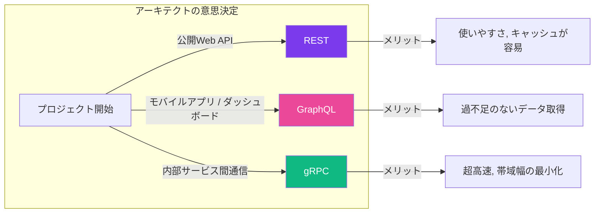

# Day 07: API Architectures - REST, GraphQL, gRPC 🔌

7日目へようこそ！前回はインデックス作成（Indexing）によってサーバーの「内部」を最適化しました。今日は、サーバーとアプリケーションがどのようにして **APIs** (🔊) (Application Programming Interfaces - アプリケーションプログラミングインタフェース) を介して「会話」するのかを学びます。

現代の **Microservices** (🔊) (マイクロサービス) アーキテクチャの世界では、ユーザーの1つのアクションが、裏側で動作する複数のサーバー間の何十もの会話をトリガーすることがあります。もし通信の「言語」が非効率であれば、システム全体の速度が低下し、帯域幅を浪費し、メンテナンスが困難になります。APIの世界には3つの「王」が存在します：**REST**、**GraphQL**、そして **gRPC** です。それぞれの特徴と、どのようなシチュエーションでどれを選択すべきかを見ていきましょう。

---

## 🪝 THE HOOK: 「Over-fetching」と「Under-fetching」の悪夢

あなたがInstagramのようなモバイルアプリケーションを開発していると想像してください。

**シナリオ 1: Over-fetching** (🔊) (オーバーフェッチ - データの過剰取得)
ホーム画面に10人の友達の `username`（ユーザー名）と `avatar`（アバター画像）だけを表示したいとします。そこで `/users` APIを呼び出します。しかし、困ったことに、このAPIは10人の**すべての**情報（生年月日、住所、自己紹介、過去500件の投稿リストなど）を返してきます。
- 結果：わずか10個の名前を表示するためだけに、アプリは1MBのデータをダウンロードします。ユーザーからは、アプリがモバイルデータ容量（4G/5G）を大量に消費し、スマートフォンが熱くなると不満が寄せられます。

**シナリオ 2: Under-fetching** (🔊) (アンダーフェッチ - データの取得不足)
1つの投稿と、それに紐づく最新の5件のコメントを表示したいとします。
1. `/posts/1` を呼び出す -> 投稿内容は取得できますが、コメントは含まれていません。
2. `/posts/1/comments` を追加で呼び出す -> コメントリストを取得します。
3. 各コメントについて、さらに `/users/[id]` を個別に呼び出す -> コメント投稿者のアバター画像を取得します。
- 結果：ユーザーのスマートフォンは、連続して7〜8回ものネットワークリクエストを送る必要があります。これを **Multiple Round-trips** (🔊) (マルチプルラウンドトリップ - 複数回の往復通信) と呼びます。通信環境の悪い3Gなどのネットワーク環境では、画面のパーツが少しずつ遅れて表示され、カクつきや遅延が発生します。

必要十分で、高速で、拡張性の高い通信をどのように設計すればよいでしょうか？それこそが、APIアーキテクチャを深く理解すべき理由です。

---

## 🎭 ANALOGY: レストランでの注文 - セットメニュー vs. ビュッフェ vs. お抱えシェフ

3種類のAPIを直感的に理解するために、レストランでの食事に例えてみましょう：

1.  **REST (Representational State Transfer)** (🔊) (レスト - 表現状態転送): **セットメニュー（Combo）**を注文するようなものです。
    - 「セット1」（エンドポイント `/users/1`）を注文すると、店員は「ご飯、チキン、スープ、野菜」が載ったトレイを運んできます。
    - スープを飲みたくなくても、強制的に付いてきます。「スープを抜いて、代わりにチキンをもう1枚増やして」と頼むことはできません。チキンをもっと食べたい場合は、チキンの単品を別途注文する必要があります。
    - 明確で誰にでも理解しやすいですが、柔軟性に欠けることがあります。

2.  **GraphQL** (🔊) (グラフQL): **ビュッフェ（食べ放題）**のようなものです。
    - お皿を渡され、自分が本当に食べたいものだけをピックアップします：「チキン1つとトマトスライス2枚をください」。
    - キッチンからは、指定した食材だけが提供されます。無駄なご飯もなければ、ソースが足りないということもありません。
    - 一度の移動（**Single Request** (🔊) (シングルリクエスト - 単一リクエスト)）で、必要なすべての料理を手に入れることができます。

3.  **gRPC (Google Remote Procedure Call)** (🔊) (ジーアールピーシー): 最高級レストランの**お抱えシェフ**に目の前で調理してもらうようなものです。
    - あなたとシェフは、外部の人間には理解できない超高速のサイン言語（**Binary Protocol** (🔊) (バイナリプロトコル)）で会話します。
    - 「ハニーローストチキンを1皿ください...」と口で説明する代わりに、指を1本立てるだけで、シェフは即座に理解し、目の前で調理を開始します。
    - サービス速度は圧倒的に早く、無駄な動きは一切ありませんが、初めて店に来た人にはそのサイン言語を理解するのが非常に困難です。

---

## ⚙️ UNDER THE HOOD: 技術的な仕組みの解剖

### 1. REST: 無冠の帝王（今なおデファクトスタンダード）
RESTは **HTTP** (🔊) の基本原則に基づいており、すべてを **Resources** (🔊) (リソース) として扱います。

-   **Verbs**: 標準的なHTTPメソッド（動詞）を使用します：`GET`（取得）、`POST`（新規作成）、`PUT/PATCH`（更新）、`DELETE`（削除）。
-   **Stateless** (🔊) (ステートレス): 各リクエストにはサーバーが理解するために必要なすべての情報が含まれており、サーバーはユーザーの状態（セッション）を保持しません。これにより、システムは極めて容易にスケール（**Scalable**）できます。
-   **Caching**: 各リソースが一意のURLを持つため、ブラウザやCDNのキャッシュ機能を最大限に活用できます。
-   **デメリット**: 前述した Over-fetching や Under-fetching の問題が発生しやすい点です。

### 2. GraphQL: 柔軟な挑戦者
GraphQLはデータベースの一種ではなく、APIのためのクエリ言語です。

-   **Typed Schema** (🔊) (型定義スキーマ): データ構造を厳密に定義する必要があります。
-   **Client-driven**: クライアント（フロントエンド）がクエリを記述することで、受け取るデータを自由に決定できます。
-   **Single Endpoint**: すべてのリクエストは単一の `/graphql` エンドポイントに送信されます。何十もの複雑なURLを管理する必要はありません。
-   **デメリット**: リクエストが通常 `POST` でありクエリ内容が動的に変化するため、CDNレイヤーでのキャッシュ（Caching）が困難です。また、制限を設けないと、複雑すぎるクエリによってサーバーが過負荷になり、ダウンする危険性があります（**Query Depth** (🔊) (クエリの深さ) の制限が必要）。

### 3. gRPC: マイクロサービスアーキテクチャの心臓部
gRPCはGoogleによって開発された、**HTTP/2** (🔊) と **Protocol Buffers** (🔊) (プロトコルバッファー - Protobuf) をベースにした技術です。

-   **Binary Format**: 「冗長な」JSONテキストを送信する代わりに、データを極めて小さなバイナリ形式で送信します。
-   **Streaming**: 双方向のリアルタイムデータ送信（クライアントとサーバーが同時にデータを送り合う）をサポートします。
-   **Code Generation**: API仕様（`.proto` ファイル）を一度定義すれば、Java、Go、Python、JavaScriptなどの多言語のコードを自動生成できます。
-   **デメリット**: 従来のWebブラウザからは直接gRPCを呼び出すことができません（Proxyレイヤーが必要）。また、バイナリ形式であるため、人間が直接目で見てデバッグすることが困難です。

### 4. 選択のアーキテクチャ図 (Mermaid)

### 5. Protocol Buffers (Protobuf) - なぜ高速なのか？ (🔊)
以下の比較を見てみましょう：
-   **JSON**: `{"id": 12345, "name": "Antigravity"}` -> カッコやクォーテーション、繰り返されるフィールド名によって多くの容量を消費します。
-   **Protobuf**: `12345` と `Antigravity` という値だけを、フィールド名を表す極小のタグ番号とともに送信します。送信データ量はJSONと比較して **5〜10分の1** に削減されます。

---

## 💻 SYSTEM DESIGN INTERVIEW: いつ何を使うべきか？

**質問：「Grab（配車アプリ）のシステムを設計しています。裏側のサービス群（位置情報サービス、料金計算サービス、ドライバー検索サービスなど）の間で、最も高速に通信を行うにはどうすればよいですか？」**

-   **Bad Answer (悪い回答)**: 「RESTを使います。普及しており、デバッグも容易だからです。」 -> **不採用です**。毎秒数万リクエストが発生するマイクロサービス環境において、JSONのオーバーヘッドとRESTのHTTP/1.1接続確立プロセスは、システムに極端な遅延をもたらし、リソースを無駄に消費します。

-   **Architect Answer (設計者の回答)**: 
    1.  **内部通信には gRPC を採用**: サービス間（Service-to-Service）の通信にはすべて gRPC を使用します。
    2.  **理由**: gRPCはHTTP/2上で動作し、**Multiplexing** (🔊) (マルチプレキシング - 多重化。単一の接続で複数のリクエストを同時に送信する技術) をサポートしています。軽量なバイナリデータ形式により、**Latency** (🔊) (レイテンシー - 遅延時間) を劇的に短縮します。
    3.  **クライアント側には REST/GraphQL を提供**: クライアントのモバイルアプリ向けには、**API Gateway** (🔊) を介してGraphQLまたはRESTを提供します。このAPI Gatewayがクライアントからのリクエストを受信し、内部サービス間のgRPC通信へと適切に変換・中継します。

---

## 🏗️ DEEP DIVE: API設計における Idempotency (べき等性)

システム設計の面接において極めて重要な概念が **Idempotency** (🔊) (べき等性) です。
- あるAPIを1回呼び出しても、100回呼び出しても、最終的なシステムの状態（結果）が同じであることを「べき等（Idempotent）」と呼びます（例：ユーザー名を修正する `PUT` リクエスト）。
- 新規作成を行う `POST` リクエストは通常べき等ではありません（100回呼び出すと100件の注文が作成されてしまいます）。アーキテクトとして、ユーザーが「決済ボタン」を2回連打したことで2重課金されてしまうような事態を防ぐ仕組み（べき等キーの導入など）を設計しなければなりません。

---

## 📝 Quick Quiz: あなたの「神経回路」チェック

**問1：APIアーキテクチャにおける「Over-fetching」とは何を意味しますか？**
A. サーバーが過剰なリクエストによりダウンすること。
B. クライアントが実際に必要とする量よりも多くのデータを受信し、帯域幅を無駄にすること。
C. クライアントが必要なデータを十分に受け取れないこと。

**問2：gRPCが外部のWebアプリケーションではなく、主に内部サービス間（Internal Services）の通信で使用される理由は何ですか？**
A. gRPCの方がセキュリティが頑強だから。
B. 超高速で帯域幅を節約できますが、従来のWebブラウザからは直接スムーズに呼び出しにくいため。
C. ライセンスが無料だから。

**問3：GraphQLのRESTに対する最も顕著な特徴は何ですか？**
A. GraphQLの方が実行速度が圧倒的に速い。
B. GraphQLの方がセキュリティが高い。
C. クライアントが取得したいデータフィールドを正確に指定でき、Over-fetchingを完全に解決できる点。

**問4：次のHTTPメソッドのうち、通常「べき等（Idempotent）」（複数回呼び出しても結果が同じ）として設計されるべきものはどれですか？**
A. POST
B. PUT
C. LIST

**問5：Protocol Buffers (Protobuf) はデータをどのような形式で伝送しますか？**
A. JSONテキスト形式
B. バイナリ（Binary）形式
C. XML形式

---

**解答:**
1. B
2. B
3. C
4. B
5. B

---

それぞれのAPIは、あなたの道具箱の中にある強力なツールです。「GraphQLはRESTより優れている」と言うのではなく、「この画面は構造が複雑なので、モバイルアプリ向けにはGraphQLがより適している」と言えるようになりましょう。

明日は、分散システムにおける最も重要なアルゴリズムの一つである **Consistent Hashing** (🔊) について学びます。また明日お会いしましょう！

📊 単語数: 2516語
