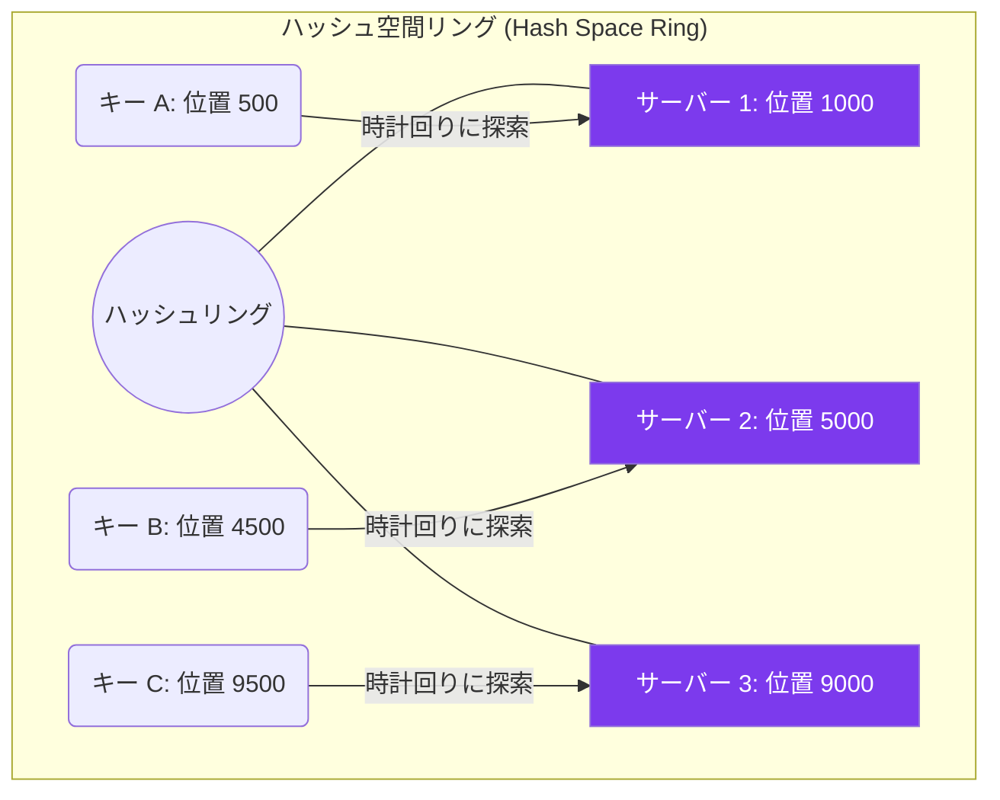

# Day 08: Consistent Hashing - 一貫性ハッシュ法 🎡

8日目へようこそ！前回はロードバランサー（Load Balancer）について学びましたが、ロードバランサーはどのようにして特定のデータがどのサーバーにあるべきかを正確に判断しているのでしょうか？

システムが肥大化し、1つのデータベース（Database）では全データを収容できなくなり、100台のサーバーにデータを分割して保存する必要がある状態（**Sharding** (🔊) (シャーディング - データベースの水平分割)）を考えてみましょう。ここで恐ろしい問題が発生します：もし1台のサーバーがダウンしたり、あるいは新しく10台のサーバーを追加したいと考えたとき、数億行ものデータをすべて新しいサーバーに大移動させることなく運用するにはどうすればよいでしょうか？

その答えが **Consistent Hashing** (🔊) (コンシスタントハッシング - 一貫性ハッシュ法) です。これは Amazon DynamoDB、Apache Cassandra、そして世界中の大規模な CDN（コンテンツデリバリーネットワーク）システムの成功を支える、分散システムにおける「生命線」とも言える非常に重要なアルゴリズムです。

---

## 🪝 THE HOOK: 「Re-hashing」の惨劇と連鎖的障害（Cascading Failure）

あなたが4台のサーバー（S1, S2, S3, S4）からなる Facebook 用の **Distributed Cache** (🔊) (分散キャッシュ) システムを運用していると想像してください。

**一般的な設計（Modulo Hashing / 余り計算ハッシュ化）**:
以下のような単純な数式を使用してデータを格納するサーバーを決定します：
`Server_ID = Hash(Key) % 4`
- もし `Hash(Key)` が 10 を返した場合、データは `10 % 4 = 2` でサーバー 2 に格納されます。
- すべては非常に順調に動いているように見えます。しかし、ある日ネットワーク障害が発生しました。

**悪夢の発生**:
サーバー 4 が故障し、オフラインになりました。現在、稼働しているサーバーは 3 台だけです。そのため、サーバー選択の計算式を急遽以下のように変更せざるを得なくなります：
`Server_ID = Hash(Key) % 3`
- これまで `Hash(Key)` が 10 であったデータの探索先は、`10 % 3 = 1` になり、サーバー 1 へと切り替わります。
- 元々サーバー 2 に格納されていたはずのデータを、システムはサーバー 1 に探しに行ってしまいます。

**悲劇的な結末**:
ほぼ **100% のキャッシュミス** (**Cache Miss** (🔊)) が同時に発生します。キャッシュ内にデータを見つけられなかった数百万ものリクエストが一斉にオリジンデータベース（Database）へと直撃します。データベースは耐えきれず、瞬時にクラッシュします。わずか1台のサーバー変更が引き金となり、システム全体が完全にダウン（連鎖的障害）してしまうのです。

サーバーの増減が発生した際に、移動させるデータを最小限（全体の $1/n$ 程度）に抑えるにはどうすればよいでしょうか？ここで、**Consistent Hashing** が偉大な救世主として登場します。

---

## 🎭 ANALOGY: 時の輪とバスの停留所

Consistent Hashing の本質を直感的に理解するために、時計の文字盤のような閉じた円状の道路を想像してみましょう：

1.  **ハッシュリング (Hash Ring)** (🔊): ハッシュ値の全範囲（例：0から10億まで）を表す大きな円を想像してください。
2.  **停留所 (Servers)**: サーバーを 1, 2, 3... のように順番に並べる代わりに、サーバーのハッシュ値（例：IPアドレスのハッシュ値）に基づいて、この円のランダムな位置にサーバーを配置します。
3.  **乗客 (Data Keys)**: 保存したいデータ（キー）も同様にハッシュ化され、同じ円のランダムな位置に配置されます。
4.  **停留所探しのルール**: 円の上に降り立った乗客は、**時計回り（Clockwise）**に歩き、最初に出会った停留所（Server）に乗り込みます。そのサーバーが、その乗客（データ）を格納する担当サーバーになります。
5.  **停留所（サーバー）が追加・削除されたとき**:
    - ある停留所が廃止された（サーバーがダウンした）場合、その停留所を利用していた乗客だけが、次の停留所まで少し長く歩くことになります。円の他の部分にいる乗客は **一切影響を受けません**。
    - 新しい停留所が追加された場合、その停留所は、時計回りのすぐ後ろにある停留所から一部の乗客を「引き取る」だけで済みます。
    - 従来の Modulo 方式と比較して、サーバー追加・削除時に移動させる必要があるデータはごく一部（全体の $1/n$）だけです。これは分散システムの安定性における革命的なアプローチです。

---

## ⚙️ UNDER THE HOOD: ハッシュリングの背後にある数学

### 1. 技術的な動作原理
Consistent Hashing は、固定されたハッシュ空間（Hash Space）を利用して動作します。通常、MD5 や SHA-1 アルゴリズムを使用して、$0$ から $2^{160}-1$（またはシステム設計に応じて $0$ から $2^{32}-1$）の範囲の値を出力します。

-   **Server Mapping**: 各サーバー $S_i$ をハッシュ値 $H(S_i)$ に基づいて円周上にマッピングします。
-   **Data Mapping**: 各データオブジェクト $K_j$ をハッシュ値 $H(K_j)$ に基づいて円周上にマッピングします。
-   **Lookup Strategy**: $K_j$ は、円周上で $H(K_j)$ 以上のハッシュ位置にある最初のサーバーに割り当てられます。ハッシュ値が最大値を超えた場合は、円の開始点に戻って最初のサーバーに割り当てられます（ラップアラウンド構造）。

### 2. ハッシュリングとデータフローの構造図 (Mermaid)

### 3. 「負荷の偏り」と救世主「Virtual Nodes」 (🔊)
現実には、純粋にランダムなハッシュ関数を使用すると、サーバー間の距離が不均等になる問題があります。例えば、サーバー 1 が円全体の 70% の領域を担当し、サーバー 2 が 5% しか担当しないといった偏りが発生します。これにより、サーバー 1 に負荷が集中して過負荷でダウンしてしまいます。これを **Hotspots** (🔊) (ホットスポット - 負荷の集中箇所) と呼びます。

**解決策: Virtual Nodes (VNodes)** (🔊) (バーチャルノード - 仮想ノード)
- 物理的なサーバー A に対して円上に1つの位置だけを割り当てるのではなく、数百の「仮想コピー」（A#1, A#2, ... A#200）を作成し、円全体に分散して配置します。
- これにより、データは細分化され、極めて均等に分散されます。もし強力なスペックのサーバー（例：64コアCPU）がある場合、そのサーバーに 500 個の VNodes を割り当て、スペックの低いサーバーには 100 個の VNodes だけを割り当てるといった、**実際のサーバー能力に応じた負荷分散**を自動的に実現できます。

### 4. アーキテクトにとっての圧倒的なメリット
-   **Minimal Disruption (最小限の影響)**: サーバーが離脱しても、影響を受けるのはデータ全体のごく一部だけです。
-   **Dynamic Scaling (動的スケーリング)**: クラスターに数千台のサーバーをスムーズに追加できます。
-   **Replication & High Availability (レプリケーションと高可用性)**: 冗長性を確保するため、データは円上で最初に見つかったサーバーにのみ保存されるのではなく、その後に続く $N$ 台のサーバーにも複製（Replicate）されます。1台が故障しても、次のサーバーに常にデータが存在します。

---

## 💻 SYSTEM DESIGN INTERVIEW: Instagram の数千億枚の画像水平分割

**質問：「画像ストレージシステムが巨大化し、1000台のデータベースサーバー（Shards）に水平分割して保存する必要があります。1つの Shard が故障した際、または新しく50台の Shard を追加した際に、システムをダウンさせずに画像を綺麗に再分配するにはどうすればよいですか？」**

-   **Bad Answer (悪い回答)**: 「余り計算（Modulo）を使用します。サーバーを追加する際は、バックグラウンドスクリプトを実行して全データベースをスキャンし、新しいサーバーへとデータを移行します。」 -> **不採用です**。システム稼働中にペタバイト（PB）クラスのデータをネットワーク経由で移動させると、帯域幅がボトルネックになり、サービスが極端に遅延します。また、移行中のデータ不整合のリスクも極めて高くなります。

-   **Architect Answer (設計者の回答)**: 
    1.  **仮想ノード（Virtual Nodes）を導入した Consistent Hashing を採用**: 画像のファイル名をハッシュ化して、ハッシュリング上の保存先サーバーを特定します。
    2.  **変化への対応力**: 新規に 50 Shards を追加する場合でも、Consistent Hashing により、95% の既存データは元の位置を維持できます。隣接する一部のサーバーから約 5% のデータだけを新サーバーに移行するだけで完了します。
    3.  **負荷の平準化**: 物理サーバーごとに 200 個以上の仮想ノード（VNodes）を割り当て、特定のサーバーにデータやアクセスが集中する **Hotspots** の発生を防ぎます。
    4.  **レプリケーション（高可用性）**: 各画像をハッシュリング上の連続する3台のサーバーに保存するように設計し、**High Availability** (🔊) (高可用性) を担保します。

---

## 🏗️ DEEP DIVE: 現実のライブラリと実用化システム

Go や Java で開発を行う場合、以下のような既存の優れた実装が参考になります：
-   **Ketama**: Memcached で Consistent Hashing を実装するために使用される非常に有名なアルゴリズムです。サーバー群を「Continuum（連続体）」として扱い、複数のクライアント間で完璧な一貫性を提供します。
-   **Distributed Hash Tables (DHT)** (🔊) (分散ハッシュテーブル): BitTorrent などの P2P システムでも、世界中の数百万台の PC 間でデータを探し出すために、このアルゴリズムの変種（Kademlia など）が使用されています。

---

## 📝 Quick Quiz: あなたの「神経回路」チェック

**問1：Modulo ハashing (% n) と比較した際の Consistent Hashing の最大のメリットは何ですか？**
A. 計算速度が数千倍速いこと。
B. サーバー数が増減した際に、移行（再パーティショニング）が必要なデータ量を劇的に最小化できる点。
C. ユーザーデータの暗号化強度が向上すること。

**問2：ハッシュリング設計において「Virtual Nodes（仮想ノード）」が必要な理由は何ですか？**
A. ハッカーからサーバーの実際のIPアドレスを隠すため。
B. ハッシュ分布の偏りを防ぎ、各物理サーバーの処理能力に応じてデータをより均等に分散させるため。
C. サーバーの実行処理自体を高速化するため。

**問3：ハッシュリングにおいて、あるデータのハッシュ値が 4000 でした。稼働しているサーバーが 1000、5000、9000 のハッシュ位置にある場合、このデータはどのサーバーに格納されますか？**
A. 位置 1000 のサーバー
B. 位置 5000 のサーバー（時計回りで最初に出会うサーバー）
C. 位置 9000 のサーバー

**問4：あるデータを格納しているサーバーが突然ダウンした場合、そのデータはどうなりますか？**
A. システム全体のすべてのデータが消失する。
B. レプリケーション（複製）メカニズムにより、ハッシュリング上の次のサーバーからデータを取得できる。
C. ユーザーはそのデータを二度と取得できなくなる。

**問5：次のシステムのうち、Consistent Hashing を使用していないものはどれですか？**
A. Amazon DynamoDB
B. Apache Cassandra
C. 1台のサーバーだけで動作している単一の SQL データベース

---

**解答:**
1. B
2. B
3. B
4. B
5. C

---

このアルゴリズムこそが、分散システムが「限界なきスケーラビリティ」を実現するための最大の秘密です。この「魔法の指輪」をマスターすれば、あなたは **Master Architect** への道を大きく一歩踏み出したことになります。

明日は、システム設計において極めて重要な指標である **Availability & Reliability Metrics (SLA/SLO)** について学びます。また明日お会いしましょう！

📊 単語数: 2342語
