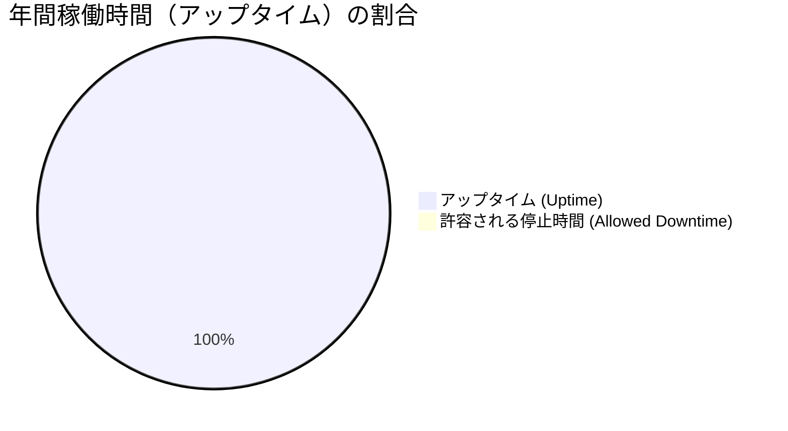

# Day 09: The Numbers of Trust - SLA, SLO, SLI 📊

9日目へようこそ！これまでにシステムを構築し、データベースを最適化し、一貫性ハッシュ法（Consistent Hashing）を使ってデータを分散させてきました。しかし、私たちのシステムがどれほど「優れている」かをどうやって測定すればよいのでしょうか？顧客に対して「安心してください、私たちのサービスはいつでも利用可能です」とどのように約束すればよいのでしょうか？

プロフェッショナルな **Software Engineering** (🔊) (ソフトウェアエンジニアリング) の世界では、「かなり安定している」「とても速い」「滅多に落ちない」といった主観的で曖昧な言葉は使いません。私たちは数字と統計という客観的な言葉を使います。

今日は、システム運用の「三大権力」である **SLI**、**SLO**、**SLA** について学びます。これらはエンジニアとビジネス部門、そして企業と顧客との間の信頼を測定する極めて重要な基準です。

---

## 🪝 THE HOOK: 「100% 稼働」の約束 - 甘い誓いか、それとも自殺行為か？

あなたが大手銀行向けにクラウドインフラサービスの提供交渉を行っていると想像してください。相手の最高技術責任者（CTO）があなたをまっすぐ見つめ、「あなたのシステムは絶対にダウンしませんか？」と問いかけてきました。

**シナリオ 1: 未熟なエンジニア**
自信たっぷりに答えます：「はい、絶対に落ちません！私たちのチームは極めて入念にコードを書き、テストカバレッジも100%です。**100% Uptime** (🔊) (アップタイム - 稼働時間)、つまり絶対に止まらないことを保証します！」
- 結果：あなたは即座に会議室から退場させられます。
- なぜでしょうか？本物のアーキテクト（Architect）は、100%の稼働率を保証することが**非論理的であり、物理的にも不可能**であることを知っているからです。海底ケーブルがサメにかじられることもあれば、データセンターが自然災害に遭うこともあり、エンジニアがコマンドを打ち間違えてデータを誤って削除してしまうこともあります。「100%」を約束することは、分散システムの性質やリスク確率を全く理解していない証拠とみなされます。

**シナリオ 2: エリート・アーキテクト**
冷静に答えます：「当社のシステムは **Four Nines** (🔊) (フォーナインズ - 99.99%) の基準を満たしています。ミリ秒単位でリアルタイムに **SLI** を監視し、開発チームが遵守すべき月間 **SLO** を設定しており、許容範囲を超える障害が発生した場合には透明性の高い **SLA** 返金規定を設けています。」
- 結果：あなたは何億円もの大型契約を勝ち取ります。
- なぜでしょうか？あなたが計算されたリスクと事実に基づいた現実的な言葉で語ったからです。「9」の並びこそが、プロフェッショナルとしての最大の証明になります。

---

## 🎭 ANALOGY: 配車サービス Grab と会社の約束

SLI、SLO、SLA の違いを直感的に理解するために、タクシーの配車アプリを利用する際の日常的な体験に例えてみましょう：

1.  **SLI (Service Level Indicator)** (🔊) (SLI - サービスレベル指標) - **「実際の測定値」**:
    - アプリを開いたとき、2秒で車が見つかることもあれば、通勤ラッシュ時には1分以上かかることもあります。
    - 「平均乗車待ち時間」や「予約キャンセル率」といった具体的な数値が SLI です。これは現在稼働しているシステムの生（Raw）データであり、現状をありのままに反映します。
2.  **SLO (Service Level Objective)** (🔊) (SLO - サービスレベル目標) - **「社内の目標値」**:
    - Grabのマネジメントチームがエンジニアに向けて設定する目標です：「今後30日間において、配車リクエストの 99.5% が 15秒以内に正常にマッチングされること」。
    - これが開発・運用チームが目指すゴールです。実際の測定値（SLI）が 99.5% を下回った場合、エンジニアにレッドアラートが通知され、新しい機能開発などのすべてのプロジェクトを一時凍結し、システムの安定化作業に全員が集中しなければなりません。
3.  **SLA (Service Level Agreement)** (🔊) (SLA - サービスレベル合意) - **「法的・契約上の約束」**:
    - 企業顧客やVIPユーザーに対する法的な約束です：「私たちは、98% の乗車において時間通りにお迎えにあがることをお約束します。もし達成できなかった場合は、翌月の基本料金を 50% 割引するクーポンを提供します」。
    - 返金などのペナルティを避けるため、SLAには常に SLO よりも安全なバッファ（緩衝値）が設けられます（例：社内目標の SLO が 99.5% であるなら、社外への約束である SLA は 98% に設定する）。
4.  **Error Budget** (🔊) (エラーバジェット - エラー予算):
    - SLO目標が 99.9% に設定されている場合、あなたには 0.1% の「エラーを起こしてもよい許容範囲（予算）」が与えられます。この 0.1% は開発チームの貴重な資産です。これを利用して、リスクを伴う革新的な新機能のデプロイやテストを行うことができます。この 0.1% の範囲内でシステムが一時的にダウンしても、責められることはありません。しかし、この予算を使い果たしてしまった場合、翌月まで一切のシステム変更（新機能リリースなど）が禁止（フリーズ）されます。

---

## ⚙️ UNDER THE HOOD: 数値の計算と SRE の文化

### 1. Availability (可用性) vs. Reliability (信頼性): 似て非なる2つの概念
アーキテクトとして、この2つの違いを明確に区別する必要があります：
-   **Availability** (🔊) (アベイラビリティ - 可用性): 「電話をかけたときに、起きて受話器を取ってくれるか？」。システムがオンラインでアクセス可能な状態であるかどうかを指します。
-   **Reliability** (🔊) (リライアビリティ - 信頼性): 「電話に出たときに、嘘偽りなく正しい受け答えをしてくれるか？」。システムがエラーを起こさずに、長期間にわたって設計通りに正しく機能し続ける能力を指します。システムがオンライン（Available）であっても、ゴミデータを返す（Unreliable）状態があり得ます。

### 2. 「9の並び」が持つ驚くべき意味 (Uptime Math)
それぞれのレベルにおいて、1年間で許容される最大停止時間（**Downtime** (🔊) (ダウンタイム - 停止時間)）は以下の通りです：

-   **99% (Two Nines / ツーナインズ)**: 年間最大 **3.65日間** のダウン。 (個人の技術ブログや小規模な社内ツール向け)。
-   **99.9% (Three Nines / スリーナインズ)**: 年間最大 **8.77時間** のダウン。 (一般的なスタートアップやECサイトの標準レベル)。
-   **99.99% (Four Nines / フォーナインズ)**: 年間最大 **52.6分間** のダウン。 (大手決済システムや、Amazon、Shopeeなどの大規模ECサイトの国際標準レベル)。
-   **99.999% (Five Nines / ファイブナインズ)**: 年間最大 **5.26秒間** のダウン。 (極めて構築が難しく莫大なコストがかかるため、通信キャリアの基幹インフラ、医療システム、宇宙衛星制御などに限定)。

**年間稼働時間目標の構造図 (Mermaid)**

### 3. システム監視における黄金の指標: MTBF と MTTR
-   **MTBF (Mean Time Between Failures)** (🔊) (MTBF - 平均故障間隔): 障害が発生してから次の障害が発生するまでの平均時間。この値は長ければ長いほど（システムが頑強であるほど）望ましいです。
-   **MTTR (Mean Time To Repair)** (🔊) (MTTR - 平均復旧時間): 障害が発生してから、エンジニアチームがシステムを完全に復旧させるまでにかかる平均時間。これは **DevOps** (🔊) (デブオプス) およびSREチームの運用能力を示す直接的な指標になります。

**アーキテクトの秘訣**: 高可用性を実現するために、システムを「絶対に壊れない」ように設計することは莫大なコストがかかります。それよりも、「壊れたときに、数秒で自動的に再起動・自己修復する仕組み」を構築して **MTTR を極限まで下げる**アプローチの方がはるかに現実的でスマートです。

### 4. 複合システムの Availability 計算方法
-   **直列接続システム (Serial)**: サーバー（可用性 $99\%$）がデータベース（可用性 $99\%$）を呼び出す場合。全体の可用性 = $0.99 \times 0.99 = 98.01\%$。（構成要素が増えるほどシステム全体は弱くなります）。
-   **並列接続システム (Parallel - 冗長化)**: 2台のサーバーを並列で実行し、互いにバックアップさせる場合。両方が同時にダウンする確率は極めて低くなります。全体の可用性 = $1 - (0.01 \times 0.01) = 99.99\%$。これが、アーキテクトが **Redundancy** (🔊) (リダンダンシー - 冗長性) をこよなく愛する理由です。

---

## 💻 SYSTEM DESIGN INTERVIEW: 可用性に関する面接対策

**質問：「当社のサービスをグローバルに展開する計画があります。適切な SLO 目標値を提案し、なぜ 99.999% を選ぶべきではないのか理由を説明してください。」**

-   **Bad Answer (悪い回答)**: 「上司や顧客を満足させるために、可能な限り最も高い数値（100%や99.999%）を提案します。」 -> **不採用です**。運用の実コストを考慮できていません。

-   **Architect Answer (設計者の回答)**: 
    1.  **費用対効果（ROI）の分析**: 99.999%（年間ダウンわずか5秒）を達成するには、完全に二重化・三重化された最高水準のインフラ、24時間365日の高度な有人監視、そして膨大な予算が必要です。
    2.  **現実的な提案**: 現在のビジネスモデル（例：フードデリバリーアプリ）であれば、**99.9%**（年間ダウン約9時間）が最適なバランスポイントです。
    3.  **理由**: 99.9%であれば、定期的なメンテナンス（計画停止）の時間を確保でき、新機能開発時に攻めたデプロイを可能にする十分なエラーバジェット（**Error Budget**）を確保できます。不要に「9」の数字を増やすことは、コストを10倍以上に膨らませる一方で、得られるビジネス価値は微々たるものになってしまいます。

---

## 🏗️ DEEP DIVE: 「非難なきポストモーテム」文化 (Blameless Post-mortem) (🔊)

障害によってエラーバジェットを使い果たしてしまった場合、SREチームは **Post-mortem (事後分析)** 会議を開催します。
- 目標：誰かを罰するためではなく、**システム上の本質的な原因（Systemic Failure）**を突き止めることです。
- 成果物：同じ障害が**二度と発生しない**ようにするための具体的な改善タスクリストを作成します。一度の障害は偶発的な事故ですが、同じ原因による二度目の障害は、設計やプロセスの重大な欠陥を意味します。

---

## 📝 Quick Quiz: あなたの「神経回路」チェック

**問1：SLO (Service Level Objective) は主に誰のために設計されますか？**
A. 弁護士が顧客に対して法的訴訟を起こすため。
B. 内部の開発・運用チームが自らのサービスを監視し、開発速度と安定性のバランスを調整するため。
C. Facebook上で会社の宣伝を行うため。

**問2：システムが 99.9% の可用性を維持する場合、1年間で許容される最大停止時間はどれくらいですか？**
A. 約1時間
B. 約9時間
C. 約24時間

**問3：「Error Budget（エラー予算）」を導入する最大の目的は何ですか？**
A. 開発者が雑なコードを書くことを許容するため。
B. 開発のイノベーション推進（スピード）と、システムの安定運用（信頼性）のバランスを健全に維持するため。
C. パートナー企業に支払う賠償金を確保するため。

**問4：MTTR (Mean Time To Repair) は、主にチームのどのような能力を測定しますか？**
A. コードを早く書く能力。
B. 障害を迅速に検知し、安全に復旧させる運用対応力。
C. 美しいユーザーインターフェースを設計する能力。

**問5：システム設計において「Redundancy（冗長化）」の最も主要な役割は何ですか？**
A. 単一障害点（SPOF）を排除し、システム全体の可用性（Availability）を向上させる。
B. サーバー単体の処理速度を劇的に向上させる。
C. ハードディスクの空き容量を節約する。

---

**解答:**
1. B
2. B
3. B
4. B
5. A

---

信頼は曖昧な約束ではなく、客観的な数値の上に築かれます。これらの指標をマスターすれば、あなたはシステムの運命を本当の意味でコントロールできるようになります。

明日は、システムで発生する障害に対処するための強力なデザインパターン：**Fault Tolerance - Retries, Backoff & Circuit Breaker** について学びます。明日またお会いしましょう！

📊 単語数: 2356語
