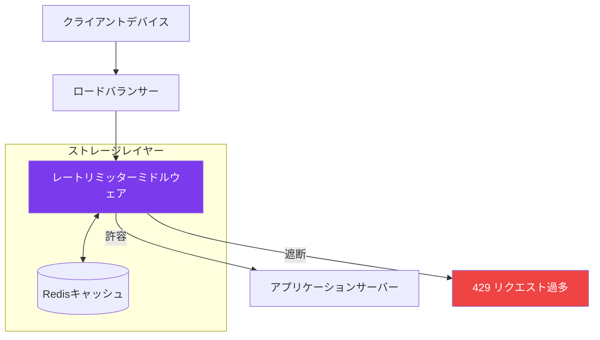

# Day 11: Rate Limiting & The Art of Traffic Control 🚦

11日目へようこそ！前回はシステムに耐障害性（Fault Tolerance）を持たせる方法について学びました。今日は、システムを利用するユーザーを制御することで、障害の発生を**「能動的」**に防ぐ方法を学びます。

理想的な世界では、すべてのユーザーが良識的です。しかし現実はそうではありません。毎秒何百万回もデータをスクレイピングしてくるボット、**DDoS** (🔊) (DDoS攻撃 - 分散サービス拒否攻撃) によってサーバーをダウンさせようとする競合他社、あるいはクライアント側の開発者が誤って無限ループの中にAPI呼び出しを記述してしまい、リクエストが止まらなくなるケースなどが日常茶飯事です。

もし **Rate Limiting** (🔊) (レートリミッティング - 流量制限) の仕組みがなければ、あなたのシステムはすぐにその巨大な圧力に屈してクラッシュし、すべてのユーザーに最悪の体験を提供することになります。

---

## 🪝 THE HOOK: 「過剰な愛」がもたらす帝国の崩壊

あなたが、世界的な超人気アーティスト（例：テイラー・スウィフト）のコンサートチケット販売サイトを運営していると想像してください。
- **1秒目**: 100人のユーザーがチケットを購入しに来ます。システムは非常に高速かつスムーズに動作しています。
- **2秒目**: プロの転売ヤー集団が 10,000台のボットを一斉に起動し、各ボットが毎秒 50回のリクエストを送信して安価なチケットを買い占めようとします。
- **3秒目**: サーバーのCPU使用率は 100% に跳ね上がります。ミリオンオーダーのクエリが殺到したことでデータベースが詰まり（接続プールが枯渇）、何ヶ月も楽しみに待っていた純粋なファンたちには、真っ白な画面か **504 Gateway Timeout** (🔊) (504 ゲートウェイタイムアウト) のエラーしか表示されません。

サーバーを10台用意していても、100台にスケールアウトしたとしても、ボットはリソースを吸い尽くし続けます。スマートに「NO」と答える術を知らなければ、システムは生存できません。こうした貪欲なアクセスをフィルタリングし、貴重なシステムリソースを一般の正常なユーザーに優先的に割り当てるにはどうすればよいでしょうか？それこそが、**Rate Limiter** (🔊) (レートリミッター - 流量制限器) の極めて重要な任務です。

---

## 🎭 ANALOGY: 大繁盛するバーと入り口の優秀な「セキュリティ」

Rate Limiting を直感的に理解するために、土曜日の夜に大行列ができている非常に有名なバーを想像してみましょう：

1.  **バー (システム)**: 毎晩提供できる席数やアルコールの量には限界（上限）があります。
2.  **お客様 (API Requests)**: 美味しいお酒と音楽を求めて店内に入りたがっています。
3.  **セキュリティ (Rate Limiter)**: 入り口に立ち、一人ひとりの身元を確認しカウントします。
    - 彼は厳格なルールを持っています：「各お客様（身分証基準）は、1時間あたり最大 3回までしか入店できません」。
    - もし4回目に来たら？どれだけお金を持っていても、彼は言います：「申し訳ありません。あなたはすでに飲みすぎです。ご自身の安全と他のお客様のために、次の1時間はお待ちいただき、また後ほどお越しください」（**429 Too Many Requests** (🔊) (429 リクエスト過多)）。
4.  **会員カード (API Key/IPアドレス)**: セキュリティが人物を特定するための識別手段です。あなたのIPアドレスやAPI Keyを利用して入店回数をカウントします。
5.  **本質**: Rate Limiting は極端なアクセス禁止措置ではなく、システム全体の **Fairness** (🔊) (フェアネス - 公平性) を担保するためのものです。1人の身勝手なユーザーがバーの全リソースを独占し、他のお行儀の良い何百人ものお客様が座れなくなるのを防ぎます。

---

## ⚙️ UNDER THE HOOD: 4つの流量制限アルゴリズム

毎秒数十億件のリクエストを処理するシステムを設計するために、必ずマスターしておくべき4つの古典的かつ強力なアルゴリズムがあります：

### 1. Token Bucket (トークンバケット) (🔊)
AmazonやStripeなどの業界大手が採用している、最も一般的で柔軟なアルゴリズムです。
-   **仕組み**: 最大 $N$ 個のトークン（利用許可証）を収容できる「バケット」を用意します。システムは毎秒一定数 $R$ 個の新しいトークンを自動的に補充します。リクエストを1回処理するごとに、トークンを1個消費します。バケットが空になると、それ以降のリクエストは即座に拒否されます。
-   **メリット**: 非常に柔軟です。バケットにトークンが貯まっていれば、アクセスの少ない時間帯に蓄積したトークンを使い、短時間の急激なアクセス増（**Burst Traffic** (🔊) (バーストトラフィック - 一時的な急増トラフィック)）を許容して処理することができます。

### 2. Leaky Bucket (リーキーバケット) (🔊)
-   **仕組み**: 底に固定サイズの小さな穴が空いたバケットを想像してください。水（リクエスト）がどれほど大量に一気に注がれても、穴からは常に一定の速度でしか水（処理）が流れ出ていきません。注ぐ速度が速すぎてバケットから水があふれた場合、あふれた分のリクエストは即座に破棄（拒否）されます。
-   **メリット**: サーバーの処理速度を常に完全に一定（**Fixed Rate**）に保ちます。インフラレベルで絶対的な均一性と安定性を求めるシステムに適しています。

### 3. Fixed Window Counter (固定ウィンドウカウンター) (🔊)
-   **仕組み**: 時間を厳密な枠（例：10:00:00 〜 10:00:59）に分割します。各枠（1分間）の中で最大 100回までのリクエストを許容し、次の1分に入るとカウンターが 0 にリセットされます。
-   **致命的なデメリット（境界値問題）**: 悪意あるユーザーが「1分目の59秒目」に 100回、「2分目の1秒目」に 100回リクエストを送信した場合、わずか 2秒の間にサーバーは 200回ものリクエストを受けることになり、設定制限の2倍の負荷が直撃してしまいます。

### 4. Sliding Window Counter (スライディングウィンドウカウンター) (🔊)
-   **仕組み**: 固定の時間枠ではなく、現在から遡った「直近の60秒間」の移動窓を用いてリクエスト数を計算します。
-   **メリット**: Fixed Window の境界値問題を完全に克服します。極めて正確ですが、各リクエストのタイムスタンプを記録・追跡する必要があるため、実装の複雑さとメモリ消費量がわずかに増加します。

### 5. レートリミッターの配置構造図 (Mermaid)

---

## 💻 SYSTEM DESIGN INTERVIEW: 10億ユーザー向けレートリミッター

**質問：「Twitter（X）の全APIプラットフォーム向けのレートリミッターを設計してください。最もレイテンシーを低く抑えるために、ユーザーのリクエストカウント情報はどこに保存すべきですか？」**

-   **Bad Answer (悪い回答)**: 「MySQLやPostgreSQLなどのリレーショナルデータベースに `RequestHistory` テーブルを作成し、リクエストが届くたびに `COUNT(*)` クエリを実行して確認します。」 -> **完全に不採用です**。このような重いデータベースクエリを実行していては、**I/O ボトルネック**によりシステム全体が瞬時に停止します。

-   **Architect Answer (設計者の回答)**: 
    1.  **分散型インメモリキャッシュを採用**: 極めて高速な In-memory データストアである **Redis** (🔊) を使用します。
    2.  **アトミック（原子）操作の実行**: Redis の `INCR` (インクリメント) と `EXPIRE` (有効期限設定) コマンドを使用します。
    3.  **理由**: RedisはデータをすべてRAM上に保持するため、1ミリ秒未満の超低レイテンシーで毎秒数百回以上の読み書きを処理できます。
    4.  **競合状態（Race Condition）の回避**: 複数のアプリサーバーが同時に Redis の同じキーを更新しようとした際に発生する **Race Condition** (🔊) (レースコンディション - 競合状態) を防ぐため、Redis 上で実行される **Luaスクリプト** を使用します。「値の取得・条件検証・カウント増算」の一連の処理を完全にアトミック（Atomic）に実行し、分散環境下でのカウントのズレを完全に排除します。

---

## 🏗️ DEEP DIVE: Throttling、Quotas、そして Blacklisting (🔊)

より深い知識を持つアーキテクトとして、以下の発展的概念も区別しておきましょう：
-   **Throttling** (🔊) (スロットリング - 帯域制限): エラーを返す代わりに、処理速度を低下させます。制限値を超えたユーザーに対して、応答速度を極端に遅くすることで「自発的にリクエスト頻度を控えるように」促します。
-   **Quotas** (🔊) (クォータ - 利用制限枠): より長い周期（月単位や年単位）での制限です。「無料プランのユーザーは、毎月最大 50記事まで閲覧可能」といったビジネス上のルールに適用されます。
-   **IP Blacklisting** (🔊) (IPブラックリスティング - IP拒否リスト登録): 明らかな攻撃動作（毎秒数万回のエラーリクエストなど）を検出した場合、レートリミッターはファイアウォールに指令を出し、そのIPからのすべてのアクセスを24時間完全に無視（ドロップ）させます。

---

## 📝 Quick Quiz: あなたの「トラフィック制御力」チェック

**問1：今回の講義において、なぜ「429」が最も重要なエラーコードなのですか？**
A. サーバーの物理ハードウェアが故障したことを示すため。
B. クライアントに対して「許可されたリクエスト制限値を超過した」ことを伝えるための標準的な HTTP ステータスコード（Too Many Requests）だから。
C. セキュリティ権限エラーを示すため。

**問2：一時的な急激なアクセス増（Burst Traffic）を最も許容しやすいアルゴリズムはどれですか？**
A. Leaky Bucket
B. Token Bucket
C. Fixed Window Counter

**問3：レートリミッターシステムにおける Redis の役割は何ですか？**
A. ユーザーのプロフィール画像を高速保存するため。
B. 分散環境において、各API呼び出しの数を極めて高速に集計・記録する共有カウンター（Shared Counter）の役割。
C. データの暗号化を行うため。

**問4：この文脈における「Race Condition（競合状態）」とはどのような現象ですか？**
A. 複数のサーバーが同時に同一ユーザーのカウントを更新しようとした結果、カウント漏れが発生し、ユーザーが設定値を超えて余分にAPIを呼び出せてしまう現象。
B. システム全体の処理速度が限界を超えて高速化すること。
C. ハッカーたちの間でハッキング速度を競い合うこと。

**問5：Redis 上で Luaスクリプトを使用してレートリミッターを実装する主な理由は何ですか？**
A. Luaスクリプトの方が記述がシンプルだから。
B. 処理の原子性（Atomicity）を保証し、競合状態（Race Condition）を完全に排除するため。
C. RedisのRAM使用量を節約するため。

---

**解答:**
1. B
2. B
3. B
4. A
5. B

---

開かれたシステムには、常に門番となる優秀なセキュリティが必要です。Rate Limiting を深く理解することは、サーバーの生存を守るだけでなく、インテリジェントな SaaS ビジネスモデルを設計するための基礎になります。

明日は、データを最もユーザーに近い場所へと届ける技術：**Content Delivery Networks (CDN)** について学びます。また明日お会いしましょう！

📊 単語数: 2652語
