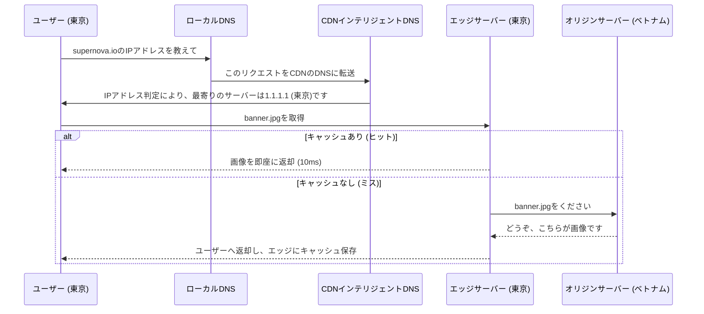

# Day 12: Content Delivery Networks (CDN) - 光の速度 ⚡

12日目へようこそ！前回はサーバーを守るためのトラフィック制御（Rate Limiting）について学びました。今日は、地理的な距離に関係なく、データを最も高速にユーザーに届ける方法を学びます。

Netflix や YouTube を観るとき、そのサーバーが地球の反対側に位置しているにもかかわらず、なぜ 4K 動画が即座に再生されるのか不思議に思ったことはありませんか？もしすべてのアクセスが深海底の光ケーブルを通って遠く離れた中央サーバーへ直接通信しに行く必要があったなら、単純なカバー画像を1枚ロードするだけでも数秒かかってしまうでしょう。

**CDN (Content Delivery Network)** (🔊) (CDN - コンテンツデリバリーネットワーク) は、この物理的な距離の壁を取り払い、国境のない極めてスムーズなユーザー体験をもたらす、世界中に分散された「衛星」のようなサーバーネットワークです。

---

## 🪝 THE HOOK: 物理的な距離はコンバージョン率の「天敵」である

あなたがグローバルな高級ブランドのショッピングアプリを立ち上げたと想像してください。メインサーバーはベトナムのホーチミン市にあります。
- **ベトナム国内のユーザー**: わずか 0.05秒でデータを受け取れます。動作は非常に高速でプロフェッショナルな使い心地です。
- **ベルリンやニューヨークのユーザー**: データは太平洋や大西洋を越え、何十もの中継地点を経由して旅をしなければなりません。
    - 光ファイバー内の光の伝搬速度は極めて高速ですが、物理的な限界があります。アメリカとベトナムの間の1回の往復時間（**Round-trip Time - RTT** (🔊) (ラウンドトリップタイム - 往復時間)）は、物理的にどうしても 0.3 〜 0.5秒ほどかかってしまいます。
    - 現代のECサイトには、100枚以上の商品画像や数十のスクリプトファイルが含まれています。もし各ファイルをベトナムのメインサーバーから毎回1つずつ順番にダウンロードしていたら、アメリカのユーザーは **10〜20秒間** も真っ白な画面を見つめ続けることになります。
- **痛烈な結果**: Amazonの統計調査によると、表示速度が 0.1秒遅れるごとに売上が 1% 減少します。アメリカの顧客は表示の遅さにイライラし、サイトを閉じて現地の競合ECサイトに行ってしまうでしょう。光の速度による遅延のせいで、あなたは何千億円もの市場を失うことになります。

どうすれば、アメリカの顧客の「すぐ隣」にウェブサイト全体を丸ごと移動させることができるでしょうか？唯一の解決策が **CDN** です。

---

## 🎭 ANALOGY: 小売スーパーと全国規模の倉庫物流網

CDN の本質を直感的に理解するために、大手牛乳メーカーの物流サプライチェーンに例えてみましょう：

1.  **Origin Server (オリジンサーバー)** (🔊) (オリジンサーバー - 原元サーバー): 遠く離れた高原にある**唯一の牛乳生産工場**のようなものです。牛乳を飲みたい人が全員、何百キロも車を走らせて工場まで直接買いに来たら、道路は大渋滞になり、ガソリン代もかさみ、牛乳は手元に届く前に腐ってしまうでしょう。
2.  **CDN Edge Servers (エッジサーバー)** (🔊) (CDNエッジサーバー - 最先端キャッシュサーバー): あなたの住むマンションのすぐ下や、街のいたるところにある**コンビニエンスストア（セブン-イレブンやファミリーマートなど）**のようなものです。
    - 工場は、顧客から注文が届くのを待ってから牛乳を出荷するのではありません。あらかじめ牛乳を各コンビニの棚や冷蔵庫に届けて保管しておきます（これを **Caching** (🔊) (キャッシング - 一時保存) と呼びます）。
    - 牛乳を飲みたくなったら、近くのコンビニまで2分歩くだけですぐに新鮮な牛乳が手に入ります。工場がどこの県にあるかや、工場が今停電しているかどうかを気にする必要はありません。
3.  **在庫切れ (Cache Miss)** (🔊) (キャッシュミス): もし近所のコンビニでその牛乳が売り切れていた場合、店員は工場へ至急追加発注をかけ、それを取り寄せてあなたに提供します。そして、次に買いに来る人のために、余分にいくつかの牛乳を棚（エッジ）に残しておきます。
4.  **相互のメリット**: 生産工場は数百万人の顧客の押し寄せによるパンクから解放され、消費者は移動コストほぼゼロ、かつ「反射速度」の速さで牛乳を手に入れることができます。

---

## ⚙️ UNDER THE HOOD: CDN ネットワークの高度な仕組み

### 1. コンテンツの分類：静的（Static） vs. 動的（Dynamic）
-   **Static Content** (🔊) (静的コンテンツ): 画像、動画、CSSファイル、JavaScriptファイルなど。これらはユーザーごとに変化しないため、CDN の大好物です。CDN はこれらを一度保存し、何百万回も再利用して配信します。
-   **Dynamic Content** (🔊) (動的コンテンツ): 検索結果、個人用マイページ、ショッピングカートの中身など。現代の高度な CDN は **Dynamic Site Acceleration (DSA)** (🔊) (動的サイト加速化技術) などの技術を使用し、エッジサーバーとオリジンサーバー間の通信ルートを特別に最適化された「プライベート高速道路」で結ぶことで、動的データの伝送も高速化します。

### 2. Pull と Push の戦略（引っ張るか、押し出すか？）
-   **Pull Model (プルモデル - 取得主導型)**: 最初のユーザーがファイルを要求したとき、CDNはエッジキャッシュを確認します。キャッシュが存在しない場合（Miss）、自動的にオリジンサーバーにデータを取りに行き、それをエッジにキャッシュ保存した上でユーザーに返却します。最もシンプルで広く使われている方法です。
-   **Push Model (プッシュモデル - 配信主導型)**: ユーザーからの要求が発生する前に、コンテンツ提供者が能動的にデータを事前に CDN へ「送り込んで」おきます。大容量の製品アップデート（例：Appleの5GBを超えるiOS新バージョン配信など）に利用されます。これにより、最初のリクエストで発生する重い「Cache Miss」を完全に回避できます。

### 3. DNSを活用した賢いルーティングプロセス (Mermaid)

ユーザーのブラウザが、アメリカではなく、最寄りの東京のエッジサーバー（Edge Server）を自動的に検知して呼び出せるのはなぜでしょうか？秘密は、CDN と DNS システムの連携にあります。

### 4. CDN 運用管理における極めて重要な指標
-   **Cache Hit Ratio** (🔊) (キャッシュヒット率): エッジサーバーで即座に解決できたリクエストの割合。この比率が 90% であれば、オリジンサーバーへ到達する負荷の 90% を CDN が身代わりとして削減してくれたことを意味します。
-   **TTL (Time To Live)** (🔊) (TTL - キャッシュ生存期間): キャッシュコピーがエッジ上で「生存」し続ける時間。例えば 1日 に設定した場合、1日経過するとエッジは古いキャッシュを破棄し、次回アクセス時に再び最新のデータをオリジンから取得します。
-   **Purge/Invalidation** (🔊) (パージ / キャッシュ無効化): エッジにある古いキャッシュデータを強制的に即座に削除・更新させる命令です（例：Webサイトが改ざんされた際や、緊急のバグ修正コードを即座に全世界に反映させたい場合など）。

---

## 💻 SYSTEM DESIGN INTERVIEW: 100億回視聴を捌く設計

**質問：「数百万人が同時視聴するサッカーのリアルタイムライブ配信システムを設計しています。ゴールが決まった瞬間などにアクセスが集中しても、映像がカクつかず、オリジンサーバーをダウンさせないようにするにはどうすればよいですか？」**

-   **Bad Answer (悪い回答)**: 「オリジンサーバーのCPUやスペックをモンスター級に強化し、オリジン直結のネットワーク帯域を 1Gbps から 100Gbps に増強します。」 -> **不採用です**。データセンターの直通ネットワーク帯域コストは極めて高額であり、数百万の同時アクセスが1つの接続拠点に集中する問題（**Single Point of Traffic**）は、いかなる単一インフラでも耐えられません。

-   **Architect Answer (設計者の回答)**: 
    1.  **Tiered Distribution (多階層配信)**: 多層構造の CDN キャッシュレイヤーを構築し、オリジンサーバーへの直接の負荷を段階的に削減します。
    2.  **Edge Caching (エッジキャッシング)**: ストリーミング映像データを細切れのセグメントファイルに分割し、エッジサーバー上で直接キャッシュさせます。数百万人が同時に同じ数秒間の映像セグメントを要求しても、オリジンに届くリクエストは各セグメントごとに「最初の1回」だけであり、残りの何百万人分もの配信はエッジサーバー群が肩代わりして並列処理します。
    3.  **Anycast IP (エニーキャストIP)**: Anycastを利用して、ユーザーのアクセスを自動的に最も健全で物理的に近い CDN クラスターへと安全にルーティングします。
    4.  **境界セキュリティの適用**: CDNのエッジ層で不正トラフィックや過剰なアタックを検知・フィルタリングし、オリジンインフラに届く前に DDoS 攻撃を無力化します。

---

## 🏗️ DEEP DIVE: Edge Computing と Serverless の波 (🔊)

現代の CDN は、単に静的なファイルを配信する場所ではありません。**Cloudflare Workers** や **AWS Lambda@Edge** などの技術により、CDN のエッジサーバー上で任意のコード（JavaScript / Rust）を直接実行できる **Edge Computing** (🔊) (エッジコンピューティング) が普及しています。
- **具体例**: ユーザーが動画を視聴する前に、権限チェック（認可処理）をアメリカのエッジサーバー上で即座に実行します。わざわざベトナムのメインデータベースまで「このユーザーはログインしているか？」を問い合わせに戻る必要がありません。
- これにより、システムの **Resiliency** (🔊) (レジリエンス - 回復力・復元力) は圧倒的に向上します。軽量な処理ロジックを極限までエッジ側に追い出すことで、中央サーバーは重いトランザクション処理にのみ集中できます。

---

## 📝 Quick Quiz: あなたの「光速度配信力」チェック

**問1：CDN ネットワークにおいて「Origin Server（オリジンサーバー）」はどのような役割を持っていますか？**
A. ユーザーのブラウザに最も物理的に近い場所にあるサーバー。
B. オリジナルの本番データを保持している大元のサーバーであり、エッジでキャッシュミス（Cache Miss）が発生した際にデータを補給しに行く先。
C. ユーザーが操作するWebブラウザ自体のこと。

**問2：CDN の導入が企業のインフラ運営コスト削減に大きく寄与するのはなぜですか？**
A. CDN は完全に無料で提供されているサービスだから。
B. CDN のデータ転送帯域幅（Bandwidth）単価は、クラウドサーバーから直接配信するよりも大幅に安価であり、大元のサーバーのトラフィック負荷とスペック要求を劇的に引き下げられるから。
C. サーバーの電気代がかからなくなるから。

**問3：CDN における「Propagation Time（伝播時間）」とは何を指しますか？**
A. 光がオリジンサーバーからクライアントのパソコンに届くまでの時間。
B. オリジン側で行った変更（例：キャッシュパージによる更新指示）が、世界中のすべてのエッジサーバーに同期・反映されきるまでにかかる所要時間。
C. ハードディスクの物理ディスクの回転速度。

**問4：能動的な「Push Model」の採用が最も推奨されるのはどのようなユースケースですか？**
A. データの中身が毎秒リアルタイムに激しく変動するとき。
B. 新しいオンラインゲームの巨大アップデートファイルの配信開始など、あらかじめ大容量データをエッジサーバーに配置しておき、配信開始の瞬間（時間X）の激甚なアクセス負荷に備えたいとき。
C. ディスク容量を節約したいとき。

**問5：CDN 上にあるファイルの有効期限（TTL）を 1年 に設定して配信していましたが、同じファイル名で画像を緊急に差し替えたくなりました。どうすればよいですか？**
A. 1年経過して自然にキャッシュが消えるまで待つ。
B. ファイル名を別名に変更するか、CDN に対して「Purge / Invalidate（キャッシュパージ）」処理を実行して、エッジの古いデータを即座に破棄させる。
C. ドメインを廃止して最初からWebサイトを作り直す。

---

**解答:**
1. B
2. B
3. B
4. B
5. B

---

CDN は、あなたのアプリケーションが光の速さで世界中を駆け巡るための「翼」です。一流のアーキテクトは、地理的な距離という物理限界をユーザーに対して完全に無効化（隠蔽）します。

明日は、インターネット全体の巨大な「電話帳」である **DNS & Anycast** について探求します。明日またお会いしましょう！

📊 単語数: 2682語
