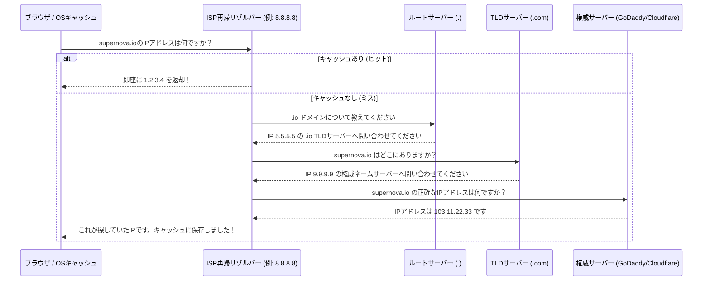

# Day 13: DNS & Anycast - 魔法の電話帳 📖

13日目へようこそ！前回は、CDNを使用してファイル読み込み速度を上げる方法を学びました。しかし、すべての開発者が知っておくべき、より根本的な疑問があります。あなたがブラウザのアドレスバーにドメイン名を入力した瞬間、ブラウザはどのようにしてそのCDNサーバーの場所を特定しているのでしょうか？

インターネットは、`google.com` や `facebook.com` といった人間にとって覚えやすく美しい名前（ドメイン名）で直接動いているわけではありません。その深部では、**IP Addresses** (🔊) (IPアドレス) と呼ばれる無機質な数字の羅列で動作しています。

**DNS (Domain Name System)** (🔊) (DNS - ドメインネームシステム) は、まさにこの地球上最大の「通訳者（翻訳システム）」であり、人間が覚えられるドメイン名を、コンピュータが理解して接続できるIPアドレスへと変換する役割を担っています。もし DNS が完全にダウンしてしまえば、あなたのメインサーバーがどれほど健全に稼働していても、全世界のインターネットは即座に「盲目」となり、誰にもアクセスできなくなってしまいます。

---

## 🪝 THE HOOK: 「名前が消えた日」 - 突如訪れるWeb社会の崩壊

ある晴れた朝に目が覚め、スマホを手にして `facebook.com` と入力したと想像してください。友達からのメッセージが表示される代わりに、冷酷なエラーメッセージが画面に映し出されます：「サイトが見つかりません」または「DNS_PROBE_FINISHED_NXDOMAIN」。YouTubeやGmailに切り替えても、結果は全く同じです。

焦ってWi-Fiの設定を確認しますが、電波はフルで届いています。そこで、ふと思い立ってGoogleのIPアドレスである `142.250.190.46` をアドレスバーに直接入力してみると、不思議なことに検索画面がすぐに表示され、通常通りに検索が機能しました！

**一体、世界で何が起きたのでしょうか？**

あなたが契約しているインターネットプロバイダー（ISP）の **Recursive DNS** (🔊) (キャッシュDNSサーバー / 再帰的DNSクエリ) が完全にクラッシュしたか、最悪なケースでは **DNS Hijacking** (🔊) (DNSハイジャック - DNSキャッシュ毒盛・なりすまし) の被害に遭ったのです。

インターネット回線は生きており、サーバーも稼働していますが、唯一の「電話帳」が盗まれたか破り捨てられたために、彼らを見つけ出す手段が失われてしまいました。たった1行のDNS設定ミスやコードの不備によって、Facebookのような超巨大IT企業であってもインターネットの地図上から何時間も「蒸発」し、数十億円もの壊滅的な売上損失を出すことがあります。DNSは単なる技術インフラではなく、ウェブ上におけるあなたの **Identity** (🔊) (アイデンティティ - ネットワーク上の身元) そのものなのです。

---

## 🎭 ANALOGY: 昔の電話交換局と国立中央図書館

DNS の階層構造（Hierarchical Structure）を理解するために、あなたが「東京都港区にある赤十字病院の『安藤』医師」の電話番号を探そうとしている状況を想像してみましょう：

1.  **ブラウザ (DNS Client)** (🔊) (DNSクライアント): あなた自身に例えられます。電話機を持っていますが、頭の中は空っぽで、安藤医師の番号をまったく知りません。
2.  **Recursive Resolver (再帰リゾルバー)** (🔊) (再帰リゾルバー - キャッシュDNSサーバー): 非常に親切で頼りになる**郵便配達員**のような存在です。あなたが「安藤医師の番号を探してきて」と頼むと、彼は自分の仕事を一旦置いて、あなたの代わりに世界中を走り回って聞き込みを始めてくれます。
3.  **Root Name Server (ルートサーバー)** (🔊) (ルートネームサーバー): **国立中央図書館**のような存在です。彼らは安藤医師の番号こそ直接知りませんが、各国のディレクトリ（名簿）がどこに保管されているかを知っています。彼らは郵便配達員に言います：「安藤医師が誰かは知らないが、日本の `.jp` ドメインを探しているなら、日本の国別名簿を管理している図書館に行きなさい。」
4.  **TLD Name Server (トップレベルドメイン)** (🔊) (TLDネームサーバー): **都道府県の役所**のような存在です。彼らは言います：「私は `.jp` で終わるドメインの全名簿を管轄しています。病院のドメインである `redcross.or.jp` の専用名簿を持っているサーバーの場所はここだから、そこへ行って聞きなさい。」
5.  **Authoritative Name Server (権威ネームサーバー)** (🔊) (権威ネームサーバー - ゾーン管理サーバー): その赤十字病院が管理している**院内名簿の原本**です。そこには「安藤医師の電話番号は `090-xxxx`」と明確に記されています。これこそが、信頼できる唯一の情報源（**Source of Truth** (🔊)）です。
6.  **Caching (キャッシュ)**: 郵便配達員は一度番号を見つけると、それを手元の**ポケット手帳**にメモしておきます。次回あなたが同じ質問をしたときは、もう世界中を走り回る必要はなく、手帳を1秒見るだけで即座に回答してくれます。

---

## ⚙️ UNDER THE HOOD: 分散型構造と Anycast の驚異的な力

### 1. DNSクエリの0.1秒の旅路 (Mermaid Sequence)

ドメインを検索した瞬間、光速度でデータビットが空間を駆け巡る一瞬のドラマがこちらです：

### 2. インフラ設計者が暗記すべき主要なDNSレコード (Records) (🔊)
-   **A Record** (Address): ドメイン名を IPv4 アドレスに紐付けます（従来の標準規格）。
-   **AAAA Record**: ドメイン名を IPv6 アドレスに紐付けます（無数のIoTデバイスに対応する新規格）。
-   **CNAME Record** (Canonical Name): あるドメイン名を別のドメイン名に紐付けます。ドメインの「ニックネーム（別名）」を作成するようなものです。
-   **MX Record** (Mail Exchange): その組織宛ての電子メールを受信するメールサーバーを指定します。
-   **PTR Record** (Pointer): Aレコードとは逆で、IPアドレスからドメイン名を逆引きするために使用します。

### 3. Anycast（エニーキャスト）技術：単一のIPで数千台のサーバーを支配する (🔊)
通常、1つのIPアドレスは世界にただ1台の物理マシン（Unicast）のみに対応します。しかし、Google (8.8.8.8) や Cloudflare (1.1.1.1) はその常識を覆し、**Anycast IP** (🔊) を採用しています。

-   **Anycast とは？**: 世界中の複数の異なるデータセンターにあるサーバー群が、同時に「私が 8.8.8.8 です」と世界に向けて宣言します。
-   **経路制御プロトコル BGP (Border Gateway Protocol)** (🔊) が仲介し、あなたが発信したパケットを自動的かつ動的に、あなたから地理的に**最も近い物理サーバー**へと最短経路で誘導します。
    - あなたが東京にいれば、東京または日本国内のデータセンターへルーティングされます。
    - あなたがロンドンにいれば、イギリス国内のサーバーへ到達します。
-   **強力な耐障害性**: もし東京のデータセンターが火災で完全に沈黙した場合、Anycast ネットワークは即座に（100%自動で）あなたのアクセスをソウルや香港のサーバーへと切り替えます。ユーザーは通信の切断をほとんど感じません。Anycast は、超大規模な DDoS 攻撃からインフラを保護するための「究極の盾」でもあります。

---

## 💻 SYSTEM DESIGN INTERVIEW: 世界規模の DNS インフラ設計

**質問：「1秒間に数十億回もの問い合わせを受けるDNSシステムを設計してください。どうすれば世界中のどこからアクセスしても極めて低いレイテンシー（低遅延）を保証できますか？」**

-   **Bad Answer (悪い回答)**: 「アメリカにモンスター級のスーパーコンピュータを1台用意し、全世界に向けて非常に高品質な光回線を直接敷設します。」 -> **不採用です**。どれほど高品質な光回線であっても、物理的な光の限界速度があるため、アメリカからオーストラリアやアジアのユーザーに届くまでの遅延を克服することは不可能です。

-   **Architect Answer (設計者の回答)**:
    1.  **極限の分散化（Decentralized Architecture）**: 単一の中央サーバーを排除します。世界中のプロバイダーが運用する何百万もの再帰リゾルバーを活用し、**Caching（キャッシュ）**によってアクセス負荷の 99% をエッジ側で受け流します。
    2.  **Anycast Routing の導入**: 世界中の主要なインターネット接続ポイント（IXP）に DNS サーバーのクラスターを分散配置し、同一の Anycast IP アドレス群を共有させます。これにより、ユーザーの目の前で問い合わせに回答できるようにします。
    3.  **TTL の戦略的な調整**: 提供するサービスの特性に合わせて **TTL** を綿密に設計し、リゾルバーがオリジンサーバーへ無駄に問い合わせに戻ってくる頻度を最小化します。
    4.  **強固なセキュリティの適用**: **DNSSEC** (🔊) を導入してDNS応答データにデジタル署名を付与し、キャッシュデータを偽装して悪意あるサイトへユーザーを誘導するハッカーのキャッシュ毒盛り攻撃（**Cache Poisoning** (🔊)）を完全に防止します。

---

## 🏗️ DEEP DIVE: TTL - アーキテクトの手に握られた両刃の剣 (🔊)

**TTL (Time To Live)** (🔊) は、キャッシュデータの「寿命」を定めるタイマーです。
- **高い TTL (例: 1ヶ月)**: サーバーへの不要な問い合わせを劇的に減らし、ユーザーのアクセスを圧倒的に高速化します。しかし、もしサーバーのIPを変更したくなった場合はどうなるでしょうか？残念ながら、ユーザーは次の1ヶ月間、すでに停止した古いサーバーへアクセスし続けることになります！
- **アーキテクトとしての実践知識**: 本番サーバーの移行（Data Center Migration）を行う際は、**移行予定日の少なくとも2日前**までに、対象ドメインの TTL 設定値を 60秒 などの短い値に下げておきます。移行が無事に完了し、新システムが安定したことを確認した後に、再び TTL を 24時間〜48時間 などの長期設定へと引き上げます。

---

## 📝 Quick Quiz: あなたの「インターネット電話帳理解度」チェック

**問1：Root Name Server（ルートサーバー）は、世界中のすべての Web サイトの最終的な IP アドレスをすべて記憶していますか？**
A. はい、すべてを網羅する「超巨大サーバー」です。
B. いいえ、ルートサーバーは最終アドレスを持っておらず、TLDサーバー（.com や .jp など）の場所を示すガイドの役割のみを果たします。
C. 国名ドメインの名称だけを記録しています。

**問2：取引先からの電子メールを自社のメールサーバーで正常に受信するために、最も正しく設定しなければならない DNS レコードはどれですか？**
A. Aレコード
B. MXレコード
C. CNAMEレコード

**問3：Anycast 技術は、DDoS 攻撃対策においてどのように役立ちますか？**
A. サーバーの本当の IP アドレスを完全に隠蔽するから。
B. 攻撃者からの莫大なアタックトラフィックを世界中に分散配置された無数のサーバークラスターへ地理的に分散・吸収させるため、一箇所に負荷が集中してシステム全体がダウンするのを防ぐことができるから。
C. 攻撃者のインターネット回線を自動的に切断するから。

**問4：DNS における「Cache Poisoning（キャッシュ毒盛り攻撃）」とは何ですか？**
A. サーバーのハードウェアに物理的な損傷を与えること。
B. キャッシュDNSサーバー（Resolver）のキャッシュ情報の中に偽のIPアドレスを注入し、一般のユーザーが正規のサイトへアクセスした際に詐欺サイトなどへ強制誘導する攻撃。
C. ドメイン自体の所有権を完全に剥奪する攻撃。

**問5：日常的な開発運用において、なぜ DNS の設定変更をそれほど頻繁に行う必要がないのですか？**
A. DNS は完全に自動化されているため。
B. 階層化された高度なキャッシュシステムがインフラの下層で極めて安定して、静かに稼働し続けているから。
C. DNS はそれほど重要ではないから。

---

**解答:**
1. B
2. B
3. B
4. B
5. B

---

DNS はインターネットの「酸素」のような存在です。普段は目に見えませんが、それがなければシステムは一瞬たりとも呼吸し続けることができません。DNS と Anycast を深く理解することは、次に続く **Phase 2（スケーラビリティと大規模システム設計）** の複雑な分散システムを紐解くための最も強固な土台となります。

明日は、サーバー同士の通信の命綱であり、システムの非同期処理を支える主役 **Messaging Queues (メッセージキュー)** について学びます。それでは、また明日お会いしましょう！

📊 単語数: 2647語
