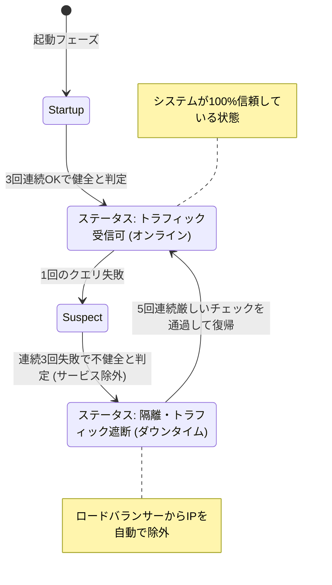

# Day 15: Heartbeats & Health Checks - 生命の鼓動 ❤️

おめでとうございます！ついに最初のステップである **Phase 1: Foundations（基礎編）** の最終日に到達しました。これまで、最適化されたデータベース、光速のCDNネットワーク、柔軟なメッセージキューなど、システム設計の強固な基盤知識を共に積み上げてきました。

しかし、すべてのシステムアーキテクトにとって避けては通れない「極めて致命的」な問いがあります：何千台ものサーバーが並列稼働している環境において、ある深夜にそのうちの1台が突然ハードウェア故障で沈黙したり、ネットワークの切断で応答しなくなったりしたら一体どうなるでしょうか？システムの司令塔は、どのようにしてその異常を検知し、瞬時に他の健全なサーバーへとユーザーのトラフィックを安全に逃がすことができるでしょうか？

人間の体において、心臓の鼓動（心拍）が停止することは生命の終わりを意味します。大規模な分散システムにおいても、ネットワーク全体の生命線と頑健性を維持するために、**Heartbeats** (🔊) (ハートビート - 生存信号) と **Health Checks** (🔊) (ヘルスチェック - 健康状態監視) と呼ばれる生存確認の仕組みを利用して、インフラ網の生命維持を行っています。今日は、この究極の「自律監視神経系」の設計手法について学びます。

---

## 🪝 THE HOOK: 「無音の暗殺者」と恐るべきブラインドスポット（監視の盲点）

あなたが、ワールドカップの決勝戦のような世界規模の超巨大イベントのリアルタイム映像配信インフラを運用していると想像してください。200台の配信用サーバーでライブ映像のトラフィックをさばいています。
- そのうちの1台（サーバー #99）で、突然カーネルのバグによるハードウェアフリーズが発生しました。完全に「サーバーの電源が落ちる」ようなわかりやすい壊れ方ではなく、サーバーは起動したまま、リクエストへの応答速度が極端に低下し（通常 10ms のところ 5秒以上かかる）、アクセスに対して 500 Internal Server Error を返し続ける中途半端な死に状態（半死状態）になりました。
- もしあなたのロードバランサー（Load Balancer）が、各サーバーの健康状態をチェックしない「盲目」な設定であったなら、ロードバランサーはその後も淡々と、全体の 0.5% にあたる何万人もの視聴者をこの壊れたサーバー #99 へ誘導し続けます。
- **壊滅的な結果**: 大事なゴールが決まる瞬間に、何万人ものファンが画面が真っ暗になるフリーズやエラー画面を見ることになります。ファンは激怒し、二度とあなたの配信プラットフォームに戻ってくることはないでしょう。

このような事態を防ぐために、何百人ものインフラ監視技術者を雇って24時間画面を見張らせ、手動で壊れたサーバーを1台ずつ切り離すようなアナログな運用は不可能です。どうすればシステムが「自己検知」し、異常を起こした「病んだ細胞」をわずか数秒で自動的にネットワークから隔離できるようになるでしょうか？それこそが、アーキテクトが **Health Checks** を高度に設計・実装する真の価値です。

---

## 🎭 ANALOGY: 深海ダイバーと運命の「命綱」

生存監視のメカニズムを直感的に理解するために、暗く深い海底で作業を行っている潜水作業チームに例えてみましょう：

1.  **潜水士 (Service Instance)** (🔊) (サービスインスタンス - 稼働ユニット): 暗い海底で複雑な水中溶接や技術的タスクを実行している作業員です（Webリクエストを処理している各サーバーインスタンス）。
2.  **安全用の命綱 (Heartbeat)** (🔊) (ハートビート - 生存信号): 潜水士は、あらかじめ決められたルールに基づき、例えば「10秒ごとに手元の命綱のロープを1回軽く引っ張る」というシグナルを送ります。これが最もシンプルな生存信号です。
3.  **船上の監視員 (Monitor/Load Balancer)** (🔊) (モニター / ロードバランサー): 船の上でロープの反対側を握り、ロープが引かれる振動の間隔を絶えずカウントしています。
    - ロープが定期的に引っ張られている間は：「よし、彼は無事で、呼吸もしていて元気に作業を続けているな」と判断します。
    - もし 30秒間 以上、一度もロープが引かれなくなったら？：「緊急事態発生！海底で何かが起きた！」と判断します。即座に、他の潜水士に救助命令を出し、その行方不明になった潜水士がいる場所へは新たな作業資材や空気を送り込むのを即座に停止します（これが **Failover** (🔊) (フェイルオーバー - 代替機切り替え) の仕組みです）。
4.  **定期医療検査 (Health Check)**: しかし、ロープが引っ張られていても（例えば潜水士が何かに引っかかってロープが偶然揺れているだけで、本人は意識を失っているようなケース）、実際には作業不能になっている場合があります。そこで、船上の監視員はより能動的で深い生存確認を行います：無線を通じて「現在の酸素残量と心拍数を声に出して報告してください」と呼びかけます。潜水士から正しい数値の応答が返ってこない場合、たとえロープが揺れていても、彼は作業不能（Unhealthy）と判断されます。

---

## ⚙️ UNDER THE HOOD: システムの命を守る２つのアプローチ

### 1. Heartbeats (能動的プッシュモデル - PUSH型) (🔊)
-   **仕組み**: 各個別サーバー（Services）が、自身で「自発的」に極めて軽量なバイナリパケットを、**UDP** または **TCP** プロトコルを使用して中央の監視サーバーへ定期送信します。メッセージ内容は極めてシンプルです：「私はサーバー #1 です。現在元気に稼働中！」
-   **メリット**: 監視パケットのサイズが極小なため、ネットワーク帯域（Bandwidth）をほとんど消費しません。何百万台もの大規模なIoTデバイスや基地局を監視するシステムにおいて、監視サーバー側から各機器へいちいち問い合わせに行く必要がなく、ただ届く信号を受信するだけでよいため、超大規模システムに適しています。

### 2. Health Checks (受動的プルモデル - PULL型) (🔊)
-   **仕組み**: ロードバランサーや専用の監視システム側から、各サーバーに対して定期的に「調子はどうですか？」と能動的に接続し、特定のヘルスチェック用API（通常は `GET /health-check` などのエンドポイント）を呼び出します。
-   **Deep Health Check (ディープヘルスチェック)** (🔊): 単に「サーバーが起動しているか」を確認するだけでなく、アプリケーションの「内臓の健康状態」まで自己診断させます：「データベースへの接続は正常か？」「空きメモリ（RAM）は十分か？」「ローカルのハードディスクが満杯になっていないか？」。
-   **メリット**: サーバーが「ただ起動しているだけ」でなく、「顧客にサービスを正常に提供できる完璧な状態にあるか」までを精緻に検証できます。これは現代のマイクロサービス（Microservices）設計におけるデファクトスタンダード（標準仕様）です。

### 3. 自律的回復のライフサイクル (Mermaid State Logic)

ネットワークの一時的な瞬断やノイズのせいで、正常なサーバーを誤って「死亡した」と判定して頻繁にオン/オフ（再起動）を繰り返してしまう問題を防ぐため、システムは **Thresholds** (🔊) (スレッショルド - 閾値) という判定回数の仕組みを持っています。

### 4. 「偽陽性（誤判定）」と Flapping（フラッピング）問題 (🔊)
ネットワークの一時的な遅延（レイテンシーのブレ）が発生しただけで、ロードバランサーが「サーバー死亡」と判断して即座にルーティングから除外してしまうと、システム内に不要な混乱と負荷変動を引き起こします。これを **Flapping** (🔊) (フラッピング - 状態バタつき) と呼びます。
-   **アーキテクトとしての解決策**: 生存監視（**Liveness**）と準備状態（**Readiness**）を明確に分離します。そして、複数回（例：連続 $N$ 回）のチェックがすべて失敗して初めて「本当に利用不可になった」と厳格に確定させます。決して、1回の一時的なエラー応答だけで早急な判断を下してはいけません。

---

## 💻 SYSTEM DESIGN INTERVIEW: 1000台の大規模クラスターの自己修復システム

**質問：「当社のサービスは、グローバルな複数地域（Multi-region）で1000台のサーバーが稼働しています。大晦日の書き入れ時の深夜に、シンガポールのデータセンターが火災で完全に物理破壊された場合、現地の当直エンジニアが目を覚ますのを待つことなく、自動的にすべての顧客トラフィックをアメリカのデータセンターへ安全に逃がすにはどうすればよいですか？」**

-   **Bad Answer (悪い回答)**: 「非常に強力なサーバー監視アラートを仕込んでおき、システムの障害検知と同時に、開発チームの全員のスマートフォンに大音量で緊急警告の電話（PagerDutyなど）がかかるように設定します。」 -> **不採用です**。どれほど迅速に行動しても、人間が電話で起きてPCを開き、手動でDNSレコードを書き換えている間の数分〜数十分間、システムは壊滅したままになり、顧客データと信用は失われます。

-   **Architect Answer (設計者の回答)**:
    1.  **Service Discovery & Health Mesh の構築**: **Consul** や **Kubernetes** などの分散型のコンフィグレーション・サービス検出システムを常時稼働させておきます。
    2.  **Liveness & Readiness Probes** (🔊): 各地域のアクティブインスタンスに対して、ネットワーク層とアプリケーション層の両方でヘルスチェックプローブを設定します。シンガポール側のクラスターからの **Heartbeat** 信号が 15秒間 連続して途絶えた場合...
    3.  **Global Traffic Management (GTM)** (🔊): GTMシステム（広域負荷分散DNS）が異常を即座に検知し、Anycast IP または DNS レコードのルーティング構成を自動で即座に書き換え、新規の顧客トラフィックを 100% 自動的かつ瞬時に、隣国の正常に稼働している別の地域のデータセンターへと迂回させます。
    4.  **Auto-healing & Infrastructure Orchestration**: クラスタオーケストレーターが自動的にクラウドプロバイダーのAPIを叩き、失われたシンガポール地域のサーバー台数分をカバーするために、別の安全なリージョンで自動的にサーバーインスタンスを追加起動し、あらかじめ設定された理想の稼働構成数（**Desired State** (🔊)）を数分以内に自動で復元（自己修復）させます。

---

## 🏗️ DEEP DIVE: Liveness、Readiness、そして Startup Probes (🔊)

現代のコンテナオーケストレーション（例：Kubernetes）においては、サーバーの健康状態を以下の3つのレイヤーで極めて厳密かつ精緻に定義・制御しています：
-   **Liveness Probe** (🔊) (Livenessプローブ - 生存監視): 「あなた自身の内部プロセスはハングアップ（フリーズ）していませんか？」。もし完全にフリーズしていると判定された場合、オーケストレーターはそのコンテナプロセスを「即座に強制終了（Kill）」し、クリーンな新規インスタンスへと強制再起動します。
-   **Readiness Probe** (🔊) (Readinessプローブ - 準備完了監視): 「あなたは現在、ユーザーのトラフィックを正常に処理できる準備が整っていますか？」。例えば、コンテナ自体は起動していても、起動直後に 2GB のインメモリキャッシュやマスタデータをストレージからメモリ上へロード（展開）するのに 30秒 かかるとします。この30秒間、サーバーは「生きていますが、仕事はまだ受けられません」。この場合、システムはコンテナを生かしたまま維持し、準備が整うまで（Readinessチェックが通るまで）ロードバランサーからの新規トラフィックの割り振りのみを安全に保留します。
-   **Startup Probe** (🔊) (Startupプローブ - 起動中監視): 起動処理（イニシャライズ）に 5分以上 かかるような旧式のレガシーアプリケーションにおいて、起動完了前の段階で Liveness チェックが誤って「ハングアップしている」と誤認して起動処理中のコンテナを途中で強制終了させてしまうという、無限ループの誤殺バグを防ぐために使用されます。

---

## 📝 Quick Quiz: あなたの「システム健康監視力」チェック

**問1：分散システムにおける「Heartbeat（ハートビート）」の主な存在意義は何ですか？**
A. サーバーの電気使用量を削減し、環境負荷を下げるため。
B. 分散ネットワーク内の各ノードが生存しているか死亡しているかを、最小限の通信リソースで迅速に把握するため。
C. データベース内の重要データを暗号化するため。

**問2：ヘルスチェックにおいて「Threshold（閾値/カウント閾値）」のメカニズムを設けるのはなぜ重要ですか？**
A. サーバーの全体的な処理スピードを低下させて安全を確保するため。
B. 一時的なネットワーク遅延や小さなパケットロスによって、稼働中の健全なサーバーを誤って「死亡判定」して除外してしまう状態のバタつき（Flapping）を防止するため。
C. ハードディスクの空き容量を自動で増やすため。

**問3：「Readiness Probe（準備完了プローブ）」の主たる役割は何ですか？**
A. フリーズしたサーバーを検知して強制終了させること。
B. サーバーコンテナが完全に初期化され、必要な設定やローカルキャッシュの展開を完了して、安全にリクエストを受け入れられる状態になるまでロードバランサーがトラフィックを送信するのを待機・制御すること。
C. サーバーのウイルススキャンをバックグラウンドで開始すること。

**問4：ある特定のサーバーインスタンスが「Unhealthy（不健全）」であるとシステムから判定された場合、ロードバランサーはどのようなアクションを自動的に実行しますか？**
A. そのサーバーに格納されている全データを即座にフォーマットする。
B. そのサーバーへの新規トラフィックの割り振りを即座に一時停止し、将来のヘルスチェックを再びクリアして健康状態が復活するまで隔離状態を維持する。
C. クラウドのサポート窓口にハードウェア修理のメールを自動送信する。

**問5：システムデザイン面接において、「スケーラビリティ（拡張性）」を論じる際、なぜ「ヘルスチェック」に言及すると面接官に高く評価されるのですか？**
A. 単にアプリケーションコードを書くだけの開発者視点を超え、本番環境の「高可用性（High Availability）」や障害時の「自己修復能力（Self-healing）」といったインフラ全体を俯瞰したアーキテクトとしての実践的な思考能力を持っていることを証明できるから。
B. 面接の制限時間を引き延ばすことができるから。
C. 最新の流行ワードをアピールできるから。

---

**解答:**
1. B
2. B
3. B
4. B
5. A

---

おめでとうございます！🎉 あなたはついに、**System Design Master** の **Phase 1: Foundations（基礎編）** を無事にすべてクリアしました！これで、システム設計における最も重要で欠かせない基本要素（データベースの最適化、高可用インフラ、光速のCDN/DNS、非同期処理MQ、そして生存監視システム）の全知識を完璧に手に入れました。

明日からは、いよいよ **Phase 2: Scalability & Reliability（拡張性と信頼性編）** へと進出します！そこでは、単一サーバーの限界をはるかに突破し、テラバイト〜ペタバイトのデータを処理するためのデータベースのシャーディング（Sharding）やレプリケーション（Replication）、そして分散システムの憲法とも言われる伝説の「CAP定理（CAP Theorem）」といった、シニアエンジニア・シニアアーキテクト級の極めて深遠でエキサイティングなテーマに挑戦します。タフで強固な知性を準備して、明日の講義を楽しみにお待ちください！

📊 単語数: 2652語
