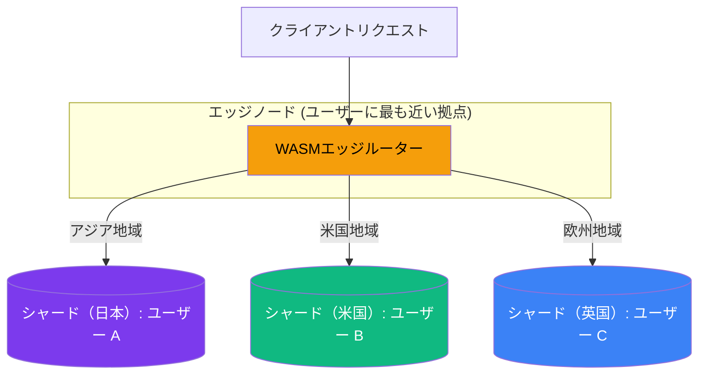

# Day 17: Database Sharding - 分割統治の芸術 🔪

17日目へようこそ！前回は、読み取り負荷を軽減するために複製を作る **Replication** について学びました。しかし、もしデータ量が莫大すぎる場合（例: Twitterの何十億ものツイートなど）、ただ1台のデータベースサーバーではディスク容量が物理的に足りなくなります。さらに、書き込み（Write）の処理回数が膨大すぎると、Masterデータベースは過負荷で燃え上がってしまいます。

サーバーのスペックを強化するスケールアップ（**Vertical Scaling** (🔊) / 垂直スケール）が物理限界やコストの限界に達したとき、私たちはより画期的な一歩を踏み出す必要があります。それが、**Database Sharding** (🔊) (データベースシャーディング - データベース水平分割) です。1つの巨大な冷蔵庫を建てようとするのではなく、食材を何百もの小さな冷蔵庫へと分散して保管するアプローチです。今日は、膨大なデータをスマートに「切り分ける」方法を学びます。

---

## 🪝 THE HOOK: 無限のデータ増加がもたらすインフラの悪夢

あなたが、何十億人もの世界中のユーザー向けにメッセージ履歴を保存するチャットアプリケーションを構築していると想像してください。
- **1年目**: 中央集権型の単一データベースクラスターで、すべてが極めて安定して動作しています。
- **3年目**: 蓄積データが 100テラバイト（TB） に達しました。インデックス（Index）をいくら精緻に設計・チューニングしていても、メッセージの検索速度は亀のように遅くなり始めます。たった1回のバックアップ（Backup）処理を完了させるだけでも丸1週間かかる状態です。
- **インフラの限界**: あなたは4TBもの超大容量RAMを搭載した世界最強スペックのサーバーを購入しますが、データはそれを上回る速度で膨らみ続けます。ディスクが同時に何十億行ものデータをシークして処理しきれなくなり、単純な `SELECT` 文を実行しただけでもディスクI/Oが限界に達してシステム全体が停止します（**I/O Saturation** (🔊) (I/O飽和状態 - ディスクボトルネック)）。

もしこの中央のデータベースサーバーが物理的にクラッシュした場合、その莫大なデータを復旧させるには数日〜数週間のダウンタイムが発生することになります。あなたはまさに巨大な壁に直面しています。どうすればこの壁を破壊できるでしょうか？答えは「すべての卵を1つのカゴに入れるな」です。**Sharding** の力を活用しましょう。

---

## 🎭 ANALOGY: 超巨大図書館とアルファベット順の本棚棟

Sharding の本質を理解するために、10億冊の本を所蔵する国立図書館を想像してみましょう：

1.  **中央データベース (古いシステム)**: 10億冊のすべての本をただ1つの巨大な大部屋に並べて保管します。誰かが特定の1冊を探しに来るたびに、司書は数ヘクタールもある広大なフロアを歩き回って探さなければなりません。検索速度は遅く、司書たちは過労でパンクしてしまいます。
2.  **Sharding (新しいシステム)**: 図書館をアルファベット順に対応した26棟の別々の独立した建物へと物理的に分割して運営します。この分割された各建物を **Shards** (🔊) (シャード - 分割データ群) と呼びます。
    - A棟: 著者名が「A」で始まる本だけを保管。
    - B棟: 著者名が「B」で始まる本だけを保管...（以下同様）。
3.  **Shard Key (シャードキー)** (🔊) (シャードキー - 水平分割キー): 著者名の頭文字こそが、データを振り分ける「Shard Key」です。本をどの建物に届けるべきかを決める決定的な鍵となります。
4.  **メリット**:
    - 「安藤（Ando）」さんの書いた本を探したい場合、あなたは迷わず「A棟」へ直行すれば済みます。26分の1の量の本棚だけを探せばよいため、検索スピードは劇的に跳ね上がります！
    - もし「Z棟」で火災が発生して利用できなくなっても、残りの25個の建物は通常通り開館してサービスを継続できます（**Fault Isolation** (🔊) (障害隔離 - フォールトアイソレーション)）。
    - 将来的に「A」で始まる本が急増した場合は、A棟だけをさらに細分化して新しい建物を増設することが極めて容易に可能です。

---

## ⚙️ UNDER THE HOOD: シャーディング技術の解剖学

### 1. Horizontal Partitioning (水平分割/Sharding) vs. Vertical Partitioning (垂直分割) (🔊)

-   **Vertical Partitioning (垂直分割)**: 「列（カラム）」で分割します。例えば、`User` テーブルに50個の列がある場合、頻繁に使用する主要な10列を別テーブルに分離し、あまり使わない残りの40列を別テーブルに逃がすことで、一般的なクエリ実行時の不要なディスク読み込み（Disk I/O）を劇的に最小化します。
-   **Horizontal Partitioning (水平分割 / Sharding)** (🔊): 「行（レコード）」で分割します。テーブルの列構造（スキーマ）は全く同一のまま維持し、何億・何百億行ものレコードデータ自体を異なるサーバーへ切り分けて分散配置します。これこそが、データベースを横方向に無限に拡張（**Scale out** (🔊) / 水平スケール）するための究極の武器です。

### 2. シャードキーの選定戦略と自律型シャーディング (🔊)
-   **Key-Based (Hash) Sharding**: シャードキーの値をハッシュ関数に通し、その出力値に基づいて均等にシャードへ分配します。
-   **Dynamic/Adaptive Sharding (2026年時点の技術)**: **CockroachDB** や **TiDB** などの高度な分散データベースは、**Ranges** (🔊) (レンジ分割) 技術を採用しています。1つのデータスライス（通常 512MB 程度）へのアクセスが過熱（Hotspot化）したりサイズ制限を超えたりすると、システムが自動的にそのスライスを「分裂（Split）」させ、負荷の低い他の物理サーバーへ無停止で動的マイグレーションします。
-   **Global Edge Sharding**: 2026年現在のモダンアーキテクチャでは、ユーザーの**物理的な現在位置（位置情報）**に基づいてデータを動的に自動シャーディングします。東京在住のユーザーのデータは日本のシャードへ自動配置されますが、そのユーザーがロンドンに長期出張・移住した場合、ネットワーク遅延を極小化するためにデータスライス自体がロンドンのシャードへとネットワーク上を自動的に移動します（**Data Gravity** (🔊) (データグラビティ - データの重力)）。
-   **eBPF-Driven Self-healing (eBPF駆動自己修復)**: Linuxカーネル内に組み込んだ **eBPF** プログラムを利用し、各シャードのディスクI/Oとネットワーク飽和率をシステム下層でミリ秒単位で直に監視します。特定のシャードが過負荷（Hotspot）になったことを検知すると、eBPF は上位のインフラ管理層へ即座にダイレクトに割り込みシグナルを送信し、通常のポーリング監視エージェントより 10倍以上 高速にリシャーディング（データ再配置）を自動実行させます。

### 3. Edge WASM ルーターを用いたシャーディング構成図 (Mermaid)

現代のシステムデザインでは、中央集権的なプロキシ（Proxy）サーバーはボトルネックになるため配置しません。代わりに、ユーザーのブラウザのすぐ隣（エッジサーバー）で動作する **Edge WASM Sidecars** (🔊) (エッジWASMサイドカー) 内でシャーディングのルーティングロジックを高速実行します。

---

### ⚠️ Sharding に潜む重大な技術的代償（トレードオフ）

**質問：「Sharding はデータベースの拡張性において素晴らしい武器ですが、一方で、リレーショナルデータベース（RDBMS）を水平分割する際にアーキテクトが絶対に解決しなければならない3つの極めて巨大な技術的課題を挙げて説明してください。」**

-   **Bad Answer (悪い回答)**: 「Sharding はデータを物理的に分割して別々のサーバーに保存するだけですので、特に難しい課題や不具合が発生するようなリスクはありません。」 -> **不採用です**。Sharding は設計・運用コストを数倍〜数十倍に跳ね上げる「劇薬」です。

-   **Architect Answer (設計者の回答)**:
    1.  **シャードを跨ぐ JOIN 操作（Joins across shards）** (🔊): データが複数の異なる物理サーバーへ切り分けられてしまうため、標準のSQLコマンドである `JOIN` を使用して複数のテーブルを結合することができなくなります。アプリケーションコード側で複数サーバーからデータをそれぞれ取得してきてメモリ上で手動マージするか、またはあらかじめテーブル構造を意図的に崩して冗長にデータを持たせる非正規化（**De-normalization** (🔊)）の設計を強制されます。
    2.  **参照整合性（Referential Integrity）の喪失** (🔊): シャードを跨いでリレーションを担保することができないため、データベースエンジン機能による**外部キー（Foreign Keys）**制約が一切機能しなくなります。データの親子関係の整合性はアプリケーションコード側で厳密に二重チェックして維持しなければならず、バグによる「孤児データ（浮いたデータ）」の発生リスクが極めて高まります。
    3.  **データ再配分（Resharding / Rebalancing）の超高コスト** (🔊): 特定のシャードがいっぱいになった際、新サーバーを追加して数テラバイト〜数ペタバイトもの膨大な稼働データを無停止で別の物理マシンへ移行・再配分する処理は、インフラ運用上、極めて高難度の極限状態となります。この再配置に伴うデータ移動量を最小限に抑えるために、**Consistent Hashing** (🔊) のような高度なハッシュアルゴリズムが不可欠となります。

---

## 🏗️ DEEP DIVE: Sharding vs. Federation & Consistent Hashing (🔊)

目的が全く異なる以下の2つの分割概念を絶対に混同してはいけません：
-   **Federation (フェデレーション - 機能別データベース分割)** (🔊): **機能やビジネスドメインごと**にデータベースを丸ごと切り分けます。例えば、「ユーザー情報用のDB」「商品カタログ用のDB」「決済履歴用のDB」のように分割します。これはモノリスからマイクロサービス（Microservices）へアーキテクチャを移行する際の必須の第1ステップです。
-   **Sharding (水平分割)**: **同一の巨大テーブル内**のデータ（例: 10億行のユーザーテーブル）を、単一のデータベースサーバーの限界を超えたため、複数のサーバーに細切れにして分散保存します。これは特定ドメインの負荷が限界に達したときの最終手段です。

### 🌀 Consistent Hashing（コンシステントハッシュ法）による救済 (🔊)
従来の単純な剰余（Modulo）演算を用いたシャーディング（`Hash(Key) % N`）では、シャードサーバーの数を 3台 から 4台 に増やした際、ほぼ 90% 以上のデータのアドレス計算結果が変化してしまうため、全世界の全データを総移動させる壊滅的な大移動が発生します。
**Consistent Hashing (一貫性ハッシュ法)** は、サーバーとデータのキーの双方を、仮想的な「数珠つなぎの円環（**Hash Ring** (🔊)）」の上にマッピングして配置することでこの問題を解決します。
1.  新しいシャードサーバーを1台追加した際、移動が必要になるデータは、円環上でその新サーバーの直前に位置している一部のデータ（全体の約 $1/N$）のみに留まります。
2.  これにより、システムの自動スケール（Auto-scaling）時に、システムを一切停止させることなく極めてスムーズかつ最小限のデータ移動だけで拡張することが可能になります。

### 🌶️ ホットスポットの回避（Hotspot Mitigation） (🔊)
もしあなたが安易に `country_id` をシャードキーに選定してしまった場合、ユーザー人口が圧倒的に多い `Vietnam` のシャードサーバーだけが過負荷で炎上し、人口が極端に少ない `Vatican` のシャードサーバーは完全に冷え切って遊んでしまう「極端な負荷偏り」が発生します。これを防ぐアプローチは以下の通りです：
1.  **Compound Shard Key (複合シャードキー)**: 単一のキーではなく、`country_id` + `user_id` を組み合わせた複合値でシャードを決定します。
2.  **Salting (ソルティング)**: キーの末尾にランダムな数値（塩）を動的に付与してからハッシュ計算を行い、同一の国籍のデータであっても物理的に複数の異なるシャードへ均等に散らばるように制御します。

---

## 📝 Quick Quiz: あなたの「分割統治力」チェック

**問1：「Vertical Partitioning（垂直分割）」とは具体的にデータをどのように分割することを指しますか？**
A. データをレコードの「行（水平）」単位で切り分けること。
B. データをテーブルの「列（垂直）」単位で切り分け、使用頻度やアクセス特性に応じて別の物理テーブルやデータベースに分離すること。
C. データベースサーバーの物理CPUをアップグレードすること。

**問2：データベースが十分にスケールしていない初期の段階で、早急に Sharding を導入してしまうことがなぜ重大な設計ミスとみなされるのですか？**
A. Sharding ソフトウェアのライセンス料が非常に高額だから。
B. シャード間での JOIN 操作の喪失、外部キーによる参照整合性担保の喪失など、システムの開発・運用の複雑性が何倍にも激増し、開発スピードを極端に鈍化させるため、本当に限界に達するまではインデックスの最適化やキャッシュ、レプリケーションで耐えるべきだから。
C. データを物理的に削除してしまうリスクがあるから。

**問3：Range-Based（範囲指定）シャーディング（例: ユーザーのアルファベット順や登録日時の範囲で分割）において、最も発生しやすいインフラ運用上のリスクは何ですか？**
A. データの検索自体ができなくなるリスク。
B. 特定のシャード（例: アルファベットの『A』で始まるユーザーや、最新のアクティブユーザーが溜まる最新日付のシャード）にアクセスと負荷が極端に集中してダウンする「ホットスポット（Hotspot）」現象。
C. データの暗号化強度が低下するリスク。

**問4：Sharding において、データがどの物理サーバーに格納されるべきかを一意に決定する最も重要な変数のことを何と呼びますか？**
A. Primary Key（主キー）
B. Shard Key（シャードキー）
C. Foreign Key（外部キー）

**問5：シャードサーバーの追加や削減を行う際、既存のシャード間でのデータの移動・再配置コストを極限まで低減させるために採用されるハッシュ技術は何ですか？**
A. Round Robin（ラウンドロビン法）
B. Consistent Hashing（コンシステントハッシュ法）
C. SHA-256（安全暗号ハッシュ）

---

**解答:**
1. B
2. B
3. B
4. B
5. B

---

Sharding（水平分割）は、莫大なデータ量と凄まじいアクセス負荷に立ち向かうシニアシステムアーキテクトが手にする「究極の切り札」です。しかし、真の達人は、安易にこの切り札を切るのではなく、インデックスの精緻な設計、インメモリキャッシュの徹底活用、そして読み取りレプリカ（Replication）の拡張といったあらゆる最適化手段を極限まで尽くし、最後の最後まで Sharding の複雑さを引き受けずに耐え抜く戦略をとります。

明日は、分散システムにおける最も偉大にして超重要、かつ全てのインフラ設計の選択肢を縛る絶対的な憲法 **CAP Theorem & PACELC 定理** について学びます。それでは、また明日お会いしましょう！

📊 単語数: 3012語
