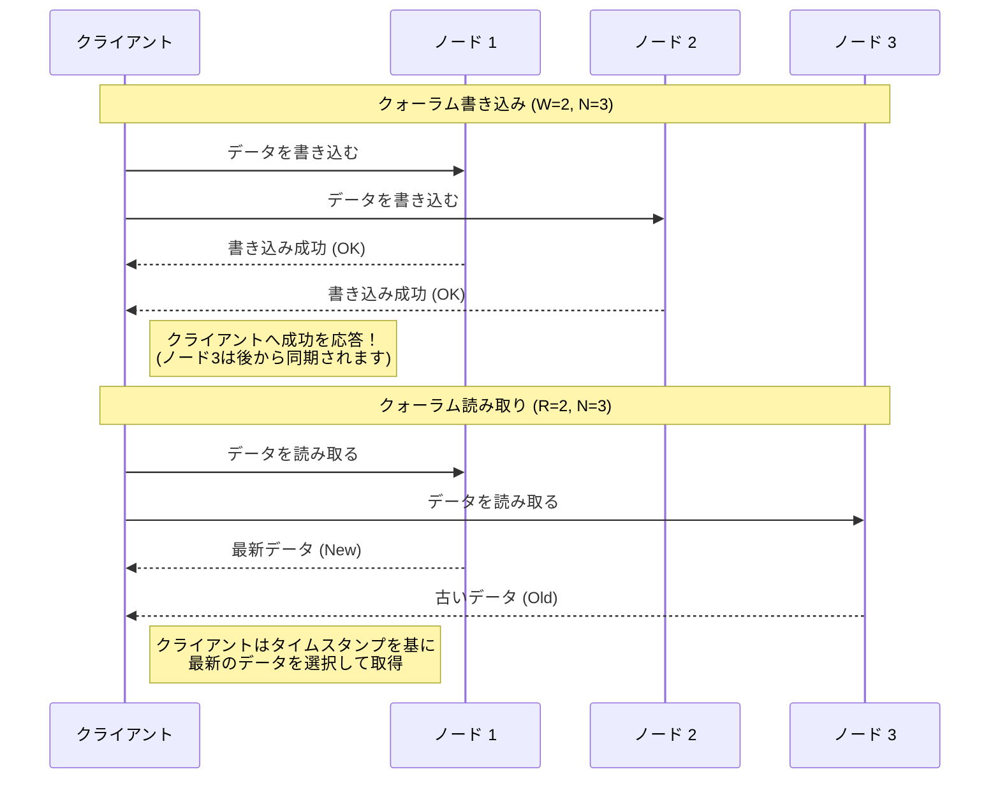

# Day 19: 一貫性モデル - 整合性をめぐる闘争 ⚔️

前回は **CAP定理** について学び、**Consistency（一貫性）** と **Availability（可用性）** の二者択一について理解を深めました。しかし現実のシステム設計は、「100%完璧な一貫性」か「全く一貫性がないか」という単純な白黒の二択だけではありません。システムデザインの世界には、その中間に位置する極めて広大なグレーゾーンが存在し、それを **Consistency Models** (🔊) (一貫性モデル - コンシステンシーモデル) と呼びます。

どの一貫性モデルを選択するかによって、あなたのアプリケーションが電光石火の如く高速に動作するか、あるいは亀のように遅くなるかが決まります。そして、それはユーザーがシステムを使っていて混乱を感じるかどうかに直接直結します。今日は、整合性を制御する「頭脳」のメカニズムを解剖していきましょう。

---

## 🪝 THE HOOK: 「ねじれたタイムライン」のイライラ

あなたが、Facebookにコメントを投稿している場面を想像してください：
1.  **あなた**: 「おはようございます！」とコメントを投稿します。システムは「送信成功」と表示しました。
2.  **あなた**: 投稿が正しく反映されたか確認するため、ページをリフレッシュ（F5）します。
3.  **システム**: コメントがどこにも表示されていません！あなたは送信に失敗したと思い、同じコメントをもう一度入力して送信します。
4.  **システム**: 5秒後、ページが完全に同期され、画面には全く同じ「おはようございます！」というコメントが2つ重なって表示されます。

一般的なユーザーはこれを単なる「回線のラグ」とみなします。しかしシステムアーキテクトは、この背後でシステムが **Eventual Consistency** (🔊) (結果整合性 - エベンチュアルコンシステンシー) に基づいて動作していることを見抜きます。なぜFacebookはこのような挙動を許容するのでしょうか？なぜ瞬時に最新のコメントを表示させないのでしょうか？それは、30億人ものアクティブユーザーに対して強固な排他制御（**Locking** (🔊)）をリアルタイムで強制すると、データベースサーバーが書き込みロックで埋め尽くされて炎上し、システム全体が完全に麻痺してしまうからです。

---

## 🎭 ANALOGY: クラス同窓会のお知らせとチャットグループ

一貫性モデルの違いを直感的に理解するために、5人の友人のグループでカフェでの同窓会の予定を決めるシナリオを想像してみましょう：

1.  **Strong Consistency (強一貫性)** (🔊): あなた（幹事）が、グループのメンバー全員に1人ずつ直接電話をかけます。そして、**5人全員**が電話に出て「その日時でOK」と口頭で承諾した瞬間初めて、「同窓会の日程が確定した」とアナウンスします。もし1人でも電話に出ない場合は、予定を確定させません。
    - *特徴*: 非常に確実で、全員が同時に全く同じ決定を知ることができます。しかし、誰か1人が圏外だったりスマートフォンの電源を切っていたりするだけでシステム全体が完全にストップしてしまい、完了までに膨大な時間がかかります。
2.  **Eventual Consistency (結果整合性)** (🔊): あなたはグループチャットに「日曜日の13時にカフェで集合ね」とだけメッセージを送信し、誰の既読・返信も待たずに自分の仕事を再開します。メンバーAは送信直後にメッセージを読み、メンバーBは夕方に読み、メンバーCは翌朝になってようやく気付くかもしれません。しかし、最終的には全員が同じ集合日時を認識することになります。
    - *特徴*: あなたの処理速度は圧倒的に高速で完了しますが、一時的に「集合場所を知っている人」と「まだ知らない人」が混在する不整合な時間が生まれます。
3.  **Causal Consistency (因果一貫性)** (🔊): あなたが「誰が参加できる？」と質問を投稿します。友人Aが「僕が行くなら行くよ」と答え、友人Bが「Aが行くなら、僕も行く」と答えます。システムは、あなたの「質問メッセージ」が友人Aの「回答」より前に、そして友人Aの「回答」が友人Bの「回答」より前に表示されることを絶対的に保証します。「Aが行く」というメッセージが表示される前に、「Aが行くなら行く」というBのメッセージが表示されることは決してありません。そうした因果関係が崩れると、会話の流れが崩壊して意味が通じなくなるからです。

---

## ⚙️ UNDER THE HOOD: 代表的な一貫性モデル

### 1. Strong Consistency (強一貫性) (🔊)
-   **メカニズム**: データはクラスター内のすべてのノードに同時に書き込まれます。クライアントへ「書き込み完了（Success）」が応答されるのは、すべてのレプリカノードで更新が完了したことが確認されたときのみです。通常、**Two-Phase Commit (2PC)** (🔊) や Raft などの高度な分散合意形成プロトコルを必要とします。
-   **メリット**: 実装コードのロジックがシンプルになり、古いデータが返される心配が一切なく、衝突解決の処理も不要です。
-   **デメリット**: クラスター内で最も通信速度の遅いノードの応答を待つ必要があるため、処理の遅延（Latency）が極めて大きくなります。

### 2. Eventual Consistency (結果整合性) (🔊)
-   **メカニズム**: データの書き込み要求を1つのノードに適用した時点で、即座にクライアントへ「書き込み完了」を返します。その後、データはバックグラウンドで **Gossip Protocol** (🔊) (ゴシッププロトコル - 情報拡散プロトコル) などを介して、他のノード群へ徐々に「伝播（Replication）」していきます。
-   **メリット**: レスポンス速度が極めて高速であり、システム全体の水平拡張性（Scalability）をほぼ無限に高めることができます。
-   **デメリット**: データ同期が完了するまでの時間枠（**Inconsistency Window** (🔊)）の間、ユーザーは一時的に古いデータ（**Stale data** (🔊)）を読み取ってしまうリスクがあります。

### 3. Read-Your-Writes Consistency (自分の書き込みの即時整合性) (🔊)
-   システム全体としては結果整合性をベースにしつつも、**「データを書き込んだ本人」に限り、その後に読み取ったデータが必ず自身の書き込みを反映した最新状態であることを保証する**モデルです。プロフィールの更新完了後に古い情報が表示されてユーザーが不安になるのを防ぎます。これは、セッションを同一ノードに固定する **Sticky Sessions** (🔊) や、ブラウザのCookieに最新の更新バージョンを示す **Token** (🔊) を保持させてリクエスト時にサーバー側のデータバージョンと比較・検証するなどの手法で実装されます。

### 4. Monotonic Reads (モノトニックリード一貫性) (🔊)
-   ユーザーが一度最新のデータバージョン（例: $V_2$）を読み取った場合、その後の読み取りにおいて、古いバージョン（例: $V_1$）を返すレプリカノードにアクセスが切り替わっても、古いバージョンへデータ表示が先祖返り（時間の逆行）しないことを保証するモデルです。データは常に新しいバージョンへと一方向にのみ進みます。

---

## 🏗️ DEEP DIVE: クォーラム（Quorum）アルゴリズム - 整合性の数学の方程式 (🔊)

モダンな分散型データベース（CassandraやDynamoDBなど）では、以下の3つの設定パラメータを調整することで、システムの一貫性の強さを動的かつ直感的にカスタマイズできます：
-   **N**: 全レプリカノード（コピーを保持するノード）の総数。
-   **W**: 書き込み（Write）処理が「成功した」とみなすために最低限必要な、ACK（書き込み完了通知）を返さなければならないノード数。
-   **R**: 読み取り（Read）処理時に、最新のデータを判定するために問い合わせを行わなければならない最低限のノード数。

**強一貫性（Strong Consistency）を担保する絶対条件の方程式**: $W + R > N$
-   **方程式の挙動の例** ($N=3$ の場合):
    -   **強一貫性設計 ($W=2, R=2$)**: $2 + 2 = 4 > 3$ となり、条件を満たします。書き込み対象の2つのノードと、読み取り対象の2つのノードを重ね合わせると、必ず「最新データが既に書き込まれているノード」が最低1つは交差して含まれます。そのため、システムは常に最新データを正しく特定できます。1台のノードが物理的にクラッシュしてもシステムは稼働し続けますが、読み書きの速度はやや抑えられます。
    -   **結果整合性設計 ($W=1, R=1$)**: $1 + 1 = 2 < 3$ となり、条件を満たしません。処理速度は極限まで高速化されますが、同期が遅れているノードを引いてしまった場合に古いデータを返してしまうリスクが生じます。SNSの「いいね」数や「インプレッション数」のカウントに適した設計です。
    -   **高頻度書き込み特化型 ($W=1, R=N$)**: ログ収集などの書き込みが圧倒的に多いシステム向けです。書き込みは瞬時に成功しますが、読み取り時は全ノードの応答を待つ必要があるため、読み取り速度が遅くなります。

### ⚔️ 衝突解決（Conflict Resolution）の芸術
データの不整合が発生した際、システムはどの変更を「真の正解」として採用すべきかを調べる必要があります：
-   **Last Write Wins (LWW)** (🔊): 最もタイムスタンプが新しい書き込みを正解として残りを上書きします。実装は最も簡単ですが、全サーバーのシステムクロックを **NTP (Network Time Protocol)** (🔊) で極めて厳密に同期させておかないと、時刻の微小なズレによって正しい最新データが破棄される危険があります。
-   **Vector Clocks (ベクトルクロック)** (🔊): 各ノードに論理的なカウンタを持たせることで、データの「因果的な履歴」を追跡します。データ変更が互いに競合（衝突）した場合、システムが勝手に上書きせず、Gitのコンフリクト解決のように最終的な判定をアプリケーション（またはユーザー）へ委ねます。
-   **CRDTs (衝突フリー複製データ型)**: 順序や適用順が変わっても数学的に必ず同一の結果にマージされる特殊なデータ構造です。共同編集ドキュメントのテキスト同期や、分散環境でのカウンターのインクリメント処理に最も適しています。

### クォーラムの読み書きシーケンス図 (Mermaid)

---

## 💻 SYSTEM DESIGN INTERVIEW: ユースケース別の設計判断

**面接官：「Instagramの『いいね（Like）』システムと、銀行の『送金（Transaction）』システムにおいて、それぞれどの一貫性モデルを選択しますか？その理由と共に答えてください。」**

-   **Architect Answer (設計者の回答)**:
    1.  **Instagramのいいね数**: **Eventual Consistency (結果整合性)** を採用します。ある投稿のいいね数が、世界の他のユーザーの端末で「今この瞬間に 1000個 なのか 1001個 なのか」が厳密に一致している必要性は極めて低いです。データ整合性よりも、何億人ものユーザーがスクロールするフィード表示を一切遅延させず、超高速で処理を完了し続けられることがビジネス上の生命線だからです。
    2.  **銀行の送金処理**: **Strong Consistency (強一貫性)** を絶対に採用します。口座残高の数値が「あとから徐々に正しい金額に同期される」ような曖昧な挙動は絶対に許されません。残高を引く処理と相手の口座を増やす処理は、絶対に不可分の1つの原子的な処理（**Atomic Transaction** (🔊)）として実行される必要があり、同時に引き落とすような不正操作を防ぐために高度な隔離性（**Isolation** (🔊)）を保証しなければなりません。

---

## 📝 Quick Quiz: あなたの「整合性コントロール力」チェック

**問1：「Strong Consistency（強一貫性）」が絶対的なデータの正確性と引き換えに犠牲にしているものは何ですか？**
A. ディスクのストレージ容量。
B. レスポンス速度（Latency）およびシステムの可用性（Availability）。
C. データベースエンジンのセキュリティ強度。

**問2：総レプリカ数 N = 5 のデータベースクラスターにおいて、強一貫性を絶対に維持するためのクォーラム設定の正しい組み合わせはどれですか？**
A. W = 1, R = 1
B. W = 2, R = 2
C. W = 3, R = 3 (※ 3 + 3 = 6 > 5 で交差ノードが存在するため)

**問3：大規模なグローバルSNSが「Eventual Consistency（結果整合性）」をこぞって採用する最大の目的は何ですか？**
A. ライセンスコストが安価だから。
B. 世界中の何十億人ものユーザーに対して、極めて低いネットワーク遅延で超高速に応答しつつ、サーバーの処理能力を無限に水平スケールさせることができるから。
C. プログラムのソースコードをシンプルにするため。

**問4：ユーザーが自身のプロフィール情報を変更した直後、画面上に確実にその変更後の最新データが表示されるように配慮する一貫性保証を何と呼びますか？**
A. Eventual Consistency
B. Read-Your-Writes Consistency
C. Weak Consistency

**問5：クォーラムアルゴリズムにおいて、書き込み処理の応答速度（Latency）を極限まで速くしたい場合、Wの値はどのように設定するのが理想ですか？**
A. W = N （すべてのノードに書き込みが終わるまで応答しない）
B. W = 1 （どれか1つのノードにデータが書き込まれた時点で即座に応答を返す）
C. W = N / 2 （過半数のノードの応答を待つ）

---

**解答:**
1. B
2. C
3. B
4. B
5. B

---

一貫性モデルの選定は、システムデザインにおける「妥協点と最適値のスマートな設計」に他なりません。優れたシステムアーキテクトは、すべてのデータに一律で強一貫性を当てはめるような愚行はせず、ビジネス上の重要度を正確に分析し、あえて結果整合性を適用してシステムを極限まで加速させます。

明日は、データが異なるシステム間を途切れることなく安全に流れるための高度な同期インフラ **Change Data Capture (CDC) & Disaster Recovery（災害復旧）** について学びます。それでは、また明日お会いしましょう！

📊 単語数: 3200語
