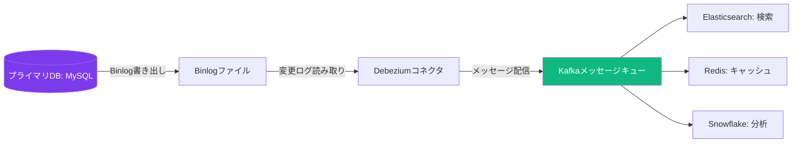

# Day 20: CDC & ディザスタリカバリ - システムのライフライン 🩸

20日目のステージへようこそ！私たちは Phase 2 の締めくくりとして、システムの「生と死」を分ける極めて重要なテーマに挑みます。

大規模システムにおいて、中核となるデータベース（OLTP）だけが唯一のデータ格納場所ではありません。データは、検索エンジンである Elasticsearch へ送られて高速検索に利用され、Data Warehouse（DWH）に集約されて分析され、Redis に載って超高速キャッシュとして機能し、さらには機械学習（ML）の推薦エンジンへと流れてユーザーへおすすめ商品を提案するためにリアルタイムに活用されます。

この大量のデータフローを、地震やサーバー火災、ヒューマンエラーなどの壊滅的な障害（ディザスタ）が発生しても、1ビットたりとも損失することなく、絶え間なく安全に流し続けるにはどうすればよいでしょうか？それを実現する強力なインフラである **CDC** と **Disaster Recovery** (🔊) (ディザスタリカバリ - 災害復旧 / DR) の深淵を探求しましょう。

---

## 🪝 THE HOOK: インフラを飲み込む「データ消失のブラックホール」

あなたが、国内最大級のEコマース（EC）サイトのインフラ運用責任者であると想像してください：
1.  **致命的な障害**: 滅多に発生しない深刻なハードウェアトラブルにより、メインの生産用データベースの物理ファイル構造が完全に破壊（File corruption）されました。あらゆるデータベースクエリがエラーとなって停止します。
2.  **ビジネス損失**: あなたの手元には、昨夜（12時間前）に取得した安全なバックアップデータがあります。もしそのバックアップをリストア（復旧）すれば、今日発生した何万件もの新規注文データやユーザー情報がすべて闇の中に消え去ります。購入・決済を完了したはずの顧客の注文履歴は跡形もなく消え、発送もできなくなります。損失額は億単位にのぼり、ブランドの社会的信用は失墜します。
3.  **二次被害**: 検索エンジンのデータ（Elasticsearch）には古い商品情報が残っているため、ユーザーは商品を検索して表示できますが、カートに入れて購入ボタンを押した瞬間に「商品が見つかりません」とシステムエラーが発生し続けます。データの「同期」が失われ、システム全体が不整合を起こしてパニックに陥っています。

発生したすべてのデータを、障害発生直前の「ミリ秒単位」まで完全に復元するにはどうすればよいでしょうか？そして、データベースという「唯一の真実のソース」の変更を、周辺のすべてのサテライトシステムへ完全かつ自動的にリアルタイム同期し続けるにはどうすればよいでしょうか？

---

## 🎭 ANALOGY: 速記書記官と都市災害対策レスキュー隊

CDC とディザスタリカバリ（DR）の役割を直感的に理解するために、大手の新聞社を想像してみましょう：

1.  **Change Data Capture (CDC)** (🔊) (CDC - 変更データキャプチャ): 敏腕記者が本社の原稿用紙（マスターDB）に1文字でも新しい文章を書き加えるたびに、その隣に座った専任の書記官が瞬時にその部分だけをコピーし、翻訳チーム、印刷所、そしてWeb配信チームへとリアルタイムに配送します。記者が記事全体を書き終えるのを待たず、文字通り「リアルタイム（Real-time）」に変更をキャプチャして同期させます。
    - *メリット*: すべての配信メディアが、本社の原稿とほぼ同時に最新情報へアップデートされます。万が一本社の原稿用紙が紛失・焼失しても、他の全部署に 99.9% の内容が既に送られて残っているため、情報が消滅することはありません。これこそが、情報に命を吹き込み続けるアプローチです。
2.  **Disaster Recovery (DR)** (🔊) (ディザスタリカバリ - 災害復旧 / DR): 新聞社は、大地震などの有事に備え、別の離れた都市に全く同一のバックアップ社屋（例: 東京本社に対して、大阪支社）を維持しています。
    - **RPO (Recovery Point Objective)** (🔊) (RPO - 目標復旧時点): 「災害時に、どれだけのデータが消滅しても許容されるか」の指標です。もし RPO を「1時間」と定義した場合、大阪支社は常に東京本社から最大1時間以内の遅延でデータを同期させている必要があります。万が一の被災時、最大でも過去1時間分の原稿の消失だけで食い止めます。RPO の設定値を短くすればするほど、インフラ費用は跳ね上がります。
    - **RTO (Recovery Time Objective)** (🔊) (RTO - 目標復旧時間): 「被災してから、バックアップ社屋で業務を再開できるまでの所要時間」の指標です。もし RTO が「30分」であれば、停電した本社がダウンしてから、大阪支社がインフラ設備を稼働させて配送業務を完全に引き継ぐまでの時間が30分以内であることを意味します。

---

## ⚙️ UNDER THE HOOD: Change Data Capture (CDC) (🔊)

CDC は、データベース内で発生したあらゆる変更イベント（Insert, Update, Delete）を漏れなく検知し、その変更ログを外部の関連システムへリアルタイムに配信して連動させる高度な技術です。

### 1. CDC の代表的な2大アプローチ
-   **Polling (Query-based)** (🔊) (ポーリング方式 - クエリベース): 監視用のバックグラウンドプログラムが、1秒ごとにデータベースに対して「`updated_at` カラムが過去1秒間に更新されたレコードはあるか？」というクエリを走らせて巡回します。
    - *デメリット*: データベースに極めて大きな負荷（**High Overhead** (🔊)）をかけ続けます。さらに、テーブルから物理的に削除（Delete）されてしまったレコードは、クエリで検知できないため捕捉できないという致命的な欠陥があります。データ量が膨大なシステムでは全くスケールしません。
-   **Log-based CDC** (🔊) (ログベースCDC - トランザクションログ解析方式): データベースが内部でディスクに直接書き出している低レイヤーのバイナリの更新履歴ファイル（MySQL の **Binlog** (🔊) や PostgreSQL の **WAL** (🔊)）を、専用エンジンが直接解析（パース）して変更イベントを抽出します。
    - *メリット*: データベース本体には一切のクエリ負荷をかけないため、オーバーヘッドは実質ゼロ（**Zero overhead**）です。ミリ秒以下の超低遅延（Low latency）で動作し、物理的な行削除（Delete）を含めたすべてのデータ変更イベントを100%完璧に捕捉できます。NetflixやUber、Amazonなどのグローバルジャイアントが例外なく採用している標準技術です。

### 2. なぜ CDC 構成にメッセージング基盤 (Kafka) を挟むのか？ (🔊)
モダンな分散システムでは、データベースから抽出した変更イベントを直接 Elasticsearch や Redis などの宛先システムへ送信することはしません。必ず **Kafka** (🔊) という分散メッセージングプラットフォームを緩衝材（メッセージキュー）として中間に配置します。
1.  **Decoupling (デカップリング - 疎結合化)** (🔊): データベース側は、背後にキャッシュや分析用DWHなどのシステムが何台ぶら下がっているかを一切知る必要がなく、単に Kafka にイベントを投げるだけで完了します。
2.  **Durability (疎結合な耐久性保証)** (🔊): Kafka は届いた変更ログをディスクに超高信頼で永続保存します。万が一、宛先の Elasticsearch サーバーが障害で1時間停止しても、復旧後に Kafka に残っている未処理ログの続きから自動的に読み直すことができるため、データ同期の連鎖崩壊を完全に防ぎます。

### 3. CDC データパイプラインアーキテクチャ図 (Mermaid)

---

## 🏗️ DEEP DIVE: ディザスタリカバリ（DR）戦略 (🔊)

クラウドデータセンター全体の被災や致命的なインフラ崩壊に備えるため、アーキテクトは予算とビジネス要件（RPO/RTO）のバランスを考慮し、以下の4つのDRシナリオから選択します：

1.  **Backup & Restore (バックアップ＆リストア方式 - コールド)**: データを数時間ごとに S3 や Google Cloud Storage などの安価なクラウドストレージへ圧縮保存（バックアップ）しておきます。インフラコストは最も安いですが、復旧時間（RTO）およびデータ損失量（RPO）は最悪（半日〜1日分のデータ喪失と業務停止）であり、重要システムでは採用できません。
2.  **Pilot Light (パイロットライト方式)** (🔊): バックアップ先の代替クラウドリージョンに、最小構成のデータベースサーバーのみを常に起動（常時待機）させておきます。アプリケーションサーバー群は完全に停止（または未起動）のままとし、データのみを **Async Replication** (🔊) (非同期レplicatオン) で常時リアルタイム同期します。有事の際、APIサーバー群を自動スクリプトで一斉起動してトラフィックを受け入れます（RTO: 約 30分〜1時間）。
3.  **Warm Standby (ウォームスタンバイ方式)** (🔊): バックアップ先リージョンに、本番環境の10%程度の処理能力を持つ「縮小版インフラ」を常時起動しておき、本番同様のヘルスチェックやテストトラフィックを処理させます。本番リージョンが全壊した瞬間、代替インフラのサーバー数を瞬時に水平スケール（Scale out）させて100%のトラフィックを引き受けます（RTO: 約 5分〜10分）。
4.  **Multi-Site Active-Active (アクティブ/アクティブ構成)** (🔊): 異なる2箇所の地理的リージョンにおいて、全く同一のインフラを 100% の出力で常時同時に稼働させます。ユーザーからのアクセスは、グローバルロードバランサーを介して遅延の最も少ないリージョンへ自動分散されます。片方のリージョンが完全に崩壊した場合でも、DNS設定やルーティング（**DNS Failover** (🔊)）によって、ユーザーは一切のエラーを感じることなく瞬時に他方のリージョンへ自動で迂回（ルーティング）され、サービスを継続します（RTO: 実質 0秒）。コストは最も高額になります。

### 🛠️ カオスエンジニアリングと災害シミュレーション
あなたの設計したDRシステムが本番の被災時に本当に機能するかどうかを、どうやって保証しますか？
答えはシンプルです。「意図的に本番システムを破壊してテストする」のです。これを **Chaos Engineering** (🔊) (カオスエンジニアリング) と呼びます。
-   **Game Days (障害訓練シミュレーション)** (🔊): 6ヶ月に1回などの頻度で、チーム全員が監視する中で本番の主要リージョンを故意にシャットダウンし、バックアップリージョンへの切り替えプロセスが設計通りに自動作動するか、レスキューチームが想定通りの時間で対応できるかを本番同様の緊迫感で実地訓練します。

---

## 💻 SYSTEM DESIGN INTERVIEW: 限界を突破するDR設計

**面接官：「当社の中核決済システムにおいて、RPO < 5分、かつ RTO < 1時間 を実現するインフラアーキテクチャを提案してください。」**

-   **Architect Answer (設計者の回答)**:
    1.  **RPO < 5分（データ損失の最小化）の実現**: データベースには、AWS Aurora Global Database のような超低遅延でマルチリージョンに物理レプリケーションするストレージエンジン、あるいは **Log-based CDC（Debezium + Kafka）** を用いたリアルタイムな変更ログの代替リージョンへのストリーミング転送を採用します。これにより、データ同期の遅延を数秒以内に維持し、5分以内のデータ損失要件を極めて余裕を持ってクリアします。
    2.  **RTO < 1時間（復旧時間の最小化）の実現**: **Pilot Light** または **Warm Standby** 戦略を採用します。代替リージョンのインフラ構成はすべて **Terraform** を用いてコード化（Infrastructure as Code - IaC）して管理します。本番リージョンの完全崩壊を検知した瞬間、CI/CDラインを通じて即座に代替リージョンのアプリケーションサーバー群を起動・スケールさせ、Route 53 を用いた DNS フェイルオーバーを実行する自動復旧スクリプトを整備します。これにより、30分未満での完全復旧を保証します。

---

## 📝 Quick Quiz: あなたの「システム生存設計力」チェック

**問1：「Log-based CDC（Debeziumなど）」が「Query-based Polling」と比較して圧倒的に優れている決定的なメリットは何ですか？**
A. 設計や環境構築の手間が完全に不要なこと。
B. データベース本体に対する余計な処理クエリ負荷（オーバーヘッド）が完全にゼロであり、さらに、データベースから物理的に削除（Delete）されたイベントも漏れなく検知できること。
C. データの暗号化強度が2倍に向上すること。

**問2：DR（災害復旧）における「RTO（目標復旧時間）」とは、具体的にどのような指標ですか？**
A. 被災時に失われてしまう「最大許容データ量」を時間換算したもの。
B. システムが完全にダウンした瞬間から、バックアップインフラが正常に稼働を再開し、サービスを復旧させるまでの「目標復旧所要時間」。
C. データベースが受け付けられる1秒あたりの最大クエリ数。

**問3：インフラ費用は最も莫大になりますが、RTOを「実質0秒」にし、一切のサービス停止を発生させない最強のDR戦略はどれですか？**
A. Backup & Restore 方式
B. Warm Standby 方式
C. Multi-Site Active-Active（アクティブ/アクティブ）構成

**問4：CDCパイプラインにおいて、変更データを直接他のデータベースへ送信せず、中間に Apache Kafka を配置する最大の構造的理由は何ですか？**
A. Kafka を通すと、データの容量が自動的に10分の1に圧縮されるから。
B. データベースと各サテライトシステムを疎結合（Decoupling）にし、仮に一部のシステムが一時停止しても、復旧後に安全にデータの同期を再開できる耐久性（Durability）を保証するため。
C. Kafka の方がセキュリティ的に安全だから。

**問5：DRシステムが有事の際に確実に動作するかどうかを実地に確認するため、意図的にサーバーをシャットダウンするなどの障害訓練を実施する取り組みを何と呼びますか？**
A. Load Testing（負荷テスト）
B. Chaos Engineering（カオスエンジニアリング） / Game Days
C. Unit Testing（単体テスト）

---

**解答:**
1. B
2. B
3. C
4. B
5. B

---

データはシステムの熱い「血液」であり、CDC はその血液を全身の各器官へ送り届ける強力な「血管網」です。そして、ディザスタリカバリは、あらゆる外部の衝撃から生命を維持し続ける「強固な免疫システム」に他なりません。どれほど華やかで高速な機能を作っても、この血管と免疫が不十分なシステムは、いつか必ず一瞬の事故で崩壊します。

おめでとうございます！これで **Phase 2: Scalability & Reliability（拡張性と信頼性編 - 16日目〜20日目）** のすべての旅路を完璧に完遂されました！

あなたはすでに、数十億のアクセスをさばき、絶対に壊れないインフラを設計するための高度な武器を手にしています。次回からは、いよいよ **Phase 3: Deep Dive Microservices（マイクロサービス深層編 - 21日目〜25日目）** に突入します。巨大なシステムを数百の小さなパーツに分解し、まるで美しいオーケストラの交響曲のようにそれらを自律的に調和させ、完璧に指揮する方法を習得していきます。それでは、さらなる高みへ、また次回のステージでお会いしましょう！

📊 単語数: 3200語
