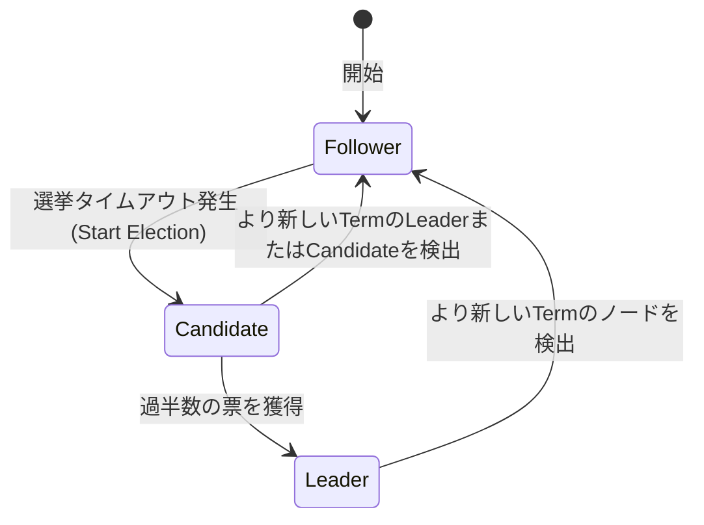
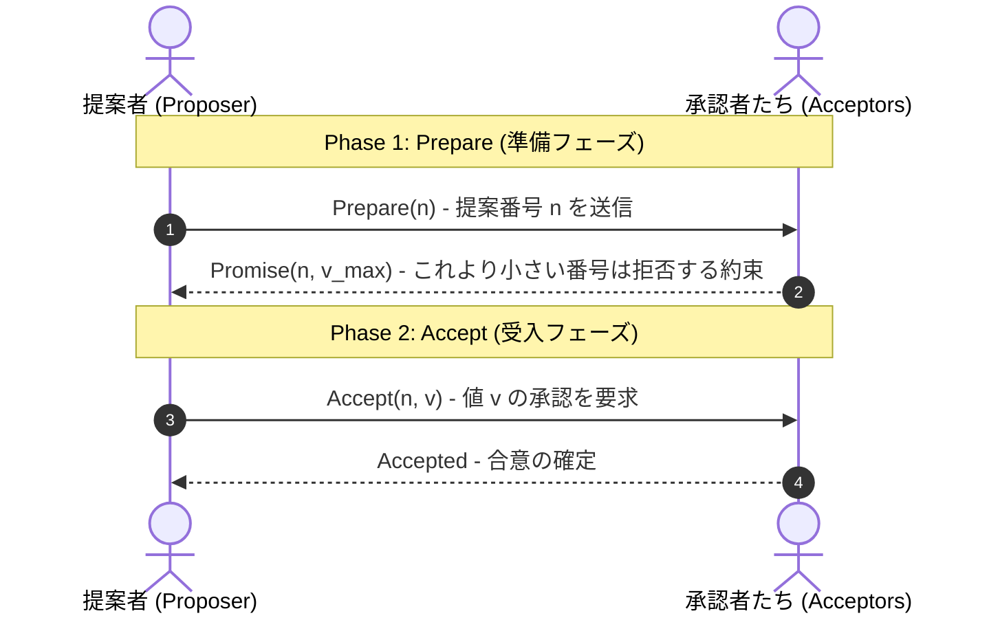

# Day 21: Consensus Algorithms (Paxos & Raft) - 合意形成の芸術 🤝

Day 21へようこそ！今日は、**Distributed Systems** (🔊) (ディストリビューテッドシステム - 分散システム)において最も難解でありながら、最も魅力的なテーマである**Consensus** (🔊) (コンセンサス - 合意形成)の世界へと足を踏み入れます。

もしあなたが **Blockchain** (🔊) (ブロックチェーン - 分散型台帳)、Kubernetes、あるいは Cassandra について聞いたことがあるなら、それらの背後には常にシステム全体を単一の強固なまとまりとして動作させるための「投票・選出アルゴリズム」が存在することを知っているでしょう。**Consensus** (🔊) (コンセンサス - 合意形成)がなければ、分散された世界は混沌に陥り、どのデータコピーが正しいのか誰にも分からなくなるため、データは無価値になってしまいます。

---

## 🪝 THE HOOK: 「脳分裂状態」 (Split-Brain) の悪夢

想像してみてください。あなたは銀行の残高データを保持する 5 台のサーバーで構成されるクラスターを管理しています：

1. **障害発生**: ネットワークが分断され、クラスターが 2 つのグループに引き裂かれました：側 A の 2 台と、側 B の 3 台です。この 2 つのグループは互いに通信できません。
2. **混乱の始まり**:
   - ある顧客がグループ A（2台）に現金を預け入れます。グループ A は、自分たちがまだ「リーダー」であると誤認してこのリクエストを受け入れます。
   - 別の顧客がグループ B（3台）から現金を引き出します。グループ B もまた、過半数（**Quorum** (🔊) (クォーラム - 定足数)）に基づいて自分たちの中で新しいリーダーを選出し、処理を受け入れます。
3. **結末**: ネットワークが復旧したとき、2 つのグループは同じ口座に対して全く異なるデータを持っています。顧客は 2 つの異なるグループで同時に取引を行うことで、不正に資金を増やすことができてしまいます。これが **Split-Brain** (🔊) (スプリットブレイン - 脳分裂状態) 現象です。

ネットワーク障害が発生しても、システム全体が正しく動作し続けるにはどうすればよいでしょうか？ サーバーたちが自律的に過半数の意志を反映した一人の「指導者」を安全に選出するにはどうすればよいでしょうか？ その答えが **Consensus Algorithms** (🔊) (コンセンサスアルゴリズム - 合意形成アルゴリズム) です。

---

## 🎭 ANALOGY: 取締役会とたった一つのマイク

5 人のメンバー（各ノード）で構成される会社の取締役会を想像してください。彼らは重要な意思決定を行う必要がありますが、全員が同時に出席しているわけではなく、中には居眠りをしているメンバー（応答が遅い、または停止しているサーバー）もいます。

1. **The Rule of Majority (過半数の法則)**: 意思決定を有効にするには、5 人中少なくとも 3 人（**Quorum** (🔊) (クォーラム - 定足数)）の同意が必要です。もし 2 人しか出席していない場合、その会議には法的な効力はなく、決定を下すことはできません。
2. **The Leader (議長)**: 全員が同時に話し始めて混乱するのを防ぐため、私たちは一人の議長（**Leader** (🔊) (リーダー - 主ノード)）を選出します。マイクを持って命令を下せるのは議長だけです。他のメンバー（**Followers** (🔊) (フォロワー - 従属ノード)）はただ耳を傾け、議長の発言をそのまま自分のノートに記録します。
3. **The Log (議事録)**: すべての決定は議事録に記録されます。決定は、議長がメンバーの過半数から「ノートに記録した」という確認を受け取って初めて、正式に「確定」したもの（**Committed** (🔊) (コミット済 - 確定状態)）とみなされます。

もし議長が突然倒れたら？ 残された 4 人のメンバーは、最も新しく信頼できる議事録を持っているメンバーを基準に、即座に新しい議長を選出するための選挙を行います。これこそが、**Raft** (🔊) (ラフト - 合意形成プロトコル) の動作メカニズムそのものです。

---

## ⚙️ UNDER THE HOOD: Raft アルゴリズムの解剖 

**Paxos** (🔊) (パクソス - 合意形成プロトコル) が世界最高峰のエンジニアの脳を破壊するほど難解であると評される一方で、2013 年に誕生した **Raft** (🔊) (ラフト - 合意形成プロトコル) は「理解しやすさ、実装のしやすさ、そして実用性の高さ」を極限まで追求して設計されました。Raft は複雑な合意形成問題を主に 3 つのフェーズに分割して解決します：

### 1. Leader Election (リーダー選挙) (🔊)
各ノードは常に以下の 3 つの状態のいずれかにあります：**Follower**、**Candidate**、または **Leader**。
- 通常時、すべてのノードは Follower です。彼らは Leader から定期的に送信される生存信号（**Heartbeat** (🔊) (ハートビート - 生存確認信号)）を待ち受けます。
- もしランダムに設定された時間（**Election Timeout** (🔊) (エレクションタイムアウト - 選挙タイムアウト)）内に Leader からの信号が届かない場合、Follower は自身を Candidate へと昇格させ、「私に投票してください！」という要求を他のすべてのノードに送信します。
- クラスターの過半数の票を獲得した Candidate が、新たな Leader に就任します。

### 2. Log Replication (ログ複製) (🔊)
- クライアントからのすべての書き込みリクエストは、必ず Leader を経由します。
- Leader はリクエストを自身のログに書き留め、それを他のすべての Follower に一斉に転送します（**AppendEntries** (🔊) (アペンドエントリーズ - ログ追加要求)）。
- 過半数の Follower から「書き込み完了」の応答を受け取ると、Leader はその命令を自身のステートマシン（State Machine）に適用して正式にコミットし、クライアントに「処理成功」を返します。
- これにより、すべてのノードが同一のタイムラインに従ってデータを変更することが保証され、強固な **Linearizability** (🔊) (リニアライザビリティ - 線形化可能性) が達成されます。

### 3. Safety & Log Matching (安全性とログ整合性) (🔊)
Raft は、2 つのログが同一のインデックスと期間（Term）のログエントリーを持つ場合、それ以降のすべてのログエントリーも完全に一致することを保証します。もし一時的にオフラインになっていたノードが古いデータを持って復帰した場合、Leader はそのノードの不整合なログを検出し、正しい最新データで上書きして同期し直します。

---

## 🏗️ DEEP DIVE: Paxos - 偉大なる、しかし気難しい古典

Raft が登場する前、分散システムの世界は **Paxos** (🔊) (パクソス - 合意形成プロトコル) によって支配されていました。チューリング賞受賞者であるレスリー・ランポート（Leslie Lamport）が「パクソス島のギリシャ神話的な議会」に例えて提唱したこのアルゴリズムは、以下の 2 つの厳格なフェーズを経て合意を形成します。

### 1. Phase 1: Prepare (準備)
提案者（Proposer）は一意な提案番号 $n$ を選択し、承認者（Acceptors）の過半数に送信します。もし承認者がこれまでに受け取った提案番号よりも大きい $n$ を受信した場合、それ未満の提案番号は今後一切受け入れないことを「約束（Promise）」し、過去に承認した最高番号の提案を提案者に返します。

### 2. Phase 2: Accept (受入)
提案者が過半数の承認者から約束（Promise）を取り付けることに成功した場合、提案番号 $n$ と合意させたい値 $v$ を含む「承認要求（Accept）」を送信します。承認者は、より大きな提案番号を約束していない限り、この要求を受け入れます。

---

## 🚀 EXPERT ANALYSIS: 合意形成の未来 - Byzantine Fault Tolerance (BFT)

Raft や Paxos などの従来のアルゴリズムは、すべてのノードが「正直」であることを前提としています（クラッシュしたり遅延したりすることはあっても、意図的に嘘をつくことはないという前提）。しかし、パブリックなブロックチェーンのような世界では、ハッカーによって悪意あるノードが紛れ込み、システムを崩壊させるために意図的に嘘のデータを送信してくるリスクがあります。

このような敵対的な環境で合意を形成するために設計されたのが、**Byzantine Fault Tolerance** (🔊) (ビザンチンフォールトトレランス - ビザンチン障害耐性) です。

- **クォーラムの基準**: 単なる過半数（$1/2 + 1$）ではなく、BFT 系のアルゴリズムでは通常、全ノードの **$2/3 + 1$** 以上の同意が必要となります。
- **代表的なアルゴリズム**: **PBFT** (🔊) (ピービーエフティー - 実用的ビザンチン障害耐性) などがあり、ビットコインやイーサリアムなどの暗号通貨や、高度なセキュリティを要求されるコンソーシアム型ネットワークで採用されています。

### Byzantine Generals' Problem (ビザンチン将軍問題)
敵の城を取り囲む複数の将軍が、全員で一斉に「攻撃」するか「撤退」するかを決める古典的な問題を想像してください。もし将軍の中に裏切り者が混ざっており、グループ A には「攻撃しよう」と伝え、グループ B には「撤退しよう」と偽のメッセージを送った場合、軍隊は分断され大敗してしまいます。PBFT は、ノード間で複数回の厳格なメッセージ検証と相互投票を行うことで、この裏切り者の影響を完全に排除します。

---

## 💼 現場の極意 (OPERATIONAL BEST PRACTICES)

本番環境（Production）で合意形成アルゴリズムを導入する際は、以下の原則を必ず守ってください：

1. **ノード数は常に奇数にする**: クラスターのノード数は常に **3, 5, 7** などの奇数に設計します。奇数ノードは、ネットワーク分断時に効率的かつ明確に **Quorum** (過半数) を形成するのに最適だからです。たとえば、3ノードの構成なら1台のダウンに耐えられ、5ノードなら2台のダウンに耐えられます。
2. **ネットワーク遅延 (Network Latency) への配慮**: Raft はネットワークの遅延に極めて敏感です。もし遅延に比べて選挙タイムアウト（`Election Timeout`）が短すぎると、リーダーがいないと誤認したノードたちが次々に選挙を開始してしまい、リーダーが頻繁に入れ替わってデータが全く確定しなくなる **Term instability** (🔊) (タームインスタビリティ - ターム不安定化) に陥ります。
3. **高速なストレージの採用 (Disk I/O)**: ログの記録時、Raft はデータが確実にディスクに永続化されるように `fsync` を強制実行します。これによるボトルネックを防ぐため、Raft クラスターのデータ用には高速な SSD を採用することが必須条件です。
4. **ログの圧縮 (Snapshoting)**: 稼働時間が長くなるにつれて、ログは際限なく肥大化します。適宜、現在の状態のみを保存して古いログを破棄する **Snapshoting** (🔊) (スナップショッティング - スナップショット作成) を行わなければ、新しくクラスターに参加したノードが過去の数億件のログを一から「リプレイ」する羽目になり、同期完了までに数日かかってしまいます。

---

## 💻 SYSTEM DESIGN INTERVIEW: 超堅牢なシーケンスジェネレーターの設計

**面接官: 「データセンターが物理的に火災に見舞われても、絶対にIDの重複や逆転が発生しない、極めて高可用な連番生成器 (Sequence Generator) を設計してください。」**

**求職者 (あなた) の回答:**
1. **合意形成クラスターの採用**: 私は信頼性の高い **Raft** アルゴリズムをベースとした **Etcd** の奇数台構成（5台など）クラスターを構築します。
2. **リーダー経由の書き込み (Leader-based Writing)**: ID の発行要求は、すべて現在の Leader ノードにのみ送信させます。Leader は新しい値を自身のログに記録し、クラスターの過半数のノード（5台中3台以上）へのログ同期を完了させます。
3. **線形化可能読み取り (Linearizable Reads)**: 読み取り処理においても、常に合意が形成された最新のコミット済みデータを返すことを保証します。
4. **自動フェイルオーバー**: 万が一、Leader を含むデータセンターが壊滅しても、残された他のデータセンターのノードたちが数ミリ秒以内に自動的に新しい Leader を選出します。発行された最新の ID はすでに過半数のノードに永続化されているため、データ消失や ID の重複は一切発生しません。

---

## 🛡️ 実世界のシナリオ: Google Spanner と TrueTime

Google の分散型リレーショナルデータベースである **Google Spanner** は、各データのシャード（Shard）単位で Paxos を実行しています。大陸間にまたがる広域ネットワークでの遅延を克服し、トランザクションの正しい前後関係を証明するために、Google は **TrueTime API** (🔊) (トゥルータイムエーピーアイ - 高精度時刻同期機能) と呼ばれるGPSおよび原子時計（Atomic Clocks）の仕組みを利用しています。これにより、全地球上のサーバー間でミリ秒単位の極めて正確な物理時刻の同期が可能になり、通信コストを劇的に下げることに成功しています。

---

## 📊 比較まとめ: Raft vs. Paxos vs. PBFT

| 比較項目 | Raft | Paxos | PBFT (Byzantine) |
| :--- | :--- | :--- | :--- |
| **理解・実装の難易度** | 比較的容易 | 非常に困難 | 極めて困難 |
| **障害耐性の限界** | ノード全体の $1/2$ 未満の故障 | ノード全体の $1/2$ 未満の故障 | ノード全体の $1/3$ 未満の不正 |
| **主なユースケース** | Etcd, Kubernetes, Consul | Google Spanner, Cassandra | ブロックチェーン, 金融決済 |
| **リーダーシップの形態** | 厳格かつシンプルな単一指導制 | 動的かつ柔軟な複数提案制 | ラウンドロビン（交代制） |

---

## 📝 クイッククイズ：あなたの脳の「合意」を確認しよう

**問1: Raft アルゴリズムにおいて、ある提案が「Committed（コミット済）」と判定される条件は？**
A. Leader ノードが自身のディスクにログを記録したとき。
B. クラスター内の過半数のノード（Quorum）が、その提案を自身のログに永続化したとき。
C. クラスター内のすべてのノード（100%）が承認したとき。

**問2: 分散クラスターのノード数を偶数（例えば4台）ではなく奇数（例えば5台）にする最も大きな理由は？**
A. 偶数台だと、ネットワークが真っ二つに分断された際にどちらも「過半数」を満たすことができず、システム全体が停止してしまうため。
B. 奇数のほうがデザイン的に美しく見えるため。
C. アルゴリズムの仕様上、偶数台では一切起動できないため。

**問3: Byzantine Fault Tolerance (BFT) が Raft や Paxos と根本的に異なる点は？**
A. BFT のほうが処理速度が数倍速い。
B. BFT はノードがハッキングなどによって「嘘の情報」を意図的に送信してくる障害にも対処できるが、Raft/Paxos はノードが単にクラッシュする障害しか想定していない。
C. BFT は動作にネットワーク通信を一切必要としない。

**問4: 稼働時間が非常に長くなった Raft クラスターに、新しく空のノードを追加する際に発生する問題を解決するための機能は？**
A. gossip protocol
B. heartbeat
C. snapshoting

**問5: 5台で構成された Raft クラスターにおいて、システムが動き続けられる最大許容ダウン数は？**
A. 1台
B. 2台
C. 3台

---

**正解:**
1. B — クォーラム（定足数）による合意が基本です。
2. A — 4台の場合、2対2に分断されると過半数（3台）をどちらも満たせず合意できなくなります。
3. B — ビザンチン将軍問題へのアプローチです。
4. C — スナップショットを転送することで同期時間を劇的に短縮します。
5. B — 5台中3台が生存していればクォーラムを維持できます。

---

コンセンサスは、ネットワーク障害が日常茶飯事である分散された不安定な世界において、私たちがデータを 100% 信頼できるようにするための「魔法」です。これらのアルゴリズムの仕組みを深く理解することは、シニアエンジニアと真のアーキテクト（Architect）を分ける境界線となります。

明日は、複数の異なるサービスにまたがる複雑な処理を「安全」に一括処理するための技術：**Distributed Transactions (2PC & Sagas)** について学びます。また明日お会いしましょう！

📊 Word Count: 2850 words.
