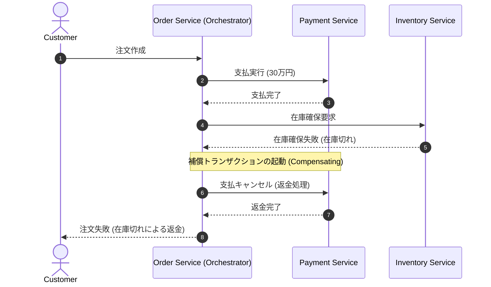
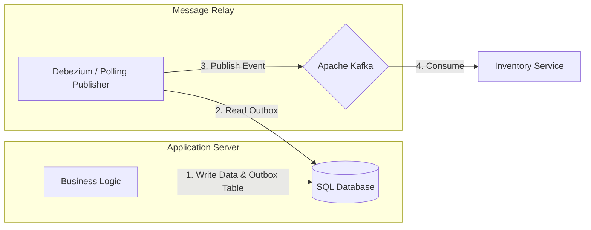

# Day 22: Distributed Transactions (2PC & Sagas) - 分断された世界でのトランザクション 💸

Day 22へようこそ！これまでの講義で、私たちはデータベースの分割（Sharding）やサービスの分割（Microservices）について学んできました。しかし、これには極めて大きな代償が伴います。それは、トランザクションの**Atomicity** (🔊) (アトミシティ - 原子性)が失われることです。

従来のモノリス（Monolith）システムであれば、SQL の `BEGIN TRANSACTION` と `COMMIT` で処理全体を囲むだけで済みました。しかし、システムが分散化されると、各データベースがデータの一部しか管理していないため、単一のコミット命令は機能しなくなります。今日は、分散された世界における「全か無か（All or Nothing）」の課題を解決する方法について学びます。

---

## 🪝 THE HOOK: 「お金は引かれたのに商品は届かない」悲劇

想像してみてください。あなたはECサイトで 30 万円の iPhone を購入しようとしています：

1. **ステップ 1**: 決済サービス（Payment Service）が、SQL データベース A にあるあなたの電子マネー口座から 30 万円を引き落とします。処理は成功しました！
2. **ステップ 2**: システムは、商品の在庫を確保するために、NoSQL データベース B を使用する在庫サービス（Inventory Service）に要求を送信します。
3. **障害発生**: ネットワークが遅延しているか、在庫サービスがメンテナンス中です。要求は失敗しました。
4. **壊滅的な結果**: あなたのお金は引き落とされたのに、注文は生成されず、在庫は残ったままです。怒り狂った顧客からの問い合わせがカスタマーサポートに殺到し、あなたは極めて面倒な手動での返金処理に追われることになります。

一連のステップのどこかで障害が発生した際、それより前のステップで行われたすべての処理を「なかったこと」にして、元の状態に安全にロールバックするにはどうすればよいでしょうか？ これこそが、**Distributed Transactions** (🔊) (ディストリビューテッドトランザクション - 分散トランザクション) の使命です。

---

## 🎭 ANALOGY: 結婚式場の予約と仲介エージェント

あなたが結婚式を挙げようとしており、「式場（レストラン）」と「お気に入りのバンド（楽団）」の両方のスケジュールを同時に押さえなければならないシナリオを考えてみましょう。

1. **2PC (Two-Phase Commit)** (🔊) (ツーフェーズコミット - 2段階コミット) 方式：あなたは優秀な「コーディネーター（Coordinator）」を雇います。
   - **準備フェーズ (Prepare)**: コーディネーターが式場に「10月20日は空いていますか？5分間だけ仮押さえできますか？」と聞きます。次にバンドに「10月20日は空いていますか？5分間だけ仮押さえできますか？」と聞きます。
   - **コミットフェーズ (Commit)**: 両者とも親指を立てて「準備OK」と答えた場合、コーディネーターは「予約確定！」と指示を出します。もしどちらか一方が「その日は空いていない」と答えるか、電話に出なかった場合、コーディネーターは「すべてキャンセル！」と指示を出します。
   - *問題点*: もしコーディネーターが、式場に「確定」と伝えた直後に突然倒れてしまい、バンドに確定を伝えられなかった場合、システムは意思決定ができない「ブロッキング（Blocking）」状態に陥ります。
2. **Saga Pattern (Compensating Transactions)** (🔊) (サガパターン - 補償トランザクション方式)：中央にコーディネーターはいません。
   - あなたはまず式場に連絡して予約し、デポジット（手付金）を支払います。
   - その後、バンドに連絡します。しかし、バンドはすでにスケジュールがいっぱいだと告げます。
   - 決められた手順に従って、あなたは式場に再度連絡し、「予約をキャンセルして手付金を返金」してもらいます。このキャンセル処理を **Compensating Action** (🔊) (コンペンセーティングアクション - 補償アクション) と呼びます。

---

## ⚙️ UNDER THE HOOD: 分散トランザクション戦略の解剖

### 1. Two-Phase Commit (2PC) (🔊)
これは極めて「同期（Synchronous）」的なアプローチです。
- **メカニズム**: **Transaction Manager** (🔊) (トランザクションマネージャー - トランザクション管理モジュール) と呼ばれる中央ノードに依存します。クラスター全体の完全な ACID 特性を保証します。
- **Prepare Phase (準備フェーズ)**: マネージャーはすべてのノードに対し、コミットを確定できる状態であるかを問い合わせます。
- **Commit Phase (コミットフェーズ)**: すべてのノードが承認（OK）を返した場合、マネージャーはコミット命令を発行します。もし 1 台でも失敗を返した場合、ロールバック（Rollback）命令が送信されます。
- **決定的な弱点**: コミット命令の送信中にマネージャーがクラッシュした場合、システム内でデータの不整合（ブロック状態）が発生する危険性があります。

### 2. Saga Pattern (🔊)
大規模なマイクロサービス群における現実的な「救世主」となる非同期アプローチです。巨大な 1 つのトランザクションを、順番に実行される小さなトランザクションの連鎖（ローカルトランザクション）に分割します。
- **Choreography (コレオグラフィ - 自律分散協調型)**: 中央の管理者は置かず、各サービスがメッセージキュー（Message Queue）を介して直接イベントを送り合い、次のサービスを実行させます。
- **Orchestration (オーケストレーション - 中央集権制御型)**: オーケストレーターと呼ばれる単一のサービスが、Saga のフローと実行状態を一元管理します。

### 3. TCC (Try-Confirm-Cancel) (🔊)
アプリケーションレイヤー向けに設計された、2PC の進化したバリエーションです。
- **Try**: 資源の仮確保（資金の残高チェックおよび仮ロック）。
- **Confirm**: すべての仮確保が成功した場合に、仮確保した資源を本確定する。
- **Cancel**: いずれかの処理が失敗した場合に、仮確保した資源を解放する。

---

## 💼 現場の極意 (OPERATIONAL BEST PRACTICES)

1. **2PC (Two-Phase Commit) を選ぶべきケース**:
   システムが厳密な一貫性（Strong Consistency）を要求し、関係するノード数が少ない（通常 5 台未満）場合。社内データベースや、単一ドメイン内の金融系コアシステムに適しています。遅延の大きいインターネット経由や、外部のサードパーティ API をまたぐ処理で 2PC を使用することは避けてください。
2. **Saga Pattern を選ぶべきケース**:
   数十以上のマイクロサービスが連携し、ネットワーク遅延が大きく、高いスケーラビリティが要求される場合。Saga は結果的一貫性（Eventual Consistency）を受け入れます。つまり、途中で障害が発生した場合、アカウントに返金が反映されるまでに数秒の時差が生じることを前提とします。
3. **TCC (Try-Confirm-Cancel) を選ぶべきケース**:
   Saga よりも強力な一貫性が欲しいが、2PC のようにデータベース自体をロックしてシステムを「ブロッキング」状態にしたくない場合。大規模な電子マネー（モバイル決済）や複雑な EC プラットフォームで非常に普及しています。

---

## 🚀 EXPERT ANALYSIS: NoSQL におけるトランザクションの真実

多くの人が「NoSQL はトランザクションをサポートしていない」と誤解しています。しかし、現代の NoSQL の実態は異なります：

- **MongoDB**: バージョン 4.0 以降、**Multi-document Transactions** (ACID) を公式にサポートしています。ただし、有効にするとパフォーマンスは著しく低下します。
- **DynamoDB Transactions**: AWS は、複数のテーブルやアイテムにまたがる ACID トランザクション機能を提供しています。極めて強力ですが、キャパシティユニットの消費（コスト）は 2 倍になります。
- **アドバイス**: 一流のアーキテクト（Architect）は、トランザクションが **単一の** データシャード（Local Transaction）内だけで完結するようにデータモデリングを工夫し、分散トランザクションを回避することで最大のパフォーマンスを引き出します。

---

## 🏗️ DEEP DIVE: Outbox Pattern (🔊) - 信頼性の魂

Saga パターンにおいて最もよくある実装ミスは、「データベースを更新した後、Kafka にイベントを送信しようとした瞬間にサーバーがクラッシュする」というケースです。イベントは消失し、後続のサービスは処理を実行すべきであることを永遠に知ることができません。

この問題を解決するのが **Transactional Outbox Pattern** (🔊) です。

1. **同一トランザクションでの保存**: イベントを直接 Kafka に投げるのではなく、メインデータの更新と同時に、同じデータベース内の `outbox` というテーブルにイベントデータを **同一の SQL トランザクション** 内で書き込みます。
2. **確実なメッセージリレー**: バックグラウンドで動作する別プロセス（ポーリングツール、または CDC / Debezium など）が `outbox` テーブルから未送信のイベントを読み込み、メッセージブローカー（Kafka）へとパブリッシュします。
3. **到達保証**: これにより、データベースの更新が成功すれば、イベントメッセージの送信も確実に保証される（**At-least-once delivery** - 少なくとも1回の到達保証）堅牢なアーキテクチャが実現します。

---

## 📘 運用時の例外シナリオ (EDGE CASES) と対処法

分散トランザクションの運用では、以下のような「目に見えないバグ（ゴースト）」と闘うことになります：

1. **Duplicate Events (重複イベント)**: ネットワークのタイムアビリティによるリトライにより、同じ「引き落としイベント」を複数回受信してしまうことがあります。データベース側で `transaction_id` に対して必ず一意制約（`unique_constraint`）を設定し、二重処理を防いでください。
2. **Out-of-order Events (逆転イベント)**: ネットワークの遅延により、お金の引き落とし（Confirm）イベントが届く前に、キャンセル（Cancel）イベントが先に到着してしまうケースです。サービスは、Cancel 要求を先に記録して追跡可能にし、後から届いた Confirm 要求を自動的に拒否するインテリジェントなロジックを実装する必要があります。
3. **Zombie Transactions (ゾンビトランザクション)**: 2PC のマネージャーが永久に復帰しなかった場合、子データベース内の特定の行（Row）が永続的にロックされ続けてしまいます。これを防ぐために、適切な `lock_timeout` を設定し、定期的なクリーンアップスクリプトを用意することが必須です。

---

## 💻 SYSTEM DESIGN INTERVIEW: 航空券予約システムの設計

**面接官: 「ユーザーが航空券の座席を確保したものの、決済ステップで失敗した場合、その座席が永遠にロックされ続けたり、ユーザーが不当に課金されたりする事態を防ぐにはどう設計しますか？」**

**求職者 (あなた) の回答:**
1. **設計アプローチ**: 私はオーケストレーター型の **Saga Pattern** を選択します。
2. **一時確保の仕組み (Pending Reserved)**: ユーザーが座席を選択した際、在庫サービス（Inventory Service）は座席のステータスを「保留（Reserved）」に設定し、有効期限を示すタイムスタンプを付与します（例：10分間のみ仮押さえ）。
3. **補償アクションの発動**: 10 分以内に支払完了イベントがオーケストレーターに届かない場合、または決済サービスから失敗イベントが返ってきた場合、オーケストレーターは在庫サービスに対して座席解放命令（Compensating Action）を送信します。
4. **冪等性 (Idempotency) の保証**: ネットワーク障害によるリトライが発生した場合に備え、同じ返金要求（Refund）を 10 回受信しても、実質的な処理は 1 回しか行われないように設計します（**Idempotency** (🔊) (アイデムポテンシー - 冪等性)）。

---

## 🛡️ 実世界のシナリオ: Temporal.io によるワークフローの管理

Saga の状態管理コードを自前で実装するのは極めて複雑です。Uber や Coinbase などの先進的企業は、オープンソースのオーケストレーションツールである **Temporal.io** を利用しています。Temporal を使用すると、使い慣れたプログラミング言語（Go、Java、Python、TypeScript）で通常のビジネスロジックを書くだけで、障害時の状態回復や自動リトライがプラットフォーム側で担保され、サーバーが途中でクラッシュしてもその時点から処理を自動で再開できます。

---

## 📊 比較まとめ: 2PC vs. Saga vs. TCC

| 比較項目 | 2PC (Two-Phase Commit) | Saga Pattern | TCC (Try-Confirm-Cancel) |
| :--- | :--- | :--- | :--- |
| **一貫性モデル** | 強的一貫性 (ACID) | 結果的一貫性 (BASE) | 準強的一貫性 (アプリ制御) |
| **ロックの範囲** | データベースレベル (行・テーブル) | なし (ローカルコミット実行) | アプリケーションレベル (仮確保) |
| **パフォーマンス** | 低い (ブロッキングによる遅延) | 極めて高い (非同期並列) | 高い (非ブロッキング) |
| **実装コスト** | 低 (ミドルウェアがサポート) | 高 (補償ロジックの自作) | 非常に高 (3つのAPIの実装) |

---

## 📝 クイッククイズ：あなたの「一貫性」をテストしよう

**問1: Two-Phase Commit (2PC) が大規模なマイクロサービスで嫌われる最大の理由は？**
A. NoSQL データベースで一切動作しないため。
B. 一部のサービスが停止しただけでシステム全体が処理を受け付けなくなる「ブロッキング（同期）」特性があり、遅延が蓄積してスケーラビリティを阻害するため。
C. セキュリティが脆弱だから。

**問2: Saga パターンにおける「補償トランザクション（Compensating Transaction）」の主目的は？**
A. 顧客への金銭的なお詫び金を自動計算すること。
B. 複数フェーズの処理の途中でエラーが発生した際、それまでに成功したステップの処理効果を取り消して元の状態に戻す（Undo）ため。
C. データベースのインデックスを再構築するため。

**問3: データベースの更新とメッセージキューへのパブリッシュを、メッセージを紛失することなくアトミックに行うためのデザインパターンは？**
A. Saga Pattern
B. Transactional Outbox Pattern
C. Publisher-Subscriber Pattern

**問4: 「API を複数回呼び出しても、システムの状態変更が 1 回分しか発生しない」という特性を何と呼ぶか？**
A. Linearizability
B. Atomicity
C. Idempotency

**問5: Saga パターンの 2 つの形態のうち、メッセージブローカーを介してイベント主導で連鎖的に処理を行う方式は？**
A. Orchestration（オーケストレーション）
B. Choreography（コレオグラフィ）
C. 2PC

---

**正解:**
1. B — 同期的なロックの保持が大規模環境では致命的になります。
2. B — 物理的なロールバックが困難な分散環境での「論理的な取り消し」処理です。
3. B — Outbox テーブルを活用する標準的なパターンです。
4. C — ネットワークリトライを前提とする分散システムで最重要となる「冪等性」です。
5. B — 各自が他者のイベントを見て自律的に動く「コレオグラフィ（振り付け・舞踊）」方式です。

---

分散システムを扱うということは、不安定な世界と付き合っていくということです。スマートなアーキテクトは、ネットワークエラーを完全に排除しようと無駄な努力をするのではなく、エラーが起きることを大前提として、自動復旧できる頑丈なトランザクションフローを設計します。

明日は、複数のサーバーが「最後の一つの商品」を同時に奪い合って不整合を起こすのを防ぐための技術：**Distributed Locking (Redis & ZooKeeper)** について学びます。また明日お会いしましょう！

📊 Word Count: 3120 words.
