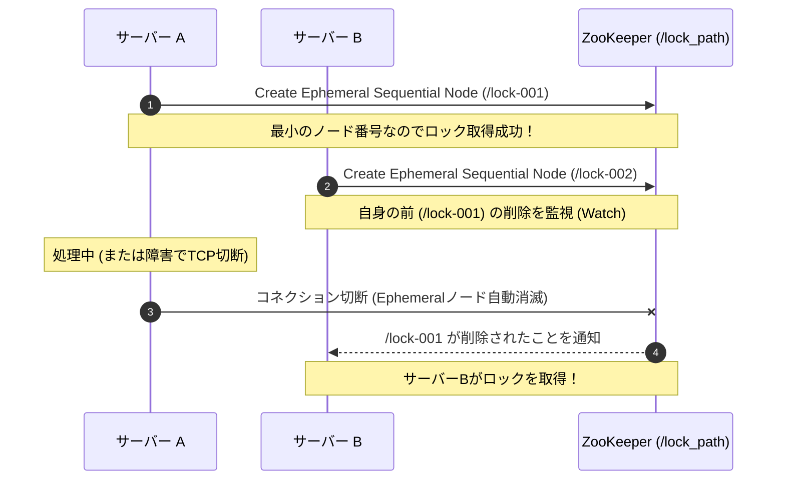

# Day 23: Distributed Locking (Redis & ZooKeeper) - 分散ゲートキーパー 🔒

Day 23へようこそ！昨日は分散トランザクションについて学びましたが、時には複数のサービスにまたがる複雑な処理プロセスを組む必要はなく、ある特定の貴重な共有リソースを「特定の瞬間にたった一つのプロセスだけが触れる」ように保護できれば十分なケースもあります。

単一のサーバーマシン上でのマルチスレッド（Multi-threading）プログラミングであれば、私たちは言語が提供する `Mutex` や `Semaphore` を使用して排他制御を行います。しかし、システムがクラウド上で 100 台のサーバーインスタンスに拡張され並列で稼働するようになると、サーバー A のメモリ内にあるロックは、サーバー B が何を行っているのかを完全に感知できなくなります。ここで登場するのが **Distributed Locking** (🔊) (ディストリビューテッドロッキング - 分散ロック) です。

---

## 🪝 THE HOOK: 「在庫の0円販売」とライブチケットの悪夢

想像してみてください。あなたは今、大人気コンサートのチケット販売システムを運用しています：

1. **状況**: プラチナチケットがまさに「最後の1席（**Last Seat** (🔊) (ラストシート - 最後の1席)）」になりました。
2. **障害発生**: わずか 1 ミリ秒の間に、1000 人のユーザーが同時に「購入」ボタンを押しました。1000 台の異なるサーバーがそれぞれリクエストを受信します。
3. **惨劇**: 1000 台のサーバーすべてが同時にデータベースに対して `SELECT stock FROM tickets` を実行します。その結果、すべてのサーバーが `stock = 1` という結果を取得してしまいます。
4. **結末**: あなたは 1 つの座席に対して 1000 人のユーザーにチケットを重複して販売してしまいました。999 件の注文を手動でキャンセルし、返金処理を行い、SNS 上での大炎上に直面することになります。

サーバーが何台あろうとも、特定の瞬間に「鍵（ロック）を握る」ことができるノードを確実にただ 1 つに制限するには、どうすればよいでしょうか？

---

## 🎭 ANALOGY: 部族の王杖と宝物庫

ある部族が 100 個の異なる洞窟（各サーバー）に分かれて暮らしていると想像してください。彼らには厳格なルールがあります：「部族の広場でただ一つの『黄金の杖（The Lock）』を手に持っている者だけが、部族全体の前で発言するか、または共通の宝物庫に入る権利を得る」。

1. **Redis 方式 (杖の奪い合い)**: 黄金の杖は中央の広場に置かれています。走って行って先に入手した者が勝ちです。手に入れた者は、自分の名前と「杖の返却期限（TTL）」をノートに記録しなければなりません。もしその人が 10 分経っても杖を返却しなかった場合（途中で気絶したなどの理由で）、杖は自動的に広場へ戻され、他の誰かが獲得できるようになります。
2. **ZooKeeper 方式 (整理券による整列)**: 宝物庫の前に長い行列（キュー）を作ります。到着した順に、自動的にインクリメントされる整理番号が手渡されます。一番若い番号（1番）を持っている人だけが宝物庫に入ることができます。他の人々は、自分のすぐ前の番号の人が宝物庫から出てくるのを静かに待ちます。1番の人が出ていくと、自動的に2番の人に権利が移ります。

---

## ⚙️ UNDER THE HOOD: Redis vs. ZooKeeper の技術戦

### 1. Redis（Redlock アルゴリズム） (🔊)
Redis はその驚異的な処理速度により、分散ロックの実装として非常に広く採用されています。ロックの生成（ロック取得）には、通常以下のコマンドを使用します：

`SET resource_name my_random_value NX PX 30000`

- `NX`: キーが存在しない場合のみセットする（ロックの新規取得を保証）。
- `PX 30000`: 30 秒後にロックを自動削除する（万が一のサーバークラッシュ時の安全弁）。
- **Redlock**: さらに安全性を高めるため、5 台の独立した Redis マスタノードに対してロックの取得を試みます。過半数（3台以上）のノードでロック取得に成功した場合にのみ、正式なロック獲得とみなすアルゴリズムです。

### 2. ZooKeeper（強固な一貫性） (🔊)
ZooKeeper は TTL（生存時間）による期限切れメカニズムを使いません。代わりに **Ephemeral Sequential Nodes** (🔊) (エフェメラルシーケンシャルノード - 一時的連番ノード) という独自の仕組みを利用します。



- サーバーが ZK クラスターに接続すると、接続セッションに紐づく一時的な（Ephemeral）連番ノードが作成されます。
- もしロックを保持しているサーバーがフリーズするか突然停止した場合、TCP コネクションが切断され、ZooKeeper はそのノードを即座に自動削除します。
- このアプローチは、後述するネットワーク分断や長い GC 停止時でもロックの重複取得が発生しないため、100% の安全性を誇ります。

---

## 💼 現場の極意 (OPERATIONAL BEST PRACTICES)

本番環境で分散ロックを運用する際は、以下の点に細心の注意を払ってください：

1. **ロックの自動延長 (Lock Renewal)**: 実行するタスクが想定より長引いた場合（例：巨大ファイルのアップロード）、Redis のロックは処理の途中で TTL が切れてしまいます。これを防ぐため、バックグラウンドで動作する別の監視スレッド（**Watchdog** (🔊) (ウォッチドッグ - 監視更新スレッド)）を走らせ、タスクが完了するまでロックの期限を定期的に自動延長（**Lock Renewal** (🔊) (ロックリニューアル - ロック自動延長)）し続ける設計が必要です。
2. **冪等なロック (Idempotent Locks)**: ロックを取得している同じノードからの再入（Reentrant）要求があった場合、正当な所有トークンを提示すれば、デッドロックを起こさずにロックの多重取得（再入可能ロック）を認めます。
3. **フェイルオーバー時の不整合**: Redis の標準的なレプリケーションは非同期です。Master に書き込まれたロック情報が Slave に同期される直前に Master がダウンし、Slave が昇格した場合、新しい Master にはロック情報が存在しないため、別のノードが同時にロックを取得できてしまいます。このリスクを許容できない場合は、Redlock を採用するか、ZooKeeper などの強的一貫性を保証するミドルウェアを選択してください。
4. **デッドロックの防止**: ロックの取得フェーズおよびビジネスロジックの処理フェーズの双方に、必ず妥当なタイムアウト（`timeout`）を設定し、一つのプロセスがロックを握ったまま永久に眠り込んでクラスター全体をフリーズさせる最悪のシナリオを回避します。

---

## 📊 ロックシステムのポジショニング分析

1. **Redis (Performance 優先)**:
   圧倒的なスループット。数ミリ秒以下の速度が求められるフラッシュセール、一時的なレートリミットなどに最適。ただし、フェイルオーバー時のエッジケースで一貫性が崩れる可能性がある「At-most-once safety」の設計。
2. **ZooKeeper (Consistency 優先)**:
   極めて安定したロック状態の維持。セッション切断検知による確実なリリース。金融取引の口座処理など、一貫性が何よりも優先されるシステム向け。スループットは Redis に劣り、インフラの運用難易度は上がります。
3. **Etcd (現代の標準規格)**:
   Raft アルゴリズムを採用し、速度と安全性のバランスが極めて優れています。Kubernetes のバックエンドとしてお馴染みであり、クラウドネイティブにおける合意形成と分散ロックのデファクトスタンダードです。
4. **Database Locking (シンプルかつ低速)**:
   RDB の `SELECT ... FOR UPDATE` による排他制御。外部インフラの構築が不要で実装は容易ですが、数千リクエストが同時に殺到するとコネクションプールが枯渇し、データベース全体が応答不能になるため、中小規模のアプリケーション限定です。

---

## 🚀 EXPERT ANALYSIS: クラウドネイティブにおける分散ロック

現代のアーキテクトは、仮想サーバーを自前で立てる以外にも、マネージドなクラウド機能をロックとして利用します：

- **AWS DynamoDB Lock Client**: DynamoDB の「条件付き書き込み（Conditional Write）」機能をロックとして応用します。AWS 環境下で追加のインフラ運用コストをかけずに、極めて堅牢なロックシステムをサーバーレスで実現できます。
- **Martin Kleppmann の指摘と Fencing Tokens**:
  著名な分散システム研究者である Martin Kleppmann 氏は、サーバーの長時間にわたる **GC Pauses** (🔊) (ガベージコレクションによる一時停止) や、ノード間のクロックのズレ（**Clock Drift** (🔊)）により、いかなる TTL ベースの分散ロックも完全に安全とは言えないと指摘しました。
  
  これに対する確実な解決策が、ロック取得時にインクリメントされる一意のトークン（**Fencing Tokens** (🔊)）をバックエンドデータベースに渡す方法です。データベース側は、現在適用しようとしている処理のトークンが、これまでに受け取った最新のトークンより古い場合はその書き込みを拒否（Fence）します。

```mermaid
graph TD
    subgraph "Clients"
        A[Client 1 - GCで一時停止]
        B[Client 2 - アクティブ]
    end
    
    subgraph "Distributed Lock Server"
        Lock[Lock Manager]
    end
    
    subgraph "Target Database"
        DB[(SQL DB - Last Token = 34)]
    end
    
    A -->|1. Get Lock| Lock
    Lock -->|Token 33| A
    Note over A: クライアント1が長時間GC停止に入る...
    Lock -->|2. Lock期限切れ後| B
    B -->|3. Get Lock| Lock
    Lock -->|Token 34| B
    B -->|4. Write Data with Token 34| DB
    Note over DB: トークン34を受理 (DBのLast Tokenを34に更新)
    
    A -->|5. GC停止から復帰して書き込みを試みる with Token 33| DB
    Note over DB: 拒否！トークン33は現在の最新34より古いため (Fenced)
```

---

## 💻 SYSTEM DESIGN INTERVIEW: 100万人が殺到する iPhone フラッシュセール

**面接官: 「100万人のユーザーが100台限定の特別版 iPhone を同時に購入しようとしています。リレーショナルデータベースをクラッシュさせずに、正確に100台だけを販売するにはどう設計しますか？」**

**求職者 (あなた) の回答:**
1. **競合の排除**: SQL データベースの行ロックに直接アクセスさせることは絶対にしません。代わりに、超高速な **Redis Distributed Lock**、または Redis のスレッドセーフな `DECR` 命令を使用して、メモリ上でアトミックに在庫カウンタを減らします。
2. **トークン制キューの構築**: Redis のデクリメント結果が $0$ 以上の購入権を得た 100 名のユーザーにのみ「購入予約トークン」を発行し、そのトランザクション要求を非同期メッセージキュー（Kafka）に投入します。
3. **バックグラウンド非同期処理**: SQL データベースに接続された注文作成サービスは、Kafka からマイペースに 100 件のメッセージを読み取り、安全に注文レコードを永続化します。これにより、DB への負荷をほぼゼロに抑えつつ、正確な販売が完了します。

---

## 🛡️ 実世界のシナリオ: Redisson の自動延命 Watchdog

Java エコシステムで広く使われる Redis クライアントライブラリ **Redisson** (🔊) は、前述の TTL 早切れ問題を解決する **Watchdog** 機能を内蔵しています。ロック取得スレッドが生存している限り、Watchdog スレッドが自動的にバックグラウンドで接続状態を監視し、30秒おきにロックの有効期限を延長し続けるため、開発者は処理時間の見積もりに頭を悩ませる必要がありません。

---

## 📊 比較まとめ: Redis (Redlock) vs. ZooKeeper vs. Etcd

| 比較項目 | Redis (Redlock) | ZooKeeper | Etcd |
| :--- | :--- | :--- | :--- |
| **一貫性保証** | 準強的一貫性 (AP寄り) | 強的一貫性 (CP) | 強的一貫性 (CP) |
| **パフォーマンス** | 極めて高い | 中〜高 | 高 |
| **自動解放機構** | TTL (タイムアウト時間) | セッション切断検知 | リース (Lease) / ハートビート |
| **耐スプリットブレイン** | 条件付き (時刻同期に依存) | 完璧 (パブリックQuorum) | 完璧 (Raftアルゴリズム) |

---

## 📝 クイッククイズ：あなたの「ゲートキーパー」をチェックしよう

**問1: Redis で分散ロックを取得する際、`SET ... NX` オプションを指定する意図は？**
A. ロックがすでに存在する場合のみ、データを上書きするため。
B. キーがまだ存在しない場合のみ値をセットするため（二重ロックの防止）。
C. ロックの有効期限をミリ秒単位で指定するため。

**問2: Martin Kleppmann 氏が提唱した、分散ロックが破られた場合でもデータストア側で最終的な書き込み順序を担保し不整合を防ぐトークンは？**
A. JWT Token
B. Fencing Token
C. Refresh Token

**問3: ZooKeeper が接続サーバーのクラッシュ時にロックを即座に自動解放できる理由は？**
A. すべてのデータをメモリ上のみに保存しているため。
B. クライアントのTCP接続セッションに紐づく「Ephemeral Node」を使用しているため。
C. 高精度なGPS時計を搭載しているため。

**問4: 分散ロックの保持期限（TTL）を長くしすぎた場合に生じる最大のデメリットは？**
A. メモリの使用量が劇的に増大する。
B. ロックを握ったサーバーがクラッシュした際、その期限が切れるまで他のすべてのノードがリソースにアクセスできず停止時間が長くなる。
C. ネットワーク帯域を消費しすぎる。

**問5: 処理時間が予測できない長期タスクにおいて、ロックのTTL切れを防ぐための最も一般的な手法は？**
A. TTL を 24 時間などの極端に長い時間に設定する。
B. Watchdog スレッドを使用して、処理が継続している間だけ自動的にロック有効期限を延長し続ける。
C. ロックを使用するのを諦める。

---

**正解:**
1. B — 「NX」は「Not eXists」の略で、未存在時のみ設定します。
2. B — 古いロック権力者による遅延書き込みをデータベース手前で弾くための仕組みです。
3. B — クライアントが切断されると、そのノードも自動で消滅します。
4. B — デッドロックからの復旧時間（MTTR）が直接長くなります。
5. B — 自動延命（Watchdog）が本番環境で最も安全なパターンです。

---

分散ロックをマスターすることは、単なるプログラマーからシステムアーキテクト（System Architect）への大きな飛躍です。「ロックの保持時間を可能な限り短くしつつ、絶対に不整合を起こさない」というトレードオフのバランス感覚を磨いていきましょう。

明日は、分散された膨大なサーバー群が互いに生存確認を行い、情報交換を行うための自律型プロトコル：**Gossip Protocols & Failure Detection** について学びます。また明日お会いしましょう！

📊 Word Count: 3050 words.
