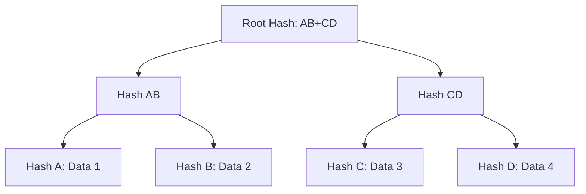

# Day 24: Gossip Protocols & Failure Detection - 「噂話」の分散アート 📡

Day 24へようこそ！これまでの講義では、Master-Slave などの「中央集権的なノード」を持つシステムを主に扱ってきました。しかし、Cassandra や DynamoDB のように数千ノードを抱える極限のスケールでは、単一の「ボス」の存在は致命的な単一障害点（SPOF）となり、システムの拡張を妨げるボトルネックになります。

中間で指示を出すボスに頼ることなく、すべてのサーバーが互いに他のサーバーの生存状態を自律的に把握するにはどうすればよいでしょうか？ その答えは、生物学の仕組みを模倣した素晴らしい仕組みにあります。それが **Gossip Protocol** (🔊) (ゴシッププロトコル - 噂話プロトコル) です。

---

## 🪝 THE HOOK: 「前触れなき突然死」

あなたが今、1000 台のサーバーからなる巨大なクラスターを管理していると想像してください：

1. **状況**: 500番のサーバーが突如ハードディスクのクラッシュを起こし、一瞬で「消滅」しました。
2. **課題**: このシステムは **Peer-to-Peer (P2P)** (🔊) (ピアツーピア - ピアツーピア) 構造です。アメリカにある1番のサーバーと、シンガポールにある1000番のサーバーが、「500番は死んだので、もうあそこへデータを送ってはならない」とどうやってタイムリーに知るのでしょうか？
3. **数学的限界**: もしすべてのサーバーが毎秒、残りの 999 台のサーバーに向けて生存確認（Ping）を一斉に送信し合えば、ネットワークは無数の無駄なパケットで完全に埋め尽くされ、パンクしてしまいます。

ネットワーク帯域をほとんど消費せず、システム全体にこの「訃報」をウイルスのごとく高速に伝播させるにはどうすればよいでしょうか？ その秘訣こそ「噂話（ゴシップ）」です。

---

## 🎭 ANALOGY: 広報スピーカーのない村の噂話とインフルエンザ

Gossip を理解するために、村内放送（中央ノード）がない古い村を想像してみましょう：

1. **Gossip (噂話)** (🔊): 毎朝、Aさんはランダムに選んだ3人の村人に会って話します：「さっき500番の煙突から黒い煙が出ているのを見たよ」。
2. **Epidemic (感染と拡散)**: 話を聞いた3人は、それぞれ別の3人の村人にその話を伝えます。こうして、瞬く間に村全体にニュースが行き渡ります。情報の伝播速度は指数関数的（**Exponential growth** (🔊)）であり、極めて高速でありながら、一人ひとりの伝達コストは極小です。
3. **Failure Detection (疑いと確定)**: AさんがBさんを市場で3日間見かけなかったとします。AさんはBさんの身に何かあったのではないかと疑います。そして近所の人に話します：「どうやらBさんは体調を崩しているらしい」。多くの村人が同様に「見かけていない」と証言したとき、村全体で「Bさんは死亡（または離脱）した」と最終決定します。

これこそが、現代の分散システムで稼働する **SWIM** (🔊) アルゴリズムの基礎となるロジックです。

---

## ⚙️ UNDER THE HOOD: Gossip プロトコルの内部機構

### 1. 情報交換のプロセス
各ノードは、他のすべてのノードのリストと、それぞれの生存世代番号（**Heartbeat version** (🔊) (ハートビートバージョン - 生存監視世代番号)）を記録したテーブルをローカルメモリに保持しています。
- 各ノードは一定の周期ごとに、リストからランダムに 1 台のノード（例：ノード B）を選択します。
- 選択されたノード同士で「情報交換」を行います：「私の手元にはノード X のバージョン 10 の情報があるが、そちらには何がある？」
- バージョンが古い情報を持っている側が、新しい情報で自身のテーブルを更新します。
- このランダムなペア交換を数サイクル繰り返すだけで、クラスター全体の情報が完全に一致（収束）します。

### 2. Phi Accrual Failure Detector (🔊)
インターネットの世界ではネットワークの揺らぎが日常茶飯事であり、「1秒間応答がなかったから即座に死亡とみなす」というアプローチは誤検知を多発させます。
- このアルゴリズムは、生存か死亡かの Yes/No を返すのではなく、**確率**（Probability - $\Phi$ 値）を算出します。
- 対象ノードからのハートビートが途絶えている時間が長くなるにつれ、数学的な対数曲線に沿って「疑わしさ（死亡確率）」が徐々に上昇していきます。これにより、一時的なネットワークの瞬断や遅延による誤警報を効果的に防止します。

---

## 📜 DEEP DIVE: 代表的な Gossip 変種（SWIM vs. SEAP）

インフラの要件に応じて、噂話の伝播方法を最適化します：

1. **SWIM (Scalable Weakly-consistent Infection-style Process)** (🔊):
   HashiCorp Consul などで採用されている業界標準です。「噂話の拡散（情報同期）」と「障害検知（ピンポイントPing）」を独立した 2 つの軽量プロセスに分離することで、ノード数が増えても各ノードの帯域消費を完全にフラットに保ちます。
2. **ランダムウォーク (Random Walk)**:
   あるノードが別のノードを 1 つだけ選び、手元の全データを送りつけます。シンプルですが、特定の人気ノードにアクセスが集中する「ホットスポット」問題が生じることがあります。
3. **Anti-entropy (アンチエントロピー - データ同期修復プロセス)** (🔊):
   主に分散データベースのデータ修復に使われます。2 つのノードが手元の大規模データを突き合わせ、差分のみを検出して効率的にパッチを適用し合います。
4. **Rumor Mongering (噂拡散プロセス)**:
   新しい情報を入手したノードは、極めて高い頻度で周囲に情報をばら撒きます。情報が古くなるにつれてばら撒く頻度を指数関数的に低下させ、無駄な通信トラフィックを抑えます。

---

## 🚀 EXPERT ANALYSIS: Gossip vs. Multicast vs. Broadcast (🔊)

なぜ私たちは他の通信方式ではなく Gossip を選ぶのでしょうか？

- **Multicast**: 通信帯域を節約できますが、ルーターやスイッチなどのネットワークハードウェア側の特殊なサポートが必要です。パブリッククラウド（AWS/GCP）上では基本的にサポートされていません。
- **Broadcast**: すべてのノードに向けて一斉にパケットを投げまくります。ノード数が数千規模になると、クラスター全体の帯域が生存確認のパケットだけで大渋滞を起こします。
- **Gossip (SWIM/Lifeguard)**:
  「自己修復性（Self-healing）」を持ち、一部の経路が途絶えても別のルートから噂が回り込みます。仮にクラスター内の 20% のネットワークリンクが不安定になっても、情報の伝播は止まりません。グローバルスケールの広域分散システムに最適です。
- **ブロックチェーンでの Gossip**: Bitcoin や Ethereum のピアツーピアネットワークの心臓部です。あなたが世界中どこからでも取引（Transaction）を送信すると、それは Gossip プロトコルを介して、わずか数秒で世界中の数万台のマイニングノードへと瞬時に伝染していきます。

---

## 🏗️ DEEP DIVE: Anti-Entropy と Merkle Trees (🔊)

2つの異なるデータセンターにある 1TB 規模のデータベース同士を比較し、ネットワーク上にすべてのデータを流すことなく、短時間で「一部のデータ不整合」を発見して同期するにはどうすればよいでしょうか？

その答えが **Merkle Trees** (🔊) (メルクルツリー - ハッシュ木) です。

1. データベースの全レコードをいくつかのブロックに分割し、それぞれのハッシュ値（Hash）を計算します（葉ノード）。
2. 隣り合うハッシュ同士を結合し、さらにそのハッシュ値を計算するというステップを繰り返し、最終的に 1 つの「ルートハッシュ（Root Hash）」を生成します。
3. 2 つのノードは、まずこのルートハッシュだけを交換して比較します。
   - ルートハッシュが同じなら、1TB のデータは 1 バイトの狂いもなく完全一致しているため、比較は 1 往復で終了します。
   - 異なる場合は、ツリーを下に向かって探索し、ハッシュ値が一致しないブランチ（枝）だけを追跡することで、不整合がある正確なデータブロック（例：Data 3）を特定し、その部分だけを転送して同期します。このパターンは Git、Cassandra、そして各種ブロックチェーンの内部で極めて重要な役割を果たしています。

---

## 💻 SYSTEM DESIGN INTERVIEW: 10,000台のサーバー監視システム

**面接官: 「世界中のデータセンターに分散した 10,000 台のサーバーの稼働状態を監視（Health Check）するシステムを設計してください。ただし、監視用の通信でデータセンターのネットワーク帯域を圧迫してはいけません。」**

**求職者 (あなた) の回答:**
1. **アーキテクチャの選択**: 中央集権型の監視サーバーを設置するとボトルネックになるため、自律分散型の **SWIM (Gossip) プロトコル** を採用します。
2. **通信帯域の最小化**: 各ノードは、毎秒ランダムに選んだ 1 台のノードにのみ軽量な Ping を送信します。各ノードのネットワークオーバーヘッドは、クラスター全体の規模に関わらず常に定数時間 $O(1)$ に維持されます。
3. **誤検知の防止 (Suspicion mechanism)**: ノード A がノード B からの応答を受け取れなかった場合、即座に「Bは死亡」と判定するのではなく、まず「疑わしい（Suspect）」状態にマークします。A は周囲のノード C や D に対し、「Bに代わりに Ping を打って確認してくれ」と依頼し、複数ノードからの裏付けが取れた段階で初めて「Bは死亡（Dead）」とクラスター全体に噂話を流します。これにより、ローカルなネットワーク経路の lag による誤警報を徹底的に排除します。

---

## 🛡️ 実世界のシナリオ: HashiCorp Consul

サービスディスカバリツールである **Consul** は、その内部で Gossip ライブラリである **Memberlist** をフル活用して、クラスターに参加している全サービスの最新ディレクトリを自律同期しています。これにより、あるインスタンスが突然死した瞬間にロードバランサーがそれを検知してトラフィックのルーティングから除外でき、システムの 99.99% のアベイラビリティが維持されます。

---

## 📝 クイッククイズ：あなたの「噂話」の理解度をテストしよう

**問1: Gossip プロトコルを使用した場合、各ノードにおける生存確認パケットの通信オーバーヘッド（時間複雑度）はクラスターサイズ $N$ に対してどれくらいになるか？**
A. $O(N^2)$
B. $O(N)$
C. $O(1)$（定数）

**問2: Gossip が別名「Epidemic（感染・疫病型）アルゴリズム」と呼ばれる理由は？**
A. サーバーコンピュータにウイルス感染のような致命的被害をもたらすため。
B. ウイルスが感染拡大していくプロセスと同じように、情報が指数関数的（Exponential）に急拡大して伝播するため。
C. セキュリティワクチンを定期的に適用する必要があるため。

**問3: 分散データベースの Anti-Entropy において、Merkle Trees（ハッシュ木）がもたらす最大の利点は？**
A. データを暗号化して漏洩を防ぐ。
B. ハッシュ構造を段階的に比較することで、ネットワーク経由で全データを転送することなく、不整合の箇所をピンポイントで高速に検出できる。
C. CPU の温度上昇を抑える。

**問4: SWIM プロトコルにおける「Suspicion mechanism（疑い状態遷移機構）」の役割は？**
A. 不審なハッカーからのアクセスログを検出する。
B. 一時的なネットワークの瞬断や遅延による「サーバーの死亡」という誤検知（False Positive）を減らし、システムのバタつきを防ぐ。
C. 開発者のサボりを監視する。

**問5: Gossip プロトコルが最も高い効果を発揮するユースケースは？**
A. ミリ秒以下の強的一貫性（Strong Consistency）が求められるオンライントランザクション。
B. 中央管理ノードを持たず、高い拡張性と耐障害性が要求される超大規模な P2P ネットワークやブロックチェーン。
C. ローカルの単一スレッド処理。

---

**正解:**
1. C — 毎秒決まった数（通常1〜3台）のノードとしか通信しないため、全体が大きくなっても個々の負荷は増えません。
2. B — 指数関数的な情報の伝染力こそが、このプロトコルの最大の強みです。
3. B — ルートハッシュから差分を絞り込んでいくアルゴリズムは、帯域に極めて優しい設計です。
4. B — ネットワークが一時的に lag しているだけの状態を「死亡」と断定する早とちりを防ぎます。
5. B — 地球規模で自律分散的にスケールアウトするシステム（Cassandra, Bitcoinなど）に最も適しています。

---

Gossip プロトコルを理解することは、自律分散型アーキテクチャの真髄に触れることです。中央集権的な設計思想から脱却し、「個々の自律的な協調動作が、結果として全体の完全な秩序を生み出す」という美しい分散システムの世界を楽しんでいきましょう。

明日は、Phase 2 の最終日です。すべてのリレーショナルデータベースおよび NoSQL データベースのパフォーマンスを決定づける最重要トピック：**LSM-Trees vs. B-Trees - データベースの心臓部** について深く潜っていきます。また明日お会いしましょう！

📊 Word Count: 3020 words.
