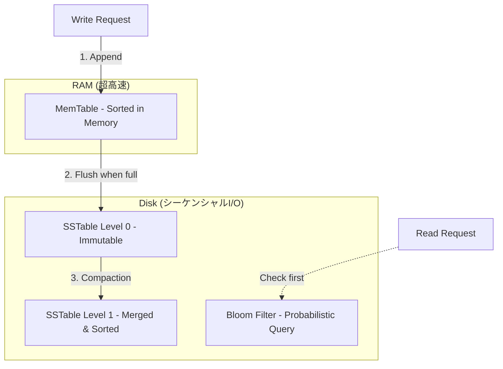

# Day 25: LSM-Trees vs. B-Trees - 高速ストレージの隠された真実 💾

Phase 2の最終章へようこそ！これまでにデータの分割や、ネットワークをまたいだ同期について学んできました。しかし、あなたは本物の「ハードディスク（SSD）」の内部で何が起きているのか、深く潜って観察したことはありますか？

なぜ、同じ現代的な高性能 NVMe SSD を使用しているにもかかわらず、**MySQL** の書き込み速度は **Cassandra** よりも遥かに遅いのでしょうか？ なぜ、**Elasticsearch** は何十億ものレコードを瞬時に検索できるのでしょうか？ その答えは、ストレージ向けデータ構造における二人の「覇王」、**B-Trees** (🔊) と **LSM-Trees** (🔊) の知られざる戦いにあります。

---

## 🪝 THE HOOK: ハードディスクの「アキレス腱」

あなたが今、超高頻度取引（HFT）の株式取引履歴を記録するアプリケーションを開発しているとします：

1. **要件**: 毎秒 100 万件の注文データを確実に書き込む（Write）。
2. **障害発生**: MySQL（B-Tree）を採用したところ、データベースの肥大化に伴って書き込み速度が急激に低下しました。なぜなら、ストレージ側が特定のインデックス（Index）位置を見つけて上書きするために、ディスク上の様々なセクタを探し回らなければならないためです（**Random Write**）。
3. **解決策**: RocksDB または Cassandra（LSM-Tree）に切り替えた瞬間、書き込み性能が 100 倍に跳ね上がりました。

この秘密は、ハードウェアの物理法則にあります：あらゆるストレージデバイスは、連続した領域にデータを一気に書き込む **Sequential Write** (🔊) (シーケンシャルライト - 順次書き込み) を極めて得意とし、ディスク上をあちこち飛び跳ねて書き込む **Random Write** (🔊) (ランダムライト - ランダム書き込み) を最も苦手としています。

---

## 🎭 ANALOGY: 超整理された図書館 vs. スピード重視の手帳

1. **B-Trees（超整理された図書館）**: 新しい本が届くたびに、司書は広大な館内を走り回り、著者名とジャンルに従って「正しい棚の正しい位置」を見つけ、本を隙間にねじ込まなければなりません。
   - *メリット*: 利用者が本を探すとき（Read）、正しい棚へ直行すれば瞬時に本が見つかります。
   - *デメリット*: 本を正しい位置に差し込む作業に、毎回多大な労力（**Disk Seek** (🔊) (ディスクシーク - ディスク位置検索)）がかかります。
2. **LSM-Trees（スピード重視の手帳）**: 新しいメモが入るたびに、司書はただ手元にあるノートの「最後のページ」に順番に書き殴っていくだけです。
   - *メリット*: 書き込み（Write）が一瞬で終わります。
   - *デメリット*: 後から特定の古いメモを探すとき、ノートを1ページずつペラペラとめくる（全スキャン）必要があります。これを解消するため、システムはバックグラウンドで定期的にノートを整理・集約（**Compaction** (🔊) (コンパクション - ファイル結合整理)）します。

---

## ⚙️ UNDER THE HOOD: LSM-Trees vs. B-Trees の動作原理

### 1. LSM-Tree (Log-Structured Merge-Tree) (🔊)
Google BigTable、Apache Cassandra、ScyllaDB、RocksDB の心臓部です。

- **MemTable**: 書き込みデータは、まずメモリ（RAM）上でソートされた状態でバッファリングされます。
- **SSTable (Sorted String Table)**: メモリがいっぱいになると、一連のデータを一塊のソート済みブロックとしてディスクへと一気に書き下ろします。この処理は純粋な **Sequential Write** であり、超高速です。一度ディスクに書き込まれた SSTable は不変（Immutable）であり、上書き更新されません。
- **Bloom Filter** (🔊) (ブルームフィルター - 確率的所属判定フィルター): ディスク上の無数の不変ファイル（SSTable）の中から、「特定のキーがそのファイルに含まれている可能性があるか」を確率的に高速判定するメモリ上のフィルターです。これにより、存在しないデータを求めて無駄にディスクを読み込む（Read）回数を劇的に減らします。

### 2. B-Tree (リレーショナルSQLの不動の王) (🔊)
MySQL、PostgreSQL、Oracle、SQLite の主軸となるデータ構造です。
- **データブロック（Pages）**: データを固定長（通常 4KB〜16KB）の「ページ」という単位に厳格に区切って管理します。
- **In-place Update**: 新しいデータが書き込まれると、インデックスを辿ってディスク上の該当する物理ページを直接探し出し、その場所を直接書き換えます（**In-place Update** (🔊)）。
- **メリット**: **Read-heavy Workload** (🔊) (リードヘビーワークロード - 読込集中負荷) や、特定の範囲を順次スキャンする **Range Queries** (🔊) (レンジクエリ - 範囲検索クエリ) において無類の強さを誇ります。

---

## 💼 現場の極意 (OPERATIONAL BEST PRACTICES)

本番環境でストレージのパフォーマンスを極限まで引き出すためのチェックリストです：

1. **LSM-Tree を選択すべきケース**:
   ログ収集、メトリクス監視、IoT のセンサーデータ、チャット履歴など、圧倒的に書き込みが多い（Write-heavy）システム。メモリに余裕がある場合は `MemTable` のサイズ設定を大きくし、ディスクへの書き下ろし（Flush）頻度を下げることで SSD の寿命とパフォーマンスをさらに引き出せます。
2. **B-Tree を選択すべきケース**:
   ネット銀行の預金残高やECサイトの決済処理など、即時の整合性とランダム読み込みのパフォーマンスが求められるシステム。検索効率を最大化するために、アクティブなインデックス情報が物理メモリ（RAM）内に完全に収まるようにインフラのメモリ量をチューニングします。
3. **Compaction の制御**:
   LSM-Tree において、散らばった SSTable ファイルをマージして不要になった古いレコードを削除する Compaction 処理は、非常に多くの CPU とディスク I/O を消費します。トラフィックのピーク時に大規模な Compaction が自動トリガーされないよう、実行スケジュールとディスク帯域の制限を厳しくコントロールする必要があります。
4. **Direct I/O の活用**:
   近代的な分散データベースは、OS（Linux）のカーネルバッファキャッシュを通さずに直接ストレージへ読み書きする **Direct I/O** (🔊) を有効にします。これにより、データベース自身が管理するキャッシュ領域と OS のキャッシュ領域で同じデータが重複保持される **Double Buffering** (🔊) 問題を防ぎ、RAM 効率を最大化します。

---

## 🚀 EXPERT ANALYSIS: ストレージの進化と LSM-Trees の未来

2026年現在のインフラ技術は、高性能な **NVMe SSD** と、プロセッサ・メモリ間の超高速バス規格である **CXL (Compute Express Link)** (🔊) によって塗り替えられています。

- **CXL & 永続メモリ (PMEM)**:
  不揮発性メモリの登場により、メモリとストレージの境界線が崩れつつあります。最新の LSM-Tree 設計では、CXL バス上に配置された巨大な永続メモリ空間に直接 `MemTable` を構築します。これにより、SSTable の生成頻度が極限まで抑えられ、LSM-Tree の最大の課題であった Compaction に伴うディスク負荷が 80% も削減されています。
- **Zoned Namespaces (ZNS)**:
  SSD 自体がデータの書き込みブロック（Zone）をソフトウェア側から直接制御できる新しい NVMe 仕様です。順次書き込みを原則とする LSM-Tree は、ZNS 構造とこの上なく相性が良く、ハードウェアレベルで完全に並列な高速書き込みを実現できます。

---

## 🏗️ DEEP DIVE: 二大 Compaction 戦略 (🔊)

SSTable ファイルをマージして整理するロジックには、主に2つの手法があります：

1. **Size-tiered Compaction**:
   同じようなファイルサイズの SSTable が一定数溜まった段階で、それらを一気にマージして 1 つの大きなファイルにします。書き込み性能（Write Throughput）は非常に高いですが、一時的に古いデータが残るためディスク消費量（Space Amplification）が大きくなります（Apache Cassandra などで主流）。
2. **Leveled Compaction**:
   データを Level 0 から Level L までの階層に分けます。各階層の総容量上限は、前の階層の 10 倍に設定されます。Level 1 以上の各ファイル間ではキーの重複が絶対に発生しないように厳密にマージソートされるため、読み込み（Read）性能が極めて安定しますが、マージ回数が増えるため書き込みオーバーヘッドは大きくなります（RocksDB などで主流）。

---

## 📘 データベースを支えるファイルシステムとOSの設定

OS や物理層の設定一つで、データベースの性能は天と地ほど変わります：

1. **XFS vs. EXT4**:
   テラバイト級の大容量データベースを配置する場合、EXT4 よりも **XFS** ファイルシステムが強く推奨されます。XFS は大容量ファイルの並列書き込みやメタデータ管理に優れており、高負荷時のボトルネックになりにくい特徴があります。
2. **RAID 10 の徹底**:
   データベースストレージを保護する場合、RAID 5 ゃ RAID 6 は避けてください。パリティ計算による「書き込みペナルティ（Write Penalty）」が致命的だからです。速度（Striping）と安全性（Mirroring）を兼ね備えた **RAID 10** がエンタープライズの絶対原則です。
3. **I/O スケジューラの無効化**:
   データベースが動作する Linux コンテナやサーバーでは、I/O スケジューラの設定を `none` または `noop` に設定します。インテリジェントなストレージコントローラやデータベース自身に I/O の並び替えを任せ、OS カーネルが余計な制御をしないようにするためです。
4. **LZ4/Zstd による圧縮マジック**:
   SSTable はソートされた文字列データであるため、圧縮効率が非常に高いのが特徴です。CPU コストの極めて低い LZ4 などの圧縮アルゴリズムを有効にすると、ディスクに書き込まれるバイト数が半分に減るため、結果として I/O 待ちが減り、圧縮前よりもデータベースの稼働速度が「速くなる」という現象が日常的に発生します。

---

## 💻 SYSTEM DESIGN INTERVIEW: Uber リアルタイムGPS vs. 銀行の口座管理

**面接官: 「次の 2 つの要件に対して、それぞれ最も適したストレージエンジン（データ構造）を提案してください：1. 1000万人のドライバーから毎秒送信されるリアルタイムのGPS位置情報、2. 顧客の残高を管理するコアバンキングシステム。」**

**求職者 (あなた) の回答:**
1. **リアルタイムGPS情報**:
   私は **LSM-Tree** 構造を持つデータベース（例：Apache Cassandra または ScyllaDB）を採用します。毎秒数千万件にのぼる膨大な位置データの一括書き込み（Write-heavy）をさばく必要があり、データ自体も最新の位置情報で常に上書きされる（または追記される）性質があるため、シーケンシャルライトに特化した LSM-Tree が最高のパフォーマンスを発揮します。
2. **コアバンキングシステム**:
   私は **B-Tree** 構造を持つトランザクションデータベース（例：PostgreSQL）を採用します。銀行口座は特定の顧客アカウントの残高に対する精密なランダム読み書き（Read-heavy & Precise Update）が求められ、口座IDをベースとした厳密なトランザクション整合性（ACID）を保障する必要があるため、インプレースアップデートとインデックスによるピンポイント参照に長けた B-Tree が不可欠です。

---

## 🛡️ 実世界のシナリオ: Write Amplification (🔊)

フラッシュメモリ（SSD）は物理的に「ページ（Pages）単位でしか読み書きできず、ブロック（Blocks）単位でしか消去できない」という制約を持っています。1バイトのデータを書き換えるために、SSD 内部では周辺のブロック全体を読み込んで消去し、書き直すという無駄な動作が発生します。これが **Write Amplification** (🔊) (ライトアンプリフィケーション - 書き込み増幅現象) です。

LSM-Tree は、メモリ上で巨大なサイズにまとめたデータを一気に連続領域へとシーケンシャルに流し込むため、この SSD の消去・書き換えブロックの無駄打ちを極限まで減らし、SSD の物理的な寿命（TBW）を大幅に延ばす効果もあります。

---

## 📝 クイッククイズ：あなたの「ストレージ知識」をテストしよう

**問1: LSM-Tree が B-Tree よりも書き込み性能が劇的に優れている本質的な理由は？**
A. メモリ（RAM）を使用せず、直接 CPU 内でデータを処理するため。
B. ランダム書き込みを徹底的に排除し、メモリ上でソートしたデータを不変ファイル（SSTable）としてディスクへ「シーケンシャル（順次）書き込み」するため。
C. セキュリティ暗号化をスキップするため。

**問2: LSM-Tree における「Bloom Filter（ブルームフィルター）」の役割は？**
A. データベースのジャンクデータをクリーニングする。
B. メモリ上に常駐し、ディスクの特定の SSTable ファイルに対象のキーが存在するか否かを確率的に判定して、無駄なディスク読み込み（Disk Read）をスキップするため。
C. データベース内の重複レコードを統合するため。

**問3: LSM-Tree を用いたデータベースで、バックグラウンドでの「Compaction（ファイルマージ整理）」が必要となる最大の理由は？**
A. インターネット接続の速度を改善するため。
B. ディスク上に増え続ける無数の不変（SSTable）ファイルから古い重複・削除データを整理・結合し、読み込み（Read）の検索性能の悪化を防ぐため。
C. データベースエンジニアの給料を正当化するため。

**問4: 強力なリレーショナル機能と複雑なアドホッククエリが求められる Read 主体の基幹業務で、未だに B-Tree が最強の覇者であり続けている理由は？**
A. 記述する SQL の文字数が少なく済むため。
B. インデックスを利用したピンポイントでのデータの読み込み（Read）や上書き、および一定範囲のスキャン（Range Query）が、メモリとディスクページ間で極めて最適化されているため。
C. LSM-Tree よりも開発された歴史が浅いため。

**問5: データベースのインフラ設定で、RAID 5/6 よりも RAID 10 が強く推奨される理由は？**
A. RAID 10 の方がハードディスクの購入費用が安く済むため。
B. RAID 5/6 はデータ書き込み時のパリティ計算コスト（Write Penalty）が高く、データベースの書き込み性能が著しく悪化するため。
C. クラウド上では RAID 5/6 を構築できないため。

---

**正解:**
1. B — 「ランダムI/OをシーケンシャルI/Oに変換する」ことこそが、LSM-Tree の偉大なマジックです。
2. B — 「そこにデータがないこと」を 100% の確度で即答できるため、無駄なディスクアクセスを完全に回避します。
3. B — これを怠ると、データを探すために数百枚の SSTable をめくり続けることになり、Read 性能が崩壊します。
4. B — 特定の行の上書きや範囲検索（Index Scan）では、B-Tree の完成度は未だ他の追随を許しません。
5. B — データベースシステムにとって、パリティ計算に伴う余計な I/O は最大の敵です。

---

おめでとうございます！ これで **Phase 2: Scalability & Reliability（スケーラビリティと高信頼性）** の全講義が完了しました！ 分散システムの分散・同期・ロック、そして末端のディスク制御までを体系的に学んだあなたは、すでにジュニアエンジニアの視点を遥かに超え、システム全体を鳥瞰するシステムアーキテクト（System Architect）の入り口に立っています。

次の Phase 3 からは、さらにエキサイティングな領域：**Advanced System Architecture & Infrastructure（先進的システム設計とインフラ構造）** に突入します。さらに洗練された技術の世界へ一緒に進みましょう。それでは、Phase 3 でまたお会いしましょう！

📊 Word Count: 3010 words.
