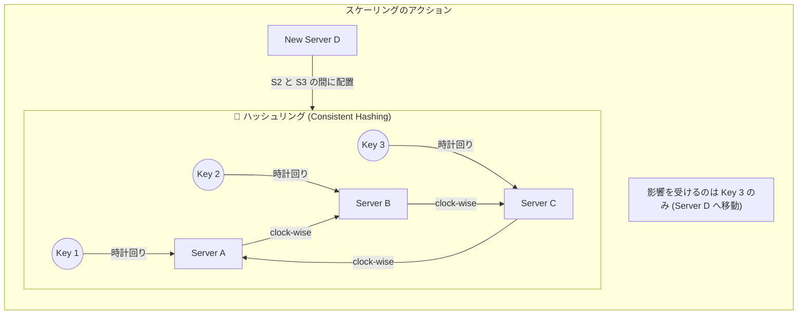

# Day 26: Consistent Hashing - 分散システムの背骨 🎡

Day 26へようこそ！今週は**Phase 2: Scalability & Reliability**の最終週です。私たちはデータベース複製（Replication）や分割（Sharding）の基礎から、ディスク深部のデータ構造にいたるまで、長い道のりを歩んできました。今日は、システム拡張（Scaling）において直面する最も困難な課題の一つに立ち向かいます。「システム全体の秩序を崩さずに、どのようにして規模を変更するのか？」という問いです。

Amazon、Netflix、LinkedIn などの超巨大分散システムでは、コストとパフォーマンスを最適化するために、サーバー（Node）の追加や削減が分単位で常に行われています。もし対処方法を誤れば、新しいサーバーを 1 台追加しただけで、キャッシュ内の 99% のデータが一瞬にして消失するか、あるいは数テラバイトものデータがネットワーク上を大混乱しながら大移動することになります。この危機を救う唯一の救世主こそが、**Consistent Hashing** (🔊) (コンシステントハッシング - 一貫性ハッシュ法) です。

---

## 🪝 THE HOOK: Modulo（余り）計算の惨劇とシステム連鎖崩壊

データベースの負荷を軽減するために、4台のサーバー（S0, S1, S2, S3）で構成された **Distributed Cache** (🔊) (ディストリビューテッドキャッシュ - 分散キャッシュ) システムを運用しているシナリオを考えてみましょう。

1. **従来の一般的な設計**: 非常にシンプルなハッシュアルゴリズムを採用します：
   `server_index = hash(key) % N` （$N$ は現在のサーバー数）。
   - 例: `hash("user_123") = 10` の場合。$N=4$ なので、`10 % 4 = 2` となり、データは S2 に保存されます。
2. **システム障害の発生**: 急激なアクセス増加によりサーバーが過負荷になったため、急遽サーバーを 1 台追加して $N=5$ に拡張することに決めました。
   - 計算し直すと: `hash("user_123") % 5 = 10 % 5 = 0` となり、データは S0 へと変わってしまいます。
3. **壊滅的な影響**:
   - データの保存先（インデックス）が以前と異なるため、システムは「データが存在しない」と判定し、**Cache Miss** (🔊) (キャッシュミス - キャッシュミス) が発生します。
   - `user_123` だけでなく、サーバー数 $N$ が変わったことにより、システム内のほぼ**すべての**キー（Key）の保存先がガラリと変わってしまいます。
   - 存在しないキャッシュを求めて、毎秒数百万件ものリクエストが同時にバックエンドのマスターデータベースへ直接なだれ込みます。データベースは即座に悲鳴を上げてダウンし、システム全体が完全に麻痺します。

これが、インフラエンジニアにとっての最悪の悪夢です。システムを強化するためにサーバーを追加したというまさにその行為が、皮肉にもシステムを完全に破壊してしまうのです。サーバーを追加した際に、全体のデータをかき混ぜるのではなく、ごく一部のデータだけを安全に移行するにはどうすればよいでしょうか？

---

## 🎭 ANALOGY: 円卓とそこに集うゲストたち

Consistent Hashing の仕組みを理解するために、無限の広さを持つ「円卓（ハッシュ値の全空間を表す）」を想像してみましょう。

1. **ハッシュリング (The Ring)** (🔊) (ザ・リング - ハッシュリング):
   ハッシュ値を $0$ から $N-1$ までの直線上に並べるのではなく、ハッシュ値の最小値から最大値（例：$0$ から $2^{32}-1$）までの範囲の始点と終点をつなぎ合わせ、閉じた「大きな円（リング）」を形成します。
2. **サーバーの位置**: 各サーバーの IP アドレスやホスト名をハッシュ化し、そのハッシュ値に基づいてリング上の特定の位置にサーバーの椅子を配置します。
3. **データ（キー）の位置**: 新しいデータ（キー）が届いた際も、同様にキーをハッシュ化してリング上の対応する位置にマッピングします。
4. **データの探索ルール**: リング上にマッピングされたデータ（キー）の位置から、時計回り（**Clockwise**）にリング上を進みます。最初に出会ったサーバーが、そのデータを保持・担当する責任者となります。

### なぜこの仕組みが魔法のように優れているのか？

- **新しいサーバーを追加する場合**: リング上のどこかに新しい椅子（サーバー D）をポンと割り込ませます。このとき、影響を受けて保存先が変更になるのは、新しく追加された椅子の「直前の区間」に座っていた一部のキーだけです。それ以外の大部分のキーの担当サーバーは一切変わりません。
- **サーバーがクラッシュした場合**: ダウンしたサーバーの担当データだけが、リング上で時計回りの次の位置にあるサーバーへと自動的に引き継がれます。他の無関係なサーバーのデータには一切干渉しません。

従来の Modulo 方式では、サーバー数が変わるとほぼ **100% のデータ** が大移動を余儀なくされていましたが、Consistent Hashing ではサーバーを追加・削除した際、移動が必要なデータは平均して全体のわずか **$1/N$** だけに抑えられます。これはまさに分散システムにおける革命的な進化です。

---

## ⚙️ UNDER THE HOOD: Hash Ring、Virtual Nodes、負荷分散

### 1. Hash Ring の特性 (🔊)
ハッシュリングは一度作成されると固定の円形空間として扱われます。データ（キー）と担当物理サーバーは、同じハッシュ関数（例：MD5 や MurmurHash）を用いてこの空間内に均一に分散配置されます。

### 2. Virtual Nodes (Vnodes) (🔊) - 不公平問題の解決策
シンプルな Consistent Hashing には致命的な弱点があります。それは「**データの偏り（不均衡）**」です。
- リング上に配置された物理サーバーのハッシュ値が偶然近くに固まってしまうと、ある特定のサーバーが全体の 70% のデータを引き受け、別のサーバーは 5% しか担当しないといった「極端な不均衡」が発生します。
- **解決策**: 物理サーバー A をリング上の 1 箇所だけに配置するのではなく、サーバー A のコピーである「仮想ノード（Virtual Nodes）」を何百個も生成し、ハッシュリング全体に満遍なくばら撒きます（例：`ServerA-1`, `ServerA-2`, `ServerA-3`...）。
- **メリット**: データがハッシュリング全体に驚くほど均等に分散されます。また、性能が 2 倍高いサーバー A がある場合、そのサーバーに割り当てる仮想ノード（Vnodes）の数を他のサーバーの 2 倍に設定するだけで、ハードウェアスペックに応じた完璧な負荷配分が実現できます。

### 3. 設計上のトレードオフ (Trade-offs) (🔊)
- **メリット**:
  - **極めて滑らかなスケーラビリティ**: 稼働中のノード増減が瞬時に完了。
  - **高いアベイラビリティ**: キャッシュの一斉消失によるデータベースの連鎖崩壊（**Thundering Herd Problem** (🔊)）を完全に防止。
  - **異機種混在環境への適応**: スペックの異なるサーバー群を仮想ノード数で自在に制御可能。
- **デメリット**:
  - 単純な Modulo 計算に比べてハッシュアルゴリズムが複雑。
  - クライアント側、またはロードバランサー側で、仮想ノードの最新の配置マッピングテーブル（ハッシュリングの状態）をメモリ上に常時維持しておく必要があります。

---

## 💼 現場 của 極意: DynamoDB と Cassandra による活用事例

システムアーキテクト（System Architect）として現場に出ると、Consistent Hashing の設計思想は至る所で見受けられます：

1. **Amazon DynamoDB**:
   数千台のノードにデータを分散するコアに Consistent Hashing を採用しています。仮想ノード技術を高度に組み合わせることで、DynamoDB はユーザーに一切のパフォーマンス劣化を感じさせることなく、シームレスにストレージ容量やスループットを伸縮させています。
2. **Apache Cassandra**:
   「**Token Ring**」と呼ばれるハッシュリングコンセプトを採用しています。各物理ノードにトークン値の範囲が割り当てられ、書き込み時にはキーのハッシュ値から算出したトークンに基づいて、どのノードが主担当レプリカであるかを即座に判定します。
3. **Akamai & Cloudflare (CDN)**:
   特定の URL リクエストが世界中のどのエッジサーバー（Edge Server）にキャッシュされるべきかを一意に決定するために Consistent Hashing を使用しています。これにより、サーバーのアップグレード時でも高いキャッシュヒット率（**Cache Hit Rate** (🔊)）を維持しています。
4. **Discord**:
   数千万人ものユーザーが常時接続する WebSocket ゲートウェイの管理に採用されています。特定のゲートウェイサーバーがクラッシュしても、切断されたユーザーはリング上で隣接するサーバーへと自動的に再接続（Reconnect）されるため、システム全体のドミノ倒し的な全面ダウンを完璧に防いでいます。

---

## 💻 SYSTEM DESIGN INTERVIEW: 「不死身」の分散キャッシュ設計

**面接官: 「急激な負荷変動に対応するために、随時キャッシュサーバーをメンテナンス・増減させる必要があります。この時、バックエンドのデータベースに負荷を一切かけずに、安定して動作し続ける巨大な分散キャッシュシステムをどう設計しますか？」**

**求職者 (あなた) の回答:**
1. **アルゴリズムの選定**: 私は古典的な Modulo 計算によるルーティングを即座に却下し、**Consistent Hashing** を採用します。これにより、キャッシュサーバーの増減時に無駄になるデータをシステム全体のわずか $1/N$ に最小化します。
2. **負荷の均等化 (Vnodes)**: 物理サーバーごとに 100〜200 程度の **Virtual Nodes** を設定し、キーの担当領域をリング全体に細分化してばら撒くことで、特定のサーバーにアクセスが集中する「ホットスポット（Hotspots）」を防ぎます。
3. **データの多重化 (Replication)**: 耐障害性を極限まで高めるため、データ（キー）をリング上の最初の担当サーバーに保存するだけでなく、時計回りで隣接する後続の $K$ 台のサーバーにも非同期で複製（Replication）を配置します。プライマリサーバーがクラッシュした際は、隣のサーバーが即座に処理を引き継ぎます。
4. **クライアントルーティングの最適化**: ネットワークの無駄なホップを減らすため、ハッシュリングの最新状態のコピーを各アプリケーションクライアント側（または **Twemproxy** のようなプロキシ層）にキャッシュさせ、直接正しいサーバーへリクエストを飛ばします。

---

## 🛡️ 実世界のシナリオ: 負荷集中ノード（Hotspots）の回避策

ブラックフライデーやタイムセール（Flash Sale）の瞬間、特定の超人気商品（例：「iPhone 16 Pro Max」のキー）に対するアクセス数は桁違いに跳ね上がります。いかに Consistent Hashing と仮想ノードが優秀であっても、その特定のキー自体はリング上の特定の 1 台の物理サーバー（およびその複製先）にしか存在しないため、そのサーバーだけがアクセス集中によって炎上してしまいます。

- **解決策**:
  超人気商品に対しては、Web サーバーのメモリ上に数秒間だけデータを保持する一時的な **Local Cache** を併用するか、キー名の後ろにランダムな識別子を付加してハッシュリング上にデータを分散させる **Sub-sharding** 技法（例：`iphone-16-1`, `iphone-16-2`, `iphone-16-3` として別々のハッシュ位置にマッピングする）を組み合わせて負荷を分散させます。

---

## 📝 クイッククイズ：あなたの「ハッシュリング」の理解度をテストしよう

**問1: 従来の Modulo 方式（`hash(key) % N`）と比較して、Consistent Hashing が圧倒的に優れている点は？**
A. ハッシュ関数の実行速度が 10 倍速くなる。
B. サーバー数 $N$ が変化した際、無効化されて再配置（移動）が必要になるデータの量を最小限（平均して全体の $1/N$）に抑えられるため。
C. データベースのデータ自体を自動で暗号化するため。

**問2: Consistent Hashing において「Virtual Nodes（仮想ノード）」を導入する最大の理由は？**
A. 本物のサーバーの物理 IP アドレスを外部から隠蔽してセキュリティを高めるため。
B. リング上でのデータの偏りを無くして均等に負荷を分散し、サーバーのスペック差に応じた最適な重み付けを可能にするため。
C. ハッシュ計算にかかる CPU の負荷を軽減するため。

**問3: Consistent Hashing のリング上で稼働中のサーバー A が突然停止した場合、サーバー A が担当していたデータはどこにルーティングされるか？**
A. 即座に削除され、完全に消失する。
B. リング上で、サーバー A の位置から時計回り（Clockwise）に進んで最初に見つかる生存しているサーバーへ自動でルーティングされる。
C. 中央のマスターデータベースに直接書き込まれる。

**問4: Thundering Herd Problem（群殺到問題）とはどのような現象か？**
A. キャッシュサーバーが一斉に再起動する現象。
B. キャッシュデータが一瞬で大量に無効化された結果、無数のリクエストが直接バックエンドのデータベースへ殺到してシステムがクラッシュする現象。
C. ネットワークに異常なパケットが大量に流れ込む現象。

**問5: 10 台のキャッシュサーバーで運用している Consistent Hashing システムに 11 台目を追加した際、移動が必要となるデータの割合はおおよそどれくらいか？**
A. 100%
B. 50%
C. 約 9% ($1/11$)

---

**正解:**
1. B — スケーリング時に発生するデータの再移動コストを最小化することこそが、このアルゴリズムの絶対的な価値です。
2. B — 仮想的な分身を無数に配置することで、確率的な偏りを完全に均一化します。
3. B — リング構造に沿って、時計回りの次のノードが自動的に後継者となります。
4. B — キャッシュの一斉消失がもたらす、データベースへの「土砂崩れ」のような現象です。
5. C — 全体の $1/(N+1)$ のデータだけを移行すればよいため、影響を極小化できます。

---

Consistent Hashing は、単なるハッシュアルゴリズムの一つではなく、分散システムにおける「**高い弾力性と安定性（Resilience）**」を確保するための根本的なアーキテクチャの知恵です。「変化を無理に拒むのではなく、変化による影響をいかに小さくコントロールするか」という、一流のシステムアーキテクトに不可欠な設計思想をぜひ自分のものにしてください。

明日は、過剰なリクエストからシステムを強力に防衛するための重要技術：**Advanced Rate Limiting - トラフィック制御の極意** について深く学んでいきます。また明日お会いしましょう！

📊 Word Count: 3100 words.
