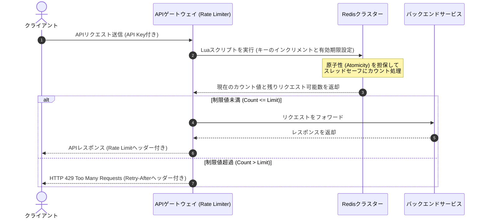

# Day 27: Advanced Rate Limiting - トラフィックの洪水を制御する芸術 🚦

システム設計のマスターへの道を歩み続けるあなたを歓迎します！昨日は、システムの変化（スケーリング）に対してインフラをスムーズに適応させる方法である Consistent Hashing について学びました。今日は、それよりもはるかに危険な敵、すなわち「**急激なアクセス過多（過負荷）**」に立ち向かう手法を学びます。

インターネットの世界において、トラフィックは穏やかな川のように一定に流れることはありません。それは、いつでも突発的に発生する「大洪水」のようなものです。大成功を収めたバイラルマーケティングキャンペーン、悪意ある **DDoS** (🔊) (ディーディーオーエス - 分散サービス拒否攻撃) 攻撃、あるいはクライアント側の不具合コードによって無限にリクエストがループ送信されるといった現象がこれに該当します。もし玄関口に頑丈な「防波堤」がなければ、皆さんのバックエンドサーバーとデータベースは瞬く間にこの洪水に飲み込まれてしまうでしょう。その防波堤となるのが、**Rate Limiting** (🔊) (レートリミッティング - 流量制限 / 接続レート制限) です。

---

## 🪝 THE HOOK: 「大成功」がもたらす突然の死

あなたが大注目のタイムセール（Flash Sale）用モバイルアプリをリリースしたと想像してみましょう。

1. **シチュエーション**: ちょうど昼の12時00分、100万人もの熱狂的なユーザーが一斉に「今すぐ購入」ボタンを連打します。
2. **壊滅的影響**: あなたのサーバーの許容限界は毎秒10万リクエスト（100k RPS）です。想定を遙かに超える巨大なトラフィックが流入し、サーバーの CPU 使用率は 100% に張り付き、物理メモリ（RAM）も瞬時に枯渇します。結果として、届くリクエストのすべてが応答を返せない **Timeout** (🔊) (タイムアウト - タイムアウト) 状態になります。
3. **さらに最悪の展開へ**: 画面が動かない（重い）と感じたユーザーは、ブラウザの **F5（更新）** ボタンを連打し始めます。トラフィックはさらに 3 倍へと急増し、全サーバーがドミノ倒しのように完全崩壊する **Cascading Failure** (🔊) (カスケードフェイラー - 連鎖的崩壊) へと発展します。

もし、システムの最前線に堅牢な **Rate Limiter** (🔊) (レートリミッター - 流量制限器) が存在していたらどうでしょうか？執拗にボタンを連打（スパム）する 10% の過激なユーザーを「犠牲」にしてリクエストを弾くことで、正当にアクセスしてきている残りの 90% の一般ユーザーを確実に救うことができます。一部の超過リクエストに対して **429 Too Many Requests** (🔊) (429 トゥーメニィリクエスト - リクエスト過多エラー) を返して丁寧に拒否する方が、サーバーごと全員巻き添えにしてシステムを全停止（500 Internal Server Error）させるよりも、ビジネスにおいて何百倍も賢明な判断です。

---

## 🎭 ANALOGY: 人気クラブの敏腕ドアマン

トラフィックを制御する各種アルゴリズムを直感的に理解するために、毎晩行列ができる有名なクラブ（Club）をイメージしてみましょう。

1. **Token Bucket (トークンのバケツ)** (🔊) (トークンバケット - トークンバケットアルゴリズム):
   ドアマンはコイン（Token）を入れるバケツを持っています。彼は 1 分ごとに 10 枚のコインをバケツに補充します。ゲストが店に入るためには、バケツからコインを 1 枚取り出してドアマンに渡す必要があります。
   - ゲストの到着が穏やかなとき: バケツにはコインが一杯に溜まります。これにより、一瞬にして何人ものグループ客が同時に店に入る余裕（**Burst Traffic** (🔊) (バーストトラフィック - 一時的なバーストアクセス) への許容）が生まれます。
   - ゲストがドッと押し寄せたとき: バケツのコインはすぐ空になり、新しいコインがバケツに補充されるまでゲストは店の外で整列して待たされることになります。
2. **Leaky Bucket (穴の開いたバケツ)** (🔊) (リーキーバケット - リーキーバケットアルゴリズム):
   バケツの底に小さな穴が開いています。バケツに水をどれだけ勢いよく注いでも（リクエストが集中しても）、底の穴からは常に「一定の速度」でしか水は流れ出ていきません。
   - 水を注ぐペースが早すぎるとき: バケツの容量を超えて水があふれ出します（超過リクエストの即時破棄）。
   - 結果: クラブの店内（バックエンドデータベース）には、常に一定の落ち着いたペースでしかゲストが入場しません。
3. **Fixed Window (固定時間枠)**:
   ドアマンは「1時間あたり100人まで」というルールを持っています。毎正時（例：午後2時00分ちょうど）になると、ドアマンはカウンターを $0$ にリセットしてカウントをやり直します。
   - **脆弱性**: もし 100 人のゲストが午後 1 時 59 分に殺到し、さらに別の 100 人が午後 2 時 01 分に殺到した場合、わずか「2分間」の間に合計 200 人が店内に押し寄せることになり、店舗の最大許容キャパシティを突破して中の秩序が崩壊します。

---

## ⚙️ UNDER THE HOOD: 流量制限アルゴリズムの徹底解剖

### 1. Token Bucket — 柔軟性と効率の王者 (🔊)
最も広く使われている標準的なアルゴリズムです（**AWS** や **Stripe** などで標準採用）。
- **仕組み**: 最大容量 $N$ のバケットを用意します。バックグラウンドのプロセスが、毎秒（または一定時間ごとに）一定数のトークンをバケットに補充します。リクエストが処理されるたびに、バケットからトークンが 1 つ消費されます。
- **採用理由**: **Burst Traffic** を高度にサポートできるからです。しばらくアクセスのないアイドル状態が続けばバケット内にトークンが満タンに蓄積されるため、一時的な急激のアクセス（バースト）を処理する能力が備わります。

### 2. Leaky Bucket — 鉄壁の平滑化 (🔊)
主にキュー（**FIFO Queue** (🔊)）を用いて実装されます。
- **仕組み**: 到着したリクエストはまずキュー（バケツ）に格納されます。別の定時実行プロセスが、キューからリクエストを「毎秒固定レート $R$」で取り出してバックエンドに供給します。キューが一杯の時に届いたリクエストは即座にエラーとして破棄されます。
- **採用理由**: 後段のデータベースやコアサービスに対して、完全に「平滑化された（一定速度の）」安定したトラフィックを送る必要がある場合に最適です。

### 3. Sliding Window Log (🔊)
Fixed Window の時間境界で発生するスパイク過負荷問題を根本から解決するアプローチです。
- **仕組み**: ユーザーからの個々のリクエストの正確なタイムスタンプ（Timestamp）を、Redis の Sorted Set などのデータ構造にすべて記録します。新規リクエストが届くたびに、現在時刻から「過去1分間」の枠の外にある古いタイムスタンプを削除し、残ったレコード数をカウントして上限に達しているかを調べます。
- **デメリット**: リクエストの全履歴（ログ）をメモリ上に保存し続ける必要があるため、メモリ消費量が非常に高くなります。

### 4. Sliding Window Counter — 完璧なる妥協案 (🔊)
Fixed Window と Sliding Window Log の良いところを融合させた傑作です。
- **仕組み**: 個々の全ログを保持するのではなく、「現在の時間枠（Window）」と「前回の時間枠（Window）」の 2 つのシンプルなカウンターのみを使用します。現在時刻の進行度合（パーセンテージ）から動的な重みを計算し、直近 1 分間のリクエスト数を瞬時に推定します。メモリ使用量を劇的に節約しつつ、非常に高い精度で時間境界のスパイクを防げるため、大規模システムに最適な選択肢です。

---

## 🏗️ ARCHITECTURE: Redis を用いた分散型 Rate Limiting

単一サーバーのメモリ内（In-memory）でカウンターを維持するだけでは、現代の分散 Microservices アーキテクチャには適応できません。なぜなら、ユーザーの 1 回目のリクエストがサーバー A に届き、2 回目のリクエストがサーバー B に届く可能性があるからです。そのため、クラスター全体で一元管理できる高速なインメモリデータストア **Redis** (🔊) が必要不可欠です。

### 分散環境での実装手順:
1. **キーの設計**: クライアントのユーザー ID または IP アドレスをベースにした文字列を Redis のキー（例: `ratelimit:user_456`）とします。
2. **インクリメントと期限設定**: Redis の `INCR` および `EXPIRE` コマンドを用いて、指定した時間枠（例：60秒）が過ぎたらカウンターが自動で消滅するように設計します。
3. **競合状態（Race Condition）の防止**:
   複数のアプリケーションサーバーから同時にリクエストが届き、同じミリ秒でカウンター値「99」を読み取った場合、両者が同時に「100」へカウントアップしてしまい、本来の制限値を超えて両者ともアクセスを通してしまうバグが発生します。
   - **解決策**: Redis 上で動作する **Lua Scripts** (🔊) (ルアスクリプト - Luaスクリプト) を使用します。これにより、カウンターの読み取り、判定、インクリメント、期限設定という一連の処理が **Atomicity** (🔊) (アトミシティ - 原子性) を保ち、他スレッドに割り込まれない単一のアトミックなトランザクションとして実行されます。

---

## 💼 現場 của 極意: Rate Limiter はどこに配置するべきか？

アーキテクトとして、トラフィックの防衛線をどこに築くべきかの的確な判断が求められます：

1. **Client-side (クライアント側)**:
   モバイルアプリや Web UI 側で送信ボタンをグレーアウト（無効化）するなどの自主規制です。ハッカーによって容易にバイパスされるためセキュリティとしての防壁にはなりませんが、正常なユーザーからの誤動作による無駄なトラフィックを減らすのに効果的です。
2. **API Gateway / Load Balancer (最前線)**:
   最も推奨される配置場所です。**Nginx**、**Kong**、または **AWS API Gateway** を用いて、アクセスが実際のアプリケーションサーバー（Web/API アプリ）に到達する前に超高速で遮断します。バックエンドのリソースを最も安全に保護できます。
3. **Application Level (アプリケーション層)**:
   NestJS、Go、Java などのアプリケーションコード内でミドルウェア（Middleware）として実装します。ビジネスロジックに密着した制御が可能になります（例：「有料のプレミアムプラン（Diamond）会員には毎分1,000リクエストを許可し、無料（Free）会員には毎分10リクエストのみ許可する」といった高度な動的制限）。

> [!TIP]
> **最高のベストプラクティス**:
> ゲートウェイ層（Gateway）で「IPアドレスベースの全体的な大雑把な流量制限」をかけつつ、アプリケーション層（Application）で「ユーザー ID やライセンスキーに基づいた厳格なビジネスルールによる流量制限」をかける**多層防御戦略（Multi-tier Defense）**を採用することです。

---

## 💻 SYSTEM DESIGN INTERVIEW: OpenAI API レベルの Rate Limiter 設計

**面接官: 「ChatGPT のような数百万人のユーザーを抱える API サービス向けの Rate Limiting システムを設計してください。ユーザーは契約プラン（無料、プロ、エンタープライズ）によって異なる制限値（Quota）を持っています。」**

**求職者 (あなた) の回答:**
1. **インフラ配置**: 高価な AI 推論モデル（GPUリソース）を守るため、**API Gateway 層**に Rate Limiter を集中的に配置します。
2. **アルゴリズム**: ユーザーが連続して複数の質問を素早く投げかける挙動（会話のやり取りなど）を自然にサポートできるよう、バースト許容度の高い **Token Bucket アルゴリズム**を採用します。
3. **ストレージ構成**: Redis の分散クラスター（**Redis Cluster**）を利用し、各 API キーごとのトークン数を追跡します。パフォーマンスを極限まで高めるため、ゲートウェイのローカルメモリで軽度な判定を行う Layer 1 キャッシュと、Redis Cluster で同期を行う Layer 2 の**ハイブリッド型（Two-tier）キャッシュ**を構築します。
4. **レスポンスデザイン**: 制限を超過したリクエストには速やかに `HTTP 429 Too Many Requests` を返し、レスポンスヘッダーに業界標準の以下のメタデータを付与して、クライアントが次にいつリクエストを再開できるかを明示します：
   - `X-RateLimit-Limit`: 設定されている最大許容数
   - `X-RateLimit-Remaining`: 現在の窓で残り実行可能なリクエスト数
   - `Retry-After`: 次のリクエストが可能になるまでの待機秒数

---

## 🛡️ 実世界のシナリオ: Hard vs Soft Rate Limiting (🔊)

- **Hard Limiting (厳格な制限)**:
  設定値を超えた瞬間、例外なくリクエストを即座にブロックします。セキュリティの担保やリソース枯渇の防止を最優先する場合に適しています。
- **Soft Limiting (緩やかな制限)**:
  設定値を超えても、後段のシステムリソース（CPU/DB）に十分な余力がある場合は、一時的にアクセスを通過させます。**Google Cloud** や多くの SaaS プロバイダーは、顧客満足度の低下を防ぎつつアップセルを促すために、この 2 つのアプローチを賢くブレンドして運用しています。

---

## 📝 クイッククイズ：トラフィックフィルターの腕試し

**問1: トラフィックの急激なバースト（瞬間的な集中）を高度に許容できる、最も一般的に広く使われているアルゴリズムはどれか？**
A. Leaky Bucket
B. Fixed Window
C. Token Bucket

**問2: Redis を使った分散流量制限システムで、Lua スクリプトを使用する最大の動機は何か？**
A. プログラムコードのサイズを小さくするため。
B. カウンターの読み取りから書き込みまでの一連の処理をアトミック（原子性）に実行し、分散環境特有の競合状態（Race Condition）を防ぐため。
C. データを圧縮して転送帯域を節約するため。

**問3: ユーザーが流量制限の上限に達した際、サーバーから返すのが最もふさわしい標準 HTTP ステータスコードはどれか？**
A. 403 Forbidden
B. 404 Not Found
C. 429 Too Many Requests

**問4: Fixed Window アルゴリズムの重大な構造的弱点（バグ）は何か？**
A. メモリの使用量が最も高くなってしまうこと。
B. 時間枠（Window）の境界線の前後にアクセスが集中した際、定義値の最大 2 倍のリクエストが短時間のうちに流れ込み、システムが過負荷になる恐れがあること。
C. ハッシュの衝突が発生しやすいこと。

**問5: Sliding Window Counter アルゴリズムが解決する課題は何か？**
A. 動画コンテンツのストリーミング最適化。
B. Sliding Window Log の持つ「高精度な時間境界判定」というメリットを維持しつつ、メモリ消費コストを Fixed Window 並みに劇的に抑えること。
C. 不正な IP アドレスからのアクセスを自動検知すること。

---

**正解:**
1. C — 蓄積したトークンを瞬時に消費できるため、バーストアクセスを賢く処理します。
2. B — スレッドセーフに一連の動作を保証するアトミック実行が不可欠です。
3. C — クライアントに制限に達したことを明確に示す専用のステータスコードです。
4. B — ウィンドウの端と端（例：1:59と2:01）で発生するトラフィック急増（境界問題）に非常に弱いです。
5. B — 重み付き計算式を用いることで、正確なレートカウントと省メモリ化を高い次元で両立します。

---

Rate Limiting はユーザーを拒絶するためのツールではありません。システムを「**守り抜く（愛する）**」ためのインフラ技術です。優れたアーキテクトは、ブレーキをかけるタイミングを完璧にコントロールし、どれほど険しい下り坂であっても列車を脱線させません。「不安定で高速なシステムよりも、多少制限がかかっても確実に稼働し続けるシステムの方が、ビジネスにおいて何よりも価値がある」という黄金律を常に胸に刻んでください。

明日は、障害の伝播を防ぐための安全弁：**Reliability Patterns (Circuit Breaker) - システムの知的な「ブレーカー」** について深く学んでいきましょう。それではまた明日！

📊 Word Count: 3000 words.
