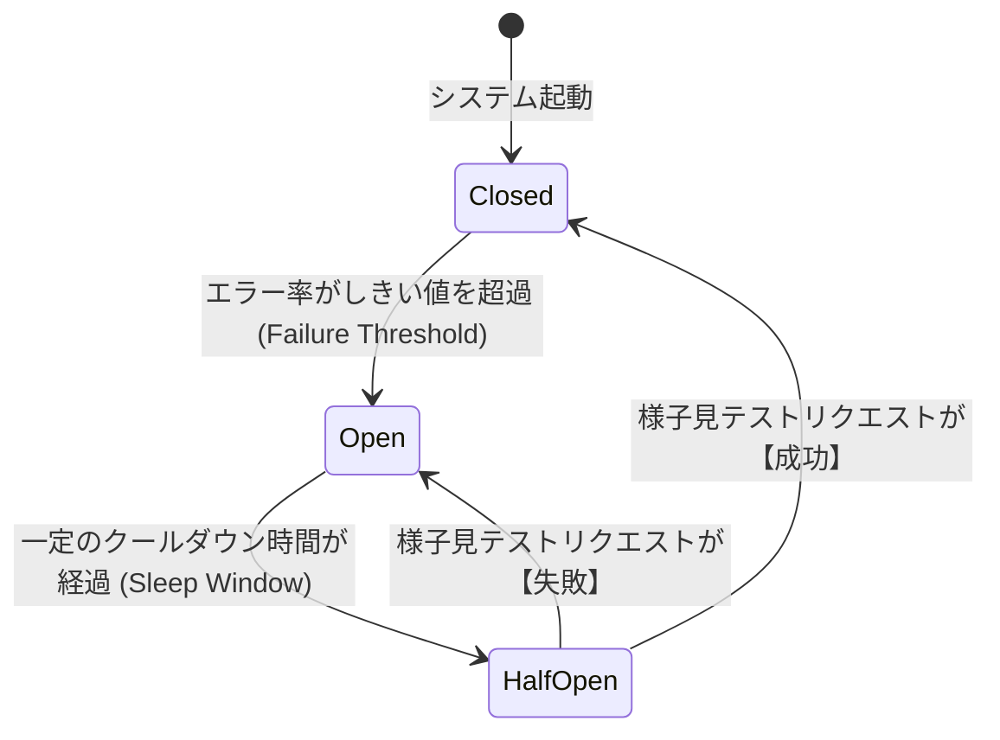

# Day 28: Reliability Patterns - 「不死身」のシステムを構築する 🛡️

Day 28へようこそ！Phase 2のゴールはもうすぐそこです。これまでに、システムの拡張方法（Scaling）と流量制限（Rate Limiting）を学びました。しかし、分散システムの世界において、すべてのアーキテクトが絶対に受け入れなければならない残酷な現実があります。それは、「**障害は絶対に避けることができない**」という事実です。

ネットワークの瞬断、データベースの応答遅延、あるいはサードパーティの外部サービス（決済ゲートウェイなど）の突然の停止など、トラブルは日常茶飯事です。もしシステムを楽観的で壊れやすい構造にしてしまうと、取るに足らない小さなサービスの障害がウイルスのように全体へ伝播し、巨大なシステムすべてを巻き込んでダウンさせてしまいます。今日は、障害を効果的に隔離し、システム全体の生命線を維持するための強力な防護壁：**Circuit Breaker** (🔊) (サーキットブレーカー - 遮断器 / 回路遮断器) と **Bulkhead** (🔊) (バルクヘッド - 隔壁隔離パターン) について深く学んでいきましょう。

---

## 🪝 THE HOOK: 「障害連鎖」という最悪のドミノ倒し

以下のような 3 つの基本サービスで構成された EC サイトを想定してみましょう。

1. **注文サービス (Order Service)**
2. **決済サービス (Payment Service)**
3. **メール通知サービス (Email Service) — 外部サードパーティ API**

```mermaid
graph TD
    Client[クライアント] --> Order[Order Service<br/>注文サービス]
    Order --> Payment[Payment Service<br/>決済サービス]
    Order --> Email[Email Service<br/>外部メールサービス]
    
    style Email fill:#ff9999,stroke:#333,stroke-width:2px;
    Note over Email: 障害発生: レスポンスが<br/>30秒に遅延 (ハング状態)
```

**連鎖崩壊（ドミノ）シナリオ**:
- メール通知サービス側で障害が発生し、普段 1 秒で終わる処理が 30 秒かかるようになり、応答が極端に遅延（ハング）しました。
- ユーザーが購入ボタンを押すと、注文サービス（Order Service）はまず決済サービスを呼び出し、次にメール通知サービスを呼び出します。
- メール通知サービスの応答が遅いため、注文サービス内の実行スレッド（**Threads** (🔊)）は応答を待つためにその場に留まり、解放されなくなります。
- わずか数分後、注文サービスのすべてのスレッドが「メール送信の応答待ち」のために完全に占有され尽くします。
- **最悪の結果**: 注文サービスが新しいリクエストを受け付けられなくなり、ユーザーは一切注文ができなくなります。無関係に見えた「メールの遅延」が、ビジネスの核心である「注文」そのものを完全に破壊してしまいました。

これが、**Cascading Failures** (🔊) (カスケードフェイラー - 連鎖的崩壊 / 障害連鎖) の恐ろしさです。一般的なエンジニアは、必死になって遅れているメールサービスの復旧やバグ修正を行います。しかし、一流のシステムアーキテクトは、「たとえメールサービスが完全に死んでいても、注文サービスは**平然と稼働し続ける**」ようにシステムを最初から設計します。

---

## 🎭 ANALOGY: 家庭の安全ブレーカーと船の隔壁

### 1. Circuit Breaker (電気のブレーカー) (🔊)
一般家庭の電気回路をイメージしてください。ある電化製品がショート（短絡）して過電流が発生すると、ブレーカー（安全装置）が自動的に作動して瞬時に「遮断（跳ねる）」します。
もしこのブレーカーがなければ、アイロンのショートが家庭内のすべての配線を焼き尽くし、火災を引き起こすでしょう。ソフトウェアにおける Circuit Breaker も同様で、異常が発生したサービスへの接続を瞬時に遮断することで、他の健全なサービスまで共倒れになるのを防ぎます。

### 2. Bulkhead (船の隔壁) (🔊)
豪華客船タイタニック号が（結果的に沈没したとはいえ）「絶対に沈まない船」と謳われたのはなぜでしょうか？それは、船体を頑丈な「**隔壁（Bulkhead）**」で区切って、独立した複数の水密区画に分割していたからです。
万が一、一部の区画が破れて浸水したとしても、水はその区画の中だけに留まり、他の区画には侵入しません。そのため、船全体が沈没することは免れます。
ソフトウェアでは、利用可能なリソース（CPU、メモリ、スレッド、接続プール）をサービスごとに独立した「プール（Pool）」として厳格に分離する設計を指します。仮にサービス A のリソースプールが満杯になってクラッシュしても、サービス B は独立した別のプールで生き残り、ユーザーに稼働を提供し続けます。

---

## ⚙️ UNDER THE HOOD: Circuit Breaker の状態遷移

### 1. 3つの基本状態 (🔊)
Circuit Breaker は、以下の状態を遷移する**State Machine** (🔊) (ステートマシン - 状態遷移機械) として動作します：

- **CLOSED (クローズド - 閉状態)**:
  通常の状態です。すべてのリクエストは対象の外部サービスへ素通りで送信されます。この間、エラー発生率（Failure Rate）のメトリクスを常に監視しています。
- **OPEN (オープン - 開状態)**:
  エラー発生率があらかじめ設定したしきい値（例：10秒間で 50% 以上のエラー）を超えた場合、ブレーカーが作動して「跳ね（オープン）」ます。この状態になると、対象サービスへのリクエストは**一切送信されず、即座にエラーとして却下**（Fail-fast）されます。これにより、相手側のサービスが回復するための十分な時間的猶予（Cooldown）を与えることができます。
- **HALF-OPEN (ハーフオープン - 半開状態)**:
  一定の待機時間（**Sleep Window** (🔊)）が経過した後、システムは「様子見」のために少数のテストリクエスト（Canary Requests）のみを通します。
  - これらのテストがすべて**見事に成功**した場合: 回復したとみなして **CLOSED** 状態に戻り、通常営業を再開します。
  - テストが 1 つでも**失敗**した場合: 再びエラー状態であると判断し、即座に **OPEN** 状態へと戻って再び待機時間を開始します。



### 2. Bulkhead Pattern による徹底的なリソース隔離 (🔊)
すべての API コールやタスク処理で、システム全体に 1 つしかない共通の「グローバルスレッドプール」を使い回す設計をしているとします。
- サービス A の応答が遅延する -> スレッドを全占有する -> 健全だったサービス B に割り振るスレッドがゼロになり、サービス B も沈没。
- **解決策**: 以下のようにサービスごとに専用スレッドプールを割り当て、上限を隔離（Service-based isolation）します：
  - 決済サービス（Payment API）呼び出し専用: **最大 20 スレッド**
  - メールサービス（Email API）呼び出し専用: **最大 10 スレッド**
  - アプリ内部のビジネスロジック処理用: **最大 50 スレッド**
- これにより、メール通知サービスが完全にハングアップしても、消費されるスレッドはメール専用の最大 10 個だけに制限され、他の 70 個のスレッドは全く影響を受けずに動作し続けます。

---

## 🏗️ STRATEGIES: システムを「自己修復」させるアーキテクトの知恵

高度な復元力（**Resilience** (🔊) (レジリエンス - 回復力)）を備えたシステムを設計するために、以下の手法を巧みに組み合わせます。

1. **Timeouts (タイムアウト)**:
   外部リクエストに対して、決して永遠に待ち続けてはいけません。応答の遅延はシステムを窒息させます。ユースケースに応じて適切なタイムアウト時間（例：最大2秒）を厳密に設定し、応答がない場合は早めに見切ってスレッドを解放します。
2. **Retries with Exponential Backoff (指数バックオフによる再試行)** (🔊):
   一時的なネットワークの瞬断などの「一時的なエラー」に対しては再試行が有効です。ただし、失敗した直後に 1 秒間に 10 回も連続して再試行を叩きつけてはいけません。相手の瀕死のサーバーに自分から DDoS 攻撃を仕掛けるようなものです。
   再試行の間隔を「1秒 → 2秒 → 4秒 → 8秒...」のように指数関数的に増やして、負荷を逃がします。
3. **Jitter (ジッター - ゆらぎの追加)** (🔊):
   指数バックオフの間隔にランダムな数ミリ秒の「ゆらぎ（Jitter）」を加えます。これにより、仮に何万台ものクライアント端末が一斉に再試行を始めても、リクエストの送信タイミングが分散され、特定の一瞬にトラフィックのスパイクが集中するのを完全に回避できます。
4. **Fallback Strategy (代替プランの提示)** (🔊):
   ブレーカーが OPEN になって処理が中断されたとき、ただ無機質なエラー画面をユーザーに返すのはアマチュアの仕事です。
   - 例: 「レコメンド商品（お勧め）サービス」がダウンした場合、即座にフォールバック処理に切り替え、あらかじめキャッシュしておいた「全ユーザー共通の売れ筋ランキング（静的データ）」を表示します。ユーザーは違和感なく買い物を継続できます。

---

## 💼 現場 của 極意: Netflix Hystrix と Resilience4j

かつて Netflix は、無数の分散マイクロサービスにおいて「障害は前提条件である」という現実を最も早く受け入れ、Circuit Breaker を実装した伝説的なライブラリ **Hystrix** を世に送り出しました。
- 彼らは、巨大な分散システムでは常にどこかのサービスが壊れているのが「正常状態」であると考えました。
- そのため、障害をゼロに抑え込もうとするのではなく、**障害を安全に内包し、いなす**ためのソフトウェア制御を進化させました。
- **実務へのアドバイス**: 現在 Java/Spring Boot 環境であれば後継の **Resilience4j** を、Go 言語であれば **Hystrix-Go** や **gobreaker** を、Node.js であれば **Opossum** などの実績あるライブラリを採用するのが業界標準です。

---

## 💻 SYSTEM DESIGN INTERVIEW: 外部決済システム障害からコアインフラを守る設計

**面接官: 「決済サービスとして外部の Stripe API を利用しています。ある日、Stripe で世界規模のシステム障害が発生し、リクエストの応答が非常に不安定になりました。この時、ユーザーのスマホ画面がフリーズすることなく、さらに自社のバックエンドサーバーが過負荷で道連れダウンするのを防ぐ具体的なシステムを提案してください。」**

**求職者 (あなた) の回答:**
1. **防衛線 (Circuit Breaker & Bulkhead)**:
   Stripe API をコールする箇所の前段に Circuit Breaker を配備し、エラー率が上がった段階でアクセスを自動遮断し、Fail-fast でシステムのリソースを保護します。また、決済通信用のスレッドと HTTP 接続コネクション（**Connection Pool** (🔊)）を他の処理から完全に物理隔離（Bulkhead）し、決済処理がどれほど詰まってもメインの閲覧やカート操作にリソースが回るように設計します。
2. **代替処理 (Asynchronous Payment Fallback)**:
   決済の即時応答が受け取れない場合の Fallback として、決済リクエストを安全性の高い高信頼メッセージキュー（**Kafka** や **RabbitMQ**）へ一時的に退避させる **Asynchronous Payment** (🔊) (アシンクロナスペイメント - 非同期決済処理) を作動させます。
3. **ユーザー体験の維持 (UX Fallback)**:
   「お支払いは現在順次処理中です。完了次第、数分以内にメールまたはプッシュ通知にてお知らせいたします」という前向きなステータス画面を即座に返し、ユーザーに安心感を与えてページに留めておきます。

---

## 🛡️ 実世界のシナリオ: 極限の低遅延を実現する Shadow Requests (🔊)

Google 検索や Bing などの極めてレスポンス速度にシビアな検索エンジンや金融取引システムでは、Circuit Breaker が作動するわずかな時間すら許容できない場合があります。そこで用いられるのが **Shadow Requests** (🔊) です。
リクエストを受けると、システムは「プライマリノード」と「バックアップ（セカンダリ）ノード」の両方にほぼ同時にリクエストを並列送信します。プライマリノードから 50ms 以内に応答が返ってこなければ、即座に見切りをつけてその時点で最速で応答を返したセカンダリノードのデータを採用します。リソースの消費量は 2 倍になりますが、どのようなネットワークの乱れがあっても常にミリ秒単位の超高速レスポンスを維持するための究極の手法です。

---

## 📝 クイッククイズ：あなたの「回復力（Resilience）」をテストしよう

**問1: 分散システムにおける「Cascading Failures（連鎖的崩壊）」とはどのような事象を指すか？**
A. 一部のサーバーが定期的にバックアップデータを作成する動作。
B. 1つの非コアなサービスで発生した障害や応答遅延が、システム全体のスレッドやリソースを食いつぶし、正常だった他のサービスまで次々とダウンさせる現象。
C. データベース内のインデックスが破損すること。

**問2: Circuit Breaker が「OPEN（開）」状態のとき、送信されたリクエストはどうなるか？**
A. 相手のサーバーが動き出すまで、スレッドを維持して無限に待ち続ける。
B. 外部サービスへは一切送信されず、即座にエラーまたはあらかじめ用意した代替データ（Fallback）が返される（Fail-fast）。
C. データベースに一度データを保存してから破棄される。

**問3: 「Exponential Backoff (指数バックoff)」のメリットとして最も的確なものはどれか？**
A. ハッシュ関数の変換効率を高める。
B. 再試行の間隔を段階的に広げることで、一時的にダウンしている相手サーバーに対して過度な負荷をかける二次災害を防ぎ、自己回復の猶予を与える。
C. メモリのフラグメンテーションを防ぐ。

**問4: Bulkhead Pattern（バルクヘッド）がリソースを隔離する際の直接的なアプローチは何か？**
A. すべてのデータベース接続に同じユーザーパスワードを設定すること。
B. 特定のサービスやコンポーネントごとに、専用のスレッドプールや接続プールを分割して上限を設定し、一箇所のトラブルが全リソースを食いつぶすのを物理的に防ぐこと。
C. HTMLコードを別ファイルに分離すること。

**問5: 指数バックオフに「Jitter（ジッター - ゆらぎ）」をミックスして再試行を行うべき理由は？**
A. プログラムコードの処理を複雑にするため。
B. 大量のクライアントが障害回復直後に「全く同じタイミング」で一斉に再試行を実行し、再びサーバーに巨大なトラフィックの壁をぶつける問題（インフェルノ効果）を完璧に防ぐため。
C. データの暗号化強度を上げるため。

---

**正解:**
1. B — 分散システム設計における最大の敵の一つであり、これの防止が最重要課題です。
2. B — 無駄な待機時間を無くしてリソースを守るための基本的な挙動です。
3. B — エラー発生中のサーバーを優しく労わり、自律回復を手助けします。
4. B — タイタニック号の隔壁と同じく、区画隔離による被害防止を実現します。
5. B — タイミングにランダム性を加えることで、衝突や瞬間負荷の集中を完全に回避します。

---

堅牢な分散システムの構築とは、すべてが完璧に動くユートピアを描くことではありません。「**すべてが最悪の形で壊れうる（マーフィーの法則）**」という前提に立ち、システムをいかに知的に設計するかという挑戦です。一流のアーキテクトは、「私のシステムは絶対に壊れません」と豪語するのではなく、「**たとえ半分以上のサーバーが炎上していても、ユーザーは全く気付かずに買い物を楽しめます**」と不敵に微笑むのです。

明日は、この強固な分散システムの中で何が起きているかを完全に可視化するための技術：**Observability (可観測性) - ログ、メトリクス、トレースの極意** について学びます。明日またお会いしましょう！

📊 Word Count: 3200 words.
