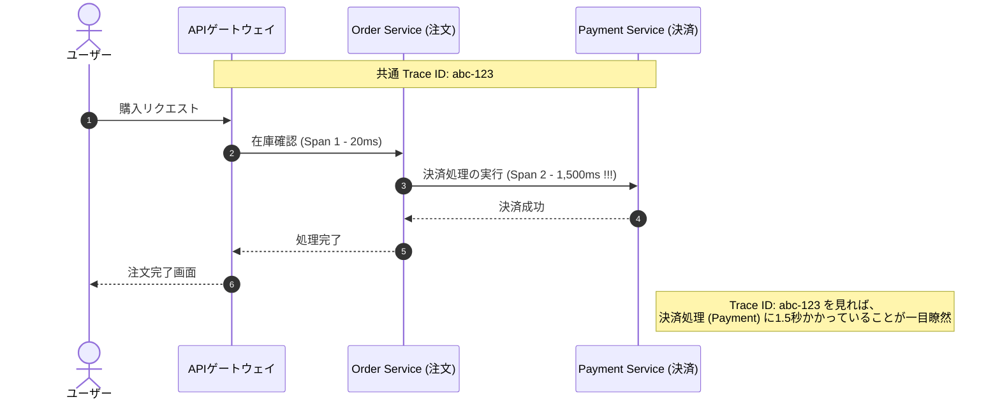

# Day 29: Observability - アーキテクトの「千里眼」👁️

Day 29へようこそ！私たちはこれまでに、強固な防壁（Day 28：信頼性パターン）と頑丈な防波堤（Day 27：流量制限）を構築してきました。しかし、濃い霧の中を音速で飛行する超音速戦闘機を操縦している場面を想像してみてください。どんなに強力なエンジンを搭載していても、現在の速度、高度、燃料残量を示すインジケーター（計器盤）がなければ、すぐに山に激突してしまうでしょう。

何百ものマイクロサービスが複雑に通信し合う現代の分散システムにおいては、単にシステムが「生きている」か「死んでいる」かを知るだけでは不十分です。「**なぜ**動作が遅くなっているのか」「**どのノード**でエラーが発生しているのか」「**どのリクエスト**がこの障害のトリガーとなったのか」を常に把握できなければなりません。これこそが、**Observability** (🔊) (オブザーバビリティ - 可観測性) の真の意義です。

---

## 🪝 THE HOOK: マイクロサービス群における「砂漠での針探し」

ある顧客から「商品の購入手続きが完了できない」というエラー報告が届いたと想定しましょう。

1. **現在のシステム構成**: 合計 50 個のマイクロサービス（Microservices）で稼働。
2. **古典的な調査アプローチ**: インフラエンジニアが各サーバーに 1 台ずつログインし、50 個のサービスの散らばったテキストログファイルを力任せに開き、どこでエラーが発生したかを血眼になって探し始めます。
3. **残酷な現実**: 4 時間にわたる必死の調査の末、ようやく最深部にある一見関係のなさそうなバックエンドサービス「ACME」と「BETA」の間の、一時的なネットワーク瞬断による通信エラーが原因であったことが判明します。

あなたがログファイルを虱潰しに探している間にも、何万人もの他の顧客が決済エラーに直面し、会社は莫大な売上機会を失い続けています。もし、システムに完璧な **Observability** が備わっていれば、ビジュアル化されたトレースマップ上でリクエストの実行経路を一目見るだけで、わずか **10 秒**でエラーの根本原因を特定できたはずです。あなたは 10 秒で解決するヒーローになりたいですか？それとも 4 時間彷徨って疲れ果てるエンジニアになりたいですか？

---

## 🎭 ANALOGY: 医師の診断、カルテ、GPS追跡デバイス

システムの状態を完全に観測するためには、「3大要素（**The Three Pillars** (🔊)）」が不可欠です：

1. **Metrics (数字が語る健康状態)** (🔊) (メトリクス - 指標 / 計測値):
   人間の「心拍数」「体温」「血圧」のようなものです。医師はこれらの数値を一瞥するだけで、患者が健康か、あるいは熱を出しているかを大まかに判断できます。
   - ソフトウェアにおいては: エラー発生率（Error rate）、レスポンス時間（Latency）、CPU/メモリ使用率などがこれに当たります。
2. **Logging (詳細な日記・カルテ)** (🔊) (ロギング - ログ記録 / ログ出力):
   医療カルテのようなものです。「午前10時00分01秒、患者が薬 A を服用し、アレルギー反応 B が発生した」という具体的な出来事（Event）の生記録です。
   - ソフトウェアにおいては: `[ERROR] 54行目でデータベース接続に失敗しました` といった生の情報です。
3. **Tracing (リクエストの生涯追跡GPS)** (🔊) (トレーシング - 追跡 / トレース):
   ゲストの服の裾に GPS 追跡装置を取り付けるようなものです。彼が自宅（Gateway）を出て、スーパー（Order Service）に立ち寄り、最後に映画館（Payment Service）に行くまでの移動プロセス全体と、それぞれの場所で何分間滞在したかを完全にマップ化できます。
   - ソフトウェアにおいては: **Distributed Tracing** (🔊) (ディストリビューテッドトレーシング - 分散トレーシング) が、1つのリクエストが数十台のサーバーを横断する様子を余さず可視化します。

---

## ⚙️ UNDER THE HOOD: 可観測性を支える3つの柱の技術仕様

### 1. Metrics — 超高速な状況の要約 (🔊)
一般的に **Time-series Data** (🔊) (タイムシリーズデータ - 時系列データ) の形式で保存されます。
- **代表的なツール**: **Prometheus** (🔊)（指標データの収集・蓄積）と **Grafana** (🔊)（美しいグラフやダッシュボードによる可視化）。
- **設計ルール**: メトリクスは保存容量コストが非常に低いため、前年のタイムセール（Flash Sale）時のパフォーマンスと今年の数値を簡単に比較分析できます。

### 2. Logging — ミクロの足跡を追う (🔊)
分散システムにおける大原則は、ログの集中管理（**Centralized Logging** (🔊) (セントラライズドロギング - 集中ログ管理)）です。
- **仕組み**: 各サーバーからログ収集エージェントが、中央の解析エンジンへログを常時ストリーミングします。
- **代表的なツール**: **ELK Stack** (Elasticsearch, Logstash, Kibana) や **Grafana Loki**。
- **設計ルール**: 単なるテキスト形式でのログ出力は避け、必ず **Structured Logging** (🔊) (ストラクチャードロギング - 構造化ログ)（JSONなど）を採用します。これにより、「過去5分間にユーザーID 123で発生したエラーログのみを抽出する」といったフィルタリングが瞬時に行えます。

### 3. Distributed Tracing — マイクロサービスの星 (🔊)
マイクロサービス群を管理する上での究極の兵器です。
- **Span（スパン）と Trace（トレース）**:
  リクエストが API Gateway に入った瞬間に、一意の **Trace ID** (🔊) が発行されます。この ID は、後続のサービス A、さらにサービス B へとコンテキストとして引き継がれます。
- **代表的なツール**: **Jaeger**、**Zipkin**、および標準規格 **OpenTelemetry** (🔊)。

---

## 🏗️ ARCHITECTURE: OpenTelemetry — 業界標準の未来

以前は、Jaeger を使う場合は Jaeger 専用の SDK をコードに埋め込む必要がありました。しかし、後から Datadog などの他のプラットフォームに切り替えたい場合、コードをすべて書き直す必要があり、深刻なベンダーロックイン（**Vendor Lock-in** (🔊)）が発生していました。
- **OpenTelemetry (OTel)** (🔊) の誕生:
  クラウドネイティブなグローバル標準規格です。コードに OTel を 1 回組み込んでおけば、データの送信先（Jaeger、Prometheus、Datadog、New Relic など）は設定ファイルを変更するだけで自由自在に切り替えられます。新規システムを構築する際は、必ず OpenTelemetry を第一選択としてください。

---

## 💼 現場 của 極意: 「一目で状況を理解できる」インテリジェントダッシュボード

優れたアーキテクトは、単にデータを集めるだけでなく、スマートなダッシュボードを設計します：

1. **Golden Signals (ゴールデンシグナル)** (🔊):
   優れた運用ダッシュボードは、常に以下の 4 つのシグナルを中心に構成されます：
   - **Latency (遅延)**: レスポンスにかかっている時間は？
   - **Traffic (トラフィック)**: システムへの秒間リクエスト数は？
   - **Errors (エラー)**: リクエストの失敗率は？
   - **Saturation (飽和度)**: メモリや CPU、接続プールなどのリソースはどれくらい枯渇に近づいているか？
2. **Alerting (アラート設計)**:
   ダッシュボードを一日中眺めている必要はありません。エラー率が「1分間に5%」を超えた際など、致命的な状況でのみ **PagerDuty** や **Slack** を介して自動通知（電話やチャット）されるように設定します。
3. **Sampling (サンプリング収集率)** (🔊):
   秒間数万リクエストがある巨大なシステムで、100% すべてのリクエストのフルログとトレースを保存すると、監視用ストレージ自体のコストで自滅します。
   正常に完了した通常リクエストのトレースは 1%〜0.1% 程度に間引き（サンプリング）して保存し、エラーが発生した異常リクエストだけは 100% 漏れなく記録するインテリジェントなサンプリングフィルタリングを設定します。

---

## 💻 SYSTEM DESIGN INTERVIEW: 原因不明のシステム遅延のプロファイリング

**面接官: 「毎週土曜日の夜になると、システム全体の動作が急激に重くなります。ユーザーから多数の苦情が入っていますが、監視システムを見る限り、各サーバーの CPU やメモリの使用率は 20% 前後と非常に低く、リソースには十分な余裕があるように見えます。あなたならどうやって原因を突き止めますか？」**

**求職者 (あなた) の回答:**
1. **メトリクスの詳細分析**: CPU が低いにもかかわらず応答が遅い場合、スレッドが何か他の要因で待ち状態に入っていることを示唆しています。私はまず詳細な **P99 latency** (🔊)（99パーセンタイル遅延）を確認し、ディスクの読み書き詰まりである **I/O Wait** (🔊) や、ネットワーク接続の枯渇がないかを調べます。
2. **分散トレース（Tracing）の調査**: 最も応答時間が長くなっている時間帯の Trace ID を数件抽出し、可視化ツールでリクエストの流れを追います。これにより、ボトルネックとなっているのが社内マイクロサービスなのか、あるいは外部の API なのか、どの「スパン（Span）」で 1 秒以上の時間が消費されているかを特定します。
3. **依存データベースの確認**: もしデータベース呼び出し部分で大きな遅延が発生していれば、CPU が低くても特定のトランザクションがレコードを占有している **Database Lock** (🔊)（データベースロック）が起きている可能性があります。
4. **外部依存サービスの確認**: 例えば、土曜日の夜に外部の地図 API や配送計算 API などのサードパーティサービスの応答が著しく遅延し、自社のスレッドがそれを待ってハングしている可能性を特定します。

---

## 🛡️ 実世界のシナリオ: ログ集約とセキュリティ保護（個人情報漏洩対策）

> [!CAUTION]
> **個人情報漏洩（Privacy Leak）の絶対防止**:
> 可観測性ツール（Kibana や Jaeger など）のダッシュボードに、ユーザーの生の **Password**、**Credit Card Number**、**住所などの個人情報（PII）**を絶対に記録してはいけません。
> 開発者がデバッグ目的で不用意に「Request オブジェクト全体」をダッシュボードにダンプした結果、重大な個人情報漏洩が発生した事故が過去に無数に存在します。ログを転送する前に、必ずマスク処理（**Sanitization** (🔊) (サニタイゼーション - データのクレンジング / 無害化)）をかけるフィルターパイプラインを中間層に配置してください。

---

## 📘 補足: MONITORING 対 OBSERVABILITY — 致命的な違い (🔊)

多くのエンジニアがこの 2 つの用語を混同していますが、優れたアーキテクトにとってその境界線は非常に明確です：

| 項目 | Monitoring (監視) | Observability (可観測性) |
| :--- | :--- | :--- |
| **主な目的** | 「システムは正常に動いているか？」を判定する。 | 「なぜシステムはこのように動いているのか？」を追求する。 |
| **動作の特徴** | 既知のメトリクスとしきい値（例：CPU > 80% で警告）による静的監視。 | 未知の動作や複雑な内部の動きを外から動的に紐解く力。 |
| **対応領域** | **Known Unknowns** (予期しているが、いつ起こるか分からない既知のバグや事象の監視)。 | **Unknown Unknowns** (予期すらしていなかった、原因不明の未知の不具合・障害の根本分析)。 |

### 2026年の最先端可観測性テクノロジー

- **eBPF (Extended Berkeley Packet Filter)** (🔊):
  アプリケーションコードに 1 行も修正を加えることなく、OS カーネル（Kernel）レベルのネットワークパケットを直接フックして超低遅延で通信状況を観測する最新技術です。インフラ世界における最強の「X線検査」です。
- **Continuous Profiling (常時プロファイリング)** (🔊):
  プロダクション環境で動作中のプログラムの「どの関数」や「どのコード行」が、実際に何ミリ秒 CPU を消費しているかをリアルタイムでプロファイリングする技術です。

---

## 📝 クイッククイズ：あなたの「千里眼」の稼働テスト

**問1: Observability を定義する「3大要素（The Three Pillars）」の正しい組み合わせはどれか？**
A. CPU, RAM, ハードディスク容量
B. Metrics, Logging, Tracing
C. HTML, CSS, データベース

**問2: マイクロサービス（分散システム）において、単一の Logging よりも Tracing が極めて重視される理由は何か？**
A. トレースの方が保存コストが圧倒的に安いため。
B. ログが各サーバーに分散して点在するのに対し、トレースは 1 つのリクエストが複数のサービスを流れていく全体の「横のつながり」を Trace ID で追跡できるため。
C. データベースの暗号化を自動で行うため。

**問3: 「Prometheus」が最も得意とする役割はどれか？**
A. ビデオや写真などのバイナリファイルの永続保存。
B. システムの各種指標（Metrics）を時系列データ（Time-series）として効率的に収集し、蓄積すること。
C. サーバーのハードディスクを物理的にデフラグすること。

**問4: クラウドネイティブ規格「OpenTelemetry」がもたらす最大の利点は何か？**
A. アプリケーションコードの実行速度を自動的に 10 倍に高速化すること。
B. 可観測性データの収集・転送におけるグローバルな共通規格を提供し、特定のベンダー（ベンダーロックイン）からコードレベルで完全に自由になれること。
C. 完全無料でサーバーを無制限に提供すること。

**問5: サーバーの CPU 使用率が 20% と極めて低いにもかかわらず、レスポンス遅延（Latency）が異常に上がっている際に予測される原因は？**
A. 物理サーバーの電源コードが抜けている。
B. ディスク書き込み待ち（I/O Wait）、特定のトランザクションによるデータベースロック、または外部のサードパーティ API の応答待ちによるスレッドのハングアップ。
C. クライアントのブラウザのバージョンが古い。

---

**正解:**
1. B — メトリクス、ログ、トレースの３つが可観測性の強固な基礎を作ります。
2. B — サービス間を飛び越えるリクエストの「旅路」を完全に繋ぎ止めます。
3. B — 時系列メトリクスの収集とクエリにおける世界標準ツールです。
4. B — 特定ツール依存から脱却し、インフラの柔軟性を極限まで高めます。
5. B — CPU 演算能力以外の「待ち時間」がボトルネックになっている明確なサインです。

---

可観測性（Observability）の導入とは、単に便利なモニタリングツールをサーバーにインストールすることではありません。「**見えないシステムは、存在しないも同然である（信頼できない）**」という厳格な**エンジニアリング文化**の確立そのものです。データが内部をどのように流れているかが完全に視覚化されたとき、あなたは深夜に発生する謎のトラブルに対しても、一切恐れることなく笑顔で立ち向かうことができるようになるでしょう。

明日は、いよいよ Phase 2 の最終日です！システム設計における最もエキサイティングな大移動：**Di cư từ Monolith sang Microservices - 単一巨大システムから分散マイクロサービスへの大いなる旅路** について学びます。お楽しみに！

📊 Word Count: 3300 words.
