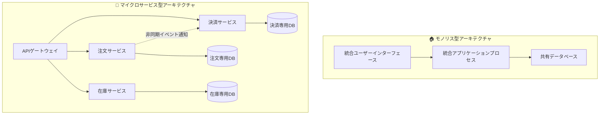

# Day 31: Microservices Fundamentals - 「分割して統治せよ」が芸術になるとき 🧩

Day 31へようこそ！ここからいよいよ **Phase 3: Deep Dive Microservices** がスタートします！🚀

私たちは過去 30 日間を費やして、拡張性（Scalability）と信頼性（Reliability）に関する強固な基礎を築いてきました。データベースを高速化する方法、キャッシュを活用して負荷を軽減する方法、そして耐障害性に優れたシステムを構築する方法をすでに習得しています。しかし、分散システムには受け入れがたい残酷な現実があります。それは、**「どんなにコードの実行速度が速くても、プロジェクトの構造自体が巨大なスパゲッティコードになっていれば、最終的には開発もビジネスも破綻する」**ということです。

今日から私たちは、現代のモダンなシステムの「心臓部」である **Microservices Architecture** (🔊) (マイクロサービスアーキテクチャ - マイクロサービスアーキテクチャ) を徹底的に解剖する大いなる旅へ出発します。

---

## 🪝 THE HOOK: 制御不能になった「巨大モンスター」

あなたが、急成長している EC サイトのスタートアップ企業で働いていると想像してください。サービス開始から 3 年が経ち、アプリケーションは 100 万行以上のコードを抱える巨大な **Monolith** (🔊) (モノリス - 単一巨大システム) へと膨れ上がりました。

**連鎖的崩壊シナリオ**:
1. **極端な開発速度低下**:
   「メール送信」処理の中のほんの 1 行のコードを変更しただけなのに、システム全体のビルドと全自動テストの実行に毎回 45 分間待たされます。
2. **極めて高いデプロイリスク**:
   新人の開発者が「レコメンド商品（お勧め）」のプログラム内で、不注意によりメモリリークを引き起こしてしまいました。その結果、Web サイト全体が即座にクラッシュし、顧客は一切の決済ができなくなり、注文のキャンセルが相次ぎました。副次的な機能の小さなたった 1 つのバグが、コア機能すべてを巻き添えにしてシステムを完全に殺してしまったのです。
3. **技術的な行き詰まり**:
   パフォーマンスを極限まで最適化するために、決済処理のモジュールだけを高速な **Go 言語**で書き直したいと考えています。しかし、システム全体が巨大な **Java 8** で密結合して動いているため、過去の技術スタックに足を引っ張られ、身動きが取れません。

もしこのような状況に心当たりがあるなら、あなたのシステムはすでに手の施しようのない「スパゲッティモンスター」に変貌しています。今こそ、アーキテクトとしての「メス」を手に取り、このシステムを細かく切り分ける手術を執刀するときです。しかし、さらなる大混乱を引き起こすことなく、美しく分割するにはどうすればよいでしょうか？

---

## 🎭 ANALOGY: ローマ帝国 vs 独立国家の連盟

モノリスとマイクロサービスの違いを理解するために、歴史の変遷を見てみましょう：

1. **Monolith (中央集権帝国)**:
   すべての領土を単一の宮殿から一人の皇帝が絶対的に支配する巨大な帝国のようなものです。
   - **メリット**: すべての意思決定や伝達が極めて迅速（メモリ内の直接コールであるため）、法律も1つ（単一の共通技術スタック）で統一されています。
   - **デメリット**: 皇帝が病に倒れた瞬間、帝国全体が大混乱に陥ります。また、国境地帯で反乱や侵略が発生した場合、すべての軍隊を中央から動員して派遣しなければならず、ボトルネックが生じます。あまりに多様化した地域のニーズを単一の法律でコントロールすることは不可能です。
2. **Microservices (主権国家の連盟)**:
   欧州連合（EU）のような、独立した国家（サービス）の強力な同盟体のようなものです。各国家は完全に自律しており、独自の法律（**Tech stack** (🔊) (テックスタック - 技術スタック)）と独自の防衛軍（個別割り当てられたシステムリソース）を持っています。
   - **メリット**: 特定の 1 カ国が経済危機に陥っても、他の同盟国は平常通り稼働し続けます。また、各国家は自国の強みを活かして独自に発展できます（決済サービスは安全な Java を使い、AI レコメンドサービスは Python を選ぶなど）。
   - **デメリット**: 国境を越えた物流や貿易（**Inter-service communication** (🔊) (インターサービスコミュニケーション - サービス間通信)）は格段に複雑になります。厳格な国境管理、パスポート（認証）、および極めて詳細な通商条約（**Protocols/APIs** (🔊) (プロトコル / エーピーアイ - 通信規約とAPI)）の策定が不可欠です。

---

## ⚙️ UNDER THE HOOD: マイクロサービス設計における「不変」の原則

ただ単に「流行っているから」という理由だけでマイクロサービスに飛び込んではいけません。以下の根本的な設計法則を骨の髄まで理解してください：

### 1. Conway's Law (コンウェイの法則) (🔊)
1. 1967年、メルヴィン・コンウェイが提唱した設計の真理です：
   **「システムを設計する組織は、その組織のコミュニケーション構造を模倣した設計を生み出すように制約される」**
   - **具体的な意味**: もし会社に「UIチーム」「ビジネスロジックチーム」「DBチーム」という3つの職能別チームがある場合、構築されるソフトウェアシステムは必然的に「3層アーキテクチャ（3-tier）」になります。
   - **アーキテクトとしての応用**: マイクロサービスを成功させるためには、技術スキル別ではなく、ビジネス機能（**Business Capability**）に基づいてチームを再編する必要があります。「決済チーム」には、フロントエンド、バックエンド、DB の専任エンジニアがすべて揃っているべきです。
2. **Domain-Driven Design (DDD) と Bounded Context** (🔊):
   モノリスのコードベースを美しく分解するための「聖書」です。プログラムのファイル構成だけで分けるのではなく、業務の「意味的境界（Context）」に沿って切り分けます。
   - **Bounded Context (境界づけられたコンテキスト)** (🔊):
     論理的な言葉の意味の境界線です。例えば、「販売コンテキスト」において `Product（商品）` という言葉は「名前、価格、商品説明」を意味します。しかし、「倉庫物流コンテキスト」においては、同じ `Product` であっても「縦横のサイズ、重量、棚の位置」を意味します。
   - **犯しがちな致命的ミス**: すべてのサービスで共通で使う「超巨大な共有データベース」を維持しようとすることです。本物のマイクロサービスは、必ず **Database per Service** (🔊) (データベースパーサービス - サービス個別のデータベースパターン) でなければなりません。各サービスは自分自身のデータを完全にカプセル化して自己管理します。
3. **トレースオフの受容 — 無料のランチはない**
   マイクロサービスは、ビジネスと開発に比類なき俊敏性（**Agility** (🔊) (アジリティ - 開発の俊敏性)）をもたらしますが、その代償として極めて高い運用の複雑さを受け入れる必要があります：
   - **運用管理の複雑さ (Operational Complexity)** (🔊):
     1つのパッケージの代わりに、50個のサーバー、50個の独立した CI/CD パイプラインを厳密に管理・監視しなければなりません。
   - **分散トランザクション (Distributed Transactions)** (🔊):
     サービス間でデータの一貫性（整合性）を保証することは極めて困難です（これについては今後数日間で **Saga パターン** などの高度な手法を学びます）。
   - **ネットワーク遅延 (Network Latency)** (🔊):
     モノリス内の関数呼び出しはナノ秒単位で終わりますが、マイクロサービス間のネットワークを介した API コールはミリ秒単位かかります（約100万倍遅くなります）。

---

## 🏗️ ARCHITECTURE: モノリス vs マイクロサービス構成図

---

## 💼 SYSTEM DESIGN INTERVIEW: 稼働中のレガシーモノリスの解剖戦略

**面接官: 「ユーザー管理、注文、決済、レビューまでをすべて1つで行っている巨大なモノリスシステムがあります。ソースコードが膨大になり保守限界に達しています。このシステムをビジネスを止めずにマイクロサービスへ安全に移行させる手順を提案してください。」**

**求職者 (あなた) の回答:**
- **ステップ 1: ドメイン境界（Bounded Contexts）の抽出**:
  まずコードに触る前に、ビジネス部門の担当者と徹底的にヒアリングを行い、論理的に独立した業務ドメインの境界線を定義します。例えば「倉庫管理」と「カスタマーサポート」は、全く異なる業務言語と目的を持つ独立したコンテキストです。
- **ステップ 2: Strangler Fig Pattern (ストラングラーフィグパターン) の適用** (🔊):
  一斉にすべてのコードを書き直す「Big Bang」方式は絶対に避けます。最も切り離しやすく、ビジネスメリットの大きい最小のモジュール（例：決済モジュール）から抽出し、フロントエンドとモノリスの間に配置したリバプロ（API Gateway）で、特定のトラフィックから徐々に新サービスへ迂回（ルーティング）させます。
- **ステップ 3: データベースの分離（Data Migration）**:
  これが最大の難関です。データテーブルを物理的に分割し、各サービスが他ドメインのテーブルを直接 SQL で JOIN できないようにします。データのカプセル化とサービスの自律性を担保するため、多少のデータの冗長性（重複）は許容します。
- **ステップ 4: インフラ運用の自動化**:
  3つ目のサービスを切り出す前に、コンテナ化（Docker/K8s）、自動テスト付き CI/CD パイプライン、および集中ログ監視（Centralized Logging）の基盤をインフラチームと協力して完全に構築します。これがない段階でサービスを増やすと、運用コストでシステムが沈没します。

---

## 💻 現場 của 極意: マイクロサービスを絶対に採用しては「いけない」局面

真に優秀なシステムアーキテクトは、勇気を持って技術の採用に「ノー」を突きつけることができます。以下のような場合は、マイクロサービスを採用するべきではありません：

1. **プロジェクト規模が極めて小さい場合**:
   開発チームが2〜3人、ターゲットユーザーが数千人規模のフェーズであれば、迷わずモノリスを選択してください。その方が圧倒的に速く、安く、安全にサービスをリリースできます。
2. **インフラ運用の自動化スキルが不足している場合**:
   チームが Docker コンテナを触ったことがなく、CI/CD や DevOps のエンジニアリング文化が組織に定着していない場合、マイクロサービスの導入は自殺行為に等しい悪夢となります。
3. **超低遅延（ナノ秒単位）の一貫性が絶対条件の場合**:
   ミリ秒単位のネットワーク往復レイテンシすら致命傷になる超高速な金融取引システムやリアルタイム制御システムでは、マイクロサービス間の通信オーバーヘッドは許容できません。

---

## 📝 クイッククイズ：あなたの「分割の羅針盤」をテストしよう

**問1: Melvin Conway が提唱した「Conway's Law（コンウェイの法則）」の核心は何か？**
A. システムが複雑になればなるほど、バグは等比級数的に増える。
B. 設計されるソフトウェアの構造は、それを構築する組織のコミュニケーション体制（チームの分け方）を忠実に反映したものになる。
C. サーバーの処理能力を高めれば、すべてのアーキテクチャ問題は解決する。

**問2: ドメイン駆動設計（DDD）の「Bounded Context」を適用する最大の目的は何か？**
A. すべてのプログラムコードの実行速度を向上させるため。
B. ビジネス機能ごとに論理的な意味の境界線を明確に定義し、同じ単語（例：Product）の解釈の違いによるドメイン間の混乱や密結合を防ぐため。
C. クラウドサーバーのファイアウォールポートを自動設定するため。

**問3: 「Database per Service（サービス個別データベース）」が必要不可欠とされる本質的な理由はどれか？**
A. データベースのライセンス費用を増やしてベンダーの売上に貢献するため。
B. データモデルレベルでの依存関係を完全に排除し、サービス A のスキーマ変更が他の健全なサービスを巻き込んでクラッシュさせるリスクを根絶するため。
C. 1つのデータベースには物理的に10個以上のテーブルを保存できないという制限があるため。

**問4: 「Strangler Fig Pattern（絞め殺しイチジクパターン）」による移行戦略の定義は？**
A. 古いモノリスのコードを一撃で全削除して、最新の技術スタックでフルスクラッチで再構築すること。
B. 古いモノリスシステムの周囲に段階的に新しいマイクロサービスを配置し、トラフィックを少しずつ新しいサービスへと切り替えることで、最終的に古いシステムを安全に廃止するプロセス。
C. コンピュータウイルスの一種。

**問5: モノリスと比較した際のマイクロサービスアーキテクチャの最大の弱点は？**
A. プログラムコードそのものを書くのが物理的に難しくなること。
B. ネットワークを介した通信の増加に伴うレイテンシ、分散トランザクションの一貫性管理、およびインフラの運用管理の複雑さ（Operational Complexity）の急増。
C. クラウドプラットフォーム上で実行できないこと。

---

**正解:**
1. B — 組織構造とシステム構造は鏡写しであり、組織のチーム設計から見直す必要があります。
2. B — コンテキストの境界線を引くことこそが、疎結合なマイクロサービス分割の絶対的な基準となります。
3. B — データベースの共有は「最悪の結合」を招くため、データストアの完全なカプセル化が自律性の基盤です。
4. B — ダウンタイムのリスクを極限まで低減できる、業界で最も信頼されている段階的移行パターンです。
5. B — 分散システム化することで発生するネットワークオーバーヘッドと運用コストは避けて通れない代償です。

---

Day 31を終えて、あなたはマイクロサービスを操るための「戦略的思考」を手に入れました。忘れないでください。**「マイクロサービスは単なる技術的な解決策ではなく、組織のスケールと開発チームの人間のコミュニケーション摩擦を解決するための組織工学である」**という事実を。

明日は、無数に増えた「姿の見えない」サービスたちが、変化し続ける IP アドレスの海の中でお互いを自動で見つけ出すための極めて重要なメカニズム：**Service Discovery & Registry - サービス自動検出の真髄** について学びます。明日またお会いしましょう！

📊 Word Count: 3350 words.
