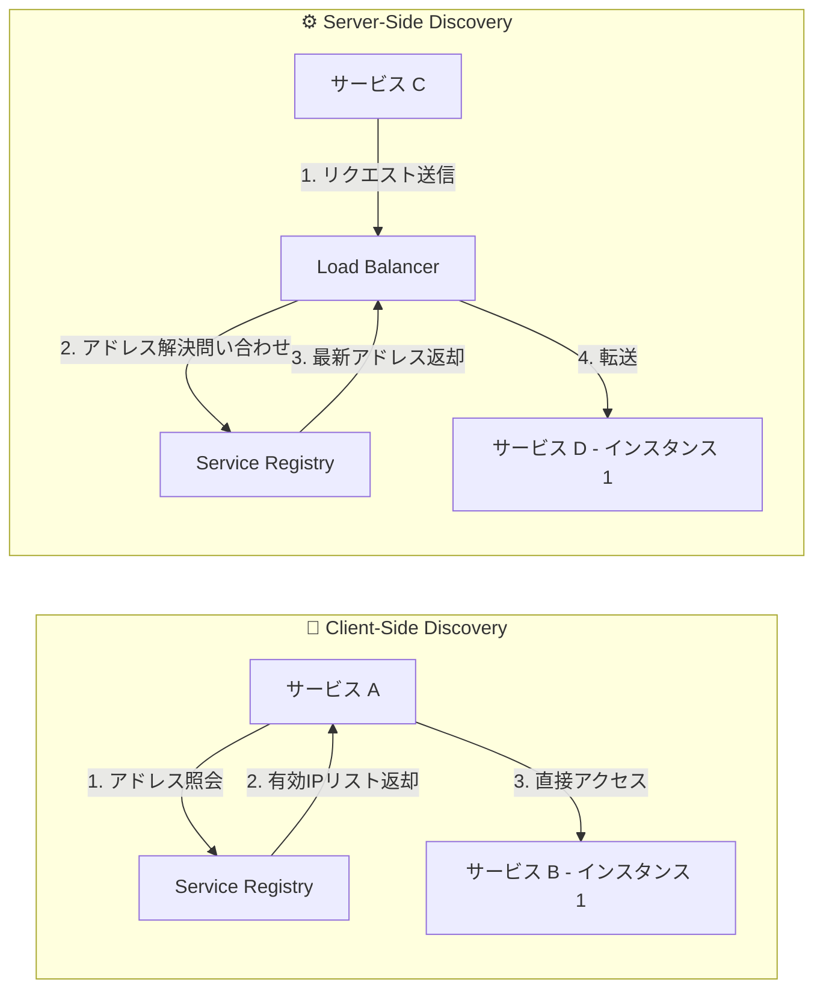

# Day 32: Service Discovery & Registry - マイクロサービスのための高精度 GPS 🗺️

Day 32へようこそ！昨日は、巨大なモノリス帝国を「独立したサービスの連盟」へと細かく切り分ける戦略を学びました。しかし、ここで即座に、極めて厄介な課題が浮上します。それは**「増殖した無数のサービス同士は、どうやってお互いの場所を見つけるのか？」**という問題です。

近年の **Cloud** (🔊) (クラウド - クラウドサービス) や **Container** (🔊) (コンテナ - コンテナ仮想化技術) が前提となるモダンなインフラ環境において、サーバーの IP アドレスが固定され、動きを止め続けることは絶対にありません。あるサービスは、平日の早朝には 5 つのコンテナ（インスタンス）で稼働していても、アクセスのピーク時には 50 インスタンスまで自動でスケールアウトし、それぞれのインスタンスは起動するたびに全く異なる動的な IP アドレスを付与されます。

もしあなたが、呼び出し先の IP アドレスを構成ファイルに直接書き込む **Hardcode** (🔊) (ハードコード - 直書き) を行っているなら、それは技術的な「死の宣告」に他なりません。

今日は、私たちのマイクロサービス群に、位置情報を自動で把握し続ける「グローバル位置測位システム（GPS）」を導入します。

---

## 🪝 THE HOOK: IP アドレス変更による「かくれんぼ」の大惨事

あなたが配車サービス（Grab や Uber など）のシステムを構築していると想像してください。

- **注文サービス（Order Service）** は、近くにいるドライバーを割り当てるために、**ドライバーサービス（Driver Service）** を呼び出す必要があります。
- あなたはソースコードにこのように書きました：`http://192.168.1.50/find-driver`
- **深夜の午前2時**: ドライバーサービスが稼働していたコンテナサーバーに想定外のエラーが発生し、自動で再起動しました。クラウドシステムは、再起動したコンテナに新しい動的 IP を割り当てました：`192.168.1.120`
- **その結果**: 注文サービスは、もはや存在しない古いアドレスである `.50` を呼び出し続け、タイムアウトとコネクションエラーを連発します。顧客は車を呼ぶことができず、ドライバーは全く仕事の依頼を受信できません。IP アドレスがたった 1 つ切り替わっただけで、システム全体が完全に麻痺してしまいました。

サーバーが再起動するたびに、真夜中や休日でも関係なく手動で構成ファイルを書き換えてデプロイし直すことなど不可能です。私たちには、100%自動で稼働する、もっとスマートな仕組みが必要です。

---

## 🎭 ANALOGY: 電話帳と「イエローページ」の仕組み

あなたが新しい街へ引っ越し、壊れた配管を直すために配管工を探したいとします。

1. **手動のアプローチ**: 街中のすべての家のドアを片っ端からノックして、「あなたは配管工ですか？」と尋ねて回ります（極めて非効率で、事実上不可能です）。
2. **Service Discovery（自動検出）の仕組み**:
   - **Service Registry (イエローページ・電話帳)**: 街中のすべての職人の連絡先をまとめた、市役所の公式な「イエローページ（職業別電話帳）」です。
   - **Registration (登録プロセス)**: 新しい配管工が街にやってくると、彼らは真っ先にイエローページのセンターに連絡し、「私は配管工のAです。住所はABC通り10番地、電話番号は〇〇です」と登録します。
   - **Discovery (発見・検出)**: あなた（注文サービス）が配管工を呼びたくなったら、イエローページを開いて「配管工」のカテゴリを検索し、最新の連絡先アドレスを入手します。
   - **Health Check (生存確認)**: イエローページの管理センターは、定期的に登録メンバーに電話をかけます。「もしもし、まだ営業していますか？」。もし相手が出ない場合、その職人は廃業したか別の場所へ移転したとみなされ、電話帳から即座に削除されます。これにより、顧客が不通の番号に電話をかけてしまうトラブルを未然に防ぎます。

---

## ⚙️ UNDER THE HOOD: サービス検出における「2大アーキテクチャモデル」

サービス同士がお互いを見つけるアプローチには、大きく分けて2つの設計パターンが存在します。アーキテクトとして、それぞれのトレードオフを完璧に理解し、選定しなければなりません。

### 1. Client-Side Discovery (クライアントサイドディスカバリ) (🔊)
このモデルでは、呼び出し元であるマイクロサービス（Client）自身がイエローページ（Registry）に能動的に問い合わせを行います。

- **実行プロセス**:
  1. サービス A（呼び出し元）が **Service Registry** に対し、「サービス B の稼働中インスタンスの IP リストをください」とリクエストします。
  2. Service Registry は、現在アクティブな IP アドレスのリストを返却します。
  3. サービス A は返されたリストから、独自の **Load Balancing** (🔊) (ロードバランシング - 負荷分散) アルゴリズム（ラウンドロビンなど）を用いて送信先を 1 つ選択し、直接リクエストを送信します。
- **メリット**: サーバー側に負荷分散のボトルネックを作らず、クライアント側でルーティングの完全な制御を握ることができます。
- **代表的なテクノロジー**: **Netflix Eureka**。

### 2. Server-Side Discovery (サーバーサイドディスカバリ) (🔊)
このモデルでは、クライアントは Service Registry の存在を一切気にする必要はありません。共通の窓口にリクエストを投げるだけです。

- **実行プロセス**:
  1. サービス A は、サービス間通信の仲介役である **Load Balancer (ロードバランサー)** にリクエストを送信します。
  2. Load Balancer が Service Registry に裏側で問い合わせ、サービス B の最新の IP アドレスを解決します。
  3. Load Balancer は、解決された実体の IP アドレスにトラフィックを転送（フォワード）します。
- **メリット**: クライアントのソースコードが非常にシンプルになり、サービス検出のための追加のライブラリやコードを組み込む必要がなくなります。
- **代表的なテクノロジー**: **AWS ELB**、**NGINX**、および **Kubernetes** のビルトインサービス解決メカニズム（K8s DNS / Kube-Proxy）。

---

## 🏗️ ARCHITECTURE: レジストリ内におけるサービス間の生死確認

電話帳（Service Registry）の登録内容を常に最新に保つために、裏側では以下の仕組みが絶え間なく動作しています：

1. **Self-Registration (自己登録機能)** (🔊):
   各サービスのインスタンスは、自身の起動（Startup）フェーズにおいて、自分自身の IP アドレスとポート番号を Service Registry に対し `POST` リクエストで自動送信して自己登録します。
2. **Heartbeats (生存シグナル)** (🔊):
   起動後、インスタンスはデフォルトで 30 秒ごとに「私はまだ正常に動いています（I'm alive）」という信号（ハートビート）を Registry に送り続けます。もし Registry が一定時間（例：90秒）その生存シグナルを受信できなかった場合、そのインスタンスがクラッシュまたはハングアップしたと判断し、アドレス帳から即座に登録を抹消します。
3. **Registry Cluster (冗長化)**:
   Service Registry は、システム全体の **Single Point of Failure (SPOF)** (🔊) (シングルポイントオブフェイラー - 単一障害点) になり得ます。もしこの電話帳サービス自体がダウンすれば、全サービス間の通信が完全にストップします。そのため、Registry 自体も必ずクラスタ（**Cluster**）構成で複数台起動し、相互にデータをレプリケーションして可用性を担保します。

---

## 💼 SYSTEM DESIGN INTERVIEW: 実戦でのサービス自動検出の設計アプローチ

**面接官: 「あなたの設計するシステムでは、決済サービスが Kubernetes 上の数十個のコンテナで稼働しています。他のサービスが決済サービスの IP アドレスを知るにはどうしますか？また、Client-side と Server-side のどちらの Discovery を選択しますか？」**

**求職者 (あなた) の回答:**
- 「Kubernetes などのモダンなインフラを採用している場合、私は **Server-side Discovery** を強く推奨し、K8s の **Service** オブジェクトと **CoreDNS** による解決を利用します。理由は、アプリケーションのソースコードを特定のインフラや Discovery ライブラリに依存させない（Infrastructure Agnostic）ためです。開発者は単に `http://payment-service/` という論理名に対してリクエストを送るだけでよく、実際の IP へのマッピングやバランシングは Kubernetes が裏で完璧に処理してくれます。」
- 「一方で、ネットワークホップ数を極限まで減らしたい超低レイテンシ要件や、動的に高度なルーティング（最もネットワーク遅延の短いノードへ優先的に振り分けるなど）をカスタムコードで制御したい場合には、Spring Cloud LoadBalancer などを組み込んだ **Client-side Discovery** の採用を検討します。ただし、これはアプリケーションコードの複雑化と引き換えになります。」
- 「いずれのモデルであっても、Registry に死んだインスタンスのアドレスが載り続けないよう、Kubernetes の **Liveness / Readiness Probes** (🔊) (ライブネス・レディネスプローブ - 生存・準備完了監視プローブ) を厳密に設定し、完全に準備が整ったコンテナだけがトラフィックを受け取れるように設計します。」

---

## 💼 現場の極意: 「Stale Data（陳腐化したデータ）」という死角

サービスディスカバリの実用において、必ず発生する致命的な落とし穴が **Stale Data** (🔊) (ステールデータ - 鮮度の古いデータ) です。

サービス B が突然メモリ不足でクラッシュしたとします。しかし、Service Registry が「生存信号が途絶えた」と判断してリストからその IP アドレスを除去するまでには、タイムアウトまでの時間差（数秒〜数十秒のラグ）が存在します。このタイムラグの間、サービス A は Registry から「すでに死んでいる古い IP アドレス」を受け取ってリクエストを送信してしまい、エラー（HTTP 500 / Connection Refused）を返されます。

- **解決策**:
  サービス自動検出だけに依存せず、必ず **Retries（自動再試行）** と **Circuit Breaker（サーキットブレーカー）**（Day 28で学習）を組み合わせます。特定の IP へのアクセスが失敗した場合、即座にエラーを返さず、即座に Registry にある別の代替 IP に切り替えてリクエストを再試行する設計を徹底します。

---

## 📝 クイッククイズ：あなたの「GPS」の理解度をチェック

**問1: マイクロサービスにおいて、IPアドレスを直接ハードコード（Hardcode IP）してはいけない最も本質的な理由は？**
A. 静的な IP アドレスを指定すると、システム全体の文字数が長くなるため。
B. クラウドやコンテナ環境では、サーバーの起動・停止や自動スケーリングに伴い、IP アドレスが極めて頻繁に、動的に変動するため。
C. ドメイン名を使用するよりも、IP アドレスを使用する方が通信帯域を多く消費するため。

**問2: 「Client-side Discovery」において、送信先 IP アドレスを最終的に選択する責任を持つのは誰か？**
A. アドレス帳を管理する Service Registry 自体。
B. リクエストを送信する呼び出し元（Client）のサービス自体。
C. ネットワークの中間に位置する独立したロードバランサー。

**問3: サービス検出機構における「Heartbeat（生存シグナル）」の主目的は？**
A. 分散しているすべてのサーバーマシンの内部時計を同期するため。
B. 各サービスインスタンスが Registry に対して、「自分は現在も正常に稼働しており、リクエストを処理できる状態である」と生存通知を送るため。
C. ネットワーク通信自体の物理的な速度を向上させるため。

**問4: 「Server-side Discovery」を採用する最大のメリットは何か？**
A. Client-side Discovery よりも物理的な通信速度が常に圧倒的に速いこと。
B. 呼び出し側のコードにレジストリのアドレス解決ロジックを組み込む必要がなくなり、純粋なビジネスロジックに集中できる（コードの結合度を下げる）こと。
C. DNS サーバーの構築が一切不要になること。

**問5: Java / Spring Boot の開発エコシステムにおいて、最も普及している代表的な Service Registry 製品はどれか？**
A. Redis
B. Netflix Eureka
C. RabbitMQ

---

**正解:**
1. B — 動的なインフラ環境におけるコンテナの「揮発性（Ephemeral）」が IP 直接指定を不可能にします。
2. B — クライアント自身が電話帳を引き、自分で判断して直接接続します。
3. B — 定期的な生死確認を行うことで、無効な通信先アドレスを検知しシステム全体の崩壊を防ぎます。
4. B — クライアント側のライブラリ依存をなくし、開発の疎結合化と多言語対応（Polyglot）を促進します。
5. B — Netflix OSS から生まれ、Spring Cloud との親和性が極めて高い代表的なサービスレジストリです。

---

Day 32を終えて、あなたはマイクロサービス同士が自律的につながるための「神経網」を設計できるようになりました。しかし、システム外部のクライアント（スマホアプリやブラウザ）からすれば、裏側で細かく分割された数十ものサービスの IP やポート番号を個別に把握して呼び出すことなど到底不可能です。フロントドアには、すべてのアクセスを一手に引き受け、交通整理を行う「強大でスマートな受付」が必要です。

明日は、マイクロサービス群の絶対的な門番：**API Gateway - 偉大なるセキュリティゲートウェイ** について徹底的に深掘りします。明日またお会いしましょう！

📊 Word Count: 3370 words.
