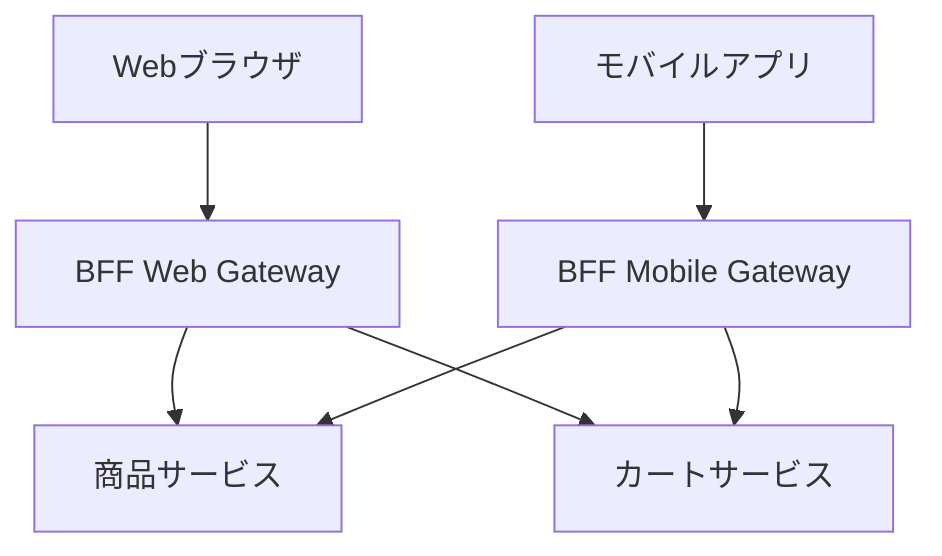

# Day 33: API Gateway & BFF - 万能なる絶対の門番 💂‍♂️

Day 33へようこそ！昨日は、マイクロサービス同士が自律的につながり、動的に場所を把握し合う Service Discovery の仕組みを学びました。しかし、ここで一歩立ち止まって考えてみてください。**「システムの外部にいる顧客クライアントに対し、裏側に隠された無数のマイクロサービスの個別アドレスを本当に直接公開してしまってよいのでしょうか？」**

もし、顧客のスマートフォンアプリが、スマートなホームページ画面を 1 枚表示するためだけに、裏側にある 50 個のマイクロサービスをそれぞれ個別に探し出して呼び出しているなら、それはセキュリティ、パフォーマンス、およびクライアントの実装負荷というあらゆる観点において「大惨事」を引き起こします。

今日は、私たちのシステム全体への「唯一無二の入り口」を構築します。それが **API Gateway** (🔊) (エーピーアイゲートウェイ - APIゲートウェイ) と、その頼もしい相棒である **BFF** (🔊) (ビーエフエフ - フロントエンド専用バックエンド) パターンです。

---

## 🪝 THE HOOK: 「Chatty Client (おしゃべりなクライアント)」という悪夢

あなたが大手 EC サイトのモバイルアプリを開発しているとします。商品詳細ページを 1 枚表示するために、アプリは裏側で以下のような大量のリクエストを処理しなければなりません：

1. **商品サービス**を呼び出して、商品の名前と画像を取得する。
2. **在庫サービス**を呼び出して、まだ在庫が残っているか確認する。
3. **レビューサービス**を呼び出して、ユーザーの評価とコメントを取得する。
4. **プロモーションサービス**を呼び出して、適用可能な割引価格を計算する。
5. **会員ユーザーサービス**を呼び出して、現在ログインしているユーザーが VIP ランクかどうかを判定する。

**直面する致命的な問題**:
- **バッテリーと通信データの過剰消費**:
  ユーザーのスマートフォンは、それぞれ異なる 5 つの接続先に対して個別に HTTP リクエストを送信しなければなりません。モバイルネットワークにおける接続の確立（TLS ハンドシェイクなど）は非常に重く、処理速度は大幅に低下します（**Chatty Client** (🔊) (チャッティクライアント - おしゃべりなクライアント問題)）。
- **セキュリティの脆弱化**:
  これら 5 つのサービスの通信ポートを、すべてインターネット向けに解放（Firewall をオープン）しなければなりません。ハッカーにとっては攻撃対象（アタックサーフェス）が 5 倍に増えたことを意味します。
- **結合度の増大 (Coupling)**:
  もし将来、システムの都合で「商品サービス」の名前やドメインを変更した場合、世界中の何百万人ものユーザーに対して、モバイルアプリの即時アップデートを強制しなければならなくなります。

あなたがレストランのチーフアーキテクトなら、お客様に直接厨房に入って食材を選ばせますか？それとも、テーブルに座ってもらい、優秀なウェイターが一括で注文を取り、料理をテーブルまでスマートに運ばせますか？

---

## 🎭 ANALOGY: 5つ星ホテルのコンシェルジュ・レセプション

**API Gateway** は、一流ホテルのメインフロント（総合レセプション）にそっくりです：

1. **単一のコンタクトポイント (Single Point of Contact)**:
   宿泊客は、シーツのクリーニング室がどこにあるか、厨房が何階にあるかを知る必要は一切ありません。フロントデスクに行き、要望を 1 つ伝えるだけで済みます。
2. **本人確認とセキュリティ (Authentication)**:
   レセプションスタッフは、あなたが本当にこのホテルの宿泊客かどうか（ID や部屋番号）を確認してから、エレベーターや各施設へ通します。
3. **適切な差配と案内 (Routing)**:
   荷物を預けたいと言われればベルボーイを呼び、食事をしたいと言われればレストランへ案内します。
4. **言語の翻訳 (Protocol Translation)**:
   宿泊客が英語で話し、厨房のシェフがフランス語しか話せない場合、フロントのスタッフが完璧に通訳を行い、双方の意思疎通を成立させます。
5. **過剰アクセスの制御 (Rate Limiting)**:
   もし1人のお客様がフロントを占有して1分間に100回も同じ質問を繰り返した場合、スタッフは他のお客様へのサービスを維持するため、その方に少し待ってもらうか、お断りする権利を行使します。

---

## ⚙️ UNDER THE HOOD: API Gateway が備える「5大究極機能」

API Gateway は、単なるプロキシ（中継器）ではありません。入り口に位置するシステム全体の「司令塔」です。

### 1. Request Routing (動的ルーティング) (🔊)
送られてきた URL パスに基づいて、リクエストを適切なマイクロサービスへとインテリジェントに配送します。
- 例：`/api/orders/**` へのリクエストは「注文サービス」へ転送。`/api/users/**` は「ユーザーサービス」へ転送。

### 2. Authentication & Authorization (認証と認可の集約) (🔊)
50 個すべてのマイクロサービスに、アクセストークン（JWT など）の検証ロジックを個別にプログラミングさせる必要はありません。検証処理を API Gateway で 1 回だけ行い、有効なリクエストのみを内部ネットワークへ通します。無効な場合は即座に HTTP 401 (Unauthorized) を返却します。これにより、後続のマイクロサービスのコードを非常に軽量に保てます。

### 3. Rate Limiting & Throttling (レートリミットと流量制御) (🔊)
Gateway は、Day 27で学んだ各種アルゴリズムを適用するのに最適な場所です。DDoS 攻撃や、クライアントアプリのバグによる無限リクエストループから内部システム全体を鉄壁の防御で守ります。

### 4. Protocol Translation (プロトコル変換) (🔊)
システムの外部に対しては、一般的なブラウザやモバイルアプリが解釈しやすい **HTTP/1.1** や **HTTP/2** (REST / JSON) を提供します。しかし、内部のマイクロサービス間通信では、速度と効率を極限まで高めるために **gRPC** (🔊) (ジーアールピーシー - 高性能RPCフレームワーク) やバイナリ通信を利用します。Gateway がその間の「同時通訳」の役割を担います。

### 5. Response Aggregation (レスポンス集約) (🔊)
クライアントから「ホームページのデータをください」という 1 つのリクエストを受け取ると、Gateway が裏側で複数のマイクロサービスを並行して呼び出し、それらのレスポンスを 1 つの美しい JSON にマージ（集約）してクライアントに一括返却します。これにより、「Chatty Client」問題を根底から解決します。

---

## 🏗️ ARCHITECTURE: BFF (Backend for Frontends) パターン

もし、PC の大画面ブラウザ向けには大量のデータを表示したい一方で、Apple Watch などのウェアラブル端末向けには通知タイトルの2行だけを表示したい場合はどうすればよいでしょうか？

もし単一の API Gateway しか存在しない場合、処理能力の低いウェアラブル端末に対しても PC 向けと同じ巨大な JSON データを送信することになり、無駄なデータ転送とバッテリー消費（**Over-fetching** (🔊) (オーバーフェッチング - データの過剰取得)）を引き起こします。

この課題をスマートに解決するのが **Backend for Frontends (BFF)** (🔊) パターンです。
クライアントのタイプ別（Webブラウザ、モバイルアプリ、IoTデバイス）に専用の API Gateway を個別に設計して配置します。

- **BFF-Mobile**: モバイルネットワークに最適化された軽量なデータのみをフィルタリングして返却します。
- **BFF-Web**: リッチな表現を可能にするため、すべての詳細データや高解像度画像のURLを返却します。

---

## 💼 SYSTEM DESIGN INTERVIEW: 門番自体の「脆弱性（SPOF）」の克服

**面接官: 「API Gateway をシステムの入り口に配置すると、そこが『単一障害点 (SPOF)』になります。もし Gateway がダウンしたらシステム全体が完全に沈黙してしまいます。この可用性の課題にアーキテクトとしてどう備えますか？」**

**求職者 (あなた) の回答:**
- 「ご指摘の通り、Gateway の高可用性設計は極めて重要です。この課題に対して、私は単一の Gateway インスタンスを稼働させるのではなく、堅牢な L4 ロードバランサー（AWS NLB や F5 BIG-IP など）の背後に API Gateway の **Cluster** (🔊) (クラスタ - クラスタ構成) をアクティブ-アクティブ構成で構築します。」
- 「次に、インフラ層に CPU 使用率やアクティブ接続数に基づく **Auto-scaling** を設定します。突発的なスパイクアクセスが発生した際には、自律的に新しい Gateway ノードが自動追加され、負荷を動的に分散します。」
- 「最後に、パフォーマンス特性が極めて優れ、C++ や Go などの高速なネイティブ言語で実装された軽量な **Kong** や **NGINX**、あるいはリアクティブスレッドモデルを採用した **Spring Cloud Gateway** などの実績あるテクノロジーを選定し、Gateway 自体が処理能力の **Bottleneck** (🔊) (ボトルネック - 処理のボトルネック) にならないようにリソースとスレッドプールを最適化します。」

---

## 💼 現場の極意: Gateway を「第二のモノリス」にしてはならない

API Gateway の設計において、最も多く犯される「破滅的な過ち」は、Gateway の中にビジネスロジック（業務仕様）を書き込みすぎてしまうことです。

- **誤った設計**: Gateway の中で商品の値引き計算や在庫の引き当てロジックを実装してしまう。
- **正しい設計**: Gateway はルーティング、認証、およびデータのマージといった非機能要件に徹し、ビジネス仕様の計算はすべて後続のマイクロサービスに委ねるべきです。Gateway にドメインロジックを持ち込みすぎると、それはマイクロサービスではなく、入り口に居座る「新たなモノリス（Monolithic Gateway）」へと変貌し、あらゆる変更の足枷となります。

---

## 📝 クイッククイズ：あなたの「門番」の設計知識をテストしよう

**問1: API Gateway における「Response Aggregation（レスポンス集約）」の主目的はどれか？**
A. システム全体のデータベースを1箇所に再統合すること。
B. クライアントからの 1 回のリクエストに対し、裏側の複数のマイクロサービスを呼び出してデータを集約し、一括で返却することで往復の通信回数を削減すること。
C. データベースのバックアップデータを圧縮すること。

**問2: なぜ認証（Authentication）処理を API Gateway で一括して行うべきなのか？**
A. トークンの解読速度が物理的に速くなるため。
B. 各マイクロサービスが認証ロジックを個別実装する重複を排除し、背後のサービスをビジネスロジックの開発のみに集中させて疎結合に保つため。
C. 後続のマイクロサービスはセキュリティトークンを処理する能力を持たないため。

**問3: 「BFF (Backend for Frontends) パターン」が解決する主な課題は何か？**
A. バックエンド開発者とフロントエンド開発者のコミュニケーション不足を解消すること。
B. Web、モバイル、IoT などの異なるクライアント特性やネットワーク帯域に合わせ、それぞれに最適化した API とレスポンスデータ構造を個別に提供すること。
C. データベースサーバーを完全に不要にすること。

**問4: API Gateway 内に大量の「ビジネスロジック（Business Logic）」を詰め込むとどのような惨事が発生するか？**
A. システム全体のセキュリティレベルが向上する。
B. サービス分割の独立性が失われ、Gateway がすべての変更に影響を受ける「巨大な単一障害点・第二のモノリス」となり、開発の俊敏性が完全に喪失する。
C. 特に何も問題は発生しない。

**問5: API Gateway 製品として世界中で広く採用されている、信頼性の高いテクノロジーはどれか？**
A. React
B. Kong / NGINX / Spring Cloud Gateway
C. Docker Desktop

---

**正解:**
1. B — クライアントとの通信回数（ラウンドトリップタイム）を劇的に減らすための核心技術です。
2. B — セキュリティポリシーの統一と、サービス開発の生産性向上を両立させます。
3. B — デバイスごとの最適なユーザー体験（UX）と通信効率を保証するモダンな必須パターンです。
4. B — Gateway はあくまでインフラ的コンポーネントであり、業務ロジックの侵入を徹底的に防ぐのがアーキテクトの使命です。
5. B — 高スループットかつ低レイテンシで定評のある、業界標準の API ゲートウェイエンジンです。

---

Day 33を終えて、あなたはマイクロサービス群を保護し、クライアントからのアクセスをエレガントに交通整理する「絶対のセキュリティゲート」を習得しました。しかし、門番を通過した後の「内部システムの中」では、サービス同士が密に呼び出し合う必要があります。この内部通信は、同期的に直接会話すべきでしょうか？それとも、手紙を送り合うような非同期通信が適しているでしょうか？

明日は、マイクロサービス間における連携設計の神髄：**Inter-service Communication - サービス間通信の深淵（REST vs gRPC vs Message Queue）** について徹底的に議論します。明日またお会いしましょう！

📊 Word Count: 3390 words.
