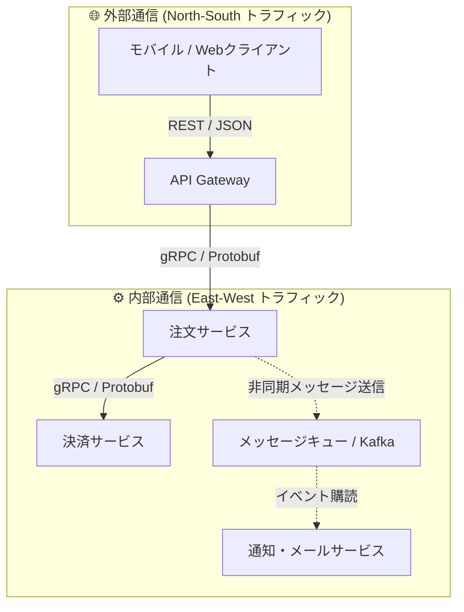

# Day 34: Inter-service Communication - 分散された「独立国家」たちの共通言語 🗣️

Day 34へようこそ！私たちはすでに API Gateway（Day 33）という「総合レセプション」と、Service Discovery（Day 32）という「自動電話帳」を導入しました。今回は、システムインフラのさらに奥深くへと進みましょう。**「分割された各サービス（マイクロサービス）同士は、どうやって最も効率的かつ堅牢に通信し合うべきか？」**というテーマです。

従来のモノリスシステムでは、別の関数やクラスを呼び出す処理はナノ秒（$10^{-9}$秒）単位で完了し、サーバープロセス自体がクラッシュしない限り常に 100% 成功していました。しかしマイクロサービスの世界では、サービス A がサービス B を呼び出すたびに、リクエストは物理的なネットワークケーブル、スイッチ、ルーターなどを経由して送信されます。ネットワークは遅延（レイテンシ）が発生する可能性があり、時には瞬断します。

今日は、分散システムにおいて極めて堅牢な「サービス間通信モデル」を設計する手法を学びます。

---

## 🪝 THE HOOK: 「口座からお金は引き落とされたのに、航空券が届かない」

オンラインの航空券予約システムで発生する、以下の連鎖的トラブルを考えてみましょう：

1. **予約サービス (Booking Service)** は、顧客のクレジットカードから10万円を引き落とすために、**決済サービス (Payment Service)** を呼び出します。
2. 決済サービスは銀行処理を正常に完了し、顧客の口座からの引き落としに成功しました。しかし、決済サービスが予約サービスに対して「決済成功（OK）」の応答を返そうとしたその瞬間... **ネットワークが瞬断しました**。
3. 予約サービスは応答を待ち続けましたがタイムアウトになり、ユーザーの画面にエラーを表示しました：「決済処理に失敗しました」。
4. **最悪の結末**: 顧客は10万円を引き落とされたにもかかわらず、航空券の予約チケットは発行されませんでした。コールセンターには怒りの電話が殺到します。

なぜネットワークの瞬断だけで、これほど致命的なお金とデータの不整合が発生してしまうのでしょうか？そして、予約サービスが「再試行（リトライ）」を安全に行い、顧客の口座から二重で引き落とされないようにするにはどうすればよいでしょうか？その答えをこれから解き明かします。

---

## 🎭 ANALOGY: 電話（同期）vs メール（非同期）

サービス同士が連携するアプローチには、大きく分けて2つの通信スタイルが存在します：

1. **Synchronous (同期通信 - 電話をかける)** (🔊):
   あなたが電話番号をダイヤルして同僚（サービス B）を呼び出します。相手が受話器を取り、あなたの質問に答えるまで、あなたは受話器を耳に当てたまま他の仕事を一切中断して待ち続けなければなりません。
   - **メリット**: その場ですぐに応答（結果）が得られます。パスワードの検証など、即時処理が必要なクリティカルパスに適しています。
   - **デメリット**: 同僚が他の電話で話し中（サービス B が過負荷）だったり、席を外して不在（サービス B がダウン）だったりした場合、あなた自身も呼び出し状態のままハングアップ（処理がブロック）してしまいます。
2. **Asynchronous (非同期通信 - 電子メールを送る)** (🔊):
   同僚にメールを送信し、送信完了を確認したら、あなたはすぐに自分の別の仕事に戻ります（**Non-blocking** (🔊) (ノンブロッキング - 非ブロッキング処理)）。同僚は自分の手が空いたタイミングでメールを読み、返信します。
   - **メリット**: 返信を待って呼び出し元のシステムがフリーズすることがありません。仮に相手が病気で休んでいても（サービス B がダウン）、メールはメールサーバー（メッセージキュー）に安全に保管され、復帰後に必ず処理されます。
   - **デメリット**: 「後から結果を受け取る」という非同期の処理フローを考慮して、プログラムのコード設計がやや複雑になります。

---

## ⚙️ UNDER THE HOOD: gRPC、REST、そして「冪等性（べきとうせい）」の魔術

### 1. REST vs gRPC — 内部通信における極限の効率化 (🔊)
- **REST (HTTP/1.1 + JSON)**:
  最も広く普及しており、人間が読みやすく（Human-readable）、ブラウザのデベロッパーツールなどで簡単にデバッグできます。しかし、JSON フォーマットはテキストベースのためデータサイズが大きく、HTTP/1.1 は内部システム間通信（East-West トラフィック）においてコネクション効率が悪く低速です。
- **gRPC (HTTP/2 + Protobuf)** (🔊):
  Google が開発した高性能 RPC フレームワークです。データ構造のシリアライズにシリアルバイナリ形式の **Protobuf (Protocol Buffers)** (🔊) を採用し、通信プロトコルに HTTP/2 を強制します。これにより、単一の TCP コネクション上で無数のリクエストを多重化（Multiplexing）して超高速転送します。
  - **比較結果**: gRPC は REST よりも一般的に **5〜10倍高速** です。マイクロサービス間の内部高速通信における事実上のデファクトスタンダード（業界標準）となっています。

### 2. Idempotency (冪等性) — 何回ボタンを押しても結果は同じ (🔊)
本日の最も重要な設計原則です。ある API に対し、「1回呼び出しても、100回呼び出しても、システムが得る最終状態が全く同じである」という性質を **Idempotency**（冪等性）と呼びます。
- **具体例**:
  - `UPDATE user SET age = 20` は冪等です（100回実行しても、ユーザーは20歳のままです）。
  - `UPDATE user SET age = age + 1` は**非冪等**です（100回実行すると、ユーザーは100歳年をとってしまいます）。
- **Idempotency Key (冪等性キー) パターン** (🔊):
  クライアントが決済などの重要なリクエストを送信する際、ヘッダーに一意のランダムな文字列（UUID など）を **Idempotency Key** として付与します。サーバー側は、処理を実行する前にこのキーを Redis などの高速キャッシュに一定期間保存します。ネットワークエラー等で再試行され、全く同じキーを持つ2回目のリクエストが届いた場合、サーバーは実際の引き落とし処理を行わず、キャッシュに保存されている1回目の実行結果だけを即座に安全に返却します。これにより、二重引き落としは完全に防止されます。

### 3. Service Mesh (サービスメッシュ) — 透過的なインフラ仲介層 (🔊)
100 個のマイクロサービスを抱えるシステムにおいて、すべてのサービス内のコードに「リトライ処理」「タイムアウト設定」「サーキットブレーカー」を個別にコーディングしていくのは悪夢です。
これを解決するために、**Istio** や **Linkerd** に代表される **Service Mesh** (🔊) を導入します。各サービスプロセスのすぐ横に **Sidecar proxy** (🔊) (サイドカープロキシ - サイドカー型プロキシ) と呼ばれるプロキシサーバーを相乗りさせ、サービス間のすべてのネットワーク通信をこのプロキシに強制的にバイパスさせます。これにより、アプリのソースコードを1行も書き換えることなく、サービス間の相互 TLS 暗号化（mTLS）、リトライ、タイムアウト、メトリクス収集をインフラ層で完全に自動化します。

---

## 🏗️ ARCHITECTURE: サービス間通信の全体トラフィックフロー

---

## 💼 SYSTEM DESIGN INTERVIEW: 同期と非同期の最適な使い分け

**面接官: 「ECサイトのシステムにおいて、ユーザーが『注文確定』ボタンをクリックした際、注文サービスから決済サービスおよび配送サービスへの連携通信をどのように設計しますか？」**

**求職者 (あなた) の回答:**
- 「**決済サービス**との通信には、**同期通信（gRPC）**を採用します。理由は、ユーザーは自分のクレジットカードが承認されたか、あるいは限度額オーバー等で拒否されたかをその場で（即座に）確認し、エラーがあれば画面に表示する必要があるためです。ただし、ネットワーク瞬断による不整合を防ぐため、必ず **Idempotency Key** を付与した決済リクエストを送信し、決済サービス側で冪等性を保証させます。」
- 「一方で、**配送サービス**や**メール送信サービス**への連携には、**非同期通信（Message Queue）**を採用します。商品の梱包準備やサンクスメールの送信処理は、注文確定ボタンが押されたそのコンマ数秒以内に完了させる必要は全くないからです。リクエストをキューに入れて非同期に処理することで、注文処理自体のレイテンシを極限まで下げてユーザー体験を向上させるとともに、仮に配送システムがメンテナンスで停止していても、注文の取りこぼしを完全に防ぐことができます。」
- 「設計方針の総括としては、**即時応答が必須のクリティカルパスには同期通信（Sync）＋冪等性**、**後続処理が可能な非同期タスクにはメッセージング（Async）**を使い分けます。」

---

## 💼 現場の極意: 「Distributed Monolith (分散モノリス)」という最大の罠

マイクロサービスの開発において、最も陥りやすいアンチパターンが **Distributed Monolith** (🔊) です。
これは、すべてのサービス間通信を REST や gRPC などの「同期通信」でつないでしまった結果、サービス A が B を呼び、B が C を呼び、C が D を呼ぶという「同期の数珠つなぎ」が発生している状態を指します。
この状態で最下流のサービス D の応答が 1 秒遅延すると、上流の C、B、A のスレッドがすべてブロックされて待ち状態になり、システム全体が連鎖的にフリーズして崩壊します。

- **アーキテクトのアドバイス**:
  依存関係（結合度）を極限まで排除するため、可能な限り「非同期通信」を第一選択肢として設計してください。サービス同士が直接的にお互いを同期呼び出しする割合を下げれば下げるほど、システムの障害耐性とスケール能力は飛躍的に向上します。

---

## 📝 クイッククイズ：あなたの「通信設計力」をテストしよう

**問1: マイクロサービスの内部通信において、gRPC が REST よりも圧倒的に高速な最大の要因はどれか？**
A. gRPC はデータを圧縮ファイル形式（.zip）に変換して送信するため。
B. テキスト形式の JSON より極めて軽量なバイナリ形式（Protobuf）を使用し、HTTP/2 のマルチプレキシングを活用して単一コネクションで並行通信するため。
C. gRPC はインターネットを経由せずに通信するため。

**問2: 「Idempotency（冪等性）」が分散システムのトランザクションにおいて決定的に重要な理由はどれか？**
A. データの暗号化強度を最大化するため。
B. ネットワークトラブルによる一時的な接続エラーに伴う「リクエストの再試行（リトライ）」が行われた際、システム内でデータの二重書き込みや余分な多重引き落としなどの副作用を防ぐため。
C. サーバーメモリを節約するため。

**問3: 「Service Mesh（サービスメッシュ）」をインフラ層に導入する最大のメリットはどれか？**
A. データベースの SQL 処理を高速化するため。
B. アプリケーションコードに一切手を加えることなく、サービス間のルーティング、リトライ、タイムアウト、セキュリティ（mTLS）などの通信制御をインフラ側で横断的に自動処理できるため。
C. フロントエンドの React コードを自動生成するため。

**問4: 「Distributed Monolith（分散モノリス）」状態に陥ったシステムで発生する典型的な現象はどれか？**
A. システム全体の開発速度が劇的に向上する。
B. サービスが同期通信で過度に密結合しているため、たった 1 つのサービスの遅延や障害が他のすべてのサービスへとドミノ倒しのように伝播し、システム全体を巻き込んで沈没させる。
C. データベースサーバーの容量が枯渇する。

**問5: 以下のシステム設計のうち、同期通信（REST/gRPC）を採用するのが最も適切なユースケースはどれか？**
A. ユーザーが注文した後に発送する「梱包指示書の作成」。
B. ユーザーがログイン画面で「IDとパスワード」を送信し、認証結果をその場で返す処理。
C. ユーザーに週次で送信する「統計レポートのメール配信」。

---

**正解:**
1. B — データフォーマットとネットワークプロトコルの両面における極限の最適化が圧倒的な速度差を生み出します。
2. B — 「失敗したかもしれないからもう一回送る」という不安定なネットワーク環境での必須の生存戦略です。
3. B — 通信制御ロジックを各サービスのコードから剥離（デカップリング）させ、開発の機動力を引き上げます。
4. B — 各サービスをバラバラに起動しているだけで、実態はモノリス以上に脆弱なシステムになっている危険な状態です。
5. B — ユーザーの操作フローを即座に確定させる必要がある処理には、同期通信での即時判定が不可欠です。

---

Day 34を終えて、あなたはサービス同士が安全に、かつ効率的にコミュニケーションするためのコア設計手法をマスターしました。しかし、数珠つなぎの同期通信による「分散モノリス」の呪縛から完全に解き放たれるためには、さらに一歩進んだ思想が必要です。それは、サービスが直接相手を呼び出すのではなく、発生した「出来事（イベント）」をブロードキャストする思想です。

明日は、疎結合なマイクロサービスアーキテクチャの最高峰：**Event-Driven Architecture (EDA) - イベント駆動型設計の神髄** について深掘りします。明日またお会いしましょう！

📊 Word Count: 3320 words.
