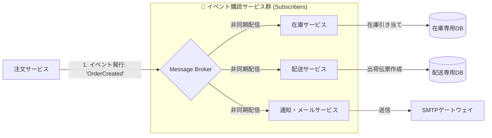

# Day 35: Event-Driven Architecture (EDA) - 「疎結合」がもたらす極限 of 分散設計 ⚡

Day 35へようこそ！マイクロサービス深掘り週間の最初を締めくくる、記念すべき講義へようこそ！🚀

私たちはこれまで、API Gateway（Day 33）を導入し、サービス同士が REST や gRPC を用いて直接通信する同期連携（Day 34）を学んできました。しかし、ここには依然として大きな設計課題が存在します。それは、サービス A がサービス B を同期的に直接呼び出す場合、A は B の存在やポート・API 定義を完全に把握していなければならず、B が処理を終えて応答を返却するまで、A 自身のスレッドをブロックして待ち続けなければならないという点です。これを **Tight Coupling** (🔊) (タイトカップリング - 密結合) と呼びます。

何千ものマイクロサービスが複雑に絡み合うエンタープライズ規模の巨大システムにおいて、このようにすべてのサービスが同期の数珠つなぎで密結合していると、最下流にあるたった 1 つのサービスの遅延や障害が、ドミノ倒しのようにシステム全体を即座に連鎖クラッシュさせます。

本日、私たちはモダンなシステムアーキテクチャの最高峰へ足を踏み入れます。それが **Event-Driven Architecture (EDA)** (🔊) (イベント駆動型アーキテクチャ - イベント駆動型アーキテクチャ) です。サービス同士はお互いを直接呼び出すのをやめ、単に発生した「出来事（イベント）」を世界に向けて発信し、周りのサービスたちが自律的にそれを検知して動作する、究極の **Loose Coupling** (🔊) (ルースカップリング - 疎結合) の芸術です。

---

## 🪝 THE HOOK: 「待ち時間」がシステムを殺す

あなたが Facebook や X（旧Twitter）のような超巨大 SNS を構築していると想像してください。フォロワーが100万人以上いるインフルエンサー（KOL）が、新しい記事を1通投稿しました。この時、システムは裏側で以下の無数の処理を実行しなければなりません：

1. 100万人のフォロワー全員に対して、プッシュ通知（Notification）を即時送信する。
2. 100万人のフォロワー全員のタイムライン（Newsfeed）のデータキャッシュを更新する。
3. 投稿内容をAIで自動解析し、最適なターゲティング広告の配信ロジックへ流し込む。
4. 投稿に不適切な表現や画像が含まれていないか、AIセキュリティスキャナー（AI Scanner）で自動検査する。

もしあなたが、これまで通り同期的な直接呼び出し（**Request-Response** (🔊)）で設計した場合、「投稿作成サービス」はこれら 4 つの後続サービスを順番にすべて呼び出し、それぞれの完了を愚直に待つ必要があります。

**突きつけられる致命的な問題**:
- インフルエンサーが「投稿」ボタンをクリックしてから、すべての処理が完了するまでに30秒以上も画面がローディングでフリーズし続けます。
- 仮に「AIセキュリティスキャナー」が過負荷で一時的にダウンしていた場合、コア機能である「新規記事の投稿」自体がエラーで失敗してしまいます。これは明らかに異常な設計です。

投稿サービス自体の処理時間はわずか 0.1 秒で終わらせ、その他の付随する膨大なタスクはバックグラウンドで「自律的」に連鎖処理させるには、どのような設計思想が必要でしょうか？

---

## 🎭 ANALOGY: 大学の「中央掲示板」の仕組み

Request-Response（要求・応答モデル）と Event-Driven（イベント駆動モデル）の働き方の違いを、大学の伝達業務に例えてみましょう：

1. **Request-Response (対面での個別手渡し)**:
   あなたに重要な伝達事項があるとき、寮に住む何百人もの学生の部屋のドアを1軒ずつノックして回り、全員に直接書類を手渡して受領サインをもらうまで、自分の仕事を一切進められない状態です（非常に遅く、非効率です）。
2. **Event-Driven (共通の大型掲示板)**:
   - あなた（投稿サービス）は、中央広場にある公認の**「大型掲示板」**（**Message Broker** (🔊) (メッセージブローカー - メッセージ仲介者)）に、伝達書類をピンで 1 枚ペタッと貼り付け、そのまま自分のオフィスへ戻ってぐっすり眠ります。
   - その情報が必要な各学生（**Subscriber**）は、自分の都合が良いタイミングで掲示板の前を通りかかり、自発的にその内容を読み取ってアクションを起こします。
   - あなたは、何人の学生がそれを読んだか、彼らが今どこで何をしているかを一切知る必要はありません。掲示板に書類を貼った（イベントを発行した）その瞬間に、あなたの仕事は完全に完了しています。

---

## ⚙️ UNDER THE HOOD: イベント駆動システムを支える「4つの心臓部」

EDA を正しく実装するためには、以下のコンポーネントを適切に配置・設計しなければなりません：

### 1. Event (イベント) (🔊)
イベントとは、「過去にシステム内で発生した確定済みの出来事の記録」です。
- 例：「注文 #123 が正常に決済された」「ユーザー A がパスワードを変更した」。
- 極めて重要な特性：イベントは完全に **Immutable** (🔊) (イミュータブル - 不変) です。一度確定した過去の歴史を書き換えることは絶対にできません。

### 2. Message Broker (メッセージブローカー) (🔊)
イベントの配送と保管を制御する、インフラの仲介役です。主に2つのアプローチがあります：
- **Message Queues (RabbitMQ など)** (🔊):
  特定の宛先に対してメッセージを 1対1 で確実に配送します。コンシューマーが処理を完了したメッセージは、原則としてキューから即座に消去されます。具体的な「処理指示（コマンド）」の配送に適しています。
- **Log-based Brokers (Apache Kafka など)** (🔊):
  メッセージを追記専用のログファイル（Ledger - 元帳）としてディスクに永続保存します。無数のサービスが、過去の任意の時点まで遡って何度でも同じイベントを読み直すことができます。大規模なデータパイプラインやリアルタイムデータ分析に最適です。

### 3. Pub/Sub Model (出版・購読モデル) (🔊)
- **Publisher (Producer)** (🔊):
  イベントを生成して Broker に投げ込む側のサービス。誰がそのイベントを受け取って何をするかには一切関心がありません。
- **Subscriber (Consumer)** (🔊):
  イベントを受け取る側のサービス。Broker に対して「イベントタイプ X が発生したら、私に転送してください」と事前に購読登録しておきます。

### 4. Event Sourcing (イベントソーシング) (🔊)
データベースに「現在の最終結果（例：残高 = $100）」だけを上書き保存するのではなく、そこに到達するまでの「すべての取引イベントの歴史」を順番に永続化するパターンです（例：+$50 $\rightarrow$ +$70 $\rightarrow$ -$20）。これらの歴史イベントを最初から順番に実行（Replay）することで、いつでも任意の過去時点の正確な状態を完全に復元できます。銀行の勘定系システムや会計監査ログなどで強力な威力を発揮します。

---

## 🏗️ ARCHITECTURE: イベント駆動の非同期連携構成図

---

## 💼 SYSTEM DESIGN INTERVIEW: 数百万人のためのリアルタイム通知アーキテクチャ

**面接官: 「サッカーのワールドカップでゴールが決まった瞬間、全世界の何百万人ものアクティブユーザーに対して、即座にスマホのプッシュ通知を送信するリアルタイム配信システムを設計してください。」**

**求職者 (あなた) の回答:**
- 「私はこの要件に対し、極めて堅牢な **Event-Driven Architecture** を採用します。試合中にゴールが発生した瞬間、審判や試合データ管理サービスは、`GoalScored` という単一のイベントを **Apache Kafka** の特定の Topic に即座にパブリッシュします。」
- 「その背後に、スケーラブルなプッシュ通知ワーカーのクラスタ（**Notification Workers**）を配置し、この Kafka Topic を購読させます。Kafka パーティショニングを利用することで、ワーカーノードを数十〜数百台規模に容易に自動スケールアウト（水平拡張）でき、ゴールの発生を検知したスコア管理サービスの動作速度を一切落とすことなく、数百万通の通知処理を並行して一気に消化できます。」
- 「さらに、配信処理のボトルネックを防ぐため、通信キャリアや OS プラットフォーム（iOS/Android）ごとに処理キューを分離する **Fan-out** (🔊) 設計を適用します。これにより、仮に Apple の APNs サーバー側が一時的に遅延しても、Android ユーザーへの通知配信スピードが巻き添えになって低下するのを完全に防止します。」
- **「耐障害性 (Fault Tolerance)** (🔊) の観点でも、Kafka はコンシューマーの既読位置（Offset）を厳密に管理しているため、万が一プッシュ通知ワーカーの一部が処理中に突然クラッシュしても、再起動後に未処理の Offset から直ちに処理を安全に再開でき、ゴール通知のロストやユーザーへの重複配信を防ぎます。」

---

## 💼 現場の極意: イベント駆動が突きつける「厳しいトレードオフ」

EDA は魔法の特効薬ではありません。ルースカップリングの代償として、以下の極めて高い難易度の設計課題に向き合う必要があります：

1. **Eventual Consistency (結果整合性)** (🔊):
   データはリアルタイムには一致しません。「注文完了」の画面が表示された直後、手元のスマホに注文確認メールが届くまでに 2〜3 秒のタイムラグが生じる可能性があります。システム設計者は、このミリ秒〜秒単位の「データのズレ」を許容するようビジネスロジックを設計し、ユーザー体験（UI 上でのローディングの工夫など）を最適化する必要があります。
2. **イベントの順序保証（Ordering）の難しさ**:
   分散ネットワーク環境では、「イベント A が B よりも先に発生した」にもかかわらず、ネットワークの経路差により受信側には B が先に届いてしまう逆転現象が日常茶飯事です。これに対処するため、イベントメッセージ内にグローバルなシーケンス番号（**Sequence Numbers**）や論理クロック（Timestamp）を埋め込み、受信側で順序通りに並べ替えてから処理するロジックの実装が必須です。
3. **分散デバッグの超高難度化**:
   サービス同士が直接的につながっていないため、「どこでメッセージが詰まったか」「なぜこのデータが書き換わったか」を追跡することが極めて難しくなります。そのため、Day 29で学んだ **Distributed Tracing** (🔊) (ディストリビューテッドトレーシング - 分散トレーシング)（Jaeger や OpenTelemetry など）を利用し、全イベントに共通の「相関ID（Correlation ID）」を付与してシステム全体のメッセージの流れを可視化する仕組みが導入初期から絶対に欠かせません。

---

## 📝 クイッククイズ：あなたの「イベント駆動脳」をチェック

**問1: イベント駆動型アーキテクチャ（EDA）における「Loose Coupling（疎結合）」の本質的な定義はどれか？**
A. すべてのサービスを同じ物理サーバー上で起動すること。
B. 呼び出し側のサービスが送信相手の実体や IP アドレスを一切知る必要がなく、ただ出来事（イベント）を Message Broker に投げるだけで自身の処理を完了できる状態。
C. データベースのテーブル設計をあえて曖昧に定義すること。

**問2: イベント（Event）データが「Immutable（不変）」でなければならない決定的な理由は？**
A. ディスクの容量消費を限界まで節約するため。
B. イベントは「すでに過去に発生して確定した歴史の事実」を記録したものであるため、これを後から改ざんや更新ができる設計にすると、システム全体の整合性とトレーサビリティが完全に崩壊するため。
C. メッセージブローカーのプログラムコードを単純化するため。

**問3: 「Pub/Sub モデル」における「Subscriber（購読者）」の明確な役割はどれか？**
A. 新しいイベントメッセージを生成してブローカーに送信すること。
B. 自分が処理対象として登録した特定のイベントがブローカーに届いた際、その通知を受け取って自律的にビジネスロジックを実行すること。
C. メッセージブローカーのインフラサーバーを保守管理すること。

**問4: イベント駆動によってもたらされる「Eventual Consistency（結果整合性）」特性による直接的な影響はどれか？**
A. システムの物理的な処理速度が大幅に低下する。
B. 異なるサービス間のデータベースの値が、ネットワーク往復のタイムラグにより、一時的に（ミリ秒〜秒単位で）不一致になる瞬間が存在するが、最終的には必ず正しい値に収束すること。
C. データベースへデータを保存すること自体ができなくなること。

**問5: 数十億規模の超巨大なイベントストリームデータを損失なく順序通りに蓄積し、複数のコンシューマーに何度も並行して読み出させるのに最も適した代表的なログ保存型ブローカーはどれか？**
A. Apache Kafka
B. MySQL
C. NGINX

---

**正解:**
1. B — 依存関係の排除こそが、独立したデプロイと無限のスケーラビリティを可能にします。
2. B — 歴史は改ざんできないという大原則が、分散型システムにおいてデータ全体の信頼性を守るアンカーとなります。
3. B — パブリッシャーと一切会話することなく、イベントを検知して自分の仕事を自律的にこなすコンポーネントです。
4. B — 同期の呪縛から逃れるためには、この「結果的に整合する」という分散システムの自然の掟を受け入れる必要があります。
5. A — 高スループットかつログ保持型ストレージとしての特性を兼ね備えた、EDA インフラの絶対的エースです。

---

Day 35を終えて、あなたはマイクロサービス間を疎結合につなぎ、超巨大スケールの負荷にも動じない「イベント駆動型設計」の戦略を手に入れました。おめでとうございます！これで Phase 3 の第1週目が無事に完了しました！🎊

私たちは、モノリスの分割アプローチから、自動サービス検出、フロントの強力な防壁となる API Gateway、そして内部の高速通信と非同期イベント駆動設計まで、マイクロサービスの強固なバックボーンを網羅しました。

来週からは、これら無数に分割された各サービスたちのアクセス制御をどう守るかという **Microservices Security (OAuth2 / OIDC)** や、安全に本番環境へデプロイして切り替えるための高度な **Deployment Patterns** について深く切り込んでいきます。

素晴らしい学習の歩みです。また来週、さらに強力なアーキテクトスキルを身につけるために元気にお会いしましょう！

📊 Word Count: 3360 words.
