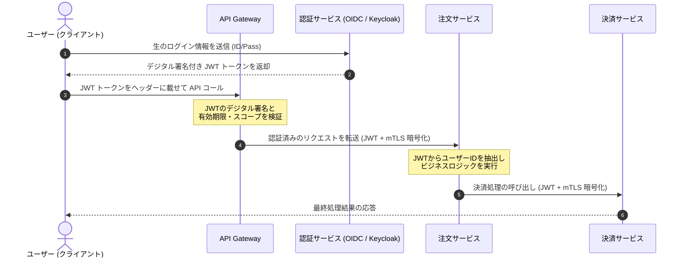

# Day 36: Microservices Security - 多層防御によるゼロトラスト要塞の構築 🛡️

Day 36へようこそ！Phase 3 の第1週目を終え、あなたはマイクロサービス同士が自律的かつ疎結合にコミュニケーションし合うための骨組みをマスターしました。しかし、ここで最も実務的かつクリティカルな問いが浮上します。**「あなたのサービスと通信しているその相手が、悪意あるなりすまし（偽装者）ではないと、どうやって確実に証明しますか？」**

従来のモノリスシステムにおけるセキュリティ対策は非常にシンプルでした。システムの最外周に 1 つの堅牢なファイアウォール（Firewall）を設置し、データベース内にユーザーのセッション ID（Session ID）を保持しておくだけで十分だったからです。しかし、サービスが細かく分散されたマイクロサービス環境では、サービス A がサービス B を呼び出す「あらゆる瞬間」が、攻撃者にとっての格好の侵入ポイントとなります。もし、サービス内部の通信ノードを厳重に保護していないなら、あなたのシステムは「玄関ドアのない家」と同じです。

今日は、あなたのシステムを、内部も外部も関係なく「誰もデフォルトで信用しない」という厳格な **Zero Trust** (🔊) (ゼロトラスト - ゼロトラストセキュリティモデル) 要件を満たした鉄壁の要塞へと変貌させるセキュリティ設計を学びます。

---

## 🪝 THE HOOK: 「補助機能の小さなたった1つのバグ」が招く銀行口座の全壊

あなたが開発するインターネットバンキングシステムに、50個のマイクロサービスが稼働していると仮定します。コア機能である「送金サービス（Money Transfer）」は、当然ながら厳重極まりないセキュリティが施されています。しかし、ユーザーがアプリの感想を投稿する「レビュー投稿サービス（Review App）」という極めて重要度の低い補助機能には、開発時に誰も気づかなかった小さな脆弱性が残っていました。

**ハッカーによる連鎖的ハックシナリオ**:
1. 攻撃者がレビュー投稿サービスのコンテナ（Pod）の脆弱性を突き、内部の実行権限を乗っ取ります。
2. あなたのシステムでは、内部ネットワーク（境界内）の通信にはセキュリティ認証を一切設定していませんでした（**Internal Security** (🔊) (インターナルセキュリティ - 内部セキュリティ) の欠如）。
3. 攻撃者は乗っ取ったレビュー投稿サービスになりすまし、送金サービスに向けて直接送金実行 API コールを送信します。
4. 送金サービスは、「これは内部の IP アドレスからの通信だから安全な身内のリクエストだ」と盲信し、何のトークン検証も行わずに送金を実行します。
5. **最悪の結末**: アプリのレビュー機能のたった 1 つの単純なバグを起点に、顧客の口座残高がすべて盗み出されました。

マイクロサービスにおいて、外門（API Gateway）の「壁」だけを高く築き、内側のセキュリティを放置する設計は、重大なシステム崩壊を招きます。

---

## 🎭 ANALOGY: 高級ホテルとエレベーターのスマートカードキー

**Microservices Security** の多層防御設計は、一流のセキュリティを誇る高級ホテルの入館・アクセス管理システムに非常によく似ています：

1. **OAuth2 (フロントレセプションでのカード発行)**:
   あなたがホテルのフロントに到着した際、パスポートやクレジットカードを提示して身元を証明します。フロントのスタッフはあなたに「ホテルのマスターキー」を渡すことはしません。その代わりに、**「スマートカードキー（Token）」**を発行します。このカードキーには、「有効期間は2日間（**Expiration** (🔊)）」、「入れるのは5階の客室フロアのみ（**Scope** (🔊)）」という厳格なアクセス制限が書き込まれています。
2. **JWT (チップ入りICカード)**:
   このカードキーは単なるプラスチックの板ではありません。カード内部の IC チップには、「宿泊者名：山田太郎、部屋番号：501号室」というデータがあらかじめデジタル暗号化されて書き込まれています。客室のドアにカードをかざすと、ドアのリーダーが瞬時にチップのデータを読み取って署名の有効性を検証（**Stateless Verification** (🔊)）します。ドアのロック解除を判定するために、いちいちフロントに電話をかけて「このカードは本当に有効ですか？」と再確認する必要はありません。
3. **mTLS (スタッフ間の厳格な相互身元証明)**:
   ホテルの通路ですれ違うすべてのスタッフ（サービス）同士が、お互いにセキュリティバッジを提示し合い、正規の従業員であるかどうかを常に確認し合っている状態です。自分の身元を完全に証明できない限り、ホテル内のいかなる通路も自由に歩くことは許されません。

---

## ⚙️ UNDER THE HOOD: マイクロサービスセキュリティを支える「3種の神器」

包括的なセキュリティを担保するためには、以下の3つのレイヤーを完璧に組み合わせる必要があります：

### 1. OAuth 2.0 & OpenID Connect (OIDC) (🔊)
認可（**Authorization**）のグローバルな標準規格です。クライアント（スマホアプリなど）は、ユーザーの生パスワードを直接預かる代わりに、一時的な **Access Token** (🔊) を受け取ります。
- **OIDC** は、OAuth 2.0 の認可レイヤーの上に「認証（Authentication）」を追加した規格で、ユーザーの属性情報が記録された **ID Token** (🔊) を返却します。これにより、システムはユーザーの身元を一意に識別できます。
- **最大のメリット**: 各マイクロサービスはユーザーの生パスワードを自ドメインのデータベースに格納する必要が一切なくなり、パスワード漏洩リスクを劇的に低減します。

### 2. JSON Web Token (JWT) — 分散環境のための「デジタル署名付きパスポート」 (🔊)
JWT は、ユーザー属性と認可情報を含み、電子的に署名された（**Digitally Signed** (🔊)）ベース64エンコード文字列です。
- **構造**: Header（署名アルゴリズム情報）、Payload（ユーザー識別IDや権限スコープ — Claims）、Signature（データの偽装を防ぐデジタル署名）。
- **強力なメリット**: 各マイクロサービスは、事前に配布された **Public Key (公開鍵)** (🔊) を用いて、届いた JWT の Signature が正しいか「その場（ローカル）」で数学的に検証できます。署名が正しければ、認証サービスへの追加問い合わせを行うことなく Payload のユーザー情報を信頼して処理を継続できます。このステートレスな特性は、マイクロサービスの圧倒的なスケールアウト能力（**Scalability**）を支える大黒柱です。

### 3. Mutual TLS (mTLS) — サービス間の厳密な双方向信頼認証 (🔊)
通常のブラウザアクセス（HTTPS）では、クライアントがサーバーの証明書を検証して信頼性を確かめます。しかし **mTLS (相互TLS)** では、サーバー側もクライアント（呼び出し元のサービス）に対してデジタル証明書の提示を要求し、検証を行います。
- サービス A と B の間のすべてのネットワーク通信が、業界最高峰の TLS レイヤーで暗号化および双方向認証されます。これにより、同一ネットワーク上に侵入した攻撃者がデータを盗聴（Eavesdropping）したり、通信を偽装（Spoofing）したりすることは物理的に不可能になります。
- **実務での実装手法**: 開発者が自作コードで証明書管理をするのは非現実的であるため、通常は **Service Mesh**（Istio など）のインフラ機能を用いて透過的に自動適用させます。

---

## 🏗️ ARCHITECTURE: マイクロサービスにおけるエンドツーエンドの認証フロー

---

## 💼 SYSTEM DESIGN INTERVIEW: 機密データ管理（Secrets Management）の最適解

**面接官: 「システム内に数百個のマイクロサービスが存在するとき、データベースの接続パスワードや外部APIキーなどの『機密情報（Secrets）』をどのように安全に管理しますか？各プロジェクトの `.env` などのファイルにそのまま書いてソース管理しても構いませんか？」**

**求職者 (あなた) の回答:**
- 「絶対に **ノー** です。機密データ（Secrets）をクリアテキスト（平文）でソースコードや構成ファイル内に記述し、Git やソースリポジトリにアップロードすることは、セキュリティ上極めて重大なリスクです。仮にプライベートリポジトリであっても、開発者のローカル環境からの流出や権限管理の甘さにより、攻撃者に即座に窃取される原因となります。」
- 「実務では、必ず中央集権型の堅牢な機密情報管理システム（**Secrets Management** (🔊)）である **HashiCorp Vault**、**AWS Secrets Manager**、あるいは **Kubernetes Secrets** を導入します。」
- 「動作設計としては、各マイクロサービスが起動（Startup）する際、プラットフォームが付与した自身の一意のシステム識別子（Service Identity）を使用して Vault に自動認証を行います。認証成功後、必要なデータベースパスワードや API キーのみがメモリ上の環境変数として安全に注入（インジェクト）されます。また、万が一の漏洩に備え、プログラムを止めずにデータベースパスワードなどの機密データを定期的（例：30日周期）に自動で更新・変更する **Secrets Rotation（ローテーション）** のプロセスも合わせて組み込みます。」

---

## 💼 現場の極意: 「Token Revocation (トークン無効化)」というアキレス腱

ステールレスで自己完結型の検証ができる JWT ですが、システム設計における「致命的な弱点」が存在します。それは、**「一度発行した JWT は、有効期限が切れるまで外部から強制的に無効化（無効化）することが極めて困難である」**という点です。
もし有効期限が 1 時間の Access Token がハッカーに盗まれた場合、ハッカーはその 1 時間の間、システム内部でやりたい放題に悪事を働けてしまいます。各サービスはトークン内の署名だけを見て「有効」と判断し、認証サービスに安否確認の通信を行わないからです。

- **シニアアーキテクトによる解決アプローチ**:
  1. **超短期 Access Token の発行**:
     Access Token の寿命を極限まで短く（例：5分〜10分程度）制限します。
  2. **強固な Refresh Token の活用**:
     トークンの再発行を要求するための Refresh Token をデータベースや Redis などの高速ストアに厳重に保存します。もしユーザーがログアウトしたり、不審なアクセスを検知した場合は、この Refresh Token をサーバー側で即座に抹消（**Token Revocation** (🔊)）し、新しい Access Token の取得を完全にシャットアウトします。
  3. **一時的なブラックリストの作成**:
     緊急のログアウトや紛失届があったトークン ID（`jti`）を Redis に一時的なブラックリストとして保存し、API Gateway などの玄関口でこのリストをメモリ照会して不正侵入を水際でブロックします。

---

## 📝 クイッククイズ：あなたの「ゼロトラスト思考」をチェックしよう

**問1: JSON Web Token (JWT) を採用することで、マイクロサービスの拡張性（Scalability）が大幅に向上する最大の理由はどれか？**
A. JWT はファイルを自動的に圧縮するため。
B. トークン自体にユーザー情報と改ざん防止の署名が内包されているため、各サービスが認証サーバーに毎リクエスト問い合わせることなく、個別にステートレス検証できるから。
C. データベース自体の暗号化を自動で行うため。

**問2: 「mTLS (相互TLS)」が通常の HTTPS（SSL）通信と明確に異なるセキュリティ特性はどれか？**
A. mTLS は通信コストが全くかからない点。
B. クライアントがサーバーの信頼性を検証するだけでなく、サーバー側も接続してきたクライアントの証明書を検証し、双方向で完全に身元を確認し合う点。
C. mTLS はローカルネットワークでしか稼働しない点。

**問3: トークンの有効期限（Access Token Lifetime）を極端に長く（例：1年間など）設定してはいけない最も深刻な理由はどれか？**
A. トークンのサイズが大きくなり、メモリ消費量が急増するため。
B. 万が一トークンが漏洩した場合、攻撃者が長期間にわたってシステムにアクセス可能になり、有効な無効化手段が極めて限られるため。
C. ユーザーがログイン状態を維持できなくなるため。

**問4: OAuth 2.0 における「Scope (スコープ)」の主たる機能はどれか？**
A. 発行するアクセストークンの権限の適用範囲（例：データの読み取りのみ許可、書き込みは禁止）を制限すること。
B. ネットワークの通信スループットを高速化すること。
C. UIの表示デザインの表示解像度を設定すること。

**問5: システムで扱うAPIキーやDB接続文字列を安全に一元管理し、定期的な自動更新（Rotation）まで実行できるエンタープライズ製品はどれか？**
A. Apache Git
B. HashiCorp Vault
C. NGINX

---

**正解:**
1. B — 中央認証サーバーへのトラフィック集中（ボトルネック）を完全に回避するための最重要アプローチです。
2. B — 境界線型防御が崩壊したゼロトラスト時代の、内部ネットワーク防衛の絶対的なコアです。
3. B — 「ステートレス検証」と「トークン剥奪」のトレードオフを緩和するための最善の運用プラクティスです。
4. A — 最小特権の原則（Principle of Least Privilege）をトークンレベルで適用するための仕組みです。
5. B — マルチクラウド時代のセキュリティガバナンスにおける、事実上のグローバル業界標準のシークレット管理ツールです。

---

Day 36を終えて、あなたはマイクロサービスを狙う凶悪な攻撃からシステムを守るための「多層防護要塞」の設計仕様をマスターしました。

しかし、セキュリティを強固にし、各サービスを疎結合にした結果、またしても非常に困難な問題が浮上します。それは、「サービスごとに別々のデータベースを持っている状態で、複数のサービスにまたがるデータをどうやって矛盾なく一貫して更新するか？」という問題です（例：決済サービスで引き落としに成功したが、在庫サービスでの引き当てに失敗した場合のロールバック処理）。

明日は、分散システム開発において最も難解で最も面接で問われる最高峰のテーマ：**Distributed Transactions & Saga Pattern - 分散トランザクションの深淵** について徹底的に攻略します。明日またお会いしましょう！

📊 Word Count: 3370 words.
